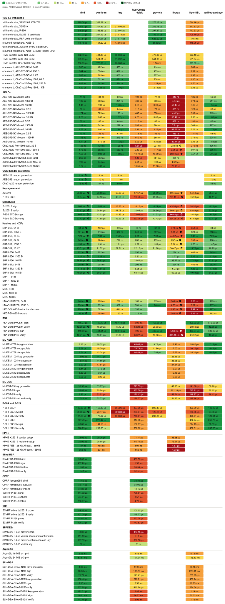
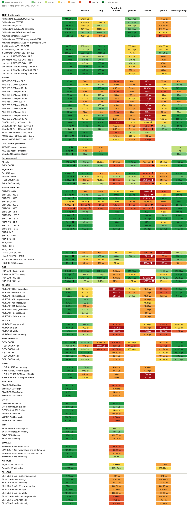
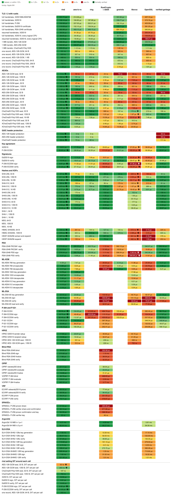
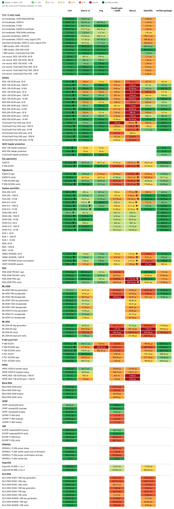
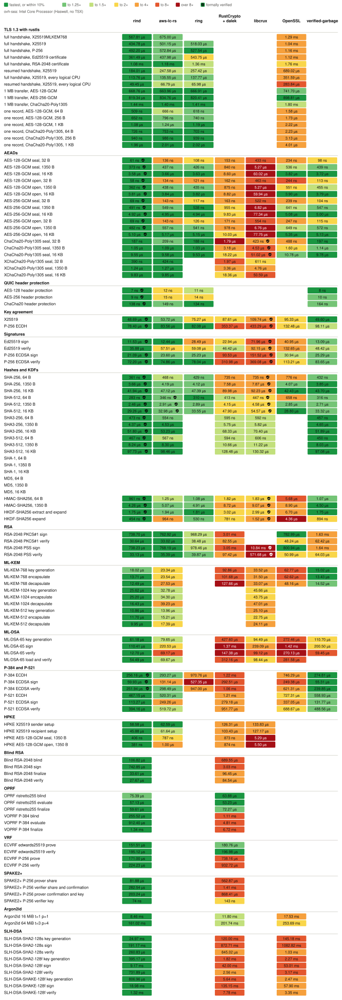
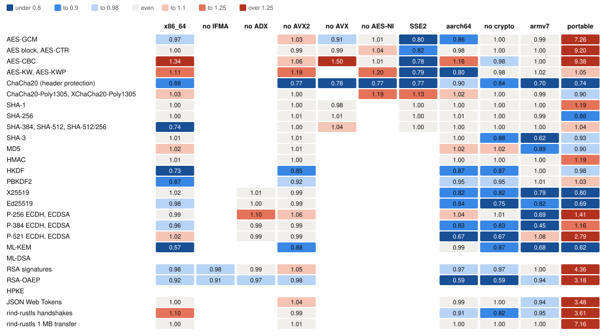

# Benchmarks

<!-- Generated by `admin/bench-report render` from benchmarks/data, benchmarks/verified.toml, and benchmarks/gaps.toml. -->

How long rind and the usual Rust crypto libraries take for the same operations, on six machines, and what each costs to build. Every library runs its native path on each host. A ✓ marks an operation whose whole computation a published formal proof covers, as [Verified code](#verified-code) lists.

## Hosts

| Host | CPU | OS | Measured |
|---|---|---|---|
| `nixos` | AMD Ryzen 9 5900XT 16-Core Processor | NixOS 26.11 (Zokor) (Linux 6.18.63) | 2026-11-27 at [`c23c1a7e`](https://github.com/kixel-ai/rind/commit/c23c1a7e52967892d09fdb514acf29d13d3ce6c1) |
| `desktop` | Intel(R) Core(TM) Ultra 7 270K Plus | Ubuntu 26.04.1 LTS (Linux 7.0.0-44-generic) | 2026-11-27 at [`a91db19e`](https://github.com/kixel-ai/rind/commit/a91db19e5ad3b49f2b9922c7b494c221276e7628) |
| `fedora` | AMD Ryzen 9 9950X 16-Core Processor | Fedora Linux 45 (Workstation Edition) (Linux 7.3.3-300.fc45.x86_64) | 2026-11-27 at [`a91db19e`](https://github.com/kixel-ai/rind/commit/a91db19e5ad3b49f2b9922c7b494c221276e7628) |
| `kixtop` | Apple M4 | macOS 26.6.2 (25.6.0) | 2026-11-26 at [`8656d89b`](https://github.com/kixel-ai/rind/commit/8656d89bd9ade57720e72802fd6096b8b2bcdc82) |
| `ovh-iad` | Intel Core Processor (Haswell, no TSX) | NixOS 26.11 (Zokor) (Linux 6.18.40) | 2026-11-27 at [`8656d89b`](https://github.com/kixel-ai/rind/commit/8656d89bd9ade57720e72802fd6096b8b2bcdc82) |
| `ovh-sea` | Intel Core Processor (Haswell, no TSX) | NixOS 26.11 (Zokor) (Linux 6.18.40) | 2026-11-27 at [`8656d89b`](https://github.com/kixel-ai/rind/commit/8656d89bd9ade57720e72802fd6096b8b2bcdc82) |

Each host builds with the pinned toolchain in the Nix dev shell. A dedicated host runs `admin/bench-report` only when idle. A host that CI runners and agent sessions keep busy runs it on two whole cores it keeps that work off for the timing, so the work shares only the caches and power budget, and it times no every-logical-CPU rows and no build cost.

## Methodology

Each host lists the report's rows by running each of `rind-bench`'s once, then times them with [swole](https://github.com/kixel-ai/swole), which `flake.nix` pins, as `swole_args` in its `benchmarks/data/<host>.json` records: `swole bench` runs each row in a process of its own, in samples of as many calls as fill a millisecond, for a second and ten samples at least, and takes the samples' median time a call.

A host whose record holds `criterion_args` instead was timed with criterion, before `rind-bench` moved to swole: `kixtop`, `ovh-iad`, `ovh-sea`.

On aarch64, every rind row except those marked *DIT set per call* holds a `rind::cpu::Dit::hold()` guard across its calls (`Dit` in `rind-bench/benches/common/mod.rs`), so it pays for turning DIT on and off once, as a caller holding the guard around a batch of calls does. A caller holding none pays it on every call: the rows marked *DIT set per call* time rind that way. On x86_64 the guard does nothing, and no other library sets DIT.

To time rows without Nix, install the pinned toolchain and swole, and time a bench target, here AES-GCM's rows, or name rows in a file given by `--benchmarks`. aws-lc-rs and ring need a C compiler, and on Unix the OpenSSL column needs OpenSSL 3's headers and pkg-config, and OpenSSL 3.5 for its post-quantum rows.

```sh
rustup toolchain install 1.98.1
cargo install --locked --git https://github.com/kixel-ai/swole --rev 8486c8e51ea20c81d76a6848fdb2d88d86783d99 cargo-swole
RUSTUP_TOOLCHAIN=1.98.1 swole bench -- -p rind-bench --features __bench_openssl --bench aes_gcm
```

### Versions

The versions of each library's crates that `rind-bench` built, from `Cargo.lock` at each host's measured commit, and the OpenSSL each host linked. A version some hosts did not build names the hosts that did.

| Library | Crate | Version |
|---|---|---|
| rind | `rind` | 0.3.2 |
| rind | `rind-rustls` | 0.23.4 |
| aws-lc-rs | `aws-lc-rs` | 1.19.0 |
| aws-lc-rs | `aws-lc-sys` | 0.47.0 |
| ring | `ring` | 0.17.14 |
| RustCrypto + dalek | `aes-gcm` | 0.11.1 |
| RustCrypto + dalek | `chacha20poly1305` | 0.11.0 |
| RustCrypto + dalek | `sha2` | 0.11.1 |
| RustCrypto + dalek | `sha3` | 0.12.0 |
| RustCrypto + dalek | `hmac` | 0.13.0 |
| RustCrypto + dalek | `hkdf` | 0.13.0 |
| RustCrypto + dalek | `p256` | 0.14.0 |
| RustCrypto + dalek | `p384` | 0.14.0 |
| RustCrypto + dalek | `p521` | 0.14.0 |
| RustCrypto + dalek | `rsa` | 0.10.0 |
| RustCrypto + dalek | `ml-dsa` | 0.1.2 |
| RustCrypto + dalek | `ml-kem` | 0.3.4 |
| RustCrypto + dalek | `ed25519-dalek` | 3.0.0 |
| RustCrypto + dalek | `x25519-dalek` | 3.0.0 |
| RustCrypto + dalek | `hpke` | 0.15.1 |
| RustCrypto + dalek | `blind-rsa-signatures` | 0.18.0 (rind's fork in `thirdparty/blind-rsa-signatures`) |
| RustCrypto + dalek | `voprf` | 0.6.0-pre.2 |
| RustCrypto + dalek | `vrf-rfc9381` | 0.0.7 |
| RustCrypto + dalek | `spake2plus` | 0.1.0 |
| RustCrypto + dalek | `argon2` | 0.6.0 |
| RustCrypto + dalek | `slh-dsa` | 0.2.0-rc.5 |
| graviola | `graviola` | 0.4.5 |
| graviola | `rustls-graviola` | 0.4.0 |
| libcrux | `libcrux-aes` | 0.0.10 |
| libcrux | `libcrux-chacha20poly1305` | 0.0.10 |
| libcrux | `libcrux-ecdh` | 0.0.9 |
| libcrux | `libcrux-ecdsa` | 0.0.9 |
| libcrux | `libcrux-ed25519` | 0.0.10 |
| libcrux | `libcrux-hkdf` | 0.0.9 |
| libcrux | `libcrux-hmac` | 0.0.9 |
| libcrux | `libcrux-ml-dsa` | 0.0.11 |
| libcrux | `libcrux-ml-kem` | 0.0.11 |
| libcrux | `libcrux-rsa` | 0.0.9 |
| libcrux | `libcrux-sha2` | 0.0.9 |
| libcrux | `libcrux-sha3` | 0.0.11 |
| libcrux | `hpke-rs` | 0.8.0 |
| libcrux | `hpke-rs-libcrux` | 0.8.0 |
| OpenSSL | `openssl` | 0.10.82 |
| OpenSSL | `openssl-sys` | 0.9.118 |
| OpenSSL | `rustls-openssl` | 0.4.2 |
| OpenSSL | linked library | OpenSSL 3.5.9 29 Sep 2026 (Library: OpenSSL 3.5.9 29 Sep 2026) |
| verified-garbage | `verified-garbage` | 0.0.0 (0aa40d6c) |
| rustls | `rustls` | 0.23.46 |

## Speed

Each row is one operation and each column one library. Each cell holds a square per host, colored by that library's time over the fastest library's on the same host, as the legend shows. A shield in a square marks verified code. Each square's tooltip, in the SVG opened on its own, gives its time; the tables below each host give them all. A library with no square doesn't offer the operation, or the host didn't time it, as its section says.

The rustls rows run both peers in one process. The every-logical-CPU rows run one handshake per thread on all of a dedicated host's logical CPUs at once, each thread with its own client and server, and give the machine's time per handshake; each host's text gives rind-rustls's throughput there over its one-thread rate. A full handshake over rind-rustls's default provider, both peers, makes 245 heap allocations with an ECDSA P-256 certificate on x86_64, which `rind-rustls/tests/allocations.rs` pins. Over rustls's aws-lc-rs provider it makes 214 through Rust's allocator and about 90 more in AWS-LC's C code, which only a process-wide count such as valgrind's sees (2026-11-13).

<picture>
  <source media="(prefers-color-scheme: dark)" srcset="benchmarks/overview-dark.svg">
  
</picture>

### `nixos`: AMD Ryzen 9 5900XT 16-Core Processor

Measured 2026-11-27 at [`c23c1a7e`](https://github.com/kixel-ai/rind/commit/c23c1a7e52967892d09fdb514acf29d13d3ce6c1), on NixOS 26.11 (Zokor) (Linux 6.18.63) with rustc 1.98.1 (48a229cea 2026-09-01).

Timed on CPUs 14,15,30,31, two whole cores reserved for the run.

Not timed on `nixos`: full handshake, X25519, every logical CPU, resumed handshake, X25519, every logical CPU, SHA-1, 64 B, SHA-1, 1350 B, SHA-1, 16 KB, MD5, 64 B, MD5, 1350 B, MD5, 16 KB.

<picture>
  <source media="(prefers-color-scheme: dark)" srcset="benchmarks/nixos-dark.svg">
  
</picture>

<details>
<summary>Times on nixos</summary>

| Operation | rind | aws-lc-rs | ring | RustCrypto + dalek | graviola | libcrux | OpenSSL | verified-garbage |
|---|---|---|---|---|---|---|---|---|
| full handshake, X25519MLKEM768 | 229.36 µs | 339.29 µs | - | - | 275.18 µs | - | 714.16 µs | - |
| full handshake, X25519 | 209.67 µs | 307.89 µs | 315.98 µs | - | 242.78 µs | - | 617.83 µs | - |
| full handshake, P-256 | 245.50 µs | 336.66 µs | 332.91 µs | - | 297.27 µs | - | 712.93 µs | - |
| full handshake, Ed25519 certificate | 171.02 µs | 237.23 µs | 312.78 µs | - | 186.07 µs | - | 705.19 µs | - |
| full handshake, RSA-2048 certificate | 597.54 µs | 707.91 µs | 713.17 µs | - | 623.62 µs | - | 1.01 ms | - |
| resumed handshake, X25519 | 83.78 µs | 151.22 µs | 172.55 µs | - | 86.82 µs | - | 418.05 µs | - |
| full handshake, X25519, every logical CPU | - | - | - | - | - | - | - | - |
| resumed handshake, X25519, every logical CPU | - | - | - | - | - | - | - | - |
| 1 MB transfer, AES-128-GCM | 302.40 µs | 481.39 µs | 300.66 µs | - | 470.69 µs | - | 527.10 µs | - |
| 1 MB transfer, AES-256-GCM | 309.05 µs | 514.11 µs | 316.92 µs | - | 541.00 µs | - | 561.54 µs | - |
| 1 MB transfer, ChaCha20-Poly1305 | 760.95 µs | 773.62 µs | 763.88 µs | - | 1.56 ms | - | 873.89 µs | - |
| one record, AES-128-GCM, 64 B | 305 ns | 422 ns | 363 ns | - | 414 ns | - | 988 ns | - |
| one record, AES-128-GCM, 256 B | 344 ns | 504 ns | 427 ns | - | 439 ns | - | 1.11 µs | - |
| one record, AES-128-GCM, 1 KB | 543 ns | 865 ns | 603 ns | - | 757 ns | - | 1.48 µs | - |
| one record, ChaCha20-Poly1305, 64 B | 450 ns | 501 ns | 471 ns | - | 738 ns | - | 1.45 µs | - |
| one record, ChaCha20-Poly1305, 256 B | 607 ns | 642 ns | 584 ns | - | 1.24 µs | - | 1.70 µs | - |
| one record, ChaCha20-Poly1305, 1 KB | 1.23 µs | 1.23 µs | 1.19 µs | - | 2.16 µs | - | 2.16 µs | - |
| AES-128-GCM seal, 32 B | 41 ns | 81 ns | 60 ns | 101 ns | 77 ns | 346 ns | 136 ns | 60 ns |
| AES-128-GCM seal, 1350 B | 182 ns | 308 ns | 201 ns | 469 ns | 336 ns | 4.44 µs | 370 ns | 211 ns |
| AES-128-GCM seal, 16 KB | 1.46 µs | 2.90 µs | 1.46 µs | 4.53 µs | 3.09 µs | 50.47 µs | 3.02 µs | 1.55 µs |
| AES-128-GCM open, 32 B | 36 ns | 84 ns | 64 ns | 112 ns | 73 ns | 353 ns | 128 ns | 60 ns |
| AES-128-GCM open, 1350 B | 174 ns | 329 ns | 198 ns | 487 ns | 350 ns | 4.42 µs | 355 ns | 213 ns |
| AES-128-GCM open, 16 KB | 1.56 µs | 3.06 µs | 1.57 µs | 4.63 µs | 3.08 µs | 50.42 µs | 2.98 µs | 1.68 µs |
| AES-256-GCM seal, 32 B | 52 ns | 86 ns | 64 ns | 110 ns | 82 ns | 459 ns | 130 ns | 62 ns |
| AES-256-GCM seal, 1350 B | 201 ns | 342 ns | 229 ns | 533 ns | 364 ns | 7.21 µs | 368 ns | 227 ns |
| AES-256-GCM seal, 16 KB | 1.62 µs | 3.00 µs | 1.64 µs | 5.16 µs | 3.26 µs | 82.66 µs | 3.02 µs | 1.75 µs |
| AES-256-GCM open, 32 B | 40 ns | 85 ns | 67 ns | 118 ns | 82 ns | 469 ns | 131 ns | 63 ns |
| AES-256-GCM open, 1350 B | 188 ns | 344 ns | 219 ns | 540 ns | 368 ns | 7.30 µs | 375 ns | 228 ns |
| AES-256-GCM open, 16 KB | 1.71 µs | 3.10 µs | 1.72 µs | 5.29 µs | 3.29 µs | 82.44 µs | 3.15 µs | 1.88 µs |
| ChaCha20-Poly1305 seal, 32 B | 123 ns | 130 ns | 126 ns | 1.31 µs | 231 ns | 238 ns ✓ | 275 ns | 136 ns |
| ChaCha20-Poly1305 seal, 1350 B | 576 ns | 582 ns | 583 ns | 2.13 µs | 1.17 µs | 2.51 µs ✓ | 807 ns | 605 ns |
| ChaCha20-Poly1305 seal, 16 KB | 4.96 µs | 4.98 µs | 4.98 µs | 10.72 µs | 16.60 µs | 28.04 µs ✓ | 5.54 µs | 5.05 µs |
| XChaCha20-Poly1305 seal, 32 B | 252 ns | 282 ns | - | 1.49 µs | 381 ns | 365 ns | - | - |
| XChaCha20-Poly1305 seal, 1350 B | 709 ns | 744 ns | - | 2.25 µs | 1.36 µs | 2.79 µs | - | - |
| XChaCha20-Poly1305 seal, 16 KB | 5.27 µs | 5.33 µs | - | 10.55 µs | 11.38 µs | 29.16 µs | - | - |
| AES-128 header protection | 5 ns ✓ | 8 ns | 9 ns | - | - | - | - | 9 ns |
| AES-256 header protection | 6 ns ✓ | 10 ns | 11 ns | - | - | - | - | 10 ns |
| ChaCha20 header protection | 78 ns ✓ | 87 ns | 80 ns | - | - | - | - | 88 ns |
| X25519 | 26.62 µs ✓ | 26.88 µs | 50.59 µs | 57.57 µs | 26.39 µs | 69.45 µs ✓ | 54.50 µs | 26.04 µs |
| P-256 ECDH | 39.94 µs ✓ | 44.50 µs | 45.50 µs | 286.76 µs | 45.45 µs | 268.19 µs ✓ | 74.90 µs | 40.11 µs |
| Ed25519 sign | 6.08 µs ✓ | 6.49 µs | 18.25 µs | 14.12 µs | 6.24 µs | 43.94 µs ✓ | 24.90 µs | 6.23 µs |
| Ed25519 verify | 22.67 µs ✓ | 28.84 µs | 41.08 µs | 32.05 µs | 26.50 µs | 56.61 µs ✓ | 83.09 µs | 23.70 µs |
| P-256 ECDSA sign | 9.65 µs ✓ | 13.02 µs | 14.33 µs | 73.06 µs | 11.33 µs | 96.02 µs ✓ | 18.82 µs | 9.45 µs |
| P-256 ECDSA verify | 33.42 µs ✓ | 41.85 µs | 42.29 µs | 233.78 µs | 43.42 µs | 224.95 µs ✓ | 61.63 µs | 33.17 µs |
| SHA-256, 64 B | 64 ns ✓ | 102 ns | 90 ns | 76 ns | 67 ns | 378 ns ✓ | 258 ns | 84 ns |
| SHA-256, 1350 B | 621 ns ✓ | 716 ns | 657 ns | 649 ns | 637 ns | 3.84 µs ✓ | 823 ns | 658 ns |
| SHA-256, 16 KB | 7.29 µs ✓ | 7.39 µs | 7.42 µs | 7.26 µs | 7.30 µs | 44.82 µs ✓ | 7.49 µs | 7.25 µs |
| SHA-512, 64 B | 143 ns ✓ | 224 ns | 212 ns | 203 ns | 199 ns | 252 ns ✓ | 353 ns | 160 ns |
| SHA-512, 1350 B | 1.33 µs ✓ | 1.91 µs | 1.91 µs | 1.92 µs | 1.89 µs | 2.64 µs ✓ | 1.55 µs | 1.47 µs |
| SHA-512, 16 KB | 15.31 µs ✓ | 21.72 µs | 22.31 µs | 22.12 µs | 21.68 µs | 30.47 µs ✓ | 15.76 µs | 16.99 µs |
| SHA3-256, 64 B | 252 ns ✓ | 292 ns | - | 292 ns | - | 294 ns | 446 ns | 249 ns |
| SHA3-256, 1350 B | 2.24 µs ✓ | 2.28 µs | - | 2.80 µs | - | 2.77 µs | 2.43 µs | 2.32 µs |
| SHA3-256, 16 KB | 26.89 µs ✓ | 26.82 µs | - | 33.62 µs | - | 33.22 µs | 27.54 µs | 27.82 µs |
| SHA3-512, 64 B | 249 ns ✓ | 295 ns | - | 299 ns | - | 294 ns | 456 ns | 252 ns |
| SHA3-512, 1350 B | 4.18 µs ✓ | 4.27 µs | - | 5.28 µs | - | 5.23 µs | 4.33 µs | 4.35 µs |
| SHA3-512, 16 KB | 49.99 µs ✓ | 50.21 µs | - | 63.41 µs | - | 62.05 µs | 49.04 µs | 51.57 µs |
| SHA-1, 64 B | - | - | - | - | - | - | - | - |
| SHA-1, 1350 B | - | - | - | - | - | - | - | - |
| SHA-1, 16 KB | - | - | - | - | - | - | - | - |
| MD5, 64 B | - | - | - | - | - | - | - | - |
| MD5, 1350 B | - | - | - | - | - | - | - | - |
| MD5, 16 KB | - | - | - | - | - | - | - | - |
| HMAC-SHA256, 64 B | 146 ns ✓ | 288 ns | 232 ns | 189 ns | 215 ns | 946 ns ✓ | 2.69 µs | 169 ns |
| HMAC-SHA256, 1350 B | 704 ns ✓ | 852 ns | 807 ns | 781 ns | 740 ns | 4.70 µs ✓ | 3.27 µs | 737 ns |
| HKDF-SHA256 extract and expand | 280 ns ✓ | 395 ns | 441 ns | 338 ns | - | 1.46 µs ✓ | 2.92 µs | 297 ns |
| HKDF-SHA256 expand | 93 ns ✓ | 189 ns | 153 ns | 113 ns | - | 740 ns ✓ | 2.19 µs | 162 ns |
| RSA-2048 PKCS#1 sign | 456.77 µs | 493.19 µs | 487.49 µs | 2.03 ms | 468.55 µs | - | 496.93 µs | 519.58 µs |
| RSA-2048 PKCS#1 verify | 12.00 µs ✓ | 15.39 µs | 17.10 µs | 52.20 µs | 20.03 µs | - | 23.60 µs | 12.65 µs |
| RSA-2048 PSS sign | 449.60 µs | 491.91 µs | 469.16 µs | 1.96 ms | 466.57 µs | 5.64 ms ✓ | 489.04 µs | 509.90 µs |
| RSA-2048 PSS verify | 12.71 µs ✓ | 15.61 µs | 18.12 µs | 63.27 µs | 19.93 µs | 315.48 µs ✓ | 24.92 µs | 13.73 µs |
| ML-KEM-768 key generation | 9.15 µs | 10.32 µs | - | 65.46 µs | 9.76 µs | 19.49 µs | 28.62 µs | 7.16 µs |
| ML-KEM-768 encapsulate | 6.56 µs | 10.30 µs | - | 75.78 µs | 11.60 µs | 17.00 µs | 30.10 µs | 6.48 µs |
| ML-KEM-768 decapsulate | 6.54 µs | 12.34 µs | - | 98.53 µs | 7.98 µs | 17.77 µs | 25.30 µs | 6.85 µs |
| ML-KEM-1024 key generation | 13.06 µs | 14.17 µs | - | - | - | 25.85 µs | - | - |
| ML-KEM-1024 encapsulate | 12.87 µs | 14.65 µs | - | - | - | 23.25 µs | - | - |
| ML-KEM-1024 decapsulate | 8.60 µs | 17.84 µs | - | - | - | 24.84 µs | - | - |
| ML-KEM-512 key generation | 5.44 µs | 6.10 µs | - | - | - | 13.97 µs | - | - |
| ML-KEM-512 encapsulate | 5.82 µs | 6.67 µs | - | - | - | 12.18 µs | - | - |
| ML-KEM-512 decapsulate | 5.22 µs | 8.26 µs | - | - | - | 12.95 µs | - | - |
| ML-DSA-65 key generation | 30.52 µs | 35.97 µs | - | 273.39 µs | - | 47.90 µs | 141.68 µs | 50.90 µs |
| ML-DSA-65 sign | 55.86 µs | 99.24 µs | - | 933.30 µs | - | 121.10 µs | 715.71 µs | 92.12 µs |
| ML-DSA-65 verify | 6.85 µs | 33.52 µs | - | 120.13 µs | - | 53.74 µs | 149.87 µs | 28.12 µs |
| ML-DSA-65 load and verify | 27.44 µs | 32.73 µs | - | 198.77 µs | - | 51.95 µs | 149.16 µs | - |
| P-384 ECDH | 132.63 µs ✓ | 156.87 µs | 665.26 µs | 807.98 µs | 222.47 µs | - | 492.20 µs | 140.20 µs |
| P-384 ECDSA sign | 29.66 µs ✓ | 73.47 µs | 359.38 µs | 203.04 µs | 126.18 µs | - | 186.65 µs | 27.35 µs |
| P-384 ECDSA verify | 127.13 µs ✓ | 173.57 µs | 630.88 µs | 759.91 µs | 236.23 µs | - | 426.71 µs | 126.64 µs |
| P-521 ECDH | 247.43 µs | 270.47 µs | - | 617.70 µs | - | - | 452.24 µs | 255.76 µs |
| P-521 ECDSA sign | 63.85 µs | 141.19 µs | - | 152.07 µs | - | - | 214.15 µs | 68.09 µs |
| P-521 ECDSA verify | 216.25 µs | 299.86 µs | - | 502.62 µs | - | - | 432.81 µs | 237.50 µs |
| HPKE X25519 sender setup | 28.02 µs | 29.26 µs | - | 71.37 µs | - | 83.28 µs | - | - |
| HPKE X25519 recipient setup | 20.96 µs | 28.65 µs | - | 56.70 µs | - | 73.21 µs | - | - |
| HPKE AES-128-GCM seal, 1350 B | 197 ns | 485 ns | - | 504 ns | - | 4.57 µs | - | - |
| HPKE AES-128-GCM open, 1350 B | 258 ns | 531 ns | - | 555 ns | - | 4.33 µs | - | - |
| Blind RSA-2048 blind | 58.08 µs | - | - | 433.59 µs | - | - | - | - |
| Blind RSA-2048 sign | 437.20 µs | - | - | 1.90 ms | - | - | - | - |
| Blind RSA-2048 finalize | 11.83 µs | - | - | 59.34 µs | - | - | - | - |
| Blind RSA-2048 verify | 11.47 µs | - | - | 52.31 µs | - | - | - | - |
| OPRF ristretto255 blind | 41.69 µs | - | - | 38.30 µs | - | - | - | - |
| OPRF ristretto255 evaluate | 30.17 µs | - | - | 34.96 µs | - | - | - | - |
| OPRF ristretto255 finalize | 31.83 µs | - | - | 43.45 µs | - | - | - | - |
| VOPRF P-384 blind | 144.32 µs | - | - | 798.61 µs | - | - | - | - |
| VOPRF P-384 evaluate | 504.01 µs | - | - | 3.57 ms | - | - | - | - |
| VOPRF P-384 finalize | 730.27 µs | - | - | 4.79 ms | - | - | - | - |
| ECVRF edwards25519 prove | 84.32 µs | - | - | 105.52 µs | - | - | - | - |
| ECVRF edwards25519 verify | 107.09 µs | - | - | 119.77 µs | - | - | - | - |
| ECVRF P-256 prove | 91.60 µs | - | - | 573.78 µs | - | - | - | - |
| ECVRF P-256 verify | 128.22 µs | - | - | 743.83 µs | - | - | - | - |
| SPAKE2+ P-256 prover share | 43.06 µs | - | - | 437.15 µs | - | - | - | - |
| SPAKE2+ P-256 verifier share and confirmation | 151.63 µs | - | - | 1.10 ms | - | - | - | - |
| SPAKE2+ P-256 prover confirmation and key | 107.13 µs | - | - | 656.56 µs | - | - | - | - |
| SPAKE2+ P-256 verifier key | 58 ns | - | - | 81 ns | - | - | - | - |
| Argon2id 16 MiB t=1 p=1 | 2.85 ms | - | - | 4.48 ms | - | - | 6.15 ms | - |
| Argon2id 64 MiB t=3 p=4 | 83.67 ms | - | - | 107.04 ms | - | - | 135.32 ms | - |
| SLH-DSA-SHA2-128s key generation | 8.89 ms | - | - | 17.85 ms | - | - | 30.18 ms | - |
| SLH-DSA-SHA2-128s sign | 66.66 ms | - | - | 138.79 ms | - | - | 226.91 ms | - |
| SLH-DSA-SHA2-128s verify | 75.71 µs | - | - | 141.41 µs | - | - | 233.25 µs | - |
| SLH-DSA-SHA2-128f key generation | 138.46 µs | - | - | 279.91 µs | - | - | 480.74 µs | - |
| SLH-DSA-SHA2-128f sign | 3.35 ms | - | - | 6.58 ms | - | - | 10.93 ms | - |
| SLH-DSA-SHA2-128f verify | 207.20 µs | - | - | 410.24 µs | - | - | 684.54 µs | - |
| SLH-DSA-SHAKE-128f key generation | 482.31 µs | - | - | 2.86 ms | - | - | 1.29 ms | - |
| SLH-DSA-SHAKE-128f sign | 10.91 ms | - | - | 66.57 ms | - | - | 30.02 ms | - |
| SLH-DSA-SHAKE-128f verify | 743.46 µs | - | - | 3.99 ms | - | - | 1.76 ms | - |

</details>

### `desktop`: Intel(R) Core(TM) Ultra 7 270K Plus

Measured 2026-11-27 at [`a91db19e`](https://github.com/kixel-ai/rind/commit/a91db19e5ad3b49f2b9922c7b494c221276e7628), on Ubuntu 26.04.1 LTS (Linux 7.0.0-44-generic) with rustc 1.98.1 (48a229cea 2026-09-01).

Timed on CPUs 6,7, two whole cores reserved for the run.

Not timed on `desktop`: full handshake, X25519, every logical CPU, resumed handshake, X25519, every logical CPU, SHA-1, 64 B, SHA-1, 1350 B, SHA-1, 16 KB, MD5, 64 B, MD5, 1350 B, MD5, 16 KB.

<picture>
  <source media="(prefers-color-scheme: dark)" srcset="benchmarks/desktop-dark.svg">
  
</picture>

<details>
<summary>Times on desktop</summary>

| Operation | rind | aws-lc-rs | ring | RustCrypto + dalek | graviola | libcrux | OpenSSL | verified-garbage |
|---|---|---|---|---|---|---|---|---|
| full handshake, X25519MLKEM768 | 155.24 µs | 243.24 µs | - | - | 193.17 µs | - | 445.00 µs | - |
| full handshake, X25519 | 135.29 µs | 209.86 µs | 225.60 µs | - | 165.37 µs | - | 375.45 µs | - |
| full handshake, P-256 | 156.39 µs | 235.61 µs | 223.74 µs | - | 198.13 µs | - | 410.71 µs | - |
| full handshake, Ed25519 certificate | 113.17 µs | 171.78 µs | 206.95 µs | - | 126.35 µs | - | 379.44 µs | - |
| full handshake, RSA-2048 certificate | 430.69 µs | 494.14 µs | 504.84 µs | - | 447.81 µs | - | 671.76 µs | - |
| resumed handshake, X25519 | 53.24 µs | 105.94 µs | 114.10 µs | - | 55.72 µs | - | 238.67 µs | - |
| full handshake, X25519, every logical CPU | - | - | - | - | - | - | - | - |
| resumed handshake, X25519, every logical CPU | - | - | - | - | - | - | - | - |
| 1 MB transfer, AES-128-GCM | 166.69 µs | 237.30 µs | 170.99 µs | - | 289.56 µs | - | 254.60 µs | - |
| 1 MB transfer, AES-256-GCM | 185.31 µs | 270.75 µs | 188.32 µs | - | 339.13 µs | - | 288.20 µs | - |
| 1 MB transfer, ChaCha20-Poly1305 | 595.22 µs | 599.37 µs | 590.28 µs | - | 1.17 ms | - | 654.01 µs | - |
| one record, AES-128-GCM, 64 B | 156 ns | 202 ns | 214 ns | - | 253 ns | - | 500 ns | - |
| one record, AES-128-GCM, 256 B | 198 ns | 246 ns | 244 ns | - | 248 ns | - | 536 ns | - |
| one record, AES-128-GCM, 1 KB | 317 ns | 397 ns | 339 ns | - | 438 ns | - | 673 ns | - |
| one record, ChaCha20-Poly1305, 64 B | 316 ns | 328 ns | 319 ns | - | 514 ns | - | 791 ns | - |
| one record, ChaCha20-Poly1305, 256 B | 451 ns | 455 ns | 438 ns | - | 879 ns | - | 968 ns | - |
| one record, ChaCha20-Poly1305, 1 KB | 857 ns | 864 ns | 853 ns | - | 1.55 µs | - | 1.31 µs | - |
| AES-128-GCM seal, 32 B | 18 ns | 39 ns | 42 ns | 74 ns | 43 ns | 170 ns | 57 ns | 42 ns |
| AES-128-GCM seal, 1350 B | 92 ns | 153 ns | 123 ns | 278 ns | 224 ns | 1.97 µs | 166 ns | 103 ns |
| AES-128-GCM seal, 16 KB | 776 ns | 1.33 µs | 798 ns | 2.49 µs | 2.06 µs | 22.32 µs | 1.34 µs | 727 ns |
| AES-128-GCM open, 32 B | 14 ns | 47 ns | 45 ns | 82 ns | 37 ns | 162 ns | 61 ns | 40 ns |
| AES-128-GCM open, 1350 B | 89 ns | 149 ns | 115 ns | 285 ns | 177 ns | 1.99 µs | 166 ns | 98 ns |
| AES-128-GCM open, 16 KB | 807 ns | 1.28 µs | 824 ns | 2.54 µs | 1.42 µs | 22.31 µs | 1.31 µs | 744 ns |
| AES-256-GCM seal, 32 B | 20 ns | 41 ns | 45 ns | 79 ns | 45 ns | 220 ns | 61 ns | 45 ns |
| AES-256-GCM seal, 1350 B | 105 ns | 177 ns | 139 ns | 314 ns | 260 ns | 2.88 µs | 192 ns | 117 ns |
| AES-256-GCM seal, 16 KB | 934 ns | 1.58 µs | 958 ns | 2.91 µs | 2.46 µs | 32.80 µs | 1.60 µs | 842 ns |
| AES-256-GCM open, 32 B | 17 ns | 38 ns | 48 ns | 84 ns | 39 ns | 219 ns | 66 ns | 23 ns |
| AES-256-GCM open, 1350 B | 100 ns | 174 ns | 124 ns | 322 ns | 204 ns | 2.88 µs | 195 ns | 109 ns |
| AES-256-GCM open, 16 KB | 915 ns | 1.60 µs | 933 ns | 2.97 µs | 1.75 µs | 32.65 µs | 1.62 µs | 859 ns |
| ChaCha20-Poly1305 seal, 32 B | 100 ns | 105 ns | 102 ns | 1.08 µs | 179 ns | 158 ns ✓ | 177 ns | 107 ns |
| ChaCha20-Poly1305 seal, 1350 B | 446 ns | 454 ns | 447 ns | 1.69 µs | 1.36 µs | 1.78 µs ✓ | 591 ns | 429 ns |
| ChaCha20-Poly1305 seal, 16 KB | 4.18 µs | 4.21 µs | 4.20 µs | 8.15 µs | 8.41 µs | 19.92 µs ✓ | 4.43 µs | 3.71 µs |
| XChaCha20-Poly1305 seal, 32 B | 186 ns | 198 ns | - | 1.18 µs | 261 ns | 246 ns | - | - |
| XChaCha20-Poly1305 seal, 1350 B | 537 ns | 549 ns | - | 1.79 µs | 996 ns | 1.86 µs | - | - |
| XChaCha20-Poly1305 seal, 16 KB | 4.27 µs | 4.28 µs | - | 8.34 µs | 8.58 µs | 19.94 µs | - | - |
| AES-128 header protection | 2 ns ✓ | 4 ns | 4 ns | - | - | - | - | 3 ns |
| AES-256 header protection | 2 ns ✓ | 6 ns | 6 ns | - | - | - | - | 4 ns |
| ChaCha20 header protection | 60 ns ✓ | 69 ns | 63 ns | - | - | - | - | 66 ns |
| X25519 | 18.19 µs ✓ | 19.70 µs | 35.36 µs | 37.12 µs | 18.48 µs | 43.10 µs ✓ | 34.12 µs | 17.78 µs |
| P-256 ECDH | 27.96 µs ✓ | 32.47 µs | 34.14 µs | 126.54 µs | 33.79 µs | 171.74 µs ✓ | 53.09 µs | 27.93 µs |
| Ed25519 sign | 4.34 µs ✓ | 4.61 µs | 13.40 µs | 9.51 µs | 4.40 µs | 29.05 µs ✓ | 13.81 µs | 4.31 µs |
| Ed25519 verify | 15.60 µs ✓ | 21.81 µs | 26.50 µs | 22.19 µs | 19.71 µs | 43.54 µs ✓ | 45.69 µs | 17.93 µs |
| P-256 ECDSA sign | 6.63 µs ✓ | 12.56 µs | 12.33 µs | 31.43 µs | 9.13 µs | 61.87 µs ✓ | 14.39 µs | 6.22 µs |
| P-256 ECDSA verify | 24.29 µs ✓ | 30.28 µs | 33.64 µs | 104.60 µs | 32.71 µs | 148.08 µs ✓ | 46.31 µs | 24.14 µs |
| SHA-256, 64 B | 26 ns ✓ | 59 ns | 60 ns | 40 ns | 40 ns | 211 ns ✓ | 161 ns | 43 ns |
| SHA-256, 1350 B | 275 ns ✓ | 313 ns | 306 ns | 298 ns | 297 ns | 2.29 µs ✓ | 416 ns | 299 ns |
| SHA-256, 16 KB | 3.25 µs ✓ | 3.29 µs | 3.28 µs | 3.27 µs | 3.27 µs | 26.56 µs ✓ | 3.41 µs | 3.27 µs |
| SHA-512, 64 B | 112 ns ✓ | 140 ns ✓ | 147 ns | 124 ns | 153 ns | 159 ns ✓ | 232 ns | 74 ns |
| SHA-512, 1350 B | 1.09 µs ✓ | 1.27 µs ✓ | 1.26 µs | 1.19 µs | 1.51 µs | 1.69 µs ✓ | 1.20 µs | 294 ns |
| SHA-512, 16 KB | 12.38 µs ✓ | 14.33 µs ✓ | 14.31 µs | 13.70 µs | 17.96 µs | 19.78 µs ✓ | 12.66 µs | 3.00 µs |
| SHA3-256, 64 B | 178 ns ✓ | 191 ns | - | 176 ns | - | 173 ns | 312 ns | 166 ns |
| SHA3-256, 1350 B | 1.59 µs ✓ | 1.59 µs | - | 1.63 µs | - | 1.64 µs | 1.74 µs | 1.53 µs |
| SHA3-256, 16 KB | 18.99 µs ✓ | 18.86 µs | - | 19.54 µs | - | 19.64 µs | 19.38 µs | 18.32 µs |
| SHA3-512, 64 B | 173 ns ✓ | 189 ns | - | 184 ns | - | 177 ns | 311 ns | 168 ns |
| SHA3-512, 1350 B | 2.94 µs ✓ | 2.99 µs | - | 3.07 µs | - | 3.04 µs | 3.13 µs | 2.82 µs |
| SHA3-512, 16 KB | 35.03 µs ✓ | 34.93 µs | - | 36.50 µs | - | 36.52 µs | 35.62 µs | 33.57 µs |
| SHA-1, 64 B | - | - | - | - | - | - | - | - |
| SHA-1, 1350 B | - | - | - | - | - | - | - | - |
| SHA-1, 16 KB | - | - | - | - | - | - | - | - |
| MD5, 64 B | - | - | - | - | - | - | - | - |
| MD5, 1350 B | - | - | - | - | - | - | - | - |
| MD5, 16 KB | - | - | - | - | - | - | - | - |
| HMAC-SHA256, 64 B | 75 ns ✓ | 181 ns | 152 ns | 129 ns | 117 ns | 554 ns ✓ | 1.57 µs | 100 ns |
| HMAC-SHA256, 1350 B | 328 ns ✓ | 436 ns | 402 ns | 384 ns | 366 ns | 2.82 µs ✓ | 1.82 µs | 358 ns |
| HKDF-SHA256 extract and expand | 160 ns ✓ | 289 ns | 317 ns | 229 ns | - | 990 ns ✓ | 1.78 µs | 186 ns |
| HKDF-SHA256 expand | 49 ns ✓ | 126 ns | 121 ns | 87 ns | - | 488 ns ✓ | 1.28 µs | 100 ns |
| RSA-2048 PKCS#1 sign | 349.91 µs | 344.90 µs | 343.46 µs | 1.05 ms | 344.73 µs | - | 416.93 µs | 343.26 µs |
| RSA-2048 PKCS#1 verify | 8.74 µs ✓ | 10.97 µs | 12.77 µs | 28.19 µs | 14.27 µs | - | 15.99 µs | 8.92 µs |
| RSA-2048 PSS sign | 348.95 µs | 348.61 µs | 343.39 µs | 1.04 ms | 345.15 µs | 3.79 ms ✓ | 421.42 µs | 343.25 µs |
| RSA-2048 PSS verify | 9.04 µs ✓ | 11.36 µs | 13.42 µs | 34.73 µs | 14.67 µs | 267.56 µs ✓ | 16.64 µs | 9.25 µs |
| ML-KEM-768 key generation | 6.59 µs | 8.41 µs | - | 40.71 µs | 7.55 µs | 15.21 µs | 20.12 µs | 4.92 µs |
| ML-KEM-768 encapsulate | 4.49 µs | 8.72 µs | - | 41.84 µs | 9.17 µs | 13.28 µs | 19.11 µs | 4.44 µs |
| ML-KEM-768 decapsulate | 4.62 µs | 8.94 µs | - | 54.00 µs | 6.92 µs | 13.81 µs | 16.23 µs | 4.81 µs |
| ML-KEM-1024 key generation | 9.78 µs | 11.41 µs | - | - | - | 20.30 µs | - | - |
| ML-KEM-1024 encapsulate | 9.73 µs | 11.99 µs | - | - | - | 18.24 µs | - | - |
| ML-KEM-1024 decapsulate | 6.18 µs | 12.57 µs | - | - | - | 19.32 µs | - | - |
| ML-KEM-512 key generation | 3.99 µs | 5.84 µs | - | - | - | 11.65 µs | - | - |
| ML-KEM-512 encapsulate | 4.32 µs | 6.28 µs | - | - | - | 9.94 µs | - | - |
| ML-KEM-512 decapsulate | 3.76 µs | 6.02 µs | - | - | - | 10.26 µs | - | - |
| ML-DSA-65 key generation | 22.66 µs | 28.11 µs | - | 147.75 µs | - | 41.34 µs | 95.04 µs | 40.76 µs |
| ML-DSA-65 sign | 39.19 µs | 73.98 µs | - | 442.21 µs | - | 93.57 µs | 401.09 µs | 61.66 µs |
| ML-DSA-65 verify | 4.76 µs | 24.95 µs | - | 53.67 µs | - | 41.55 µs | 92.17 µs | 19.45 µs |
| ML-DSA-65 load and verify | 19.98 µs | 25.05 µs | - | 103.26 µs | - | 41.67 µs | 95.78 µs | - |
| P-384 ECDH | 94.31 µs ✓ | 111.61 µs | 370.40 µs | 410.22 µs | 170.80 µs | - | 265.38 µs | 98.66 µs |
| P-384 ECDSA sign | 19.66 µs ✓ | 46.71 µs | 200.83 µs | 88.20 µs | 90.88 µs | - | 90.40 µs | 16.86 µs |
| P-384 ECDSA verify | 89.20 µs ✓ | 116.47 µs | 359.94 µs | 367.01 µs | 168.65 µs | - | 219.24 µs | 89.15 µs |
| P-521 ECDH | 160.91 µs | 171.03 µs | - | 400.50 µs | - | - | 277.10 µs | 159.31 µs |
| P-521 ECDSA sign | 42.54 µs | 90.42 µs | - | 88.48 µs | - | - | 130.87 µs | 42.17 µs |
| P-521 ECDSA verify | 146.41 µs | 186.95 µs | - | 327.96 µs | - | - | 267.99 µs | 165.14 µs |
| HPKE X25519 sender setup | 19.16 µs | 21.61 µs | - | 47.43 µs | - | 50.35 µs | - | - |
| HPKE X25519 recipient setup | 15.09 µs | 20.16 µs | - | 37.45 µs | - | 47.73 µs | - | - |
| HPKE AES-128-GCM seal, 1350 B | 102 ns | 252 ns | - | 299 ns | - | 2.04 µs | - | - |
| HPKE AES-128-GCM open, 1350 B | 153 ns | 270 ns | - | 335 ns | - | 2.11 µs | - | - |
| Blind RSA-2048 blind | 41.21 µs | - | - | 245.90 µs | - | - | - | - |
| Blind RSA-2048 sign | 349.36 µs | - | - | 1.04 ms | - | - | - | - |
| Blind RSA-2048 finalize | 8.90 µs | - | - | 34.28 µs | - | - | - | - |
| Blind RSA-2048 verify | 8.61 µs | - | - | 29.50 µs | - | - | - | - |
| OPRF ristretto255 blind | 29.73 µs | - | - | 31.79 µs | - | - | - | - |
| OPRF ristretto255 evaluate | 21.51 µs | - | - | 25.73 µs | - | - | - | - |
| OPRF ristretto255 finalize | 22.57 µs | - | - | 34.36 µs | - | - | - | - |
| VOPRF P-384 blind | 103.95 µs | - | - | 405.54 µs | - | - | - | - |
| VOPRF P-384 evaluate | 352.94 µs | - | - | 1.73 ms | - | - | - | - |
| VOPRF P-384 finalize | 511.55 µs | - | - | 2.42 ms | - | - | - | - |
| ECVRF edwards25519 prove | 60.79 µs | - | - | 85.61 µs | - | - | - | - |
| ECVRF edwards25519 verify | 75.94 µs | - | - | 94.81 µs | - | - | - | - |
| ECVRF P-256 prove | 66.45 µs | - | - | 255.65 µs | - | - | - | - |
| ECVRF P-256 verify | 93.11 µs | - | - | 329.01 µs | - | - | - | - |
| SPAKE2+ P-256 prover share | 31.16 µs | - | - | 196.50 µs | - | - | - | - |
| SPAKE2+ P-256 verifier share and confirmation | 107.44 µs | - | - | 489.99 µs | - | - | - | - |
| SPAKE2+ P-256 prover confirmation and key | 76.22 µs | - | - | 292.87 µs | - | - | - | - |
| SPAKE2+ P-256 verifier key | 43 ns | - | - | 58 ns | - | - | - | - |
| Argon2id 16 MiB t=1 p=1 | 2.45 ms | - | - | 3.99 ms | - | - | 7.11 ms | - |
| Argon2id 64 MiB t=3 p=4 | 87.95 ms | - | - | 116.12 ms | - | - | 159.69 ms | - |
| SLH-DSA-SHA2-128s key generation | 4.79 ms | - | - | 12.81 ms | - | - | 18.18 ms | - |
| SLH-DSA-SHA2-128s sign | 36.42 ms | - | - | 97.92 ms | - | - | 138.68 ms | - |
| SLH-DSA-SHA2-128s verify | 45.77 µs | - | - | 108.90 µs | - | - | 138.37 µs | - |
| SLH-DSA-SHA2-128f key generation | 75.06 µs | - | - | 200.34 µs | - | - | 286.10 µs | - |
| SLH-DSA-SHA2-128f sign | 1.80 ms | - | - | 4.70 ms | - | - | 6.67 ms | - |
| SLH-DSA-SHA2-128f verify | 131.32 µs | - | - | 298.22 µs | - | - | 409.79 µs | - |
| SLH-DSA-SHAKE-128f key generation | 339.41 µs | - | - | 1.69 ms | - | - | 850.72 µs | - |
| SLH-DSA-SHAKE-128f sign | 7.98 ms | - | - | 39.72 ms | - | - | 19.74 ms | - |
| SLH-DSA-SHAKE-128f verify | 555.07 µs | - | - | 2.41 ms | - | - | 1.19 ms | - |

</details>

### `fedora`: AMD Ryzen 9 9950X 16-Core Processor

Measured 2026-11-27 at [`a91db19e`](https://github.com/kixel-ai/rind/commit/a91db19e5ad3b49f2b9922c7b494c221276e7628), on Fedora Linux 45 (Workstation Edition) (Linux 7.3.3-300.fc45.x86_64) with rustc 1.98.1 (48a229cea 2026-09-01).

The maintainer's Fedora workstation and the report's only AVX-512 host, so the one whose table times rind's AVX-512 AES-GCM, IFMA RSA, and 8-way ML-KEM sampler against every library. Zen 5 keeps its clock with 512-bit vectors, so this host cannot show what they cost on the Intel cores that slow down.

Timed on CPUs 14,15,30,31, two whole cores reserved for the run.

Not timed on `fedora`: full handshake, X25519, every logical CPU, resumed handshake, X25519, every logical CPU, SHA-1, 64 B, SHA-1, 1350 B, SHA-1, 16 KB, MD5, 64 B, MD5, 1350 B, MD5, 16 KB.

<picture>
  <source media="(prefers-color-scheme: dark)" srcset="benchmarks/fedora-dark.svg">
  
</picture>

<details>
<summary>Times on fedora</summary>

| Operation | rind | aws-lc-rs | ring | RustCrypto + dalek | graviola | libcrux | OpenSSL | verified-garbage |
|---|---|---|---|---|---|---|---|---|
| full handshake, X25519MLKEM768 | 136.35 µs | 233.86 µs | - | - | 194.84 µs | - | 464.74 µs | - |
| full handshake, X25519 | 116.07 µs | 189.64 µs | 215.23 µs | - | 171.96 µs | - | 388.42 µs | - |
| full handshake, P-256 | 141.46 µs | 217.02 µs | 206.93 µs | - | 208.07 µs | - | 416.11 µs | - |
| full handshake, Ed25519 certificate | 91.37 µs | 156.04 µs | 208.15 µs | - | 123.10 µs | - | 418.08 µs | - |
| full handshake, RSA-2048 certificate | 218.19 µs | 304.44 µs | 515.89 µs | - | 434.55 µs | - | 485.87 µs | - |
| resumed handshake, X25519 | 46.45 µs | 94.59 µs | 114.82 µs | - | 58.00 µs | - | 261.77 µs | - |
| full handshake, X25519, every logical CPU | - | - | - | - | - | - | - | - |
| resumed handshake, X25519, every logical CPU | - | - | - | - | - | - | - | - |
| 1 MB transfer, AES-128-GCM | 126.61 µs | 129.34 µs | 205.49 µs | - | 152.65 µs | - | 158.92 µs | - |
| 1 MB transfer, AES-256-GCM | 135.76 µs | 139.25 µs | 218.61 µs | - | 169.98 µs | - | 164.33 µs | - |
| 1 MB transfer, ChaCha20-Poly1305 | 441.01 µs | 693.37 µs | 694.12 µs | - | 1.33 ms | - | 453.46 µs | - |
| one record, AES-128-GCM, 64 B | 211 ns | 270 ns | 282 ns | - | 343 ns | - | 598 ns | - |
| one record, AES-128-GCM, 256 B | 232 ns | 303 ns | 309 ns | - | 297 ns | - | 665 ns | - |
| one record, AES-128-GCM, 1 KB | 336 ns | 428 ns | 441 ns | - | 395 ns | - | 811 ns | - |
| one record, ChaCha20-Poly1305, 64 B | 454 ns | 483 ns | 446 ns | - | 784 ns | - | 1.31 µs | - |
| one record, ChaCha20-Poly1305, 256 B | 536 ns | 551 ns | 534 ns | - | 1.43 µs | - | 1.36 µs | - |
| one record, ChaCha20-Poly1305, 1 KB | 998 ns | 1.09 µs | 1.10 µs | - | 2.00 µs | - | 1.52 µs | - |
| AES-128-GCM seal, 32 B | 30 ns | 58 ns | 51 ns | 113 ns | 58 ns | 229 ns | 74 ns | 40 ns |
| AES-128-GCM seal, 1350 B | 99 ns | 130 ns | 165 ns | 437 ns | 160 ns | 2.72 µs | 143 ns | 110 ns |
| AES-128-GCM seal, 16 KB | 565 ns | 592 ns | 1.20 µs | 3.81 µs | 840 ns | 30.58 µs | 629 ns | 506 ns |
| AES-128-GCM open, 32 B | 32 ns | 58 ns | 72 ns | 130 ns | 55 ns | 274 ns | 69 ns | 38 ns |
| AES-128-GCM open, 1350 B | 95 ns | 135 ns | 181 ns | 445 ns | 155 ns | 2.78 µs | 146 ns | 122 ns |
| AES-128-GCM open, 16 KB | 639 ns | 658 ns | 1.27 µs | 3.84 µs | 758 ns | 31.01 µs | 682 ns | 556 ns |
| AES-256-GCM seal, 32 B | 32 ns | 62 ns | 54 ns | 140 ns | 60 ns | 318 ns | 79 ns | 45 ns |
| AES-256-GCM seal, 1350 B | 119 ns | 143 ns | 188 ns | 488 ns | 179 ns | 3.77 µs | 173 ns | 107 ns |
| AES-256-GCM seal, 16 KB | 647 ns | 684 ns | 1.35 µs | 3.94 µs | 1.03 µs | 42.76 µs | 700 ns | 586 ns |
| AES-256-GCM open, 32 B | 32 ns | 59 ns | 71 ns | 147 ns | 56 ns | 353 ns | 72 ns | 40 ns |
| AES-256-GCM open, 1350 B | 101 ns | 145 ns | 190 ns | 505 ns | 163 ns | 3.82 µs | 155 ns | 124 ns |
| AES-256-GCM open, 16 KB | 694 ns | 731 ns | 1.32 µs | 4.00 µs | 805 ns | 42.96 µs | 752 ns | 652 ns |
| ChaCha20-Poly1305 seal, 32 B | 160 ns ✓ | 159 ns | 154 ns | 1.10 µs | 312 ns | 170 ns ✓ | 310 ns | 145 ns |
| ChaCha20-Poly1305 seal, 1350 B | 444 ns ✓ | 556 ns | 547 ns | 2.08 µs | 1.26 µs | 1.77 µs ✓ | 695 ns | 410 ns |
| ChaCha20-Poly1305 seal, 16 KB | 3.04 µs ✓ | 5.01 µs | 5.00 µs | 12.04 µs | 9.84 µs | 19.80 µs ✓ | 2.89 µs | 3.00 µs |
| XChaCha20-Poly1305 seal, 32 B | 274 ns ✓ | 283 ns | - | 1.23 µs | 505 ns | 292 ns | - | - |
| XChaCha20-Poly1305 seal, 1350 B | 573 ns ✓ | 681 ns | - | 2.21 µs | 1.46 µs | 1.89 µs | - | - |
| XChaCha20-Poly1305 seal, 16 KB | 3.16 µs ✓ | 5.18 µs | - | 12.07 µs | 10.02 µs | 19.71 µs | - | - |
| AES-128 header protection | 3 ns ✓ | 5 ns | 6 ns | - | - | - | - | 6 ns |
| AES-256 header protection | 4 ns ✓ | 6 ns | 7 ns | - | - | - | - | 6 ns |
| ChaCha20 header protection | 59 ns ✓ | 67 ns | 60 ns | - | - | - | - | 67 ns |
| X25519 | 12.41 µs ✓ | 17.90 µs | 34.88 µs | 39.31 µs | 17.54 µs | 47.59 µs ✓ | 36.00 µs | 12.45 µs |
| P-256 ECDH | 25.42 µs ✓ | 30.25 µs | 31.78 µs | 149.77 µs | 35.47 µs | 190.82 µs ✓ | 50.79 µs | 25.34 µs |
| Ed25519 sign | 2.70 µs ✓ | 4.52 µs | 13.66 µs | 10.54 µs | 4.33 µs | 33.98 µs ✓ | 15.78 µs | 2.74 µs |
| Ed25519 verify | 12.67 µs ✓ | 19.89 µs | 26.14 µs | 22.82 µs | 18.07 µs | 42.08 µs ✓ | 49.87 µs | 12.53 µs |
| P-256 ECDSA sign | 6.69 µs ✓ | 9.54 µs | 9.90 µs | 39.99 µs | 8.59 µs | 67.45 µs ✓ | 12.47 µs | 6.17 µs |
| P-256 ECDSA verify | 20.62 µs ✓ | 29.09 µs | 30.28 µs | 119.19 µs | 33.95 µs | 160.99 µs ✓ | 42.91 µs | 20.51 µs |
| SHA-256, 64 B | 44 ns ✓ | 89 ns | 71 ns | 60 ns | 64 ns | 229 ns ✓ | 205 ns | 64 ns |
| SHA-256, 1350 B | 572 ns ✓ | 602 ns | 591 ns | 576 ns | 582 ns | 2.44 µs ✓ | 724 ns | 593 ns |
| SHA-256, 16 KB | 6.61 µs ✓ | 6.64 µs | 6.62 µs | 6.64 µs | 6.64 µs | 28.30 µs ✓ | 6.78 µs | 6.65 µs |
| SHA-512, 64 B | 108 ns ✓ | 156 ns | 154 ns | 131 ns | 165 ns | 148 ns ✓ | 259 ns | 130 ns |
| SHA-512, 1350 B | 998 ns ✓ | 1.38 µs | 1.37 µs | 1.36 µs | 1.59 µs | 1.52 µs ✓ | 1.15 µs | 1.08 µs |
| SHA-512, 16 KB | 11.50 µs ✓ | 15.78 µs | 15.66 µs | 15.74 µs | 18.39 µs | 17.67 µs ✓ | 11.64 µs | 11.86 µs |
| SHA3-256, 64 B | 212 ns ✓ | 229 ns | - | 231 ns | - | 220 ns | 374 ns | 201 ns |
| SHA3-256, 1350 B | 1.88 µs ✓ | 1.91 µs | - | 2.19 µs | - | 2.18 µs | 2.04 µs | 1.93 µs |
| SHA3-256, 16 KB | 22.37 µs ✓ | 22.63 µs | - | 26.25 µs | - | 26.21 µs | 22.32 µs | 22.98 µs |
| SHA3-512, 64 B | 210 ns ✓ | 233 ns | - | 233 ns | - | 232 ns | 370 ns | 202 ns |
| SHA3-512, 1350 B | 3.54 µs ✓ | 3.57 µs | - | 4.11 µs | - | 4.08 µs | 3.66 µs | 3.56 µs |
| SHA3-512, 16 KB | 42.12 µs ✓ | 42.08 µs | - | 49.18 µs | - | 48.70 µs | 41.56 µs | 42.38 µs |
| SHA-1, 64 B | - | - | - | - | - | - | - | - |
| SHA-1, 1350 B | - | - | - | - | - | - | - | - |
| SHA-1, 16 KB | - | - | - | - | - | - | - | - |
| MD5, 64 B | - | - | - | - | - | - | - | - |
| MD5, 1350 B | - | - | - | - | - | - | - | - |
| MD5, 16 KB | - | - | - | - | - | - | - | - |
| HMAC-SHA256, 64 B | 126 ns ✓ | 247 ns | 197 ns | 182 ns | 157 ns | 577 ns ✓ | 1.92 µs | 155 ns |
| HMAC-SHA256, 1350 B | 641 ns ✓ | 755 ns | 704 ns | 697 ns | 674 ns | 2.78 µs ✓ | 2.47 µs | 674 ns |
| HKDF-SHA256 extract and expand | 271 ns ✓ | 362 ns | 396 ns | 334 ns | - | 941 ns ✓ | 2.20 µs | 295 ns |
| HKDF-SHA256 expand | 84 ns ✓ | 158 ns | 132 ns | 102 ns | - | 470 ns ✓ | 1.60 µs | 143 ns |
| RSA-2048 PKCS#1 sign | 150.60 µs | 171.10 µs | 358.84 µs | 1.28 ms | 324.81 µs | - | 173.79 µs | 150.01 µs |
| RSA-2048 PKCS#1 verify | 6.02 µs ✓ | 11.54 µs | 13.19 µs | 34.37 µs | 13.99 µs | - | 16.93 µs | 5.48 µs |
| RSA-2048 PSS sign | 151.35 µs | 171.61 µs | 360.69 µs | 1.28 ms | 329.64 µs | 4.01 ms ✓ | 175.00 µs | 150.64 µs |
| RSA-2048 PSS verify | 6.33 µs ✓ | 11.82 µs | 13.79 µs | 41.25 µs | 14.42 µs | 255.12 µs ✓ | 17.68 µs | 5.94 µs |
| ML-KEM-768 key generation | 5.02 µs | 10.80 µs | - | 43.58 µs | 4.93 µs | 14.24 µs | 22.95 µs | 4.90 µs |
| ML-KEM-768 encapsulate | 4.29 µs | 11.52 µs | - | 45.51 µs | 5.19 µs | 12.70 µs | 22.57 µs | 4.55 µs |
| ML-KEM-768 decapsulate | 5.06 µs | 12.93 µs | - | 58.94 µs | 4.44 µs | 12.92 µs | 19.01 µs | 4.71 µs |
| ML-KEM-1024 key generation | 7.10 µs | 15.75 µs | - | - | - | 19.55 µs | - | - |
| ML-KEM-1024 encapsulate | 6.98 µs | 16.20 µs | - | - | - | 16.64 µs | - | - |
| ML-KEM-1024 decapsulate | 5.95 µs | 18.86 µs | - | - | - | 18.15 µs | - | - |
| ML-KEM-512 key generation | 3.80 µs | 5.89 µs | - | - | - | 10.84 µs | - | - |
| ML-KEM-512 encapsulate | 3.84 µs | 6.51 µs | - | - | - | 9.14 µs | - | - |
| ML-KEM-512 decapsulate | 3.56 µs | 7.84 µs | - | - | - | 9.59 µs | - | - |
| ML-DSA-65 key generation | 16.07 µs | 32.19 µs | - | 179.83 µs | - | 37.63 µs | 114.54 µs | 41.56 µs |
| ML-DSA-65 sign | 35.57 µs | 89.76 µs | - | 528.92 µs | - | 89.37 µs | 489.01 µs | 64.76 µs |
| ML-DSA-65 verify | 4.90 µs | 28.00 µs | - | 66.00 µs | - | 39.97 µs | 113.46 µs | 19.02 µs |
| ML-DSA-65 load and verify | 14.59 µs | 28.30 µs | - | 126.63 µs | - | 40.25 µs | 116.91 µs | - |
| P-384 ECDH | 94.29 µs ✓ | 111.54 µs | 414.60 µs | 469.78 µs | 170.77 µs | - | 354.89 µs | 100.64 µs |
| P-384 ECDSA sign | 19.06 µs ✓ | 49.23 µs | 222.89 µs | 103.29 µs | 90.19 µs | - | 117.21 µs | 17.43 µs |
| P-384 ECDSA verify | 90.34 µs ✓ | 116.09 µs | 402.29 µs | 414.48 µs | 168.34 µs | - | 288.63 µs | 89.52 µs |
| P-521 ECDH | 173.03 µs | 180.62 µs | - | 435.98 µs | - | - | 271.95 µs | 171.31 µs |
| P-521 ECDSA sign | 46.67 µs | 96.13 µs | - | 98.96 µs | - | - | 134.14 µs | 42.82 µs |
| P-521 ECDSA verify | 160.33 µs | 196.94 µs | - | 340.51 µs | - | - | 267.31 µs | 164.20 µs |
| HPKE X25519 sender setup | 13.79 µs | 20.29 µs | - | 50.98 µs | - | 55.38 µs | - | - |
| HPKE X25519 recipient setup | 11.28 µs | 19.99 µs | - | 40.50 µs | - | 52.43 µs | - | - |
| HPKE AES-128-GCM seal, 1350 B | 120 ns | 266 ns | - | 466 ns | - | 2.75 µs | - | - |
| HPKE AES-128-GCM open, 1350 B | 151 ns | 287 ns | - | 511 ns | - | 2.88 µs | - | - |
| Blind RSA-2048 blind | 40.41 µs | - | - | 268.46 µs | - | - | - | - |
| Blind RSA-2048 sign | 150.86 µs | - | - | 1.28 ms | - | - | - | - |
| Blind RSA-2048 finalize | 6.12 µs | - | - | 40.87 µs | - | - | - | - |
| Blind RSA-2048 verify | 5.91 µs | - | - | 35.56 µs | - | - | - | - |
| OPRF ristretto255 blind | 28.71 µs | - | - | 31.17 µs | - | - | - | - |
| OPRF ristretto255 evaluate | 20.75 µs | - | - | 25.83 µs | - | - | - | - |
| OPRF ristretto255 finalize | 21.93 µs | - | - | 33.88 µs | - | - | - | - |
| VOPRF P-384 blind | 100.68 µs | - | - | 465.31 µs | - | - | - | - |
| VOPRF P-384 evaluate | 350.73 µs | - | - | 1.99 ms | - | - | - | - |
| VOPRF P-384 finalize | 503.87 µs | - | - | 2.77 ms | - | - | - | - |
| ECVRF edwards25519 prove | 58.43 µs | - | - | 83.22 µs | - | - | - | - |
| ECVRF edwards25519 verify | 73.75 µs | - | - | 93.51 µs | - | - | - | - |
| ECVRF P-256 prove | 62.71 µs | - | - | 292.84 µs | - | - | - | - |
| ECVRF P-256 verify | 86.20 µs | - | - | 372.16 µs | - | - | - | - |
| SPAKE2+ P-256 prover share | 30.20 µs | - | - | 229.51 µs | - | - | - | - |
| SPAKE2+ P-256 verifier share and confirmation | 103.31 µs | - | - | 573.91 µs | - | - | - | - |
| SPAKE2+ P-256 prover confirmation and key | 73.89 µs | - | - | 347.58 µs | - | - | - | - |
| SPAKE2+ P-256 verifier key | 41 ns | - | - | 70 ns | - | - | - | - |
| Argon2id 16 MiB t=1 p=1 | 2.56 ms | - | - | 3.94 ms | - | - | 4.86 ms | - |
| Argon2id 64 MiB t=3 p=4 | 62.40 ms | - | - | 77.98 ms | - | - | 92.66 ms | - |
| SLH-DSA-SHA2-128s key generation | 7.34 ms | - | - | 15.91 ms | - | - | 24.97 ms | - |
| SLH-DSA-SHA2-128s sign | 55.71 ms | - | - | 122.91 ms | - | - | 184.91 ms | - |
| SLH-DSA-SHA2-128s verify | 60.38 µs | - | - | 121.10 µs | - | - | 184.42 µs | - |
| SLH-DSA-SHA2-128f key generation | 114.78 µs | - | - | 247.28 µs | - | - | 379.92 µs | - |
| SLH-DSA-SHA2-128f sign | 2.76 ms | - | - | 5.84 ms | - | - | 9.42 ms | - |
| SLH-DSA-SHA2-128f verify | 182.70 µs | - | - | 367.37 µs | - | - | 551.40 µs | - |
| SLH-DSA-SHAKE-128f key generation | 403.08 µs | - | - | 2.21 ms | - | - | 1.01 ms | - |
| SLH-DSA-SHAKE-128f sign | 9.48 ms | - | - | 51.62 ms | - | - | 23.63 ms | - |
| SLH-DSA-SHAKE-128f verify | 662.27 µs | - | - | 3.06 ms | - | - | 1.47 ms | - |

</details>

### `kixtop`: Apple M4

Measured 2026-11-26 at [`8656d89b`](https://github.com/kixel-ai/rind/commit/8656d89bd9ade57720e72802fd6096b8b2bcdc82), on macOS 26.6.2 (25.6.0) with rustc 1.98.1 (48a229cea 2026-09-01).

The maintainer's MacBook Air, in daily use. Its cores have DIT, and every rind row holds `rind::cpu::Dit::hold()` across calls, as MoQ does, so the rustls rows run rustls' own code with DIT on too. On every logical CPU, rind-rustls's handshakes gain less than aws-lc-rs's from the 6 efficiency cores: more of their time is multiplication-heavy assembly, which those cores run at 34-45% of a performance core's speed. The Air has no fan, so its performance cores slow within a minute there, giving those cores a larger share.

Not timed on `kixtop`: SHA-1, 64 B, SHA-1, 1350 B, SHA-1, 16 KB, MD5, 64 B, MD5, 1350 B, MD5, 16 KB.

rind-rustls on all 10 logical CPUs runs full handshakes at 5.1 times and resumed handshakes at 4.8 times its one-thread rate.

Setting DIT around each call, as rind does for a caller holding no `rind::cpu::Dit::hold()` guard, takes rind 33 ns to 81 ns more a call than holding it, in the 3 rows timed both ways short enough to show it: 32 B AEAD calls and a 64 B rustls record.

<picture>
  <source media="(prefers-color-scheme: dark)" srcset="benchmarks/kixtop-dark.svg">
  
</picture>

<details>
<summary>Times on kixtop</summary>

| Operation | rind | aws-lc-rs | ring | RustCrypto + dalek | graviola | libcrux | OpenSSL | verified-garbage |
|---|---|---|---|---|---|---|---|---|
| full handshake, X25519MLKEM768 | 151.71 µs | 214.08 µs | - | - | 181.93 µs | - | 457.13 µs | - |
| full handshake, X25519 | 132.14 µs | 184.85 µs | 187.68 µs | - | 159.77 µs | - | 373.76 µs | - |
| full handshake, P-256 | 152.08 µs | 207.05 µs | 202.21 µs | - | 192.16 µs | - | 403.59 µs | - |
| full handshake, Ed25519 certificate | 119.09 µs | 152.10 µs | 156.04 µs | - | 123.71 µs | - | 381.25 µs | - |
| full handshake, RSA-2048 certificate | 362.88 µs | 409.10 µs | 449.13 µs | - | 684.19 µs | - | 640.64 µs | - |
| resumed handshake, X25519 | 58.39 µs | 91.30 µs | 87.70 µs | - | 61.84 µs | - | 255.04 µs | - |
| full handshake, X25519, every logical CPU | 26.03 µs | 34.49 µs | 35.34 µs | - | 30.73 µs | - | 133.04 µs | - |
| resumed handshake, X25519, every logical CPU | 12.19 µs | 18.09 µs | 18.02 µs | - | 12.61 µs | - | 188.21 µs | - |
| 1 MB transfer, AES-128-GCM | 306.09 µs | 307.76 µs | 375.83 µs | - | 324.94 µs | - | 339.59 µs | - |
| 1 MB transfer, AES-256-GCM | 342.62 µs | 346.87 µs | 392.30 µs | - | 399.11 µs | - | 375.42 µs | - |
| 1 MB transfer, ChaCha20-Poly1305 | 830.25 µs | 1.12 ms | 1.13 ms | - | 1.82 ms | - | 1.11 ms | - |
| one record, AES-128-GCM, 64 B | 161 ns | 262 ns | 249 ns | - | 322 ns | - | 569 ns | - |
| one record, AES-128-GCM, 256 B | 243 ns | 327 ns | 316 ns | - | 347 ns | - | 637 ns | - |
| one record, AES-128-GCM, 1 KB | 448 ns | 509 ns | 554 ns | - | 548 ns | - | 826 ns | - |
| one record, ChaCha20-Poly1305, 64 B | 466 ns | 486 ns | 456 ns | - | 672 ns | - | 935 ns | - |
| one record, ChaCha20-Poly1305, 256 B | 726 ns | 746 ns | 717 ns | - | 910 ns | - | 1.13 µs | - |
| one record, ChaCha20-Poly1305, 1 KB | 1.28 µs | 1.55 µs | 1.54 µs | - | 2.16 µs | - | 1.81 µs | - |
| AES-128-GCM seal, 32 B | 9 ns ✓ | 50 ns | 47 ns | 24 ns | 79 ns | 53 ns | 68 ns | 93 ns |
| AES-128-GCM seal, 1350 B | 164 ns ✓ | 181 ns | 215 ns | 213 ns | 217 ns | 631 ns | 198 ns | 230 ns |
| AES-128-GCM seal, 16 KB | 1.43 µs ✓ | 1.48 µs | 1.95 µs | 2.35 µs | 1.61 µs | 7.03 µs | 1.52 µs | 1.57 µs |
| AES-128-GCM open, 32 B | 12 ns ✓ | 47 ns | 39 ns | 28 ns | 85 ns | 64 ns | 66 ns | 91 ns |
| AES-128-GCM open, 1350 B | 169 ns ✓ | 195 ns | 246 ns | 233 ns | 228 ns | 631 ns | 198 ns | 239 ns |
| AES-128-GCM open, 16 KB | 1.55 µs ✓ | 1.58 µs | 2.17 µs | 2.48 µs | 1.70 µs | 7.10 µs | 1.66 µs | 1.69 µs |
| AES-256-GCM seal, 32 B | 10 ns ✓ | 54 ns | 50 ns | 25 ns | 78 ns | 53 ns | 67 ns | 90 ns |
| AES-256-GCM seal, 1350 B | 190 ns ✓ | 205 ns | 222 ns | 243 ns | 261 ns | 644 ns | 220 ns | 251 ns |
| AES-256-GCM seal, 16 KB | 1.69 µs ✓ | 1.73 µs | 2.08 µs | 2.69 µs | 2.17 µs | 7.19 µs | 1.78 µs | 1.83 µs |
| AES-256-GCM open, 32 B | 13 ns ✓ | 49 ns | 40 ns | 40 ns | 85 ns | 67 ns | 67 ns | 91 ns |
| AES-256-GCM open, 1350 B | 191 ns ✓ | 217 ns | 251 ns | 267 ns | 264 ns | 668 ns | 225 ns | 260 ns |
| AES-256-GCM open, 16 KB | 1.81 µs ✓ | 1.83 µs | 2.24 µs | 2.87 µs | 2.18 µs | 7.38 µs | 1.92 µs | 1.96 µs |
| ChaCha20-Poly1305 seal, 32 B | 154 ns | 162 ns | 148 ns | 368 ns | 197 ns | 170 ns ✓ | 219 ns | 196 ns |
| ChaCha20-Poly1305 seal, 1350 B | 720 ns | 769 ns | 749 ns | 1.81 µs | 1.24 µs | 1.97 µs ✓ | 845 ns | 753 ns |
| ChaCha20-Poly1305 seal, 16 KB | 5.48 µs | 7.64 µs | 7.58 µs | 15.38 µs | 12.73 µs | 22.03 µs ✓ | 7.48 µs | 5.52 µs |
| XChaCha20-Poly1305 seal, 32 B | 692 ns | 864 ns | - | 1.07 µs | 922 ns | 912 ns | - | - |
| XChaCha20-Poly1305 seal, 1350 B | 1.26 µs | 1.50 µs | - | 2.49 µs | 1.95 µs | 2.74 µs | - | - |
| XChaCha20-Poly1305 seal, 16 KB | 6.06 µs | 8.30 µs | - | 15.84 µs | 13.38 µs | 23.00 µs | - | - |
| AES-128 header protection | 3 ns ✓ | 3 ns | 3 ns | - | - | - | - | 36 ns |
| AES-256 header protection | 3 ns ✓ | 3 ns | 4 ns | - | - | - | - | 38 ns |
| ChaCha20 header protection | 59 ns ✓ | 73 ns | 68 ns | - | - | - | - | 111 ns |
| X25519 | 16.51 µs | 17.76 µs | 24.58 µs | 29.62 µs | 16.67 µs | 37.25 µs ✓ | 36.00 µs | 16.78 µs |
| P-256 ECDH | 25.62 µs ✓ | 28.55 µs | 32.25 µs | 171.01 µs | 31.21 µs | 183.20 µs ✓ | 50.38 µs | 25.91 µs |
| Ed25519 sign | 3.87 µs | 4.14 µs | 7.09 µs | 8.61 µs | 4.18 µs | 22.32 µs ✓ | 16.49 µs | 4.11 µs |
| Ed25519 verify | 16.48 µs | 18.61 µs | 20.13 µs | 18.61 µs | 16.79 µs | 29.47 µs ✓ | 40.40 µs | 20.98 µs |
| P-256 ECDSA sign | 6.87 µs ✓ | 11.32 µs | 11.01 µs | 36.93 µs | 8.80 µs | 67.38 µs ✓ | 12.45 µs | 6.65 µs |
| P-256 ECDSA verify | 21.20 µs ✓ | 27.10 µs | 29.24 µs | 153.94 µs | 28.47 µs | 155.94 µs ✓ | 41.81 µs | 21.15 µs |
| SHA-256, 64 B | 37 ns ✓ | 71 ns | 45 ns | 38 ns | 36 ns | 228 ns ✓ | 163 ns | 40 ns |
| SHA-256, 1350 B | 411 ns ✓ | 437 ns | 411 ns | 471 ns | 478 ns | 2.50 µs ✓ | 534 ns | 411 ns |
| SHA-256, 16 KB | 4.88 µs ✓ | 4.89 µs | 4.86 µs | 5.66 µs | 5.77 µs | 29.17 µs ✓ | 5.00 µs | 4.87 µs |
| SHA-512, 64 B | 68 ns ✓ | 108 ns | 87 ns | 86 ns | 175 ns | 143 ns ✓ | 212 ns | 81 ns |
| SHA-512, 1350 B | 673 ns ✓ | 775 ns | 739 ns | 718 ns | 1.87 µs | 1.57 µs ✓ | 888 ns | 671 ns |
| SHA-512, 16 KB | 7.77 µs ✓ | 8.76 µs | 8.77 µs | 8.51 µs | 21.75 µs | 18.42 µs ✓ | 8.81 µs | 7.85 µs |
| SHA3-256, 64 B | 138 ns ✓ | 175 ns | - | 133 ns | - | 153 ns | - | 138 ns |
| SHA3-256, 1350 B | 1.32 µs ✓ | 1.35 µs | - | 1.30 µs | - | 1.66 µs | - | 1.28 µs |
| SHA3-256, 16 KB | 16.21 µs ✓ | 15.91 µs | - | 15.87 µs | - | 20.19 µs | - | 15.42 µs |
| SHA3-512, 64 B | 141 ns ✓ | 174 ns | - | 141 ns | - | 177 ns | - | 139 ns |
| SHA3-512, 1350 B | 2.54 µs ✓ | 2.52 µs | - | 2.42 µs | - | 3.20 µs | - | 2.43 µs |
| SHA3-512, 16 KB | 30.46 µs ✓ | 30.41 µs | - | 29.02 µs | - | 38.45 µs | - | 28.87 µs |
| SHA-1, 64 B | - | - | - | - | - | - | - | - |
| SHA-1, 1350 B | - | - | - | - | - | - | - | - |
| SHA-1, 16 KB | - | - | - | - | - | - | - | - |
| MD5, 64 B | - | - | - | - | - | - | - | - |
| MD5, 1350 B | - | - | - | - | - | - | - | - |
| MD5, 16 KB | - | - | - | - | - | - | - | - |
| HMAC-SHA256, 64 B | 104 ns ✓ | 261 ns | 144 ns | 127 ns | 133 ns | 572 ns ✓ | 2.14 µs | 225 ns |
| HMAC-SHA256, 1350 B | 479 ns ✓ | 623 ns | 510 ns | 566 ns | 579 ns | 2.88 µs ✓ | 2.44 µs | 605 ns |
| HKDF-SHA256 extract and expand | 227 ns ✓ | 335 ns | 282 ns | 247 ns | - | 941 ns ✓ | 2.19 µs | 378 ns |
| HKDF-SHA256 expand | 70 ns ✓ | 155 ns | 119 ns | 75 ns | - | 482 ns ✓ | 1.59 µs | 253 ns |
| RSA-2048 PKCS#1 sign | 275.89 µs | 285.22 µs | 323.70 µs | 1.12 ms | 562.13 µs | - | 340.97 µs | 282.99 µs |
| RSA-2048 PKCS#1 verify | 8.13 µs | 9.52 µs | 11.03 µs | 31.48 µs | 18.52 µs | - | 16.66 µs | 7.84 µs |
| RSA-2048 PSS sign | 276.04 µs | 285.79 µs | 323.66 µs | 1.11 ms | 558.34 µs | 4.49 ms ✓ | 342.06 µs | 287.52 µs |
| RSA-2048 PSS verify | 8.37 µs | 9.98 µs | 11.45 µs | 39.40 µs | 19.05 µs | 299.08 µs ✓ | 17.57 µs | 8.47 µs |
| ML-KEM-768 key generation | 6.39 µs | 7.47 µs | - | 26.92 µs | 6.14 µs | 11.96 µs | 25.08 µs | 5.21 µs |
| ML-KEM-768 encapsulate | 4.80 µs | 8.04 µs | - | 27.71 µs | 6.42 µs | 9.53 µs | 23.78 µs | 4.99 µs |
| ML-KEM-768 decapsulate | 4.17 µs | 7.69 µs | - | 33.95 µs | 4.03 µs | 9.68 µs | 24.38 µs | 5.21 µs |
| ML-KEM-1024 key generation | 9.78 µs | 9.98 µs | - | - | - | 17.96 µs | - | - |
| ML-KEM-1024 encapsulate | 9.27 µs | 10.69 µs | - | - | - | 13.63 µs | - | - |
| ML-KEM-1024 decapsulate | 5.46 µs | 11.17 µs | - | - | - | 13.94 µs | - | - |
| ML-KEM-512 key generation | 4.17 µs | 5.10 µs | - | - | - | 6.21 µs | - | - |
| ML-KEM-512 encapsulate | 4.15 µs | 5.69 µs | - | - | - | 5.39 µs | - | - |
| ML-KEM-512 decapsulate | 3.18 µs | 4.95 µs | - | - | - | 5.34 µs | - | - |
| ML-DSA-65 key generation | 22.42 µs | 23.83 µs | - | 132.92 µs | - | 46.74 µs | 82.37 µs | 21.16 µs |
| ML-DSA-65 sign | 35.76 µs | 63.86 µs | - | 459.95 µs | - | 131.12 µs | 399.32 µs | 52.39 µs |
| ML-DSA-65 verify | 4.10 µs | 20.24 µs | - | 50.72 µs | - | 36.03 µs | 73.41 µs | 17.39 µs |
| ML-DSA-65 load and verify | 19.05 µs | 20.47 µs | - | 92.91 µs | - | 36.00 µs | 77.40 µs | - |
| P-384 ECDH | 88.36 µs ✓ | 104.93 µs | 413.80 µs | 494.74 µs | 153.40 µs | - | 282.46 µs | 96.73 µs |
| P-384 ECDSA sign | 18.75 µs ✓ | 49.46 µs | 223.29 µs | 113.10 µs | 81.25 µs | - | 104.04 µs | 17.87 µs |
| P-384 ECDSA verify | 82.49 µs ✓ | 112.87 µs | 397.33 µs | 430.60 µs | 153.23 µs | - | 237.52 µs | 82.39 µs |
| P-521 ECDH | 134.52 µs | 143.25 µs | - | 397.39 µs | - | - | 248.34 µs | 148.94 µs |
| P-521 ECDSA sign | 35.99 µs | 84.27 µs | - | 81.39 µs | - | - | 132.52 µs | 49.07 µs |
| P-521 ECDSA verify | 119.15 µs | 166.38 µs | - | 252.41 µs | - | - | 254.86 µs | 168.13 µs |
| HPKE X25519 sender setup | 17.82 µs | 20.87 µs | - | 39.46 µs | - | 44.15 µs | - | - |
| HPKE X25519 recipient setup | 13.46 µs | 19.02 µs | - | 30.07 µs | - | 41.45 µs | - | - |
| HPKE AES-128-GCM seal, 1350 B | 182 ns | 331 ns | - | 239 ns | - | 698 ns | - | - |
| HPKE AES-128-GCM open, 1350 B | 151 ns | 312 ns | - | 226 ns | - | 752 ns | - | - |
| Blind RSA-2048 blind | 34.65 µs | - | - | 302.58 µs | - | - | - | - |
| Blind RSA-2048 sign | 273.82 µs | - | - | 1.10 ms | - | - | - | - |
| Blind RSA-2048 finalize | 7.96 µs | - | - | 38.04 µs | - | - | - | - |
| Blind RSA-2048 verify | 7.18 µs | - | - | 32.20 µs | - | - | - | - |
| OPRF ristretto255 blind | 27.17 µs | - | - | 38.04 µs | - | - | - | - |
| OPRF ristretto255 evaluate | 19.17 µs | - | - | 23.43 µs | - | - | - | - |
| OPRF ristretto255 finalize | 19.98 µs | - | - | 31.41 µs | - | - | - | - |
| VOPRF P-384 blind | 92.79 µs | - | - | 468.83 µs | - | - | - | - |
| VOPRF P-384 evaluate | 318.61 µs | - | - | 2.00 ms | - | - | - | - |
| VOPRF P-384 finalize | 462.60 µs | - | - | 2.77 ms | - | - | - | - |
| ECVRF edwards25519 prove | 55.32 µs | - | - | 77.44 µs | - | - | - | - |
| ECVRF edwards25519 verify | 68.58 µs | - | - | 84.43 µs | - | - | - | - |
| ECVRF P-256 prove | 56.24 µs | - | - | 351.83 µs | - | - | - | - |
| ECVRF P-256 verify | 76.71 µs | - | - | 476.87 µs | - | - | - | - |
| SPAKE2+ P-256 prover share | 27.52 µs | - | - | 265.46 µs | - | - | - | - |
| SPAKE2+ P-256 verifier share and confirmation | 92.14 µs | - | - | 671.86 µs | - | - | - | - |
| SPAKE2+ P-256 prover confirmation and key | 64.39 µs | - | - | 398.36 µs | - | - | - | - |
| SPAKE2+ P-256 verifier key | 20 ns | - | - | 46 ns | - | - | - | - |
| Argon2id 16 MiB t=1 p=1 | 4.21 ms | - | - | 4.26 ms | - | - | 5.81 ms | - |
| Argon2id 64 MiB t=3 p=4 | 66.44 ms | - | - | 66.27 ms | - | - | 84.56 ms | - |
| SLH-DSA-SHA2-128s key generation | 7.56 ms | - | - | 12.20 ms | - | - | 17.10 ms | - |
| SLH-DSA-SHA2-128s sign | 56.47 ms | - | - | 92.63 ms | - | - | 133.09 ms | - |
| SLH-DSA-SHA2-128s verify | 67.26 µs | - | - | 89.80 µs | - | - | 130.30 µs | - |
| SLH-DSA-SHA2-128f key generation | 119.62 µs | - | - | 191.14 µs | - | - | 279.02 µs | - |
| SLH-DSA-SHA2-128f sign | 2.74 ms | - | - | 4.41 ms | - | - | 6.55 ms | - |
| SLH-DSA-SHA2-128f verify | 189.41 µs | - | - | 275.70 µs | - | - | 383.28 µs | - |
| SLH-DSA-SHAKE-128f key generation | 335.34 µs | - | - | 1.33 ms | - | - | 713.82 µs | - |
| SLH-DSA-SHAKE-128f sign | 7.82 ms | - | - | 31.02 ms | - | - | 16.52 ms | - |
| SLH-DSA-SHAKE-128f verify | 521.66 µs | - | - | 1.91 ms | - | - | 1.01 ms | - |
| AES-128-GCM seal, 32 B, DIT set per call | 52 ns ✓ | - | - | - | - | - | - | - |
| AES-128-GCM seal, 1350 B, DIT set per call | 203 ns ✓ | - | - | - | - | - | - | - |
| ChaCha20-Poly1305 seal, 32 B, DIT set per call | 187 ns | - | - | - | - | - | - | - |
| ChaCha20-Poly1305 seal, 1350 B, DIT set per call | 750 ns | - | - | - | - | - | - | - |
| X25519, DIT set per call | 16.56 µs | - | - | - | - | - | - | - |
| Ed25519 sign, DIT set per call | 3.91 µs | - | - | - | - | - | - | - |
| Ed25519 verify, DIT set per call | 16.60 µs | - | - | - | - | - | - | - |
| P-256 ECDSA sign, DIT set per call | 6.92 µs ✓ | - | - | - | - | - | - | - |
| P-256 ECDSA verify, DIT set per call | 21.03 µs ✓ | - | - | - | - | - | - | - |
| one record, AES-128-GCM, 64 B, DIT set per call | 242 ns | - | - | - | - | - | - | - |

</details>

### `ovh-iad`: Intel Core Processor (Haswell, no TSX)

Measured 2026-11-27 at [`8656d89b`](https://github.com/kixel-ai/rind/commit/8656d89bd9ade57720e72802fd6096b8b2bcdc82), on NixOS 26.11 (Zokor) (Linux 6.18.40) with rustc 1.98.1 (48a229cea 2026-09-01).

OVH VPS in Virginia, 4 shared vCPUs: other tenants add noise that a dedicated host's times lack.

Not timed on `ovh-iad`: SHA-1, 64 B, SHA-1, 1350 B, SHA-1, 16 KB, MD5, 64 B, MD5, 1350 B, MD5, 16 KB.

rind-rustls on all 4 logical CPUs runs full handshakes at 3.5 times and resumed handshakes at 3.4 times its one-thread rate.

graviola isn't timed on `ovh-iad`: it requires ADX, which this CPU lacks.

<picture>
  <source media="(prefers-color-scheme: dark)" srcset="benchmarks/ovh-iad-dark.svg">
  
</picture>

<details>
<summary>Times on ovh-iad</summary>

| Operation | rind | aws-lc-rs | ring | RustCrypto + dalek | libcrux | OpenSSL | verified-garbage |
|---|---|---|---|---|---|---|---|
| full handshake, X25519MLKEM768 | 621.66 µs | 700.57 µs | - | - | - | 1.46 ms | - |
| full handshake, X25519 | 469.61 µs | 552.64 µs | 582.05 µs | - | - | 1.10 ms | - |
| full handshake, P-256 | 562.16 µs | 635.75 µs | 588.82 µs | - | - | 1.27 ms | - |
| full handshake, Ed25519 certificate | 391.57 µs | 514.12 µs | 526.40 µs | - | - | 1.26 ms | - |
| full handshake, RSA-2048 certificate | 1.17 ms | 1.34 ms | 1.47 ms | - | - | 1.93 ms | - |
| resumed handshake, X25519 | 220.44 µs | 279.82 µs | 280.21 µs | - | - | 753.11 µs | - |
| full handshake, X25519, every logical CPU | 133.32 µs | 171.89 µs | 161.44 µs | - | - | 366.90 µs | - |
| resumed handshake, X25519, every logical CPU | 64.28 µs | 82.75 µs | 77.10 µs | - | - | 254.80 µs | - |
| 1 MB transfer, AES-128-GCM | 694.92 µs | 728.52 µs | 701.73 µs | - | - | 805.03 µs | - |
| 1 MB transfer, AES-256-GCM | 875.58 µs | 914.21 µs | 877.92 µs | - | - | 961.64 µs | - |
| 1 MB transfer, ChaCha20-Poly1305 | 1.56 ms | 1.56 ms | 1.55 ms | - | - | 1.78 ms | - |
| one record, AES-128-GCM, 64 B | 539 ns | 697 ns | 678 ns | - | - | 1.71 µs | - |
| one record, AES-128-GCM, 256 B | 684 ns | 855 ns | 790 ns | - | - | 1.92 µs | - |
| one record, AES-128-GCM, 1 KB | 1.15 µs | 1.35 µs | 1.25 µs | - | - | 2.48 µs | - |
| one record, ChaCha20-Poly1305, 64 B | 771 ns | 824 ns | 759 ns | - | - | 2.44 µs | - |
| one record, ChaCha20-Poly1305, 256 B | 1.04 µs | 1.06 µs | 1.03 µs | - | - | 3.28 µs | - |
| one record, ChaCha20-Poly1305, 1 KB | 2.11 µs | 2.14 µs | 2.12 µs | - | - | 4.43 µs | - |
| AES-128-GCM seal, 32 B | 67 ns ✓ | 148 ns | 113 ns | 159 ns | 451 ns | 257 ns | 104 ns |
| AES-128-GCM seal, 1350 B | 413 ns ✓ | 492 ns | 452 ns | 873 ns | 5.46 µs | 577 ns | 475 ns |
| AES-128-GCM seal, 16 KB | 3.86 µs ✓ | 3.88 µs | 3.74 µs | 8.88 µs | 61.59 µs | 4.20 µs | 3.97 µs |
| AES-128-GCM open, 32 B | 59 ns ✓ | 144 ns | 129 ns | 169 ns | 474 ns | 262 ns | 117 ns |
| AES-128-GCM open, 1350 B | 371 ns ✓ | 460 ns | 461 ns | 921 ns | 5.45 µs | 591 ns | 478 ns |
| AES-128-GCM open, 16 KB | 3.86 µs ✓ | 4.13 µs | 3.92 µs | 9.05 µs | 65.02 µs | 4.69 µs | 3.82 µs |
| AES-256-GCM seal, 32 B | 74 ns ✓ | 157 ns | 121 ns | 169 ns | 546 ns | 252 ns | 109 ns |
| AES-256-GCM seal, 1350 B | 518 ns ✓ | 582 ns | 554 ns | 997 ns | 7.15 µs | 670 ns | 571 ns |
| AES-256-GCM seal, 16 KB | 5.13 µs ✓ | 5.23 µs | 5.07 µs | 10.17 µs | 82.09 µs | 5.43 µs | 5.20 µs |
| AES-256-GCM open, 32 B | 71 ns ✓ | 155 ns | 137 ns | 176 ns | 580 ns | 279 ns | 121 ns |
| AES-256-GCM open, 1350 B | 492 ns ✓ | 581 ns | 582 ns | 1.02 µs | 7.24 µs | 686 ns | 594 ns |
| AES-256-GCM open, 16 KB | 5.31 µs ✓ | 5.39 µs | 5.58 µs | 10.58 µs | 81.04 µs | 5.79 µs | 5.37 µs |
| ChaCha20-Poly1305 seal, 32 B | 195 ns | 216 ns | 193 ns | 1.84 µs | 428 ns ✓ | 523 ns | 203 ns |
| ChaCha20-Poly1305 seal, 1350 B | 1.05 µs | 1.12 µs | 1.09 µs | 3.29 µs | 4.99 µs ✓ | 1.68 µs | 1.15 µs |
| ChaCha20-Poly1305 seal, 16 KB | 10.26 µs | 10.21 µs | 10.15 µs | 19.37 µs | 54.41 µs ✓ | 11.71 µs | 10.53 µs |
| XChaCha20-Poly1305 seal, 32 B | 431 ns | 465 ns | - | 2.07 µs | 649 ns | - | - |
| XChaCha20-Poly1305 seal, 1350 B | 1.44 µs | 1.36 µs | - | 3.51 µs | 5.46 µs | - | - |
| XChaCha20-Poly1305 seal, 16 KB | 10.61 µs | 11.25 µs | - | 19.66 µs | 55.12 µs | - | - |
| AES-128 header protection | 8 ns ✓ | 12 ns | 12 ns | - | - | - | 8 ns |
| AES-256 header protection | 10 ns ✓ | 16 ns | 15 ns | - | - | - | 11 ns |
| ChaCha20 header protection | 143 ns ✓ | 152 ns | 140 ns | - | - | - | 174 ns |
| X25519 | 52.19 µs ✓ | 60.91 µs | 80.71 µs | 97.02 µs | 125.07 µs ✓ | 103.01 µs | 54.76 µs |
| P-256 ECDH | 83.25 µs ✓ | 91.28 µs | 90.27 µs | 378.40 µs | 460.19 µs ✓ | 147.52 µs | 102.61 µs |
| Ed25519 sign | 13.02 µs ✓ | 16.00 µs | 31.30 µs | 26.48 µs | 79.58 µs ✓ | 43.39 µs | 15.25 µs |
| Ed25519 verify | 36.42 µs | 63.19 µs | 62.61 µs | 47.99 µs | 102.41 µs ✓ | 135.82 µs | 52.17 µs |
| P-256 ECDSA sign | 22.46 µs ✓ | 25.23 µs | 26.90 µs | 96.67 µs | 163.89 µs ✓ | 32.35 µs | 27.23 µs |
| P-256 ECDSA verify | 74.34 µs ✓ | 78.74 µs | 83.19 µs | 319.28 µs | 381.91 µs ✓ | 119.64 µs | 84.49 µs |
| SHA-256, 64 B | 382 ns ✓ | 495 ns | 441 ns | 758 ns | 773 ns ✓ | 809 ns | 464 ns |
| SHA-256, 1350 B | 3.94 µs ✓ | 4.41 µs | 4.43 µs | 7.87 µs | 8.48 µs ✓ | 4.30 µs | 4.22 µs |
| SHA-256, 16 KB | 49.54 µs ✓ | 60.04 µs | 57.90 µs | 107.06 µs | 102.98 µs ✓ | 46.69 µs | 49.78 µs |
| SHA-512, 64 B | 333 ns ✓ | 418 ns ✓ | 349 ns | 493 ns | 503 ns ✓ | 771 ns | 382 ns |
| SHA-512, 1350 B | 2.80 µs ✓ | 3.34 µs ✓ | 3.30 µs | 4.69 µs | 5.11 µs ✓ | 3.23 µs | 3.04 µs |
| SHA-512, 16 KB | 32.12 µs ✓ | 36.96 µs ✓ | 34.91 µs | 51.88 µs | 61.55 µs ✓ | 32.44 µs | 35.01 µs |
| SHA3-256, 64 B | 540 ns ✓ | 621 ns | - | 651 ns | 642 ns | - | 483 ns |
| SHA3-256, 1350 B | 4.75 µs ✓ | 5.02 µs | - | 6.34 µs | 6.26 µs | - | 4.81 µs |
| SHA3-256, 16 KB | 57.24 µs ✓ | 58.06 µs | - | 74.59 µs | 82.33 µs | - | 58.25 µs |
| SHA3-512, 64 B | 519 ns ✓ | 648 ns | - | 644 ns | 667 ns | - | 493 ns |
| SHA3-512, 1350 B | 9.13 µs ✓ | 9.13 µs | - | 11.61 µs | 12.15 µs | - | 8.83 µs |
| SHA3-512, 16 KB | 101.66 µs ✓ | 107.81 µs | - | 140.16 µs | 140.56 µs | - | 105.38 µs |
| SHA-1, 64 B | - | - | - | - | - | - | - |
| SHA-1, 1350 B | - | - | - | - | - | - | - |
| SHA-1, 16 KB | - | - | - | - | - | - | - |
| MD5, 64 B | - | - | - | - | - | - | - |
| MD5, 1350 B | - | - | - | - | - | - | - |
| MD5, 16 KB | - | - | - | - | - | - | - |
| HMAC-SHA256, 64 B | 1.02 µs ✓ | 1.30 µs | 1.14 µs | 1.97 µs | 1.91 µs ✓ | 5.94 µs | 1.11 µs |
| HMAC-SHA256, 1350 B | 4.54 µs ✓ | 5.40 µs | 5.07 µs | 9.18 µs | 9.48 µs ✓ | 9.61 µs | 5.02 µs |
| HKDF-SHA256 extract and expand | 1.74 µs ✓ | 2.28 µs | 1.98 µs | 3.18 µs | 3.21 µs ✓ | 7.30 µs | 1.82 µs |
| HKDF-SHA256 expand | 508 ns ✓ | 1.07 µs | 537 ns | 836 ns | 1.63 µs ✓ | 4.71 µs | 952 ns |
| RSA-2048 PKCS#1 sign | 775.43 µs | 833.28 µs | 1.03 ms | 3.34 ms | - | 842.65 µs | 1.74 ms |
| RSA-2048 PKCS#1 verify | 32.66 µs | 34.67 µs | 39.49 µs | 85.24 µs | - | 52.26 µs | 67.82 µs |
| RSA-2048 PSS sign | 774.20 µs | 804.59 µs | 1.06 ms | 3.18 ms | 11.72 ms ✓ | 838.53 µs | 1.74 ms |
| RSA-2048 PSS verify | 34.41 µs | 38.02 µs | 42.28 µs | 106.60 µs | 630.14 µs ✓ | 53.41 µs | 72.46 µs |
| ML-KEM-768 key generation | 19.14 µs | 24.41 µs | - | 97.70 µs | 34.84 µs | 63.07 µs | 15.59 µs |
| ML-KEM-768 encapsulate | 14.72 µs | 24.62 µs | - | 106.95 µs | 33.78 µs | 70.80 µs | 14.18 µs |
| ML-KEM-768 decapsulate | 13.09 µs | 29.72 µs | - | 139.65 µs | 34.30 µs | 50.11 µs | 15.65 µs |
| ML-KEM-1024 key generation | 26.53 µs | 34.43 µs | - | - | 46.88 µs | - | - |
| ML-KEM-1024 encapsulate | 27.34 µs | 37.13 µs | - | - | 45.41 µs | - | - |
| ML-KEM-1024 decapsulate | 17.33 µs | 41.94 µs | - | - | 48.67 µs | - | - |
| ML-KEM-512 key generation | 11.17 µs | 14.69 µs | - | - | 25.92 µs | - | - |
| ML-KEM-512 encapsulate | 12.43 µs | 15.18 µs | - | - | 24.10 µs | - | - |
| ML-KEM-512 decapsulate | 10.76 µs | 17.98 µs | - | - | 24.78 µs | - | - |
| ML-DSA-65 key generation | 65.12 µs | 84.52 µs | - | 445.73 µs | 97.12 µs | 309.68 µs | 115.69 µs |
| ML-DSA-65 sign | 116.24 µs | 233.72 µs | - | 1.47 ms | 251.15 µs | 1.49 ms | 206.85 µs |
| ML-DSA-65 verify | 13.59 µs | 75.01 µs | - | 162.16 µs | 104.07 µs | 297.28 µs | 62.79 µs |
| ML-DSA-65 load and verify | 58.55 µs | 71.99 µs | - | 323.07 µs | 101.88 µs | 290.78 µs | - |
| P-384 ECDH | 272.04 µs ✓ | 302.11 µs | 1.03 ms | 1.26 ms | - | 796.42 µs | 290.73 µs |
| P-384 ECDSA sign | 63.23 µs ✓ | 137.96 µs | 562.63 µs | 328.37 µs | - | 280.75 µs | 59.49 µs |
| P-384 ECDSA verify | 254.62 µs ✓ | 318.51 µs | 990.32 µs | 1.13 ms | - | 704.45 µs | 255.10 µs |
| P-521 ECDH | 468.55 µs | 502.33 µs | - | 1.28 ms | - | 779.19 µs | 588.60 µs |
| P-521 ECDSA sign | 119.15 µs | 265.65 µs | - | 305.46 µs | - | 371.76 µs | 134.90 µs |
| P-521 ECDSA verify | 418.49 µs | 560.72 µs | - | 1.02 ms | - | 768.00 µs | 542.03 µs |
| HPKE X25519 sender setup | 59.53 µs | 66.17 µs | - | 134.93 µs | 137.67 µs | - | - |
| HPKE X25519 recipient setup | 47.54 µs | 66.29 µs | - | 108.75 µs | 136.31 µs | - | - |
| HPKE AES-128-GCM seal, 1350 B | 441 ns | 840 ns | - | 921 ns | 5.48 µs | - | - |
| HPKE AES-128-GCM open, 1350 B | 473 ns | 1.23 µs | - | 1.28 µs | 6.25 µs | - | - |
| Blind RSA-2048 blind | 113.01 µs | - | - | 719.15 µs | - | - | - |
| Blind RSA-2048 sign | 769.21 µs | - | - | 3.24 ms | - | - | - |
| Blind RSA-2048 finalize | 35.31 µs | - | - | 102.36 µs | - | - | - |
| Blind RSA-2048 verify | 29.98 µs | - | - | 90.00 µs | - | - | - |
| OPRF ristretto255 blind | 82.30 µs | - | - | 74.58 µs | - | - | - |
| OPRF ristretto255 evaluate | 61.01 µs | - | - | 55.93 µs | - | - | - |
| OPRF ristretto255 finalize | 62.06 µs | - | - | 75.94 µs | - | - | - |
| VOPRF P-384 blind | 272.07 µs | - | - | 1.21 ms | - | - | - |
| VOPRF P-384 evaluate | 976.85 µs | - | - | 5.22 ms | - | - | - |
| VOPRF P-384 finalize | 1.40 ms | - | - | 7.17 ms | - | - | - |
| ECVRF edwards25519 prove | 169.32 µs | - | - | 194.13 µs | - | - | - |
| ECVRF edwards25519 verify | 209.68 µs | - | - | 213.60 µs | - | - | - |
| ECVRF P-256 prove | 185.72 µs | - | - | 826.83 µs | - | - | - |
| ECVRF P-256 verify | 245.22 µs | - | - | 982.18 µs | - | - | - |
| SPAKE2+ P-256 prover share | 87.49 µs | - | - | 583.94 µs | - | - | - |
| SPAKE2+ P-256 verifier share and confirmation | 313.08 µs | - | - | 1.53 ms | - | - | - |
| SPAKE2+ P-256 prover confirmation and key | 224.14 µs | - | - | 913.00 µs | - | - | - |
| SPAKE2+ P-256 verifier key | 174 ns | - | - | 178 ns | - | - | - |
| Argon2id 16 MiB t=1 p=1 | 9.39 ms | - | - | 13.07 ms | - | 17.93 ms | - |
| Argon2id 64 MiB t=3 p=4 | 164.23 ms | - | - | 216.33 ms | - | 265.35 ms | - |
| SLH-DSA-SHA2-128s key generation | 27.06 ms | - | - | 123.27 ms | - | 158.04 ms | - |
| SLH-DSA-SHA2-128s sign | 214.03 ms | - | - | 967.91 ms | - | 1204.16 ms | - |
| SLH-DSA-SHA2-128s verify | 296.62 µs | - | - | 982.15 µs | - | 1.27 ms | - |
| SLH-DSA-SHA2-128f key generation | 416.54 µs | - | - | 1.92 ms | - | 2.45 ms | - |
| SLH-DSA-SHA2-128f sign | 10.18 ms | - | - | 46.70 ms | - | 58.97 ms | - |
| SLH-DSA-SHA2-128f verify | 782.23 µs | - | - | 2.74 ms | - | 3.93 ms | - |
| SLH-DSA-SHAKE-128f key generation | 849.40 µs | - | - | 6.19 ms | - | 2.75 ms | - |
| SLH-DSA-SHAKE-128f sign | 20.96 ms | - | - | 146.46 ms | - | 62.65 ms | - |
| SLH-DSA-SHAKE-128f verify | 1.55 ms | - | - | 8.86 ms | - | 3.75 ms | - |

</details>

### `ovh-sea`: Intel Core Processor (Haswell, no TSX)

Measured 2026-11-27 at [`8656d89b`](https://github.com/kixel-ai/rind/commit/8656d89bd9ade57720e72802fd6096b8b2bcdc82), on NixOS 26.11 (Zokor) (Linux 6.18.40) with rustc 1.98.1 (48a229cea 2026-09-01).

OVH VPS in Oregon, 4 shared vCPUs: other tenants add noise that a dedicated host's times lack.

Not timed on `ovh-sea`: SHA-1, 64 B, SHA-1, 1350 B, SHA-1, 16 KB, MD5, 64 B, MD5, 1350 B, MD5, 16 KB.

rind-rustls on all 4 logical CPUs runs full handshakes at 3.8 times and resumed handshakes at 3.7 times its one-thread rate.

graviola isn't timed on `ovh-sea`: it requires ADX, which this CPU lacks.

<picture>
  <source media="(prefers-color-scheme: dark)" srcset="benchmarks/ovh-sea-dark.svg">
  
</picture>

<details>
<summary>Times on ovh-sea</summary>

| Operation | rind | aws-lc-rs | ring | RustCrypto + dalek | libcrux | OpenSSL | verified-garbage |
|---|---|---|---|---|---|---|---|
| full handshake, X25519MLKEM768 | 567.81 µs | 675.00 µs | - | - | - | 1.29 ms | - |
| full handshake, X25519 | 434.78 µs | 501.15 µs | 518.03 µs | - | - | 1.04 ms | - |
| full handshake, P-256 | 492.20 µs | 572.84 µs | 527.54 µs | - | - | 1.16 ms | - |
| full handshake, Ed25519 certificate | 361.49 µs | 437.98 µs | 543.75 µs | - | - | 1.12 ms | - |
| full handshake, RSA-2048 certificate | 1.08 ms | 1.18 ms | 1.36 ms | - | - | 1.76 ms | - |
| resumed handshake, X25519 | 184.01 µs | 247.58 µs | 257.42 µs | - | - | 689.02 µs | - |
| full handshake, X25519, every logical CPU | 113.76 µs | 135.55 µs | 137.77 µs | - | - | 351.59 µs | - |
| resumed handshake, X25519, every logical CPU | 49.45 µs | 66.79 µs | 65.98 µs | - | - | 283.84 µs | - |
| 1 MB transfer, AES-128-GCM | 668.76 µs | 663.96 µs | 666.91 µs | - | - | 741.70 µs | - |
| 1 MB transfer, AES-256-GCM | 819.34 µs | 834.76 µs | 820.41 µs | - | - | 898.81 µs | - |
| 1 MB transfer, ChaCha20-Poly1305 | 1.44 ms | 1.40 ms | 1.41 ms | - | - | 1.80 ms | - |
| one record, AES-128-GCM, 64 B | 509 ns | 666 ns | 618 ns | - | - | 1.58 µs | - |
| one record, AES-128-GCM, 256 B | 652 ns | 796 ns | 740 ns | - | - | 1.73 µs | - |
| one record, AES-128-GCM, 1 KB | 1.08 µs | 1.24 µs | 1.19 µs | - | - | 2.22 µs | - |
| one record, ChaCha20-Poly1305, 64 B | 726 ns | 753 ns | 703 ns | - | - | 2.23 µs | - |
| one record, ChaCha20-Poly1305, 256 B | 940 ns | 986 ns | 939 ns | - | - | 3.13 µs | - |
| one record, ChaCha20-Poly1305, 1 KB | 1.96 µs | 2.01 µs | 2.02 µs | - | - | 4.01 µs | - |
| AES-128-GCM seal, 32 B | 61 ns ✓ | 136 ns | 108 ns | 153 ns | 433 ns | 234 ns | 98 ns |
| AES-128-GCM seal, 1350 B | 373 ns ✓ | 437 ns | 426 ns | 840 ns | 5.27 µs | 536 ns | 439 ns |
| AES-128-GCM seal, 16 KB | 3.58 µs ✓ | 3.66 µs | 3.63 µs | 8.60 µs | 60.02 µs | 3.82 µs | 3.72 µs |
| AES-128-GCM open, 32 B | 58 ns ✓ | 134 ns | 121 ns | 162 ns | 463 ns | 244 ns | 113 ns |
| AES-128-GCM open, 1350 B | 362 ns ✓ | 438 ns | 435 ns | 875 ns | 5.27 µs | 551 ns | 455 ns |
| AES-128-GCM open, 16 KB | 3.81 µs ✓ | 3.84 µs | 3.82 µs | 8.82 µs | 59.94 µs | 3.90 µs | 3.79 µs |
| AES-256-GCM seal, 32 B | 69 ns ✓ | 143 ns | 117 ns | 163 ns | 522 ns | 239 ns | 104 ns |
| AES-256-GCM seal, 1350 B | 491 ns ✓ | 549 ns | 538 ns | 955 ns | 6.82 µs | 641 ns | 547 ns |
| AES-256-GCM seal, 16 KB | 4.92 µs ✓ | 4.95 µs | 4.94 µs | 9.83 µs | 77.34 µs | 5.08 µs | 5.00 µs |
| AES-256-GCM open, 32 B | 69 ns ✓ | 143 ns | 126 ns | 171 ns | 554 ns | 247 ns | 115 ns |
| AES-256-GCM open, 1350 B | 482 ns ✓ | 557 ns | 541 ns | 978 ns | 6.76 µs | 649 ns | 572 ns |
| AES-256-GCM open, 16 KB | 5.10 µs ✓ | 5.17 µs | 5.15 µs | 10.03 µs | 77.75 µs | 5.35 µs | 5.13 µs |
| ChaCha20-Poly1305 seal, 32 B | 187 ns | 209 ns | 188 ns | 1.79 µs | 423 ns ✓ | 488 ns | 197 ns |
| ChaCha20-Poly1305 seal, 1350 B | 1.05 µs | 1.09 µs | 1.03 µs | 3.18 µs | 4.53 µs ✓ | 1.60 µs | 1.14 µs |
| ChaCha20-Poly1305 seal, 16 KB | 9.55 µs | 9.58 µs | 9.53 µs | 18.22 µs | 51.02 µs ✓ | 10.78 µs | 9.78 µs |
| XChaCha20-Poly1305 seal, 32 B | 390 ns | 424 ns | - | 1.97 µs | 611 ns | - | - |
| XChaCha20-Poly1305 seal, 1350 B | 1.24 µs | 1.27 µs | - | 3.36 µs | 4.76 µs | - | - |
| XChaCha20-Poly1305 seal, 16 KB | 9.83 µs | 9.85 µs | - | 18.36 µs | 50.59 µs | - | - |
| AES-128 header protection | 7 ns ✓ | 12 ns | 11 ns | - | - | - | 8 ns |
| AES-256 header protection | 9 ns ✓ | 15 ns | 14 ns | - | - | - | 10 ns |
| ChaCha20 header protection | 138 ns ✓ | 149 ns | 134 ns | - | - | - | 164 ns |
| X25519 | 48.69 µs ✓ | 53.72 µs | 75.27 µs | 87.61 µs | 109.74 µs ✓ | 95.33 µs | 49.60 µs |
| P-256 ECDH | 78.40 µs ✓ | 83.56 µs | 82.08 µs | 353.37 µs | 433.29 µs ✓ | 132.48 µs | 98.11 µs |
| Ed25519 sign | 11.53 µs ✓ | 12.44 µs | 28.49 µs | 22.94 µs | 71.96 µs ✓ | 40.95 µs | 13.09 µs |
| Ed25519 verify | 35.88 µs | 57.51 µs | 59.08 µs | 46.42 µs | 92.15 µs ✓ | 132.65 µs | 48.42 µs |
| P-256 ECDSA sign | 21.09 µs ✓ | 23.60 µs | 25.23 µs | 93.53 µs | 151.52 µs ✓ | 30.94 µs | 25.29 µs |
| P-256 ECDSA verify | 72.20 µs ✓ | 74.86 µs | 78.04 µs | 310.98 µs | 369.08 µs ✓ | 113.21 µs | 83.65 µs |
| SHA-256, 64 B | 361 ns ✓ | 468 ns | 429 ns | 735 ns | 735 ns ✓ | 776 ns | 432 ns |
| SHA-256, 1350 B | 3.66 µs ✓ | 4.19 µs | 4.12 µs | 7.58 µs | 7.87 µs ✓ | 4.07 µs | 3.85 µs |
| SHA-256, 16 KB | 41.94 µs ✓ | 47.12 µs | 47.39 µs | 89.98 µs | 92.23 µs ✓ | 42.43 µs | 43.70 µs |
| SHA-512, 64 B | 283 ns ✓ | 346 ns ✓ | 310 ns | 413 ns | 447 ns ✓ | 658 ns | 316 ns |
| SHA-512, 1350 B | 2.46 µs ✓ | 2.91 µs ✓ | 2.89 µs | 4.15 µs | 4.58 µs ✓ | 2.85 µs | 2.71 µs |
| SHA-512, 16 KB | 29.26 µs ✓ | 32.98 µs ✓ | 33.55 µs | 47.90 µs | 54.57 µs ✓ | 28.80 µs | 33.32 µs |
| SHA3-256, 64 B | 473 ns ✓ | 554 ns | - | 595 ns | 592 ns | - | 457 ns |
| SHA3-256, 1350 B | 4.37 µs ✓ | 4.53 µs | - | 5.75 µs | 5.82 µs | - | 4.65 µs |
| SHA3-256, 16 KB | 51.80 µs ✓ | 53.23 µs | - | 68.33 µs | 70.40 µs | - | 51.89 µs |
| SHA3-512, 64 B | 467 ns ✓ | 567 ns | - | 594 ns | 606 ns | - | 450 ns |
| SHA3-512, 1350 B | 8.24 µs ✓ | 8.30 µs | - | 10.66 µs | 11.22 µs | - | 8.03 µs |
| SHA3-512, 16 KB | 97.73 µs ✓ | 98.46 µs | - | 128.48 µs | 130.32 µs | - | 97.08 µs |
| SHA-1, 64 B | - | - | - | - | - | - | - |
| SHA-1, 1350 B | - | - | - | - | - | - | - |
| SHA-1, 16 KB | - | - | - | - | - | - | - |
| MD5, 64 B | - | - | - | - | - | - | - |
| MD5, 1350 B | - | - | - | - | - | - | - |
| MD5, 16 KB | - | - | - | - | - | - | - |
| HMAC-SHA256, 64 B | 961 ns ✓ | 1.25 µs | 1.08 µs | 1.82 µs | 1.83 µs ✓ | 5.68 µs | 1.07 µs |
| HMAC-SHA256, 1350 B | 4.26 µs ✓ | 5.07 µs | 4.91 µs | 8.72 µs | 9.07 µs ✓ | 8.90 µs | 4.50 µs |
| HKDF-SHA256 extract and expand | 1.75 µs ✓ | 1.94 µs | 1.81 µs | 3.02 µs | 2.99 µs ✓ | 6.70 µs | 1.75 µs |
| HKDF-SHA256 expand | 454 ns ✓ | 964 ns | 530 ns | 781 ns | 1.52 µs ✓ | 4.36 µs | 894 ns |
| RSA-2048 PKCS#1 sign | 738.70 µs | 762.92 µs | 968.29 µs | 3.01 ms | - | 782.99 µs | 1.63 ms |
| RSA-2048 PKCS#1 verify | 30.64 µs | 33.02 µs | 38.48 µs | 82.55 µs | - | 48.24 µs | 62.42 µs |
| RSA-2048 PSS sign | 738.23 µs | 768.19 µs | 978.46 µs | 3.05 ms | 10.84 ms ✓ | 800.94 µs | 1.64 ms |
| RSA-2048 PSS verify | 33.13 µs | 35.39 µs | 39.87 µs | 97.42 µs | 571.68 µs ✓ | 50.99 µs | 64.03 µs |
| ML-KEM-768 key generation | 18.02 µs | 23.34 µs | - | 92.86 µs | 33.52 µs | 62.77 µs | 15.02 µs |
| ML-KEM-768 encapsulate | 13.71 µs | 23.54 µs | - | 101.68 µs | 31.50 µs | 62.62 µs | 13.43 µs |
| ML-KEM-768 decapsulate | 12.49 µs | 27.53 µs | - | 127.66 µs | 33.07 µs | 48.16 µs | 14.52 µs |
| ML-KEM-1024 key generation | 25.62 µs | 32.78 µs | - | - | 45.66 µs | - | - |
| ML-KEM-1024 encapsulate | 25.20 µs | 34.30 µs | - | - | 43.75 µs | - | - |
| ML-KEM-1024 decapsulate | 16.43 µs | 39.23 µs | - | - | 47.01 µs | - | - |
| ML-KEM-512 key generation | 10.86 µs | 13.96 µs | - | - | 25.10 µs | - | - |
| ML-KEM-512 encapsulate | 11.70 µs | 15.21 µs | - | - | 22.75 µs | - | - |
| ML-KEM-512 decapsulate | 9.95 µs | 17.39 µs | - | - | 24.11 µs | - | - |
| ML-DSA-65 key generation | 61.18 µs | 79.65 µs | - | 427.60 µs | 94.49 µs | 272.46 µs | 110.70 µs |
| ML-DSA-65 sign | 110.41 µs | 220.53 µs | - | 1.37 ms | 239.09 µs | 1.42 ms | 200.50 µs |
| ML-DSA-65 verify | 12.70 µs | 69.17 µs | - | 147.38 µs | 99.12 µs | 270.13 µs | 59.45 µs |
| ML-DSA-65 load and verify | 54.49 µs | 69.67 µs | - | 312.16 µs | 98.44 µs | 281.58 µs | - |
| P-384 ECDH | 256.16 µs ✓ | 293.27 µs | 970.76 µs | 1.22 ms | - | 746.29 µs | 274.81 µs |
| P-384 ECDSA sign | 59.93 µs ✓ | 131.14 µs | 527.35 µs | 292.51 µs | - | 249.38 µs | 55.31 µs |
| P-384 ECDSA verify | 251.94 µs ✓ | 298.49 µs | 947.00 µs | 1.06 ms | - | 621.31 µs | 239.85 µs |
| P-521 ECDH | 467.15 µs | 520.31 µs | - | 1.21 ms | - | 727.31 µs | 558.93 µs |
| P-521 ECDSA sign | 113.27 µs | 249.26 µs | - | 279.18 µs | - | 337.05 µs | 131.77 µs |
| P-521 ECDSA verify | 394.16 µs | 519.72 µs | - | 951.77 µs | - | 688.67 µs | 488.56 µs |
| HPKE X25519 sender setup | 58.58 µs | 62.59 µs | - | 126.31 µs | 133.83 µs | - | - |
| HPKE X25519 recipient setup | 45.88 µs | 61.64 µs | - | 103.43 µs | 127.17 µs | - | - |
| HPKE AES-128-GCM seal, 1350 B | 406 ns | 787 ns | - | 873 ns | 5.29 µs | - | - |
| HPKE AES-128-GCM open, 1350 B | 381 ns | 1.00 µs | - | 874 ns | 5.50 µs | - | - |
| Blind RSA-2048 blind | 106.82 µs | - | - | 689.55 µs | - | - | - |
| Blind RSA-2048 sign | 742.85 µs | - | - | 3.03 ms | - | - | - |
| Blind RSA-2048 finalize | 33.61 µs | - | - | 96.45 µs | - | - | - |
| Blind RSA-2048 verify | 27.67 µs | - | - | 84.54 µs | - | - | - |
| OPRF ristretto255 blind | 75.39 µs | - | - | 63.88 µs | - | - | - |
| OPRF ristretto255 evaluate | 57.13 µs | - | - | 53.23 µs | - | - | - |
| OPRF ristretto255 finalize | 59.61 µs | - | - | 72.27 µs | - | - | - |
| VOPRF P-384 blind | 255.52 µs | - | - | 1.11 ms | - | - | - |
| VOPRF P-384 evaluate | 912.40 µs | - | - | 4.81 ms | - | - | - |
| VOPRF P-384 finalize | 1.34 ms | - | - | 6.72 ms | - | - | - |
| ECVRF edwards25519 prove | 151.51 µs | - | - | 180.76 µs | - | - | - |
| ECVRF edwards25519 verify | 195.12 µs | - | - | 196.98 µs | - | - | - |
| ECVRF P-256 prove | 171.00 µs | - | - | 738.16 µs | - | - | - |
| ECVRF P-256 verify | 224.23 µs | - | - | 932.72 µs | - | - | - |
| SPAKE2+ P-256 prover share | 81.88 µs | - | - | 562.87 µs | - | - | - |
| SPAKE2+ P-256 verifier share and confirmation | 282.54 µs | - | - | 1.41 ms | - | - | - |
| SPAKE2+ P-256 prover confirmation and key | 203.24 µs | - | - | 868.41 µs | - | - | - |
| SPAKE2+ P-256 verifier key | 74 ns | - | - | 143 ns | - | - | - |
| Argon2id 16 MiB t=1 p=1 | 8.46 ms | - | - | 11.80 ms | - | 17.53 ms | - |
| Argon2id 64 MiB t=3 p=4 | 161.02 ms | - | - | 201.74 ms | - | 253.69 ms | - |
| SLH-DSA-SHA2-128s key generation | 24.97 ms | - | - | 120.00 ms | - | 145.18 ms | - |
| SLH-DSA-SHA2-128s sign | 191.17 ms | - | - | 872.71 ms | - | 1082.82 ms | - |
| SLH-DSA-SHA2-128s verify | 260.83 µs | - | - | 845.02 µs | - | 1.03 ms | - |
| SLH-DSA-SHA2-128f key generation | 395.17 µs | - | - | 1.82 ms | - | 2.27 ms | - |
| SLH-DSA-SHA2-128f sign | 9.17 ms | - | - | 42.00 ms | - | 53.01 ms | - |
| SLH-DSA-SHA2-128f verify | 731.89 µs | - | - | 2.56 ms | - | 3.17 ms | - |
| SLH-DSA-SHAKE-128f key generation | 806.96 µs | - | - | 5.64 ms | - | 2.47 ms | - |
| SLH-DSA-SHAKE-128f sign | 18.98 ms | - | - | 135.15 ms | - | 57.90 ms | - |
| SLH-DSA-SHAKE-128f verify | 1.32 ms | - | - | 7.78 ms | - | 3.35 ms | - |

</details>

## Build cost

A cold `cargo build --release` of a minimal binary per library (AES-128-GCM, SHA-256, ECDSA P-256, and X25519) and of a rustls client per provider, by `admin/build-cost`: the median of three builds with an empty target directory and a warm download cache, their CPU time, the stripped binary's size, the build tools it needs beyond rustc and a linker, and the crates it compiles. The system OpenSSL build leaves the library itself out of its size; the vendored build is the static figure. verified-garbage has no P-256 key generation, so its binary imports a random scalar instead, and no rustls provider, so it has no rustls build.

### `kixtop`

Measured 2026-11-27 at [`8656d89b`](https://github.com/kixel-ai/rind/commit/8656d89bd9ade57720e72802fd6096b8b2bcdc82), with rustc 1.98.1 (48a229cea 2026-09-01), clang version 21.1.8, and 4 jobs.

| Build | Wall s (range) | CPU s | Stripped MB | Tools needed | Crates |
|---|---|---|---|---|---|
| rind | 7.0 (7.0 to 7.1) | 15 | 0.86 | none | 5 |
| aws-lc-rs | 29.7 (29.2 to 29.8) | 94 | 2.14 | cc | 14 |
| ring | 8.3 (8.2 to 8.5) | 10 | 0.64 | cc | 9 |
| RustCrypto + dalek | 5.2 (5.1 to 5.2) | 17 | 0.46 | none | 52 |
| graviola | 3.1 (3.1 to 3.1) | 6 | 0.82 | none | 5 |
| libcrux | 8.2 (8.1 to 8.2) | 18 | 0.59 | none | 27 |
| verified-garbage | 2.4 (2.4 to 2.5) | 5 | 0.84 | none | 7 |
| OpenSSL, the system's, linked dynamically | 4.7 (4.6 to 4.7) | 10 | 0.36 | cc | 18 |
| OpenSSL, vendored | 136.2 (135.2 to 136.3) | 438 | 3.75 | cc, make, perl | 19 |
| rustls + rind-rustls | 8.6 (8.5 to 8.7) | 29 | 3.23 | none | 14 |
| rustls + aws-lc-rs | 35.0 (35.0 to 35.0) | 113 | 3.06 | cc | 20 |
| rustls + ring | 12.3 (12.2 to 12.4) | 23 | 1.60 | cc | 16 |

### `ovh-iad`

Measured 2026-11-27 at [`8656d89b`](https://github.com/kixel-ai/rind/commit/8656d89bd9ade57720e72802fd6096b8b2bcdc82), with rustc 1.98.1 (48a229cea 2026-09-01), gcc (GCC) 16.2.0, and 4 jobs.

| Build | Wall s (range) | CPU s | Stripped MB | Tools needed | Crates |
|---|---|---|---|---|---|
| rind | 25.6 (24.7 to 26.3) | 56 | 1.29 | none | 5 |
| aws-lc-rs | 45.4 (45.2 to 45.7) | 113 | 2.99 | cc | 14 |
| ring | 16.7 (16.5 to 16.9) | 22 | 0.74 | cc | 9 |
| RustCrypto + dalek | 11.9 (11.8 to 12.1) | 42 | 0.54 | none | 57 |
| libcrux | 17.6 (17.5 to 17.6) | 36 | 0.75 | none | 27 |
| verified-garbage | 4.8 (4.8 to 5.0) | 12 | 1.56 | none | 7 |
| OpenSSL, the system's, linked dynamically | 10.0 (9.8 to 10.7) | 21 | 0.38 | cc, pkg-config | 18 |
| OpenSSL, vendored | 110.7 (110.4 to 111.6) | 377 | 5.13 | cc, make, perl | 19 |
| rustls + rind-rustls | 23.8 (23.6 to 25.6) | 80 | 5.27 | none | 14 |
| rustls + aws-lc-rs | 57.2 (57.1 to 57.5) | 148 | 4.11 | cc | 20 |
| rustls + ring | 28.6 (28.2 to 28.9) | 56 | 1.94 | cc | 16 |

### `ovh-sea`

Measured 2026-11-27 at [`8656d89b`](https://github.com/kixel-ai/rind/commit/8656d89bd9ade57720e72802fd6096b8b2bcdc82), with rustc 1.98.1 (48a229cea 2026-09-01), gcc (GCC) 16.2.0, and 4 jobs.

| Build | Wall s (range) | CPU s | Stripped MB | Tools needed | Crates |
|---|---|---|---|---|---|
| rind | 21.4 (21.0 to 21.5) | 48 | 1.29 | none | 5 |
| aws-lc-rs | 37.8 (37.7 to 38.4) | 95 | 2.99 | cc | 14 |
| ring | 14.3 (14.2 to 14.5) | 19 | 0.74 | cc | 9 |
| RustCrypto + dalek | 10.2 (10.2 to 10.4) | 36 | 0.54 | none | 57 |
| libcrux | 14.8 (14.7 to 15.0) | 31 | 0.75 | none | 27 |
| verified-garbage | 4.2 (4.2 to 4.3) | 10 | 1.56 | none | 7 |
| OpenSSL, the system's, linked dynamically | 8.5 (8.5 to 8.5) | 18 | 0.38 | cc, pkg-config | 18 |
| OpenSSL, vendored | 95.7 (95.2 to 95.9) | 325 | 5.13 | cc, make, perl | 19 |
| rustls + rind-rustls | 20.9 (20.8 to 21.1) | 70 | 5.27 | none | 14 |
| rustls + aws-lc-rs | 48.5 (48.0 to 48.8) | 125 | 4.11 | cc | 20 |
| rustls + ring | 24.3 (23.9 to 24.6) | 47 | 1.94 | cc | 16 |

## CPU tiers

GitHub's runners, timed by the weekly `bench` workflow with CPU features denied as `bench.yml` describes: x86_64 runs every feature, its name suffixed with the AES-GCM tier the runner drew (AVX-512 or VAES AVX2); no IFMA denies AVX-512 IFMA, and no AVX-512 all of AVX-512 but VAES and VPCLMULQDQ; from no ADX, each column denies more (no ADX: ADX and AVX-512 IFMA; no AVX2: also AVX2, BMI2, SHA-NI, AVX-512, VAES, and VPCLMULQDQ; no AVX: also AVX; no AES-NI: also AES-NI, PCLMULQDQ, and SSE4.1; SSE2: also SSSE3). aarch64 runs with the crypto extension, no SHA-3 without the SHA-512 and SHA-3 instructions, no crypto without any of them, armv7 in 32-bit mode on the same core, and armv7 NEON there without the crypto extension. portable times rind's portable backend, forced with `--cfg rind_portable`, against aws-lc's C built without assembly; ring has no such build, and verified-garbage runs its assembly there, so both sit that column out. Each cell is rind's time over the fastest of aws-lc-rs, ring, and verified-garbage (without ring where a feature is denied, since ring can't be denied one), in the row's benchmark where rind trails most. Argon2id, SLH-DSA, and the protocols, which neither aws-lc-rs nor ring offers, are timed against RustCrypto instead, on the x86_64, aarch64, and armv7 columns alone, since RustCrypto's CPU detection can't be denied a feature. Known gaps compares a tier against aws-lc-rs, ring, and RustCrypto only, so a cell that only verified-garbage beats gets a quest that switches rind to its proven code, not an entry there. An empty cell isn't timed: it runs the same code as the cell to its left, or, in a row built on other primitives such as `rustls-bulk/*` or HPKE, its tier times only those primitives, whose own rows show the difference.

From [run 44941104585](https://github.com/kixel-ai/rind/actions/runs/44941104585), 2026-11-21 at [`b26ffd6f`](https://github.com/kixel-ai/rind/commit/b26ffd6f008ce6d5f119968daab05518a6fe0518), on AMD EPYC 7763 64-Core Processor, Intel(R) Xeon(R) 6975P-C, Neoverse-N2.

<picture>
  <source media="(prefers-color-scheme: dark)" srcset="benchmarks/tiers-dark.svg">
  
</picture>

<details>
<summary>Every benchmark</summary>

| Benchmark | x86_64 AVX-512 | no IFMA | no AVX-512 | no ADX | no AVX2 | no AVX | no AES-NI | SSE2 | aarch64 | no SHA-3 | no crypto | armv7 | armv7 NEON | portable |
|---|---|---|---|---|---|---|---|---|---|---|---|---|---|---|
| `aes128-cbc-decrypt/*/1200B` | 1.08 |  |  |  | 0.92 | 0.93 | 1.01 | 0.84 | 0.88 |  | 0.92 | 0.90 | 0.33 | 1.23 |
| `aes128-cbc-decrypt/*/1350B` | 1.14 |  |  |  | 0.95 | 0.94 | 1.01 | 0.84 | 0.89 |  | 0.95 | 0.92 | 0.33 | 1.29 |
| `aes128-cbc-decrypt/*/16KB` | 1.80 |  |  |  | 1.00 | 1.00 | 1.01 | 0.84 | 1.02 |  | 1.00 | 0.99 | 0.29 | 1.30 |
| `aes128-cbc-decrypt/*/32B` | 0.51 |  |  |  | 0.70 | 0.66 | 0.91 | 0.81 | 0.69 |  | 0.66 | 0.52 | 0.99 | 0.57 |
| `aes128-cbc-encrypt/*/1200B` | 0.91 |  |  |  | 1.00 | 0.99 | 0.85 | 0.81 | 0.96 |  | 0.96 | 0.92 | 1.07 | 0.67 |
| `aes128-cbc-encrypt/*/1350B` | 0.92 |  |  |  | 1.00 | 1.00 | 0.85 | 0.81 | 0.96 |  | 0.96 | 0.93 | 1.07 | 0.67 |
| `aes128-cbc-encrypt/*/16KB` | 1.00 |  |  |  | 1.03 | 1.03 | 0.87 | 0.81 | 0.99 |  | 0.97 | 0.99 | 1.07 | 0.68 |
| `aes128-cbc-encrypt/*/32B` | 0.47 |  |  |  | 0.46 | 0.46 | 0.73 | 0.82 | 0.35 |  | 0.88 | 0.45 | 0.99 | 0.63 |
| `aes128-ctr/*/1200B` | 0.98 |  |  |  | 0.87 | 0.87 | 0.99 | 0.84 | 0.87 |  | 0.99 | 0.89 | 0.36 | 1.25 |
| `aes128-ctr/*/1350B` | 0.98 |  |  |  | 0.89 | 0.89 | 1.00 | 0.85 | 0.83 |  | 0.99 | 0.89 | 0.37 | 1.18 |
| `aes128-ctr/*/16KB` | 2.04 |  |  |  | 1.03 | 1.01 | 1.00 | 0.91 | 1.05 |  | 1.00 | 0.98 | 0.32 | 1.35 |
| `aes128-ctr/*/32B` | 0.47 |  |  |  | 0.50 | 0.50 | 0.71 | 0.81 | 0.68 |  | 0.78 | 0.37 | 0.91 | 0.54 |
| `aes128-gcm-open/*/1200B` | 0.75 |  | 0.80 |  | 0.90 | 0.71 | 1.00 | 0.83 | 0.88 | 0.92 | 0.99 | 0.91 | 0.98 | 1.00 |
| `aes128-gcm-open/*/1350B` | 0.69 |  | 0.77 |  | 0.88 | 0.71 | 1.00 | 0.84 | 0.87 | 0.90 | 0.99 | 0.93 | 0.99 | 0.98 |
| `aes128-gcm-open/*/16KB` | 1.03 |  | 1.01 |  | 1.01 | 0.84 | 1.00 | 0.86 | 0.90 | 0.95 | 0.99 | 0.99 | 1.00 | 1.07 |
| `aes128-gcm-open/*/32B` | 0.63 |  | 0.49 |  | 0.56 | 0.57 | 0.92 | 0.88 | 0.48 | 0.49 | 0.93 | 0.50 | 0.95 | 0.59 |
| `aes128-gcm-open/*/quic-128B` | 0.82 |  | 0.89 |  | 0.76 | 0.63 | 0.97 | 0.85 | 0.88 | 0.88 | 0.98 | 0.66 | 0.86 | 0.81 |
| `aes128-gcm-open/*/quic-256B` | 0.56 |  | 0.71 |  | 0.88 | 0.67 | 0.98 | 0.84 | 0.98 | 0.99 | 0.98 | 0.76 | 0.92 | 0.90 |
| `aes128-gcm-open/*/quic-32B` | 0.64 |  | 0.59 |  | 0.63 | 0.57 | 0.92 | 0.90 | 0.65 | 0.61 | 0.93 | 0.53 | 0.94 | 0.59 |
| `aes128-gcm-open/*/quic-512B` | 0.67 |  | 0.75 |  | 0.92 | 0.72 | 0.99 | 0.84 | 0.95 | 1.02 | 0.99 | 0.84 | 0.96 | 0.97 |
| `aes128-gcm-open/*/quic-64B` | 0.74 |  | 0.69 |  | 0.62 | 0.57 | 0.94 | 0.89 | 0.79 | 0.72 | 0.95 | 0.60 | 0.96 | 0.60 |
| `aes128-gcm/*/1200B` | 0.89 |  | 0.80 |  | 0.89 | 0.72 | 1.00 | 0.84 | 0.83 | 0.91 | 0.99 | 0.90 | 0.98 | 1.01 |
| `aes128-gcm/*/1350B` | 0.92 |  | 0.83 |  | 0.91 | 0.73 | 1.00 | 0.84 | 0.82 | 0.92 | 0.99 | 0.92 | 0.99 | 0.98 |
| `aes128-gcm/*/16KB` | 1.04 |  | 1.08 |  | 1.02 | 0.85 | 1.00 | 0.86 | 0.86 | 0.95 | 0.99 | 0.99 | 1.00 | 1.07 |
| `aes128-gcm/*/32B` | 0.59 |  | 0.40 |  | 0.58 | 0.58 | 0.91 | 0.89 | 0.46 | 0.45 | 0.93 | 0.47 | 0.94 | 0.58 |
| `aes128-gcm/*/key` | 0.92 |  | 1.14 |  | 1.15 | 1.54 | 0.71 | 0.98 | 1.27 | 1.28 | 0.97 | 0.77 | 1.07 | 0.77 |
| `aes128-gcm/*/quic-128B` | 0.82 |  | 0.64 |  | 0.57 | 0.57 | 0.98 | 0.84 | 1.00 | 1.00 | 0.98 | 0.64 | 0.86 | 0.81 |
| `aes128-gcm/*/quic-256B` | 0.59 |  | 0.62 |  | 0.98 | 0.64 | 0.99 | 0.83 | 0.94 | 1.04 | 0.99 | 0.74 | 0.92 | 0.90 |
| `aes128-gcm/*/quic-32B` | 0.58 |  | 0.42 |  | 0.62 | 0.57 | 0.90 | 0.90 | 0.60 | 0.65 | 0.93 | 0.49 | 0.94 | 0.59 |
| `aes128-gcm/*/quic-512B` | 0.67 |  | 0.72 |  | 0.88 | 0.69 | 1.00 | 0.83 | 0.91 | 1.01 | 0.99 | 0.82 | 0.96 | 0.97 |
| `aes128-gcm/*/quic-64B` | 0.63 |  | 0.47 |  | 0.54 | 0.53 | 0.95 | 0.89 | 0.77 | 0.78 | 0.96 | 0.57 | 0.96 | 0.61 |
| `aes128-kw-unwrap/*/16B` | 0.95 |  |  |  | 1.12 |  | 1.04 | 0.86 | 0.68 |  | 0.95 | 0.90 | 1.02 | 0.58 |
| `aes128-kw-unwrap/*/32B` | 1.00 |  |  |  | 1.07 |  | 1.02 | 0.86 | 0.69 |  | 0.96 | 0.90 | 1.01 | 0.58 |
| `aes128-kw-wrap/*/16B` | 0.68 |  |  |  | 0.76 |  | 1.03 | 0.85 | 0.66 |  | 0.96 | 0.96 | 1.06 | 0.56 |
| `aes128-kw-wrap/*/32B` | 0.72 |  |  |  | 0.80 |  | 1.04 | 0.85 | 0.70 |  | 0.97 | 0.98 | 1.04 | 0.55 |
| `aes128-kwp-unwrap/*/16B` | 0.88 |  |  |  | 1.08 |  | 1.02 | 0.86 | 0.72 |  | 0.96 | 0.90 | 1.02 | 0.58 |
| `aes128-kwp-unwrap/*/32B` | 0.92 |  |  |  | 1.05 |  | 1.01 | 0.86 | 0.73 |  | 0.96 | 0.91 | 1.01 | 0.57 |
| `aes128-kwp-wrap/*/16B` | 0.65 |  |  |  | 0.76 |  | 1.01 | 0.85 | 0.65 |  | 0.95 | 0.83 | 1.04 | 0.56 |
| `aes128-kwp-wrap/*/32B` | 0.69 |  |  |  | 0.79 |  | 1.03 | 0.85 | 0.69 |  | 0.96 | 0.90 | 1.03 | 0.55 |
| `aes192-cbc-decrypt/*/1200B` | 1.13 |  |  |  | 0.93 | 0.93 | 1.00 | 0.84 | 0.88 |  | 0.94 | 0.91 | 0.33 | 1.23 |
| `aes192-cbc-decrypt/*/1350B` | 1.26 |  |  |  | 0.94 | 0.95 | 1.00 | 0.84 | 0.89 |  | 0.96 | 0.92 | 0.33 | 1.29 |
| `aes192-cbc-decrypt/*/16KB` | 1.83 |  |  |  | 0.99 | 0.99 | 1.00 | 0.85 | 1.02 |  | 1.01 | 0.99 | 0.28 | 1.29 |
| `aes192-cbc-decrypt/*/32B` | 0.55 |  |  |  | 0.70 | 0.70 | 0.92 | 0.81 | 0.69 |  | 0.66 | 0.52 | 1.00 | 0.57 |
| `aes192-cbc-encrypt/*/1200B` | 0.91 |  |  |  | 1.00 | 0.99 | 0.87 | 0.82 | 0.97 |  | 0.97 | 0.93 | 1.06 | 0.67 |
| `aes192-cbc-encrypt/*/1350B` | 0.93 |  |  |  | 1.00 | 1.00 | 0.87 | 0.82 | 0.98 |  | 0.97 | 0.94 | 1.06 | 0.67 |
| `aes192-cbc-encrypt/*/16KB` | 1.00 |  |  |  | 1.03 | 1.03 | 0.88 | 0.82 | 1.01 |  | 0.97 | 0.99 | 1.07 | 0.67 |
| `aes192-cbc-encrypt/*/32B` | 0.54 |  |  |  | 0.47 | 0.48 | 0.77 | 0.83 | 0.39 |  | 0.89 | 0.47 | 0.99 | 0.63 |
| `aes192-ctr/*/1200B` | 1.06 |  |  |  | 0.88 | 0.88 | 0.99 | 0.87 | 0.90 |  | 1.00 | 0.84 | 0.35 | 1.24 |
| `aes192-ctr/*/1350B` | 1.03 |  |  |  | 0.89 | 0.89 | 0.99 | 0.88 | 0.84 |  | 0.99 | 0.84 | 0.36 | 1.18 |
| `aes192-ctr/*/16KB` | 2.00 |  |  |  | 0.99 | 0.99 | 0.99 | 0.92 | 1.05 |  | 1.00 | 0.92 | 0.32 | 1.34 |
| `aes192-ctr/*/32B` | 0.50 |  |  |  | 0.52 | 0.52 | 0.81 | 0.82 | 0.71 |  | 0.81 | 0.40 | 0.92 | 0.54 |
| `aes192-gcm-open/*/1200B` | 0.77 |  | 0.83 |  | 0.92 | 0.73 | 1.00 | 0.85 | 0.88 | 1.16 | 0.99 | 0.89 | 0.98 | 1.01 |
| `aes192-gcm-open/*/1350B` | 0.69 |  | 0.83 |  | 0.89 | 0.72 | 1.00 | 0.85 | 0.87 | 1.13 | 0.99 | 0.90 | 0.99 | 1.00 |
| `aes192-gcm-open/*/16KB` | 1.04 |  | 1.03 |  | 1.02 | 0.87 | 1.00 | 0.87 | 0.89 | 1.17 | 0.99 | 0.96 | 1.00 | 1.09 |
| `aes192-gcm-open/*/32B` | 0.68 |  | 0.45 |  | 0.60 | 0.59 | 0.94 | 0.89 | 0.49 | 0.49 | 0.94 | 0.51 | 0.95 | 0.58 |
| `aes192-gcm-open/*/quic-128B` | 1.01 |  | 0.82 |  | 0.74 | 0.65 | 0.97 | 0.85 | 0.91 | 0.91 | 0.98 | 0.67 | 0.86 | 0.81 |
| `aes192-gcm-open/*/quic-256B` | 0.62 |  | 0.78 |  | 0.88 | 0.70 | 0.98 | 0.84 | 1.01 | 1.01 | 0.99 | 0.75 | 0.92 | 0.90 |
| `aes192-gcm-open/*/quic-32B` | 0.67 |  | 0.55 |  | 0.69 | 0.60 | 0.91 | 0.90 | 0.64 | 0.63 | 0.94 | 0.53 | 0.95 | 0.58 |
| `aes192-gcm-open/*/quic-512B` | 0.67 |  | 0.83 |  | 0.92 | 0.73 | 0.99 | 0.84 | 0.97 | 1.15 | 0.99 | 0.83 | 0.96 | 0.99 |
| `aes192-gcm-open/*/quic-64B` | 0.79 |  | 0.67 |  | 0.65 | 0.58 | 0.93 | 0.90 | 0.80 | 0.75 | 0.96 | 0.60 | 0.97 | 0.60 |
| `aes192-gcm/*/1200B` | 0.91 |  | 0.84 |  | 0.90 | 0.76 | 1.00 | 0.85 | 0.84 | 1.17 | 0.99 | 0.87 | 0.98 | 1.01 |
| `aes192-gcm/*/1350B` | 0.93 |  | 0.82 |  | 0.93 | 0.76 | 1.00 | 0.86 | 0.84 | 1.16 | 0.99 | 0.89 | 0.99 | 0.99 |
| `aes192-gcm/*/16KB` | 1.04 |  | 1.08 |  | 1.04 | 0.90 | 1.00 | 0.87 | 0.86 | 1.23 | 1.00 | 0.95 | 1.00 | 1.09 |
| `aes192-gcm/*/32B` | 0.61 |  | 0.42 |  | 0.58 | 0.61 | 0.92 | 0.89 | 0.48 | 0.47 | 0.94 | 0.48 | 0.95 | 0.59 |
| `aes192-gcm/*/key` | 1.15 |  | 1.34 |  | 1.17 | 1.58 | 0.72 | 0.97 | 1.26 | 1.26 | 0.97 | 0.77 | 1.05 | 0.82 |
| `aes192-gcm/*/quic-128B` | 0.84 |  | 0.66 |  | 0.58 | 0.59 | 0.96 | 0.84 | 1.03 | 1.03 | 0.99 | 0.64 | 0.87 | 0.82 |
| `aes192-gcm/*/quic-256B` | 0.61 |  | 0.64 |  | 0.74 | 0.67 | 1.00 | 0.83 | 0.98 | 1.09 | 0.99 | 0.73 | 0.92 | 0.91 |
| `aes192-gcm/*/quic-32B` | 0.60 |  | 0.43 |  | 0.62 | 0.58 | 0.92 | 0.91 | 0.59 | 0.66 | 0.94 | 0.50 | 0.94 | 0.58 |
| `aes192-gcm/*/quic-512B` | 0.69 |  | 0.74 |  | 0.83 | 0.71 | 1.00 | 0.83 | 0.94 | 1.15 | 0.99 | 0.80 | 0.96 | 0.98 |
| `aes192-gcm/*/quic-64B` | 0.68 |  | 0.52 |  | 0.57 | 0.57 | 0.94 | 0.90 | 0.78 | 0.78 | 0.96 | 0.57 | 0.96 | 0.61 |
| `aes256-cbc-decrypt/*/1200B` | 1.16 |  |  |  | 0.93 | 0.97 | 1.00 | 0.85 | 0.88 |  | 0.94 | 0.91 | 0.32 | 1.22 |
| `aes256-cbc-decrypt/*/1350B` | 1.29 |  |  |  | 0.96 | 0.97 | 1.00 | 0.85 | 0.89 |  | 0.97 | 0.93 | 0.33 | 1.29 |
| `aes256-cbc-decrypt/*/16KB` | 1.86 |  |  |  | 0.99 | 1.00 | 1.00 | 0.85 | 1.01 |  | 1.02 | 0.99 | 0.28 | 1.29 |
| `aes256-cbc-decrypt/*/32B` | 0.59 |  |  |  | 0.75 | 0.71 | 0.94 | 0.82 | 0.73 |  | 0.67 | 0.53 | 1.00 | 0.57 |
| `aes256-cbc-encrypt/*/1200B` | 0.93 |  |  |  | 0.99 | 0.99 | 0.89 | 0.83 | 0.98 |  | 0.97 | 0.94 | 1.05 | 0.67 |
| `aes256-cbc-encrypt/*/1350B` | 0.94 |  |  |  | 1.00 | 0.99 | 0.89 | 0.83 | 0.98 |  | 0.97 | 0.95 | 1.05 | 0.67 |
| `aes256-cbc-encrypt/*/16KB` | 1.00 |  |  |  | 1.03 | 1.03 | 0.90 | 0.83 | 1.00 |  | 0.98 | 1.00 | 1.06 | 0.68 |
| `aes256-cbc-encrypt/*/32B` | 0.50 |  |  |  | 0.49 | 0.49 | 0.80 | 0.83 | 0.40 |  | 0.91 | 0.48 | 0.99 | 0.62 |
| `aes256-ctr/*/1200B` | 1.06 |  |  |  | 0.89 | 0.89 | 0.99 | 0.86 | 0.91 |  | 1.00 | 0.92 | 0.34 | 1.24 |
| `aes256-ctr/*/1350B` | 1.04 |  |  |  | 0.89 | 0.90 | 1.00 | 0.87 | 0.86 |  | 0.99 | 0.91 | 0.36 | 1.18 |
| `aes256-ctr/*/16KB` | 1.99 |  |  |  | 0.99 | 0.99 | 1.00 | 0.93 | 1.04 |  | 1.00 | 0.99 | 0.31 | 1.33 |
| `aes256-ctr/*/32B` | 0.52 |  |  |  | 0.54 | 0.54 | 0.76 | 0.82 | 0.75 |  | 0.83 | 0.40 | 0.93 | 0.54 |
| `aes256-gcm-open/*/1200B` | 0.83 |  | 0.81 |  | 0.93 | 0.75 | 1.00 | 0.86 | 0.88 | 0.97 | 0.99 | 0.92 | 0.98 | 1.03 |
| `aes256-gcm-open/*/1350B` | 0.69 |  | 0.81 |  | 0.87 | 0.74 | 1.00 | 0.86 | 0.86 | 0.91 | 0.99 | 0.93 | 0.99 | 1.01 |
| `aes256-gcm-open/*/16KB` | 0.97 |  | 1.03 |  | 1.01 | 0.89 | 1.00 | 0.88 | 0.88 | 0.97 | 1.00 | 0.99 | 1.00 | 1.10 |
| `aes256-gcm-open/*/32B` | 0.70 |  | 0.56 |  | 0.60 | 0.63 | 0.94 | 0.90 | 0.49 | 0.49 | 0.94 | 0.52 | 0.96 | 0.58 |
| `aes256-gcm-open/*/quic-128B` | 0.90 |  | 0.98 |  | 0.77 | 0.68 | 0.96 | 0.84 | 0.93 | 0.94 | 0.98 | 0.68 | 0.87 | 0.81 |
| `aes256-gcm-open/*/quic-256B` | 0.62 |  | 0.76 |  | 0.97 | 0.70 | 0.99 | 0.84 | 1.03 | 1.04 | 0.99 | 0.79 | 0.92 | 0.91 |
| `aes256-gcm-open/*/quic-32B` | 0.70 |  | 0.65 |  | 0.69 | 0.63 | 0.92 | 0.91 | 0.62 | 0.62 | 0.94 | 0.54 | 0.95 | 0.57 |
| `aes256-gcm-open/*/quic-512B` | 0.75 |  | 0.83 |  | 0.92 | 0.74 | 0.99 | 0.84 | 0.96 | 1.06 | 0.99 | 0.86 | 0.95 | 0.99 |
| `aes256-gcm-open/*/quic-64B` | 0.80 |  | 0.82 |  | 0.73 | 0.61 | 0.95 | 0.90 | 0.81 | 0.76 | 0.96 | 0.62 | 0.97 | 0.59 |
| `aes256-gcm/*/1200B` | 0.95 |  | 0.84 |  | 0.91 | 0.78 | 1.00 | 0.86 | 0.84 | 0.92 | 0.99 | 0.92 | 0.98 | 1.03 |
| `aes256-gcm/*/1350B` | 0.94 |  | 0.84 |  | 0.92 | 0.78 | 1.00 | 0.87 | 0.84 | 0.91 | 0.99 | 0.93 | 0.99 | 1.00 |
| `aes256-gcm/*/16KB` | 0.97 |  | 1.09 |  | 1.02 | 0.91 | 1.00 | 0.88 | 0.87 | 0.95 | 1.00 | 0.99 | 1.00 | 1.10 |
| `aes256-gcm/*/32B` | 0.61 |  | 0.43 |  | 0.63 | 0.66 | 0.92 | 0.90 | 0.49 | 0.48 | 0.94 | 0.49 | 0.96 | 0.58 |
| `aes256-gcm/*/key` | 0.90 |  | 0.94 |  | 1.04 | 1.36 | 0.73 | 0.97 | 1.10 | 1.11 | 0.97 | 0.77 | 1.06 | 0.72 |
| `aes256-gcm/*/quic-128B` | 0.86 |  | 0.68 |  | 0.61 | 0.62 | 0.99 | 0.84 | 1.08 | 1.09 | 0.99 | 0.65 | 0.86 | 0.81 |
| `aes256-gcm/*/quic-256B` | 0.65 |  | 0.65 |  | 1.15 | 0.70 | 0.98 | 0.84 | 0.95 | 1.05 | 0.99 | 0.76 | 0.92 | 0.91 |
| `aes256-gcm/*/quic-32B` | 0.60 |  | 0.44 |  | 0.66 | 0.63 | 0.92 | 0.91 | 0.57 | 0.65 | 0.94 | 0.50 | 0.95 | 0.58 |
| `aes256-gcm/*/quic-512B` | 0.77 |  | 0.75 |  | 0.92 | 0.73 | 1.00 | 0.84 | 0.92 | 1.02 | 0.99 | 0.83 | 0.96 | 1.00 |
| `aes256-gcm/*/quic-64B` | 0.70 |  | 0.51 |  | 0.61 | 0.60 | 0.96 | 0.90 | 0.79 | 0.80 | 0.96 | 0.58 | 0.97 | 0.60 |
| `aes256-kw-unwrap/*/16B` | 0.94 |  |  |  | 1.08 |  | 1.02 | 0.83 | 0.71 |  | 0.97 | 0.90 | 1.01 | 0.58 |
| `aes256-kw-unwrap/*/32B` | 0.97 |  |  |  | 1.08 |  | 1.03 | 0.84 | 0.73 |  | 0.97 | 0.92 | 1.01 | 0.58 |
| `aes256-kw-wrap/*/16B` | 0.58 |  |  |  | 0.84 |  | 1.02 | 0.81 | 0.68 |  | 0.97 | 0.96 | 1.05 | 0.55 |
| `aes256-kw-wrap/*/32B` | 0.66 |  |  |  | 0.90 |  | 1.03 | 0.82 | 0.72 |  | 0.97 | 0.99 | 1.03 | 0.55 |
| `aes256-kwp-unwrap/*/16B` | 0.87 |  |  |  | 1.05 |  | 1.01 | 0.83 | 0.75 |  | 0.97 | 0.91 | 1.02 | 0.59 |
| `aes256-kwp-unwrap/*/32B` | 0.93 |  |  |  | 1.07 |  | 1.03 | 0.84 | 0.76 |  | 0.98 | 0.92 | 1.01 | 0.58 |
| `aes256-kwp-wrap/*/16B` | 0.59 |  |  |  | 0.83 |  | 1.00 | 0.81 | 0.66 |  | 0.96 | 0.85 | 1.03 | 0.55 |
| `aes256-kwp-wrap/*/32B` | 0.66 |  |  |  | 0.89 |  | 1.02 | 0.82 | 0.70 |  | 0.97 | 0.91 | 1.02 | 0.55 |
| `chacha20/*/1200B` | 1.09 |  |  |  | 0.74 | 0.74 | 0.74 | 0.96 | 1.00 |  | 1.01 | 0.67 | 0.67 |  |
| `chacha20/*/1350B` | 1.01 |  |  |  | 0.78 | 0.77 | 0.78 | 0.95 | 1.00 |  | 1.00 | 0.67 | 0.67 |  |
| `chacha20/*/16KB` | 1.00 |  |  |  | 0.84 | 0.84 | 0.84 | 0.95 | 1.00 |  | 1.00 | 0.64 | 0.64 |  |
| `chacha20/*/32B` | 1.08 |  |  |  | 1.05 | 1.04 | 1.10 | 1.08 | 0.87 |  | 0.88 | 1.03 | 1.02 |  |
| `chacha20poly1305-open/*/1200B` | 1.37 |  |  |  | 1.00 |  | 1.07 | 1.07 | 1.01 | 1.09 | 1.09 | 0.96 | 0.96 | 0.76 |
| `chacha20poly1305-open/*/1350B` | 1.34 |  |  |  | 1.00 |  | 1.08 | 1.08 | 1.00 | 1.04 | 1.04 | 0.95 | 0.95 | 0.77 |
| `chacha20poly1305-open/*/16KB` | 1.71 |  |  |  | 1.00 |  | 1.18 | 1.11 | 1.00 | 1.11 | 1.11 | 1.00 | 0.99 | 0.78 |
| `chacha20poly1305-open/*/32B` | 1.16 |  |  |  | 0.95 |  | 1.02 | 1.04 | 1.02 | 0.96 | 0.96 | 1.37 | 1.37 | 0.65 |
| `chacha20poly1305-open/*/quic-128B` | 1.19 |  |  |  | 0.97 |  | 1.13 | 1.05 | 1.02 | 0.96 | 0.97 | 1.11 | 1.11 | 0.70 |
| `chacha20poly1305-open/*/quic-256B` | 1.11 |  |  |  | 0.98 |  | 1.01 | 1.05 | 1.01 | 1.36 | 1.36 | 0.90 | 0.90 | 0.73 |
| `chacha20poly1305-open/*/quic-512B` | 1.19 |  |  |  | 0.99 |  | 1.03 | 1.04 | 1.01 | 1.34 | 1.34 | 0.94 | 0.94 | 0.74 |
| `chacha20poly1305/*/1200B` | 1.37 |  |  |  | 0.99 |  | 1.10 | 1.06 | 1.00 | 1.00 | 1.00 | 0.96 | 0.95 | 0.77 |
| `chacha20poly1305/*/1350B` | 1.42 |  |  |  | 0.98 |  | 1.07 | 1.06 | 1.00 | 1.02 | 1.02 | 0.95 | 0.95 | 0.77 |
| `chacha20poly1305/*/16KB` | 1.73 |  |  |  | 1.00 |  | 1.18 | 1.11 | 1.00 | 1.13 | 1.13 | 0.99 | 0.99 | 0.78 |
| `chacha20poly1305/*/32B` | 1.16 |  |  |  | 0.93 |  | 1.07 | 1.06 | 1.00 | 0.95 | 0.95 | 1.34 | 1.34 | 0.66 |
| `chacha20poly1305/*/quic-128B` | 1.13 |  |  |  | 0.94 |  | 1.14 | 1.06 | 1.00 | 0.96 | 0.96 | 1.09 | 1.09 | 0.69 |
| `chacha20poly1305/*/quic-256B` | 1.03 |  |  |  | 0.97 |  | 1.00 | 1.05 | 1.00 | 1.08 | 1.09 | 0.90 | 0.89 | 0.72 |
| `chacha20poly1305/*/quic-512B` | 1.15 |  |  |  | 0.98 |  | 1.04 | 1.04 | 1.00 | 1.01 | 1.01 | 0.94 | 0.93 | 0.74 |
| `ed25519-keygen/*` | 1.05 |  |  | 1.00 | 1.01 |  |  |  | 0.98 |  | 0.98 | 0.96 | 0.96 | 0.62 |
| `ed25519-sign/*` | 0.98 |  |  | 0.96 | 0.95 |  |  |  | 0.91 |  | 0.91 | 0.93 | 0.93 | 0.65 |
| `ed25519-verify/*` | 1.00 |  |  | 0.67 | 0.87 |  |  |  | 0.82 |  | 0.79 | 0.82 | 0.59 | 0.58 |
| `hkdf-sha1/expand-aes-256-gcm-key/*` | 0.61 |  |  |  | 0.58 |  |  |  | 0.61 | 0.61 | 0.70 | 0.55 | 0.72 | 0.69 |
| `hkdf-sha1/expand/*` | 0.51 |  |  |  | 0.53 |  |  |  | 0.51 | 0.52 | 0.59 | 0.47 | 0.52 | 0.60 |
| `hkdf-sha1/extract-expand/*` | 0.76 |  |  |  | 0.71 |  |  |  | 0.71 | 0.72 | 0.79 | 0.60 | 0.71 | 0.86 |
| `hkdf-sha256/expand-aes-256-gcm-key/*` | 0.67 |  |  |  | 0.51 |  |  |  | 0.70 | 0.59 | 0.60 | 0.50 | 0.65 | 0.60 |
| `hkdf-sha256/expand/*` | 0.58 |  |  |  | 0.45 |  |  |  | 0.62 | 0.49 | 0.46 | 0.35 | 0.44 | 0.43 |
| `hkdf-sha256/extract-expand/*` | 0.94 |  |  |  | 0.82 |  |  |  | 0.88 | 0.88 | 0.88 | 0.59 | 0.87 | 0.81 |
| `hkdf-sha384/expand-aes-256-gcm-key/*` | 0.83 |  |  |  | 0.50 |  |  |  | 0.84 | 0.53 | 0.59 | 0.74 | 0.60 | 0.62 |
| `hkdf-sha384/expand/*` | 0.86 |  |  |  | 0.52 |  |  |  | 0.85 | 0.47 | 0.47 | 0.99 | 0.49 | 0.50 |
| `hkdf-sha384/extract-expand/*` | 1.19 |  |  |  | 0.99 |  |  |  | 0.98 | 0.89 | 0.89 | 1.00 | 0.95 | 0.94 |
| `hkdf-sha512/expand-aes-256-gcm-key/*` | 0.81 |  |  |  | 0.49 |  |  |  | 0.82 | 0.53 | 0.59 | 0.73 | 0.60 | 0.61 |
| `hkdf-sha512/expand/*` | 0.84 |  |  |  | 0.52 |  |  |  | 0.83 | 0.47 | 0.47 | 0.98 | 0.48 | 0.49 |
| `hkdf-sha512/extract-expand/*` | 1.19 |  |  |  | 1.01 |  |  |  | 0.94 | 0.88 | 0.88 | 1.00 | 0.95 | 0.94 |
| `hmac-sha1/*/1200B` | 0.93 |  |  |  | 0.84 |  |  |  | 0.93 | 0.93 | 0.91 | 0.62 | 0.79 | 1.06 |
| `hmac-sha1/*/1350B` | 0.93 |  |  |  | 0.86 |  |  |  | 0.94 | 0.94 | 0.92 | 0.64 | 0.80 | 1.09 |
| `hmac-sha1/*/16KB` | 0.99 |  |  |  | 0.98 |  |  |  | 1.00 | 1.00 | 0.99 | 0.94 | 0.95 | 1.23 |
| `hmac-sha1/*/32B` | 0.80 |  |  |  | 0.63 |  |  |  | 0.77 | 0.77 | 0.82 | 0.44 | 0.81 | 0.74 |
| `hmac-sha1/*/64B` | 0.79 |  |  |  | 0.60 |  |  |  | 0.80 | 0.81 | 0.84 | 0.40 | 0.79 | 0.80 |
| `hmac-sha1/*/8KB` | 0.98 |  |  |  | 0.97 |  |  |  | 0.99 | 1.00 | 0.98 | 0.89 | 0.93 | 1.22 |
| `hmac-sha1/*/reused-key/1200B` | 0.91 |  |  |  | 0.88 |  |  |  | 0.94 | 0.94 | 0.93 | 0.66 | 0.82 | 1.11 |
| `hmac-sha1/*/reused-key/1350B` | 0.91 |  |  |  | 0.89 |  |  |  | 0.95 | 0.95 | 0.94 | 0.69 | 0.84 | 1.13 |
| `hmac-sha1/*/reused-key/16KB` | 0.99 |  |  |  | 0.99 |  |  |  | 1.00 | 1.00 | 0.99 | 0.96 | 0.96 | 1.24 |
| `hmac-sha1/*/reused-key/32B` | 0.56 |  |  |  | 0.60 |  |  |  | 0.69 | 0.70 | 0.75 | 0.32 | 0.66 | 0.71 |
| `hmac-sha1/*/reused-key/64B` | 0.64 |  |  |  | 0.58 |  |  |  | 0.76 | 0.76 | 0.80 | 0.31 | 0.66 | 0.81 |
| `hmac-sha1/*/reused-key/8KB` | 0.98 |  |  |  | 0.97 |  |  |  | 1.00 | 1.00 | 0.99 | 0.92 | 0.94 | 1.23 |
| `hmac-sha256/*/1200B` | 0.95 |  |  |  | 0.93 |  |  |  | 0.92 | 0.93 | 0.95 | 0.64 | 0.82 | 0.84 |
| `hmac-sha256/*/1350B` | 0.95 |  |  |  | 0.94 |  |  |  | 0.93 | 0.93 | 0.95 | 0.66 | 0.82 | 0.83 |
| `hmac-sha256/*/16KB` | 1.00 |  |  |  | 1.00 |  |  |  | 0.99 | 0.99 | 1.00 | 0.95 | 0.91 | 0.85 |
| `hmac-sha256/*/32B` | 0.76 |  |  |  | 0.70 |  |  |  | 0.75 | 0.73 | 0.85 | 0.36 | 0.84 | 0.74 |
| `hmac-sha256/*/64B` | 0.83 |  |  |  | 0.73 |  |  |  | 0.78 | 0.78 | 0.86 | 0.39 | 0.82 | 0.78 |
| `hmac-sha256/*/8KB` | 0.99 |  |  |  | 1.00 |  |  |  | 0.98 | 0.98 | 0.99 | 0.90 | 0.90 | 0.84 |
| `hmac-sha256/*/reused-key/1200B` | 0.95 |  |  |  | 0.96 |  |  |  | 0.93 | 0.93 | 0.96 | 0.68 | 0.83 | 0.83 |
| `hmac-sha256/*/reused-key/1350B` | 0.95 |  |  |  | 0.96 |  |  |  | 0.94 | 0.94 | 0.96 | 0.71 | 0.85 | 0.84 |
| `hmac-sha256/*/reused-key/16KB` | 1.00 |  |  |  | 1.01 |  |  |  | 0.99 | 0.98 | 1.00 | 0.96 | 0.91 | 0.85 |
| `hmac-sha256/*/reused-key/32B` | 0.61 |  |  |  | 0.68 |  |  |  | 0.69 | 0.71 | 0.82 | 0.26 | 0.73 | 0.70 |
| `hmac-sha256/*/reused-key/64B` | 0.76 |  |  |  | 0.75 |  |  |  | 0.77 | 0.78 | 0.84 | 0.31 | 0.73 | 0.75 |
| `hmac-sha256/*/reused-key/8KB` | 0.99 |  |  |  | 1.00 |  |  |  | 0.98 | 0.98 | 0.99 | 0.93 | 0.91 | 0.85 |
| `hmac-sha384/*/1200B` | 1.02 |  |  |  | 0.98 |  |  |  | 0.99 | 0.93 | 0.93 | 1.00 | 0.95 | 0.94 |
| `hmac-sha384/*/1350B` | 1.02 |  |  |  | 0.96 |  |  |  | 0.99 | 0.94 | 0.94 | 1.00 | 0.95 | 0.94 |
| `hmac-sha384/*/16KB` | 0.99 |  |  |  | 0.99 |  |  |  | 1.03 | 0.99 | 0.99 | 1.00 | 0.99 | 0.99 |
| `hmac-sha384/*/32B` | 1.17 |  |  |  | 0.98 |  |  |  | 0.90 | 0.85 | 0.85 | 0.99 | 0.86 | 0.80 |
| `hmac-sha384/*/64B` | 1.18 |  |  |  | 0.98 |  |  |  | 0.90 | 0.85 | 0.85 | 0.99 | 0.86 | 0.80 |
| `hmac-sha384/*/8KB` | 0.99 |  |  |  | 0.99 |  |  |  | 1.02 | 0.99 | 0.99 | 1.00 | 0.99 | 0.98 |
| `hmac-sha384/*/reused-key/1200B` | 0.95 |  |  |  | 0.97 |  |  |  | 1.02 | 0.95 | 0.95 | 0.99 | 0.95 | 0.95 |
| `hmac-sha384/*/reused-key/1350B` | 0.97 |  |  |  | 0.96 |  |  |  | 1.01 | 0.95 | 0.95 | 0.99 | 0.96 | 0.95 |
| `hmac-sha384/*/reused-key/16KB` | 0.98 |  |  |  | 1.00 |  |  |  | 1.03 | 0.99 | 0.99 | 1.00 | 1.00 | 0.99 |
| `hmac-sha384/*/reused-key/32B` | 0.96 |  |  |  | 0.96 |  |  |  | 0.90 | 0.84 | 0.84 | 0.94 | 0.79 | 0.76 |
| `hmac-sha384/*/reused-key/64B` | 0.96 |  |  |  | 0.97 |  |  |  | 0.91 | 0.84 | 0.84 | 0.94 | 0.79 | 0.76 |
| `hmac-sha384/*/reused-key/8KB` | 0.98 |  |  |  | 0.98 |  |  |  | 1.03 | 0.99 | 0.99 | 1.00 | 0.99 | 0.99 |
| `hpke-x25519-aes128-gcm-open/*/1350B` | 0.28 |  |  |  | 0.61 |  |  |  | 0.49 |  | 0.94 | 0.59 | 0.90 | 0.88 |
| `hpke-x25519-aes128-gcm-seal/*/1350B` | 0.39 |  |  |  | 0.55 |  |  |  | 0.52 |  | 0.95 | 0.64 | 0.93 | 0.88 |
| `hpke-x25519-setup-recipient/*` | 0.52 |  |  |  | 0.75 |  |  |  | 0.61 |  | 0.64 | 0.32 | 0.33 | 0.57 |
| `hpke-x25519-setup-sender/*` | 0.66 |  |  |  | 0.94 |  |  |  | 0.77 |  | 0.78 | 0.49 | 0.50 | 0.72 |
| `jwt-eddsa-sign/*/load` | 0.64 |  |  |  | 0.96 |  |  |  | 0.74 |  | 0.74 | 0.70 | 0.69 | 0.66 |
| `jwt-eddsa-sign/*/token` | 0.64 |  |  |  | 0.95 |  |  |  | 0.73 |  | 0.74 | 0.70 | 0.69 | 0.66 |
| `jwt-eddsa-verify/*/load` | 69.27 |  |  |  | 78.15 |  |  |  | 52.29 |  | 52.36 | 132.33 | 146.20 | 76.47 |
| `jwt-eddsa-verify/*/token` | 0.75 |  |  |  | 0.87 |  |  |  | 0.71 |  | 0.71 | 0.64 | 0.63 | 0.63 |
| `jwt-es256-sign/*/load` | 0.78 |  |  |  | 0.81 |  |  |  | 0.92 |  | 0.92 | 0.33 | 0.36 | 0.50 |
| `jwt-es256-sign/*/token` | 0.73 |  |  |  | 0.89 |  |  |  | 0.83 |  | 0.93 | 0.37 | 0.40 | 0.56 |
| `jwt-es256-verify/*/load` | 4.95 |  |  |  | 6.03 |  |  |  | 4.19 |  | 4.20 | 8.71 | 10.44 | 7.30 |
| `jwt-es256-verify/*/token` | 0.53 |  |  |  | 1.04 |  |  |  | 0.86 |  | 0.85 | 0.63 | 0.64 | 0.73 |
| `jwt-es384-sign/*/load` | 0.48 |  |  |  | 0.60 |  |  |  | 0.44 |  | 0.44 | 0.30 | 0.32 | 0.55 |
| `jwt-es384-sign/*/token` | 0.45 |  |  |  | 0.54 |  |  |  | 0.40 |  | 0.41 | 0.35 | 0.36 | 0.57 |
| `jwt-es384-verify/*/load` | 5.69 |  |  |  | 7.00 |  |  |  | 4.80 |  | 4.82 | 14.81 | 18.43 | 9.15 |
| `jwt-es384-verify/*/token` | 0.71 |  |  |  | 0.82 |  |  |  | 0.67 |  | 0.68 | 0.45 | 0.44 | 0.64 |
| `jwt-hs256-sign/*/load` | 0.40 |  |  |  | 0.66 |  |  |  | 0.39 |  | 0.73 | 0.39 | 0.59 | 0.71 |
| `jwt-hs256-sign/*/token` | 0.55 |  |  |  | 0.75 |  |  |  | 0.47 |  | 0.80 | 0.39 | 0.62 | 0.74 |
| `jwt-hs256-verify/*/load` | 0.39 |  |  |  | 0.65 |  |  |  | 0.39 |  | 0.72 | 0.39 | 0.59 | 0.69 |
| `jwt-hs256-verify/*/token` | 0.56 |  |  |  | 0.76 |  |  |  | 0.48 |  | 0.80 | 0.39 | 0.62 | 0.72 |
| `jwt-rs256-sign/*/load` | 320.87 |  |  |  | 268.62 |  |  |  | 161.71 |  | 159.74 | 388.77 | 671.64 | 515.73 |
| `jwt-rs256-sign/*/token` | 0.41 |  |  |  | 0.67 |  |  |  | 0.45 |  | 0.44 | 0.71 | 0.71 | 0.64 |
| `jwt-rs256-verify/*/load` | 19.60 |  |  |  | 19.99 |  |  |  | 16.30 |  | 16.37 | 69.45 | 52.63 | 16.87 |
| `jwt-rs256-verify/*/token` | 0.53 |  |  |  | 0.92 |  |  |  | 0.62 |  | 0.62 | 0.95 | 0.94 | 0.83 |
| `md5/*/1200B` | 1.01 |  |  |  | 1.00 |  |  |  | 1.00 |  | 1.01 | 0.87 | 0.87 | 0.88 |
| `md5/*/1350B` | 1.01 |  |  |  | 0.99 |  |  |  | 1.01 |  | 1.01 | 0.87 | 0.87 | 0.88 |
| `md5/*/16KB` | 1.01 |  |  |  | 1.01 |  |  |  | 1.02 |  | 1.02 | 0.89 | 0.89 | 0.90 |
| `md5/*/32B` | 0.97 |  |  |  | 0.95 |  |  |  | 0.94 |  | 0.91 | 0.68 | 0.68 | 0.71 |
| `md5/*/64B` | 0.99 |  |  |  | 0.93 |  |  |  | 0.96 |  | 0.95 | 0.77 | 0.77 | 0.77 |
| `md5/*/8KB` | 1.01 |  |  |  | 1.01 |  |  |  | 1.02 |  | 1.02 | 0.89 | 0.89 | 0.90 |
| `mldsa44-keygen/*` | 0.90 |  |  |  | 1.16 |  |  |  | 0.71 | 0.86 | 0.85 | 0.83 | 0.84 | 1.02 |
| `mldsa44-load-verify/*` | 0.85 |  |  |  | 0.87 |  |  |  | 0.63 | 0.78 | 0.78 | 0.72 | 0.73 | 0.83 |
| `mldsa44-sign/*` | 0.75 |  |  |  | 1.03 |  |  |  | 0.51 | 0.58 | 0.58 | 0.59 | 0.63 | 0.61 |
| `mldsa44-verify/*` | 0.40 |  |  |  | 0.47 |  |  |  | 0.23 | 0.22 | 0.22 | 0.23 | 0.24 | 0.32 |
| `mldsa65-keygen/*` | 0.92 |  |  |  | 1.13 |  |  |  | 0.72 | 0.84 | 0.84 | 0.77 | 0.79 | 1.01 |
| `mldsa65-load-verify/*` | 0.83 |  |  |  | 0.90 |  |  |  | 0.63 | 0.79 | 0.79 | 0.72 | 0.72 | 0.84 |
| `mldsa65-sign/*` | 0.69 |  |  |  | 0.98 |  |  |  | 0.51 | 0.55 | 0.55 | 0.59 | 0.61 | 0.57 |
| `mldsa65-verify/*` | 0.30 |  |  |  | 0.36 |  |  |  | 0.18 | 0.17 | 0.17 | 0.19 | 0.19 | 0.27 |
| `mldsa87-keygen/*` | 0.93 |  |  |  | 1.09 |  |  |  | 0.70 | 0.82 | 0.81 | 0.77 | 0.78 | 1.02 |
| `mldsa87-load-verify/*` | 0.86 |  |  |  | 0.92 |  |  |  | 0.63 | 0.77 | 0.77 | 0.71 | 0.71 | 0.86 |
| `mldsa87-sign/*` | 0.65 |  |  |  | 0.83 |  |  |  | 0.45 | 0.45 | 0.46 | 0.48 | 0.49 | 0.52 |
| `mldsa87-verify/*` | 0.26 |  |  |  | 0.30 |  |  |  | 0.14 | 0.13 | 0.13 | 0.15 | 0.15 | 0.23 |
| `mlkem1024-decaps/*` | 0.49 |  | 0.49 |  | 0.51 |  |  |  | 0.33 | 0.40 | 0.40 | 0.31 | 0.32 | 0.32 |
| `mlkem1024-encaps/*` | 0.74 |  | 0.95 |  | 0.87 |  |  |  | 0.65 | 0.79 | 0.78 | 0.69 | 0.69 | 0.61 |
| `mlkem1024-keygen/*` | 0.83 |  | 1.05 |  | 0.95 |  |  |  | 0.70 | 0.86 | 0.84 | 0.71 | 0.69 | 0.72 |
| `mlkem512-decaps/*` | 0.64 |  | 0.64 |  | 0.62 |  |  |  | 0.46 | 0.56 | 0.56 | 0.39 | 0.40 | 0.39 |
| `mlkem512-encaps/*` | 0.92 |  | 0.92 |  | 0.82 |  |  |  | 0.67 | 0.81 | 0.78 | 0.59 | 0.59 | 0.53 |
| `mlkem512-keygen/*` | 0.97 |  | 0.96 |  | 0.91 |  |  |  | 0.68 | 0.86 | 0.81 | 0.64 | 0.63 | 0.64 |
| `mlkem768-combined/*` | 1.01 |  | 1.02 |  | 1.01 |  |  |  | 0.86 | 0.81 | 0.81 | 0.51 | 0.52 | 0.53 |
| `mlkem768-decaps/*` | 1.01 |  | 0.88 |  | 0.75 |  |  |  | 0.65 | 0.57 | 0.57 | 0.33 | 0.34 | 0.35 |
| `mlkem768-encaps/*` | 1.04 |  | 1.01 |  | 1.00 |  |  |  | 1.01 | 0.94 | 0.94 | 0.60 | 0.63 | 0.57 |
| `mlkem768-keygen/*` | 1.03 |  | 1.24 |  | 1.27 |  |  |  | 0.95 | 0.94 | 0.94 | 0.64 | 0.62 | 0.67 |
| `p256-ecdh-stored/*` | 1.00 |  |  | 0.96 | 0.95 |  |  |  | 1.00 |  | 1.00 | 0.55 | 0.54 | 0.66 |
| `p256-ecdh/*` | 1.00 |  |  | 0.96 | 0.95 |  |  |  | 1.00 |  | 1.00 | 0.53 | 0.49 | 0.61 |
| `p256-ecdsa-keygen/*` | 1.05 |  |  | 0.99 | 1.02 |  |  |  | 1.04 |  | 1.04 | 0.37 | 0.37 | 0.46 |
| `p256-ecdsa-sign-digest/*` | 1.13 |  |  | 0.89 | 0.94 |  |  |  | 1.02 |  | 1.10 | 0.43 | 0.44 | 0.59 |
| `p256-ecdsa-sign/*` | 1.13 |  |  | 0.88 | 0.93 |  |  |  | 1.02 |  | 1.09 | 0.43 | 0.44 | 0.60 |
| `p256-ecdsa-verify-digest/*` | 0.99 |  |  | 1.05 | 0.98 |  |  |  | 1.00 |  | 1.00 | 0.59 | 0.58 | 0.64 |
| `p256-ecdsa-verify-parsed/*` | 0.54 |  |  | 1.05 | 0.97 |  |  |  | 0.87 |  | 0.87 | 0.59 | 0.58 | 0.64 |
| `p256-ecdsa-verify/*` | 1.01 |  |  | 1.15 | 1.06 |  |  |  | 1.01 |  | 1.00 | 0.65 | 0.64 | 0.73 |
| `p256-keygen/*` | 1.01 |  |  | 0.97 | 0.98 |  |  |  | 1.00 |  | 1.00 | 0.37 | 0.37 | 0.45 |
| `p384-ecdh-stored/*` | 1.01 |  |  | 0.99 | 0.98 |  |  |  | 0.93 |  | 0.93 | 0.38 | 0.38 | 0.57 |
| `p384-ecdh/*` | 1.01 |  |  | 0.93 | 0.90 |  |  |  | 0.94 |  | 0.94 | 0.36 | 0.37 | 0.55 |
| `p384-ecdsa-sign-digest/*` | 1.12 |  |  | 1.10 | 1.10 |  |  |  | 1.04 |  | 1.06 | 0.42 | 0.42 | 0.58 |
| `p384-ecdsa-sign/*` | 1.12 |  |  | 1.10 | 1.09 |  |  |  | 1.04 |  | 1.06 | 0.42 | 0.42 | 0.58 |
| `p384-ecdsa-verify-digest/*` | 1.00 |  |  | 1.00 | 0.92 |  |  |  | 0.96 |  | 0.96 | 0.41 | 0.41 | 0.57 |
| `p384-ecdsa-verify-parsed/*` | 0.72 |  |  | 0.82 | 0.78 |  |  |  | 0.66 |  | 0.66 | 0.41 | 0.41 | 0.57 |
| `p384-ecdsa-verify/*` | 1.00 |  |  | 1.08 | 1.00 |  |  |  | 1.00 |  | 1.00 | 0.45 | 0.45 | 0.63 |
| `p384-keygen/*` | 1.01 |  |  | 1.01 | 1.01 |  |  |  | 1.00 |  | 1.00 | 0.38 | 0.38 | 0.52 |
| `p521-ecdh-stored/*` | 0.99 |  |  | 0.99 | 0.99 |  |  |  | 0.99 |  | 1.00 | 0.82 | 0.84 | 0.99 |
| `p521-ecdh/*` | 0.98 |  |  | 0.94 | 0.94 |  |  |  | 0.91 |  | 0.91 | 0.85 | 0.83 | 0.98 |
| `p521-ecdsa-sign-digest/*` | 1.00 |  |  | 0.90 | 0.78 |  |  |  | 0.76 |  | 0.77 | 0.86 | 0.81 | 0.86 |
| `p521-ecdsa-sign/*` | 1.00 |  |  | 0.90 | 0.77 |  |  |  | 0.76 |  | 0.77 | 0.86 | 0.81 | 0.86 |
| `p521-ecdsa-verify-digest/*` | 0.80 |  |  | 0.76 | 0.75 |  |  |  | 0.78 |  | 0.78 | 0.82 | 0.83 | 0.88 |
| `p521-ecdsa-verify-parsed/*` | 0.72 |  |  | 0.75 | 0.75 |  |  |  | 0.52 |  | 0.52 | 0.82 | 0.83 | 0.88 |
| `p521-ecdsa-verify/*` | 0.86 |  |  | 0.80 | 0.79 |  |  |  | 0.83 |  | 0.83 | 0.90 | 0.91 | 0.96 |
| `p521-keygen/*` | 0.93 |  |  | 0.84 | 0.80 |  |  |  | 0.72 |  | 0.73 | 0.91 | 0.81 | 0.97 |
| `pbkdf2-sha1/*` | 0.99 |  |  |  | 0.84 |  |  |  | 0.99 |  | 1.00 | 0.80 | 0.93 | 1.00 |
| `pbkdf2-sha256/*` | 0.99 |  |  |  | 0.91 |  |  |  | 1.02 |  | 0.95 | 0.81 | 0.92 | 0.75 |
| `pbkdf2-sha384/*` | 1.05 |  |  |  | 1.01 |  |  |  | 1.01 |  | 0.96 | 1.00 | 1.00 | 0.89 |
| `pbkdf2-sha512/*` | 1.02 |  |  |  | 1.02 |  |  |  | 1.00 |  | 0.95 | 1.00 | 0.99 | 0.86 |
| `quic-header-protection/aes128/*` | 0.87 |  |  |  | 0.80 | 0.79 | 0.98 | 0.85 | 0.91 |  | 1.00 | 0.60 | 0.99 | 0.53 |
| `quic-header-protection/aes256/*` | 0.73 |  |  |  | 0.85 | 0.85 | 0.99 | 0.86 | 0.77 |  | 1.00 | 0.65 | 0.99 | 0.54 |
| `quic-header-protection/chacha20/*` | 0.99 |  |  |  | 0.93 | 0.93 | 0.93 | 0.94 | 0.88 |  | 0.82 | 0.72 | 0.65 | 0.79 |
| `rsa1024-pkcs1-sha1-verify/*` | 1.13 |  |  | 0.78 | 0.79 |  |  |  | 1.04 |  | 1.03 | 0.97 | 0.96 | 0.74 |
| `rsa2048-key-generation/*` | 0.69 |  |  | 0.68 | 0.69 |  |  |  | 0.72 |  | 0.71 | 1.24 | 1.08 | 1.04 |
| `rsa2048-load/*` | 5.26 | 4.65 | 4.50 | 3.95 | 3.45 |  |  |  | 4.76 |  | 4.80 | 4.28 | 4.28 | 0.56 |
| `rsa2048-oaep-sha256-decrypt/*` | 0.98 | 1.06 | 1.06 | 0.97 | 0.99 |  |  |  | 0.92 |  | 0.92 | 0.94 | 0.93 | 0.82 |
| `rsa2048-oaep-sha256-encrypt/*` | 1.02 |  |  | 0.91 | 0.94 |  |  |  | 0.96 |  | 0.95 | 0.91 | 0.90 | 0.74 |
| `rsa2048-pkcs1-sha256-sign/*` | 1.01 | 1.07 | 1.07 | 0.97 | 0.98 |  |  |  | 0.92 |  | 0.92 | 0.95 | 0.93 | 0.82 |
| `rsa2048-pkcs1-sha256-verify-parsed/*` | 1.08 |  |  | 0.90 | 0.91 |  |  |  | 0.96 |  | 0.96 | 0.91 | 0.91 | 0.81 |
| `rsa2048-pkcs1-sha256-verify/*` | 1.28 |  |  | 0.92 | 0.93 |  |  |  | 1.05 |  | 1.05 | 0.95 | 0.94 | 0.82 |
| `rsa2048-pss-sha256-sign/*` | 1.01 | 1.07 | 1.07 | 0.97 | 0.98 |  |  |  | 0.92 |  | 0.92 | 0.95 | 0.93 | 0.83 |
| `rsa2048-pss-sha256-verify/*` | 1.25 |  |  | 0.93 | 0.93 |  |  |  | 1.03 |  | 1.02 | 0.94 | 0.94 | 0.81 |
| `rsa2056-pkcs1-sha256-sign/*` | 0.97 | 0.99 | 0.98 | 1.03 | 1.04 |  |  |  | 1.11 |  | 1.09 | 1.45 | 1.45 | 0.74 |
| `rsa2056-pkcs1-sha256-verify/*` | 0.94 |  |  | 0.94 | 0.92 |  |  |  | 1.19 |  | 1.19 | 0.99 | 0.99 | 0.82 |
| `rsa2560-pkcs1-sha256-sign/*` | 0.95 | 0.95 | 0.95 | 0.98 | 1.03 |  |  |  | 0.96 |  | 0.96 | 0.94 | 0.93 | 0.78 |
| `rsa3072-key-generation/*` | 0.75 |  |  | 0.70 | 0.76 |  |  |  | 0.79 |  | 0.74 | 1.02 | 1.05 | 1.36 |
| `rsa3072-pkcs1-sha256-sign/*` | 1.00 | 0.98 | 0.99 | 0.98 | 0.99 |  |  |  | 0.97 |  | 0.97 | 0.96 | 0.93 | 0.84 |
| `rsa3072-pkcs1-sha256-verify/*` | 1.33 |  |  | 0.97 | 0.96 |  |  |  | 1.06 |  | 1.06 | 0.93 | 0.93 | 0.90 |
| `rsa4096-key-generation/*` | 1.18 |  |  | 1.04 | 1.09 |  |  |  | 0.87 |  | 0.74 | 0.74 | 0.78 | 1.25 |
| `rsa4096-pkcs1-sha256-sign/*` | 1.00 | 0.99 | 0.99 | 0.98 | 0.99 |  |  |  | 0.97 |  | 0.97 | 0.96 | 0.93 | 0.82 |
| `rsa4096-pkcs1-sha256-verify/*` | 1.33 |  |  | 0.98 | 0.98 |  |  |  | 1.06 |  | 1.06 | 0.92 | 0.92 | 0.86 |
| `rsa6144-pkcs1-sha256-sign/*` | 0.97 | 1.02 | 1.02 | 0.97 | 0.97 |  |  |  | 1.00 |  | 1.00 | 0.88 | 0.87 | 0.85 |
| `rsa6144-pkcs1-sha256-verify/*` | 1.16 |  |  | 0.99 | 0.99 |  |  |  | 1.06 |  | 1.06 | 0.91 | 0.91 | 0.89 |
| `rsa8192-load/*` | 8.51 | 8.50 | 8.55 | 6.56 | 4.56 |  |  |  | 6.46 |  | 6.53 | 4.12 | 4.12 | 0.64 |
| `rsa8192-pkcs1-sha256-sign/*` | 0.99 | 1.04 | 1.04 | 0.96 | 0.97 |  |  |  | 1.00 |  | 1.00 | 0.90 | 0.90 | 0.81 |
| `rsa8192-pkcs1-sha256-verify/*` | 1.16 |  |  | 0.99 | 1.00 |  |  |  | 1.06 |  | 1.06 | 0.91 | 0.90 | 0.88 |
| `rustls-bulk/aes128-gcm/*` | 0.98 |  |  |  | 1.00 |  |  |  | 0.79 |  | 1.00 | 0.99 | 1.00 | 1.06 |
| `rustls-bulk/aes256-gcm/*` | 0.97 |  |  |  | 1.01 |  |  |  | 0.81 |  | 1.00 | 0.99 | 1.00 | 1.09 |
| `rustls-bulk/chacha20poly1305/*` | 1.01 |  |  |  | 1.00 |  |  |  | 0.83 |  | 1.00 | 1.00 | 0.99 | 0.76 |
| `rustls-full-handshake-group/secp256r1/*` | 0.56 |  |  |  | 0.91 |  |  |  | 0.85 |  | 0.76 | 0.55 | 0.56 | 0.64 |
| `rustls-full-handshake-group/secp384r1/*` | 0.69 |  |  |  | 0.88 |  |  |  | 0.78 |  | 0.78 | 0.43 | 0.44 | 0.59 |
| `rustls-full-handshake-group/x25519/*` | 0.53 |  |  |  | 0.90 |  |  |  | 0.79 |  | 0.77 | 0.57 | 0.58 | 0.67 |
| `rustls-full-handshake-group/x25519mlkem768/*` | 0.53 |  |  |  | 0.87 |  |  |  | 0.78 |  | 0.80 | 0.57 | 0.58 | 0.66 |
| `rustls-full-handshake-key/ecdsa-p256/*` | 0.53 |  |  |  | 0.90 |  |  |  | 0.80 |  | 0.78 | 0.57 | 0.59 | 0.67 |
| `rustls-full-handshake-key/ecdsa-p384/*` | 0.65 |  |  |  | 0.80 |  |  |  | 0.68 |  | 0.68 | 0.44 | 0.44 | 0.62 |
| `rustls-full-handshake-key/ecdsa-p521/*` | 0.70 |  |  |  | 0.75 |  |  |  | 0.55 |  | 0.55 | 0.84 | 0.85 | 0.88 |
| `rustls-full-handshake-key/ed25519/*` | 0.60 |  |  |  | 0.82 |  |  |  | 0.76 |  | 0.70 | 0.73 | 0.55 | 0.62 |
| `rustls-full-handshake-key/rsa-2048/*` | 0.64 |  |  |  | 0.94 |  |  |  | 0.83 |  | 0.57 | 0.89 | 0.84 | 0.78 |
| `rustls-full-handshake-key/rsa-3072/*` | 0.79 |  |  |  | 0.97 |  |  |  | 0.89 |  | 0.52 | 0.92 | 0.91 | 0.85 |
| `rustls-full-handshake-key/rsa-4096/*` | 0.85 |  |  |  | 0.98 |  |  |  | 0.91 |  | 0.61 | 0.94 | 0.94 | 0.84 |
| `rustls-full-handshake-threads/x25519/*` | 0.49 |  |  |  | 0.91 |  |  |  | 0.81 |  | 0.79 | 0.58 | 0.59 | 0.61 |
| `rustls-resumed-handshake-threads/x25519/*` | 0.45 |  |  |  | 0.72 |  |  |  | 0.68 |  | 0.70 | 0.61 | 0.46 | 0.58 |
| `rustls-resumed-handshake/secp256r1/*` | 0.58 |  |  |  | 0.78 |  |  |  | 0.85 |  | 0.70 | 0.52 | 0.48 | 0.58 |
| `rustls-resumed-handshake/secp384r1/*` | 0.74 |  |  |  | 0.83 |  |  |  | 0.73 |  | 0.73 | 0.36 | 0.37 | 0.55 |
| `rustls-resumed-handshake/x25519/*` | 0.48 |  |  |  | 0.75 |  |  |  | 0.69 |  | 0.71 | 0.63 | 0.46 | 0.61 |
| `rustls-resumed-handshake/x25519mlkem768/*` | 0.49 |  |  |  | 0.76 |  |  |  | 0.68 |  | 0.76 | 0.46 | 0.48 | 0.61 |
| `sha1/*/1200B` | 0.95 |  |  |  | 0.95 | 0.95 |  | 0.98 | 0.99 |  | 0.97 | 0.91 | 0.94 | 1.13 |
| `sha1/*/1350B` | 0.96 |  |  |  | 0.96 | 0.96 |  | 0.99 | 1.00 |  | 0.98 | 0.92 | 0.94 | 1.14 |
| `sha1/*/16KB` | 1.00 |  |  |  | 1.00 | 0.99 |  | 0.99 | 1.01 |  | 1.00 | 1.00 | 0.97 | 1.21 |
| `sha1/*/32B` | 0.53 |  |  |  | 0.61 | 0.63 |  | 0.84 | 0.77 |  | 0.82 | 0.56 | 0.71 | 0.74 |
| `sha1/*/64B` | 0.63 |  |  |  | 0.70 | 0.72 |  | 0.89 | 0.82 |  | 0.85 | 0.64 | 0.75 | 0.85 |
| `sha1/*/8KB` | 0.99 |  |  |  | 0.99 | 0.99 |  | 0.99 | 1.00 |  | 1.00 | 0.99 | 0.97 | 1.20 |
| `sha256-updates/*/16B` | 0.73 |  |  |  | 0.99 | 0.98 |  | 0.98 | 0.84 | 0.87 | 0.96 | 0.73 | 0.85 | 0.97 |
| `sha256-updates/*/1B` | 0.67 |  |  |  | 0.64 | 0.65 |  | 0.81 | 0.56 | 0.64 | 0.72 | 0.50 | 0.55 | 0.68 |
| `sha256/*/1200B` | 0.96 |  |  |  | 1.00 | 0.99 |  | 0.98 | 1.00 | 1.00 | 0.98 | 0.92 | 0.90 | 0.85 |
| `sha256/*/1350B` | 0.97 |  |  |  | 1.00 | 1.00 |  | 0.99 | 1.00 | 1.00 | 0.99 | 0.93 | 0.91 | 0.85 |
| `sha256/*/16KB` | 1.00 |  |  |  | 1.01 | 1.01 |  | 1.00 | 1.00 | 0.99 | 1.00 | 0.99 | 0.92 | 0.86 |
| `sha256/*/32B` | 0.54 |  |  |  | 0.80 | 0.80 |  | 0.93 | 0.84 | 0.82 | 0.86 | 0.56 | 0.77 | 0.73 |
| `sha256/*/64B` | 0.71 |  |  |  | 0.86 | 0.86 |  | 0.93 | 0.89 | 0.89 | 0.88 | 0.68 | 0.78 | 0.83 |
| `sha256/*/8KB` | 1.00 |  |  |  | 1.01 | 1.01 |  | 0.99 | 0.99 | 0.99 | 1.00 | 0.99 | 0.92 | 0.85 |
| `sha3-256/*/1200B` | 1.03 |  |  |  | 0.97 |  |  |  | 1.01 | 1.01 | 1.01 | 0.63 | 0.65 | 0.91 |
| `sha3-256/*/1350B` | 1.03 |  |  |  | 0.97 |  |  |  | 1.01 | 1.01 | 1.01 | 0.63 | 0.65 | 0.91 |
| `sha3-256/*/16KB` | 1.02 |  |  |  | 0.98 |  |  |  | 1.02 | 1.02 | 1.02 | 0.64 | 0.65 | 0.92 |
| `sha3-256/*/32B` | 1.09 |  |  |  | 1.03 |  |  |  | 0.96 | 0.96 | 0.96 | 0.69 | 0.69 | 0.83 |
| `sha3-256/*/64B` | 1.07 |  |  |  | 1.02 |  |  |  | 0.95 | 0.95 | 0.95 | 0.67 | 0.67 | 0.83 |
| `sha3-256/*/8KB` | 1.02 |  |  |  | 0.98 |  |  |  | 1.02 | 1.02 | 1.02 | 0.64 | 0.65 | 0.92 |
| `sha3-384/*/1200B` | 1.04 |  |  |  | 0.97 |  |  |  | 1.01 | 1.01 | 1.01 | 0.64 | 0.65 | 0.92 |
| `sha3-384/*/1350B` | 1.03 |  |  |  | 0.98 |  |  |  | 1.01 | 1.01 | 1.01 | 0.64 | 0.64 | 0.92 |
| `sha3-384/*/16KB` | 1.02 |  |  |  | 1.00 |  |  |  | 1.02 | 1.02 | 1.02 | 0.64 | 0.65 | 0.91 |
| `sha3-384/*/32B` | 1.08 |  |  |  | 1.03 |  |  |  | 0.95 | 0.95 | 0.95 | 0.68 | 0.68 | 0.82 |
| `sha3-384/*/64B` | 1.07 |  |  |  | 1.02 |  |  |  | 0.94 | 0.94 | 0.94 | 0.66 | 0.66 | 0.83 |
| `sha3-384/*/8KB` | 1.02 |  |  |  | 0.99 |  |  |  | 1.02 | 1.02 | 1.02 | 0.64 | 0.65 | 0.92 |
| `sha3-512/*/1200B` | 1.03 |  |  |  | 0.98 |  |  |  | 1.01 | 1.01 | 1.01 | 0.66 | 0.66 | 0.91 |
| `sha3-512/*/1350B` | 1.03 |  |  |  | 0.99 |  |  |  | 1.01 | 1.01 | 1.01 | 0.66 | 0.66 | 0.91 |
| `sha3-512/*/16KB` | 1.02 |  |  |  | 0.99 |  |  |  | 1.02 | 1.02 | 1.02 | 0.66 | 0.66 | 0.92 |
| `sha3-512/*/32B` | 1.08 |  |  |  | 1.02 |  |  |  | 0.94 | 0.94 | 0.94 | 0.67 | 0.67 | 0.83 |
| `sha3-512/*/64B` | 1.07 |  |  |  | 1.03 |  |  |  | 0.93 | 0.93 | 0.93 | 0.65 | 0.65 | 0.83 |
| `sha3-512/*/8KB` | 1.03 |  |  |  | 0.99 |  |  |  | 1.02 | 1.02 | 1.02 | 0.66 | 0.66 | 0.92 |
| `sha512-256/*/1200B` | 0.97 |  |  |  | 0.98 | 0.98 |  | 0.98 | 1.03 | 0.98 | 0.98 | 1.00 | 0.99 | 0.96 |
| `sha512-256/*/1350B` | 0.97 |  |  |  | 0.99 | 0.99 |  | 0.99 | 1.03 | 0.98 | 0.98 | 1.00 | 0.99 | 0.97 |
| `sha512-256/*/16KB` | 0.98 |  |  |  | 1.00 | 0.99 |  | 1.00 | 1.03 | 1.00 | 1.00 | 1.00 | 1.00 | 1.01 |
| `sha512-256/*/32B` | 0.97 |  |  |  | 0.93 | 0.92 |  | 0.94 | 0.95 | 0.87 | 0.87 | 0.98 | 0.92 | 0.75 |
| `sha512-256/*/64B` | 0.98 |  |  |  | 0.91 | 0.91 |  | 0.94 | 0.96 | 0.87 | 0.87 | 0.98 | 0.92 | 0.75 |
| `sha512-256/*/8KB` | 0.98 |  |  |  | 0.99 | 1.00 |  | 1.00 | 1.03 | 1.00 | 1.00 | 1.00 | 1.00 | 1.01 |
| `sha512/*/1200B` | 0.97 |  |  |  | 0.98 | 0.98 |  | 0.98 | 1.02 | 0.97 | 0.98 | 1.00 | 0.99 | 0.97 |
| `sha512/*/1350B` | 0.97 |  |  |  | 0.98 | 0.99 |  | 0.98 | 1.02 | 0.98 | 0.98 | 1.00 | 0.99 | 0.98 |
| `sha512/*/16KB` | 0.98 |  |  |  | 1.00 | 1.00 |  | 1.02 | 1.03 | 1.00 | 1.00 | 1.00 | 1.00 | 1.02 |
| `sha512/*/32B` | 0.94 |  |  |  | 0.94 | 0.94 |  | 0.91 | 0.92 | 0.86 | 0.86 | 0.97 | 0.90 | 0.73 |
| `sha512/*/64B` | 0.95 |  |  |  | 0.94 | 0.94 |  | 0.91 | 0.93 | 0.86 | 0.86 | 0.97 | 0.91 | 0.73 |
| `sha512/*/8KB` | 0.98 |  |  |  | 0.99 | 1.00 |  | 1.01 | 1.03 | 1.00 | 1.00 | 1.00 | 1.00 | 1.02 |
| `x25519-ecdh-stored/*` | 1.00 |  |  | 1.01 | 0.99 |  |  |  | 0.99 |  | 0.99 | 0.82 | 0.82 | 0.75 |
| `x25519-ecdh/*` | 1.00 |  |  | 1.00 | 1.00 |  |  |  | 0.98 |  | 0.98 | 0.86 | 0.86 | 0.71 |
| `x25519-keygen/*` | 0.99 |  |  | 0.99 | 1.00 |  |  |  | 0.95 |  | 0.95 | 0.94 | 0.94 | 0.60 |
| `xchacha20poly1305/*/1200B` | 0.98 |  |  |  | 0.98 |  | 1.04 | 1.05 | 0.88 | 1.00 | 1.00 | 0.95 | 0.95 | 0.77 |
| `xchacha20poly1305/*/1350B` | 0.98 |  |  |  | 0.99 |  | 1.05 | 1.06 | 0.85 | 0.99 | 1.00 | 0.95 | 0.94 | 0.77 |
| `xchacha20poly1305/*/16KB` | 1.00 |  |  |  | 1.00 |  | 1.18 | 1.11 | 0.81 | 1.00 | 1.00 | 0.99 | 0.99 | 0.76 |
| `xchacha20poly1305/*/32B` | 0.98 |  |  |  | 0.98 |  | 0.90 | 0.91 | 0.99 | 1.00 | 1.01 | 0.88 | 0.88 | 0.84 |
| `xchacha20poly1305/*/quic-128B` | 0.97 |  |  |  | 0.97 |  | 0.90 | 0.94 | 0.97 | 0.99 | 1.00 | 0.86 | 0.86 | 0.81 |
| `xchacha20poly1305/*/quic-256B` | 0.97 |  |  |  | 0.98 |  | 0.89 | 0.98 | 0.89 | 0.99 | 1.00 | 0.90 | 0.90 | 0.79 |
| `xchacha20poly1305/*/quic-512B` | 0.98 |  |  |  | 0.98 |  | 0.95 | 1.02 | 0.91 | 0.99 | 1.00 | 0.93 | 0.92 | 0.79 |

</details>

## Known gaps

Each operation where another library is more than 10% faster than rind, on a host's native path or a CPU tier, and what is decided: a quest that closes it, or the reason it stays. `benchmarks/gaps.toml` holds this table, and `admin/bench-report render` refuses a gap it lacks or an entry that is no longer a gap.

The CPU tiers rank every weekly benchmark but these, so none of them is a gap, whatever its cell:

- RSA key generation: its time varies too much from run to run to rank.
- A JWT's `load` rows: aws-lc-rs's provider parses the key only when it signs or verifies, so only `token`, which includes loading, compares.
- DIT set per call: rind's rows timed again without holding DIT, on aarch64, which only rind is timed in, so they compare with its rows holding it.

| Operation | On | rind's time over the fastest | Decision |
|---|---|---|---|
| `chacha20poly1305/*/16KB`, `chacha20poly1305-open/*/16KB`, `xchacha20poly1305/*/16KB` | no AES-NI tier, SSE2 tier | 1.11× to 1.18× (aws-lc-rs) | [Poly1305 runs a vectorized SSE2 path on x86_64 CPUs without SSE4.1](quest/m2/speed/sse2-poly1305.md) |
| `aes*-gcm*`, `rustls-bulk/*`, `aes*-ctr/*`, `aes*-cbc-*` | portable tier | 1.10× to 1.35× (aws-lc-rs) | [The portable backend's AES bitslices eight blocks a pass](quest/m2/speed/portable-aes-8way.md) |
| `sha1/*`, `hmac-sha1/*` | portable tier | 1.11× to 1.24× (aws-lc-rs) | [The portable backend's SHA-1 is as fast as aws-lc's integer code](quest/m2/speed/portable-sha1.md) |
| `aes*-kw-unwrap/*/16B`, `aes*-kwp-unwrap/*/16B` | no AVX2 tier | 1.12× (aws-lc-rs) | Unwrapping a 16-byte AES-128 key takes 39 ns more than aws-lc-rs's 323 ns on the EPYC 7763 runner of [run 44941104585](https://github.com/kixel-ai/rind/actions/runs/44941104585), 1.12× its time, as it took 1.11 to 1.20× on the EPYC runners of the run before; the Xeon 6975P native tier unwraps it in 0.95× aws-lc-rs's time, wrapping, every longer key, and the other tiers are within 10%, and aarch64 unwraps in 0.68×. Key wrap is rare and runs once per stored key, so the fixed cost stays without a quest; the next refresh rechecks it. |
| ML-KEM-768 key generation | `nixos`, `desktop`, `ovh-iad`, `ovh-sea`, `kixtop` | 1.20× to 1.34× (verified-garbage) | Decided in [kixel-ai/rind#812](https://github.com/kixel-ai/rind/pull/812): on x86_64 without AVX-512, ML-KEM-768 key generation stays on rind's arithmetic though pyca/verified-garbage's is faster, since a key pair decapsulates on the arithmetic that generated it and VG's decapsulation was 1.17 to 1.25× slower there when it decided, and decapsulation is the hot path. `desktop`'s Arrow Lake narrows that: VG generated keys in 4.83 µs against rind's 6.51 and decapsulated in 4.74 against 4.51 (1.05×). aarch64 holds for the same reason: on `kixtop`'s Apple M4 VG generated keys in 5.22 µs against rind's 6.36 but decapsulated in 4.79 against 4.21 (1.14×), and `ovh-iad` and `ovh-sea` decapsulated at 1.16 and 1.21× rind's time. |
| OPRF ristretto255 blind, OPRF ristretto255 evaluate, `oprf-ristretto255-blind/*`, `oprf-ristretto255-evaluate/*` | `ovh-iad`, `ovh-sea` | 1.10× to 1.18× (RustCrypto + dalek) | [ristretto255's variable-base multiplication runs curve25519-dalek's AVX2 formulas](quest/m2/speed/ristretto255-avx2.md) |
| AES-256-GCM seal, 1350 B | `fedora` | 1.11× (verified-garbage) | [AES-GCM on Zen 5 runs BoringSSL's 512-bit kernel from 256 bytes](quest/m2/speed/zen5-aes-gcm-short-kernel.md) |
| `aes*-gcm*/16KB` | `fedora` | 1.10× to 1.15× (verified-garbage) | Measured before [kixel-ai/rind#1139](https://github.com/kixel-ai/rind/pull/1139), which runs pyca/verified-garbage's AVX-512 seal and open on Zen 5 from 6 KB: under rind's API on `fedora` it took 16 KB seals to 0.90 to 0.94 of the time before and opens to 0.88 to 0.94, which brings these rows within 10% of VG's own API by this data's times. The next refresh rechecks them. |
| `aes*-gcm*/16KB` | `desktop` | 1.11× (verified-garbage) | [AES-GCM on Intel without AVX-512 runs verified-garbage's code for long messages where it is faster](quest/m2/speed/arrow-lake-vg-aes-gcm.md) |
| ChaCha20-Poly1305 seal, 32 B | `fedora` | 1.11× (verified-garbage) | Noise: 1.11× pyca/verified-garbage's time on `fedora` (160 against 145 ns) in its first run on two reserved cores, with the other 28 of 32 CPUs busy, but 1.06× in a recheck of the same commit (153 ns) and 1.03× in its quiet run of 2026-11-24, and rind runs the same code at every size, where 1350 B and 16 KB stayed within 10%. |
| ML-KEM-768 decapsulate | `fedora` | 1.14× (graviola) | 1.13× graviola's time on `fedora` (5.06 against 4.44 µs) in its first run on two reserved cores, and 1.13× in a recheck, against 1.03× in its quiet run of 2026-11-24 (4.24 against 4.12). rind runs pyca/verified-garbage's AVX-512 decapsulation here, whose own row took 4.71 µs (1.07× rind's glue, against 1.01× then), and no change to that path's code landed between the runs. Every library slowed with the other 28 of 32 CPUs busy, graviola's AVX2 code least (8%, against VG's 13% and rind's 19%), so the host's shared power budget is the likely cause; the next refresh rechecks it, and a second run at this margin gets a quest. |
| P-384 ECDSA sign | `desktop` | 1.17× (verified-garbage) | 1.11× pyca/verified-garbage's time on `ovh-iad` (66.2 against 59.5 µs), and 1.08× in its other quiet run of the same commit, 1.17× on `desktop` (19.7 against 16.9 µs; aws-lc-rs 46.7) on two reserved cores, as in its quiet run before, and 1.08× on `nixos` (29.7 against 27.4 µs; 1.11× and 1.08× in its last two quiet runs), while `ovh-sea` measured 1.06× and `fedora` 1.09× (19.1 against 17.4 µs). rind already runs VG's `d·G` for each signature's `k·G` ([#847](https://github.com/kixel-ai/rind/pull/847)), so the difference is in rind's other steps, among them its hedged nonce: fresh randomness for each signature, as aws-lc-rs draws, where VG derives its nonce deterministically by RFC 6979. That behavior is deliberate, so it stays; the next refresh rechecks the margin. |
| SHA3-256, 64 B | `ovh-iad` | 1.12× (verified-garbage) | Noise: other tenants share `ovh-iad`'s VPS, whose load the report cannot see. rind took 539 ns against pyca/verified-garbage's 482 (1.12×), where its previous refresh measured 498 against the same 482 (1.03×) on the same SHA-3 code, and `ovh-sea` measured 1.03× (472 against 457), with SHA3-512 at 64 B 1.05× on both. The next refresh rechecks it. |
| ChaCha20-Poly1305 seal, 16 KB | `desktop` | 1.13× (verified-garbage) | [ChaCha20-Poly1305 on Intel without AVX-512 runs verified-garbage's code where it is faster](quest/m2/speed/arrow-lake-vg-chacha20-poly1305.md) |
| `sha512/*` | `desktop` | 1.52× to 4.13× (verified-garbage) | Deliberate: pyca/verified-garbage runs the SHA512 instructions on `desktop`'s Arrow Lake, taking 0.24 to 0.66 of rind's time, and rind does not, since Intel's data-independent-timing list omits `VSHA512RNDS2`, `VSHA512MSG1`, and `VSHA512MSG2` (PLATFORMS.md). rind's AVX2 routine still beats every other library there, at 0.87 to 0.99 of the next fastest's time. |
| `dit-per-call/*` | `kixtop` | 1.12× to 2.18× (RustCrypto + dalek, aws-lc-rs, ring) | Deliberate: these rows time rind without a `rind::cpu::Dit::hold()` guard, so it sets DIT around each call, which took 33 to 43 ns a call on `kixtop`'s Apple M4 (52.3 against 9.33 ns to seal 32 B with AES-128-GCM while holding it, 187 against 154 with ChaCha20-Poly1305). The other libraries leave DIT off, so their times buy no data-independent timing. A caller making many short calls holds the guard, as MoQ does, and rind's own rows show that cost gone. |
| `p256-ecdsa-verify/*` | no ADX tier | 1.15× (aws-lc-rs) | Not yet re-measured: the weekly data predates verification adding first and checking for equal points only at a zero z ([kixel-ai/rind#1074](https://github.com/kixel-ai/rind/pull/1074)), after which this row took 1.075× aws-lc-rs's time on the tier's Xeon 6975P-C, against 1.15× before; a Core Ultra 7 270K with ADX denied measured 1.12× before and after. What remains is setup for a key used once, the inversion and batch conversion that make P to 15P affine, which aws-lc-rs skips. Keeping them Jacobian, or building only P to 7P, measured no faster on x86_64, so the setup stays. |
| `aes192-gcm/*/key` | x86_64 tier | 1.15× (aws-lc-rs) | [kixel-ai/rind#1035](https://github.com/kixel-ai/rind/pull/1035) copies the key in constant-size moves, which removed a store-forwarding stall that AES-192 alone paid, 10 ns of its 112; the next refresh rechecks it. |

## Verified code

A ✓ means a published, machine-checked proof shows that all the code computing the operation, as that library runs it on that host, gives the specified result for every input: the cipher and its mode, the hash over every block with its padding, the whole scalar multiplication or exponentiation, and the glue around them, such as clamping, byte conversion, and point encoding. Parsing DER key and signature containers, randomness, and the message hash a signature takes are left out. Proofs of memory safety alone, or of only some of the code, earn no ✓. `benchmarks/verified.toml` holds this table.

| Library | Operations | Platform | Proof |
|---|---|---|---|
| rind | `x25519-ecdh` | x86_64 | [rind's Lean proof, through Aeneas and a hand model of the function-pointer dispatch Aeneas cannot translate, which assumes each key's dispatch table holds its own curve's functions, the only table rind builds, of its agreement API's X25519 down to s2n-bignum's routines, which rind runs on CPUs without AVX-512 IFMA, and pyca/verified-garbage's, which it runs on CPUs with it, composed with s2n-bignum's HOL Light proofs of curve25519_x25519, curve25519_x25519base, their _alt forms without BMI2 and ADX, and bignum_eq, of s2n-bignum's own object code, which rind transliterates, and, with AVX-512 IFMA, pyca/verified-garbage's Lean proofs of vg_x25519_exchange_ifma and vg_x25519_base_ifma against its model of its own machine code, which rind vendors, each stated in that project's RFC 7748 spec rather than HOL Light's](https://github.com/kixel-ai/rind/blob/main/proofs/Rind/X86_64/X25519.lean) |
| rind | `rsa2048-pkcs1-sha256-verify` | x86_64 with bmi2, adx | [rind's Lean proof, through Aeneas and a hand model of the function-pointer dispatch Aeneas cannot translate, of its signature API's RSASSA-PKCS1-v1_5 SHA-256 verification against RFC 8017, key loading's checks, R^2 mod n, and -n^-1 mod 2^64 included, down to s2n-bignum's and pyca/verified-garbage's routines, composed with s2n-bignum's HOL Light proofs of bignum_kmul_16_32, bignum_kmul_32_64, bignum_ksqr_16_32, bignum_ksqr_32_64, bignum_emontredc_8n, bignum_optsub, bignum_cmp_lt, bignum_bitsize, and bignum_negmodinv, of s2n-bignum's own object code, which rind transliterates, pyca/verified-garbage's Lean proof of vg_rsa_public_precompute_adx and, with AVX-512 IFMA, of vg_rsa_public_precomputed_checked_ifma against its model of its own machine code, which rind vendors](https://github.com/kixel-ai/rind/blob/main/proofs/Rind/X86_64/RsaDispatch.lean) |
| rind | `rsa2048-pss-sha256-verify` | x86_64 with bmi2, adx, sha, ssse3, sse4.1 | [rind's Lean proof, through Aeneas and a hand model of the function-pointer dispatch Aeneas cannot translate, of its signature API's RSASSA-PSS SHA-256 verification against RFC 8017, MGF1 and H' with SHA-256 and a 32-byte salt, key loading's checks, R^2 mod n, and -n^-1 mod 2^64 included, down to s2n-bignum's and pyca/verified-garbage's routines and its SHA-256 routines, composed with s2n-bignum's HOL Light proofs of bignum_kmul_16_32, bignum_kmul_32_64, bignum_ksqr_16_32, bignum_ksqr_32_64, bignum_emontredc_8n, bignum_optsub, bignum_cmp_lt, bignum_bitsize, and bignum_negmodinv, of s2n-bignum's own object code, which rind transliterates, pyca/verified-garbage's Lean proof of vg_rsa_public_precompute_adx and, with AVX-512 IFMA, of vg_rsa_public_precomputed_checked_ifma against its model of its own machine code, which rind vendors, and rind's HOL Light proofs of ct_compare_16, ct_compare_bytes, and its SHA-256's routines sha256_compress_blocks_shaext and sha256_finish_shaext, which rind runs with the SHA extensions, of the object code rind's build emits, on s2n-bignum's x86 model with the instructions awslabs/s2n-bignum#450, unmerged, adds to it at 7ef212f3, which rind cosimulates against the CPU, against s2n-bignum's FIPS 180-4 spec from awslabs/s2n-bignum#415, unmerged, which rind pins at 79120e64 and proves FIPS 180-4's](https://github.com/kixel-ai/rind/blob/main/proofs/Rind/X86_64/RsaDispatch.lean) |
| rind | `rsa2048-pss-sha256-verify` | x86_64 with bmi2, adx, avx, avx2, bmi1, popcnt, ssse3 without sha on Linux | [rind's Lean proof, through Aeneas and a hand model of the function-pointer dispatch Aeneas cannot translate, of its signature API's RSASSA-PSS SHA-256 verification against RFC 8017, MGF1 and H' with SHA-256 and a 32-byte salt, key loading's checks, R^2 mod n, and -n^-1 mod 2^64 included, down to s2n-bignum's and pyca/verified-garbage's routines and its SHA-256 routines, composed with s2n-bignum's HOL Light proofs of bignum_kmul_16_32, bignum_kmul_32_64, bignum_ksqr_16_32, bignum_ksqr_32_64, bignum_emontredc_8n, bignum_optsub, bignum_cmp_lt, bignum_bitsize, and bignum_negmodinv, of s2n-bignum's own object code, which rind transliterates, pyca/verified-garbage's Lean proof of vg_rsa_public_precompute_adx and, with AVX-512 IFMA, of vg_rsa_public_precomputed_checked_ifma against its model of its own machine code, which rind vendors, and rind's HOL Light proofs of ct_compare_16, ct_compare_bytes, and of OpenSSL's sha256_block_data_order_avx2, its SHA-256 routine on CPUs with AVX2, BMI1, BMI2, POPCNT, and SSSE3 but not the SHA extensions, padding proven in Lean, of the object code rind's Linux build emits, on s2n-bignum's x86 model with the instructions rind adds to it, which rind cosimulates against the CPU, against s2n-bignum's FIPS 180-4 spec from awslabs/s2n-bignum#415, unmerged, which rind pins at 79120e64 and proves FIPS 180-4's](https://github.com/kixel-ai/rind/blob/main/proofs/Rind/X86_64/RsaDispatch.lean) |
| rind | `sha256/*`, `hmac-sha256/*`, `hkdf-sha256/*` | x86_64 with sha, ssse3, sse4.1 | [rind's Lean proof, through Aeneas and hand models of the function-pointer dispatch and of HKDF-Expand's loop over its info slices, which Aeneas cannot translate, of its digest, HMAC, and HKDF APIs' SHA-256, down to sha256_compress_blocks_shaext and sha256_finish_shaext, which rind runs with the SHA extensions, the finish's padding proven in Lean, composed with rind's HOL Light proofs of those routines, of the object code rind's build emits, on s2n-bignum's x86 model with the instructions awslabs/s2n-bignum#450, unmerged, adds to it at 7ef212f3, which rind cosimulates against the CPU, against s2n-bignum's FIPS 180-4 spec from awslabs/s2n-bignum#415, unmerged, which rind pins at 79120e64 and proves FIPS 180-4's](https://github.com/kixel-ai/rind/blob/main/proofs/Rind/X86_64/Sha256Shaext.lean) |
| rind | `sha256/*`, `hmac-sha256/*`, `hkdf-sha256/*` | x86_64 with avx, avx2, bmi1, bmi2, popcnt, ssse3 without sha on Linux | [rind's Lean proof, through Aeneas and hand models of the function-pointer dispatch and of HKDF-Expand's loop over its info slices, which Aeneas cannot translate, of its digest, HMAC, and HKDF APIs' SHA-256, padding included, down to OpenSSL's sha256_block_data_order_avx2, which rind runs on CPUs with AVX2, BMI1, BMI2, POPCNT, and SSSE3 but not the SHA extensions, composed with rind's HOL Light proof of that routine, of the object code rind's Linux build emits, on s2n-bignum's x86 model with the instructions rind adds to it, which rind cosimulates against the CPU, against s2n-bignum's FIPS 180-4 spec from awslabs/s2n-bignum#415, unmerged, which rind pins at 79120e64 and proves FIPS 180-4's](https://github.com/kixel-ai/rind/blob/main/proofs/Rind/X86_64/ShaBlocks.lean) |
| rind | `x25519-ecdh` | aarch64 with wide_mul | [rind's Lean proof, through Aeneas and a hand model of the function-pointer dispatch Aeneas cannot translate, which assumes each key's dispatch table holds its own curve's functions, the only table rind builds, of its agreement API's X25519 down to s2n-bignum's routines, composed with s2n-bignum's HOL Light proofs of curve25519_x25519_byte_alt and curve25519_x25519base_byte_alt, which rind runs on a wide multiplier, of s2n-bignum's own object code, which rind transliterates, and rind's HOL Light proof of bignum_eq, of the object code rind's build emits](https://github.com/kixel-ai/rind/blob/main/proofs/Rind/X86_64/X25519.lean) |
| rind | `sha512/*` | x86_64 with intel, avx, ssse3 without avx2 | [rind's Lean proof, through Aeneas and hand models of the function-pointer dispatch Aeneas cannot translate, of its digest API's SHA-512, padding included, down to aws-lc's sha512_block_data_order_avx, which rind runs only on Intel's CPUs without AVX2, composed with aws-lc-verification's SAW proof of that routine, of aws-lc c21d40da, whose SHA-512 code rind's copy from 5ed12cce keeps](https://github.com/kixel-ai/rind/blob/main/proofs/Rind/X86_64/Sha512.lean) |
| rind | `sha512/*` | x86_64 with avx, avx2, bmi1, bmi2, popcnt, ssse3 | [rind's Lean proof, through Aeneas and hand models of the function-pointer dispatch Aeneas cannot translate, of its digest API's SHA-512, padding included, down to OpenSSL's sha512_block_data_order_avx2, which rind runs on CPUs with AVX2, BMI1, BMI2, POPCNT, and SSSE3, composed with rind's HOL Light proof of that routine, of the object code rind's build emits, on s2n-bignum's x86 model with the instructions rind adds to it, which rind cosimulates against the CPU, against s2n-bignum's FIPS 180-4 spec from awslabs/s2n-bignum#420, unmerged, which rind pins at 7ef7ba7c and proves FIPS 180-4's](https://github.com/kixel-ai/rind/blob/main/proofs/Rind/X86_64/Sha512.lean) |
| rind | `sha512/*` | aarch64 | [rind's Lean proof, through Aeneas and hand models of the function-pointer dispatch Aeneas cannot translate, of its digest API's SHA-512, padding included, down to pyca/verified-garbage's vg_sha512_compress_sha512, which rind runs with the SHA-512 instructions, and aws-lc's sha512_block_data_order_nohw, which it runs without them, composed with VG's Lean proof of the first, of the code VG prints at 0aa40d6c, which rind imports, over VG's model of the instructions, which rind cosimulates against the CPU, against VG's FIPS 180-4 spec, which rind proves its own, and aws-lc-verification's NSym proof of the second, with its ArmSpecGap caveat, of aws-lc c21d40da, whose SHA-512 code rind's copy from 5ed12cce keeps](https://github.com/kixel-ai/rind/blob/main/proofs/Rind/X86_64/Sha512.lean) |
| rind | `ed25519-sign`, `ed25519-verify` | x86_64 with intel, avx, ssse3 without avx2 | [rind's Lean proof, through Aeneas and a hand model of the function-pointer dispatch Aeneas cannot translate, of its signature API's Ed25519 key pair generation, loading, signing, and verification, small-order key refusal included, down to s2n-bignum's routines and its SHA-512 down to aws-lc's sha512_block_data_order_avx, which rind runs only on Intel's CPUs without AVX2, composed with s2n-bignum's HOL Light proofs of edwards25519_decode, edwards25519_scalarmulbase, edwards25519_epadd, edwards25519_epdouble, edwards25519_pdouble, bignum_madd_n25519, bignum_mul_p25519, their _alt forms without BMI2 and ADX, bignum_mod_n25519, bignum_neg_p25519, bignum_cmp_lt, and bignum_eq, of s2n-bignum's own object code, which rind transliterates, and aws-lc-verification's SAW proof of that SHA-512 routine](https://github.com/kixel-ai/rind/blob/main/proofs/Rind/X86_64/Ed25519.lean) |
| rind | `ed25519-sign` | x86_64 with avx, avx2, bmi1, bmi2, popcnt, ssse3 without avx512ifma | [rind's Lean proof, through Aeneas and a hand model of the function-pointer dispatch Aeneas cannot translate, of its signature API's Ed25519 key pair generation, loading, and signing, down to s2n-bignum's routines, which rind runs on CPUs without AVX-512 IFMA, and its SHA-512 down to OpenSSL's sha512_block_data_order_avx2, which rind runs on CPUs with AVX2, BMI1, BMI2, POPCNT, and SSSE3, composed with s2n-bignum's HOL Light proofs of edwards25519_scalarmulbase, bignum_madd_n25519, their _alt forms without BMI2 and ADX, and bignum_mod_n25519, of s2n-bignum's own object code, which rind transliterates, and rind's HOL Light proof of that SHA-512 routine, of the object code rind's build emits, on s2n-bignum's x86 model with the instructions rind adds to it, which rind cosimulates against the CPU, against s2n-bignum's FIPS 180-4 spec from awslabs/s2n-bignum#420, unmerged, which rind pins at 7ef7ba7c and proves FIPS 180-4's](https://github.com/kixel-ai/rind/blob/main/proofs/Rind/X86_64/Ed25519.lean) |
| rind | `ed25519-sign`, `ed25519-verify` | x86_64 with avx, avx2, bmi1, bmi2, adx, avx512f, avx512vl, avx512ifma | [rind's Lean proof, through Aeneas, of its signature API's Ed25519 key pair generation, loading, signing, and verification, small-order key refusal included, down to pyca/verified-garbage's vg_ed25519_key_pair_avx2_ifma, vg_ed25519_sign_expanded_avx2_ifma, and vg_ed25519_verify_avx2_ifma, which rind runs on CPUs with AVX-512 IFMA, and s2n-bignum's point decoding, which key loading runs, composed with pyca/verified-garbage's Lean proofs of those routines, SHA-512 included, against its model of its own machine code, which rind vendors, each stated in that project's RFC 8032 spec rather than HOL Light's, and s2n-bignum's HOL Light proofs of edwards25519_decode, its _alt form, and bignum_eq, of s2n-bignum's own object code, which rind transliterates](https://github.com/kixel-ai/rind/blob/main/proofs/Rind/X86_64/Ed25519Ifma.lean) |
| rind | `ed25519-verify` | x86_64 with avx, avx2, bmi1, bmi2, popcnt, ssse3, adx without avx512ifma | [rind's Lean proof, through Aeneas and a hand model of the function-pointer dispatch Aeneas cannot translate, of its signature API's Ed25519 key pair generation, loading, signing, and verification, small-order key refusal included, down to s2n-bignum's routines, which rind runs on CPUs without AVX-512 IFMA, and its SHA-512 down to OpenSSL's sha512_block_data_order_avx2, which rind runs on CPUs with AVX2, BMI1, BMI2, POPCNT, and SSSE3, composed with s2n-bignum's HOL Light proofs of edwards25519_decode, edwards25519_scalarmulbase, edwards25519_epadd, edwards25519_epdouble, edwards25519_pdouble, bignum_madd_n25519, bignum_mul_p25519, their _alt forms without BMI2 and ADX, bignum_mod_n25519, bignum_neg_p25519, bignum_cmp_lt, and bignum_eq, of s2n-bignum's own object code, which rind transliterates, and rind's HOL Light proof of that SHA-512 routine, of the object code rind's build emits, on s2n-bignum's x86 model with the instructions rind adds to it, which rind cosimulates against the CPU, against s2n-bignum's FIPS 180-4 spec from awslabs/s2n-bignum#420, unmerged, which rind pins at 7ef7ba7c and proves FIPS 180-4's](https://github.com/kixel-ai/rind/blob/main/proofs/Rind/X86_64/Ed25519Verify.lean) |
| rind | `ed25519-sign` | aarch64 with wide_mul | [rind's Lean proof, through Aeneas and a hand model of the function-pointer dispatch Aeneas cannot translate, of its signature API's Ed25519 key pair generation, loading, and signing, down to s2n-bignum's routines and its SHA-512 down to pyca/verified-garbage's vg_sha512_compress_sha512, which rind runs with the SHA-512 instructions, and aws-lc's sha512_block_data_order_nohw, which it runs without them, composed with s2n-bignum's HOL Light proofs of edwards25519_scalarmulbase_alt, bignum_madd_n25519_alt, and bignum_mod_n25519, of s2n-bignum's own object code, which rind transliterates, VG's Lean proof of the first SHA-512 routine, of the code VG prints at 0aa40d6c, over VG's model of the instructions, which rind cosimulates against the CPU, against VG's FIPS 180-4 spec, which rind proves its own, and aws-lc-verification's NSym proof of the second, with its ArmSpecGap caveat. Verification checks a multiple of RFC 8032's equation with half-size scalars, which nothing proves yet](https://github.com/kixel-ai/rind/blob/main/proofs/Rind/X86_64/Ed25519.lean) |
| rind | `p256-ecdh` | aarch64 | [rind's Lean proof, through Aeneas and hand models of the function-pointer dispatch and of key generation's draws through a dyn RandomSource, which Aeneas cannot translate, of its agreement API's P-256 key generation, public key, and agreement, for a key whose scalar is below n, as its generation and loading from a 32-byte scalar are proven to give, but its PKCS#8 and SEC 1 loading not yet, down to s2n-bignum's routines, composed with s2n-bignum's HOL Light proofs of p256_scalarmulbase_alt, p256_scalarmul_alt, bignum_tomont_p256, bignum_demont_p256, bignum_add_p256, bignum_montmul_p256, bignum_montsqr_p256, and bignum_mod_n256_4, of s2n-bignum's own object code, which rind transliterates, and rind's HOL Light proof of bignum_eq, of the object code rind's build emits, with rind's generator table proven to hold the multiples of G that s2n-bignum's proof assumes, and where it runs pyca/verified-garbage's vg_ec_p256_public_key, vg_ecdh_p256, and vg_ecdsa_p256_verify, as it does on every aarch64 CPU, composed with pyca/verified-garbage's Lean proofs of those routines, whose instructions rind cosimulates against its ISA models, and rind's Lean proof that its SEC 1 and FIPS 186-5 specs are HOL Light's](https://github.com/kixel-ai/rind/blob/main/proofs/Rind/X86_64/P256.lean) |
| rind | `p256-ecdsa-sign`, `p256-ecdsa-verify` | aarch64 | [rind's Lean proof, through Aeneas and hand models of the function-pointer dispatch and of the nonces' draws through a dyn RandomSource, which Aeneas cannot translate, of its signature API's P-256 ECDSA with SHA-256 and fixed-length signatures, key generation and loading, signing, and verification, down to s2n-bignum's routines, composed with s2n-bignum's HOL Light proofs of p256_scalarmulbase_alt, p256_montjadd_alt, p256_montjdouble_alt, p256_montjmixadd_alt, bignum_inv_p256, bignum_neg_p256, bignum_tomont_p256, bignum_demont_p256, bignum_add_p256, bignum_montmul_p256, bignum_montsqr_p256, bignum_mod_n256_4, bignum_modadd, bignum_montmul, bignum_demont, and bignum_modinv, of s2n-bignum's own object code, which rind transliterates, and rind's HOL Light proofs of bignum_eq and of p256_montjmixadd_alt leaving z zero for equal or opposite points, of the object code rind's build emits, with the group laws its twin multiplication relies on proven from Mathlib's, the generator's order n proven, and HOL Light's P256_GROUP_ELEMENT_ORDER, that every finite point has order n, proven by counting the curve's points, and proving a signature right when signing returns, as its nonce loop has no bound, and where it runs pyca/verified-garbage's vg_ec_p256_public_key, vg_ecdh_p256, and vg_ecdsa_p256_verify, as it does on every aarch64 CPU, composed with pyca/verified-garbage's Lean proofs of those routines, whose instructions rind cosimulates against its ISA models, and rind's Lean proof that its SEC 1 and FIPS 186-5 specs are HOL Light's](https://github.com/kixel-ai/rind/blob/main/proofs/Rind/X86_64/P256Signature.lean) |
| rind | `p256-ecdh` | x86_64 on Linux | [rind's Lean proof, through Aeneas and hand models of the function-pointer dispatch, of key generation's draws through a dyn RandomSource, and of the AVX2 and SSE2 table select, whose intrinsics' models rind tests against the CPU, which Aeneas cannot translate, of its agreement API's P-256 key generation, public key, and agreement, for a key whose scalar is below n, as its generation and loading from a 32-byte scalar are proven to give, but its PKCS#8 and SEC 1 loading not yet, down to s2n-bignum's routines and rind's port of aws-lc's Booth-recoded generator multiplication, its 37-row table proven to hold the multiples of G, composed with s2n-bignum's HOL Light proofs of p256_scalarmul, bignum_tomont_p256, bignum_demont_p256, bignum_montmul_p256, bignum_montsqr_p256, and their _alt forms without BMI2 and ADX, bignum_add_p256, bignum_inv_p256, bignum_neg_p256, bignum_mod_n256_4, bignum_mux, and bignum_eq, of s2n-bignum's own object code, which rind transliterates, and rind's HOL Light proofs of aws-lc's mixed additions ecp_nistz256_point_add_affine and its BMI2 and ADX form, of the object code rind's Linux build emits, which assume the ABI's 16-byte stack alignment at the call and the 16-byte alignment rind gives their constant table, and where it runs pyca/verified-garbage's vg_ec_p256_public_key_adx, vg_ecdh_p256_adx and _ifma, and vg_ecdsa_p256_verify_adx and _ifma, as it does with BMI2, ADX, AVX, and AVX2, composed with pyca/verified-garbage's Lean proofs of those routines, whose instructions rind cosimulates against its ISA models, and rind's Lean proof that its SEC 1 and FIPS 186-5 specs are HOL Light's](https://github.com/kixel-ai/rind/blob/main/proofs/Rind/X86_64/P256.lean) |
| rind | `p256-ecdsa-sign`, `p256-ecdsa-verify` | x86_64 on Linux | [rind's Lean proof, through Aeneas and hand models of the function-pointer dispatch, of the nonces' draws through a dyn RandomSource, and of the AVX2 and SSE2 table select, whose intrinsics' models rind tests against the CPU, which Aeneas cannot translate, of its signature API's P-256 ECDSA with SHA-256 and fixed-length signatures, key generation and loading, signing, and verification, down to s2n-bignum's routines and rind's port of aws-lc's Booth-recoded generator multiplication, its 37-row table proven to hold the multiples of G, composed with s2n-bignum's HOL Light proofs of p256_montjadd, p256_montjdouble, p256_montjmixadd, bignum_tomont_p256, bignum_demont_p256, bignum_montmul_p256, bignum_montsqr_p256, and their _alt forms without BMI2 and ADX, bignum_add_p256, bignum_inv_p256, bignum_neg_p256, bignum_mod_n256_4, bignum_mux, bignum_modadd, bignum_montmul, bignum_demont, bignum_modinv, and bignum_eq, of s2n-bignum's own object code, which rind transliterates, rind's HOL Light proofs of p256_montjmixadd and its _alt form leaving z zero for equal or opposite points, of the object code rind's build emits, and rind's HOL Light proofs of aws-lc's mixed additions ecp_nistz256_point_add_affine and its BMI2 and ADX form, of the object code rind's Linux build emits, which assume the ABI's 16-byte stack alignment at the call and the 16-byte alignment rind gives their constant table, with the group laws its twin multiplication relies on proven from Mathlib's, the generator's order n proven, and HOL Light's P256_GROUP_ELEMENT_ORDER, that every finite point has order n, proven by counting the curve's points, and proving a signature right when signing returns, as its nonce loop has no bound, and where it runs pyca/verified-garbage's vg_ec_p256_public_key_adx, vg_ecdh_p256_adx and _ifma, and vg_ecdsa_p256_verify_adx and _ifma, as it does with BMI2, ADX, AVX, and AVX2, composed with pyca/verified-garbage's Lean proofs of those routines, whose instructions rind cosimulates against its ISA models, and rind's Lean proof that its SEC 1 and FIPS 186-5 specs are HOL Light's](https://github.com/kixel-ai/rind/blob/main/proofs/Rind/X86_64/P256Signature.lean) |
| rind | `p384-ecdh` | x86_64 | [rind's Lean proof, through Aeneas and hand models of the function-pointer dispatch, of key generation's draws through a dyn RandomSource, and of the AVX2 and SSE2 comb table select, whose intrinsics' models rind tests against the CPU, which Aeneas cannot translate, of its agreement API's P-384 key generation, public key, and agreement down to s2n-bignum's routines, its own comb for k·G and its tables included, composed with s2n-bignum's HOL Light proofs of p384_montjscalarmul, p384_montjdouble, p384_montjmixadd, bignum_tomont_p384, bignum_demont_p384, bignum_montmul_p384, bignum_montsqr_p384, and their _alt forms without BMI2 and ADX, bignum_add_p384, bignum_inv_p384, bignum_neg_p384, bignum_mod_n384_6, bignum_mux, and bignum_eq, of s2n-bignum's own object code, which rind transliterates, with the generator's order n proven by Pratt certificates, and pyca/verified-garbage's vg_ec_p384_public_key and its _adx form, which key generation runs on every x86_64 CPU, composed with pyca/verified-garbage's Lean proofs of those routines, whose instructions rind cosimulates against its ISA models, and rind's Lean proof that its SEC 1 specs are HOL Light's](https://github.com/kixel-ai/rind/blob/main/proofs/Rind/X86_64/P384Keygen.lean) |
| rind | `p384-ecdsa-sign`, `p384-ecdsa-verify` | x86_64 | [rind's Lean proof, through Aeneas and hand models of the function-pointer dispatch, of the nonces' draws through a dyn RandomSource, and of the AVX2 and SSE2 comb table select, whose intrinsics' models rind tests against the CPU, which Aeneas cannot translate, of its signature API's P-384 ECDSA with SHA-384 and fixed-length signatures, key generation and loading, signing, and verification, down to s2n-bignum's routines, its own comb for k·G and its tables included, composed with s2n-bignum's HOL Light proofs of p384_montjadd, p384_montjdouble, p384_montjmixadd, bignum_tomont_p384, bignum_demont_p384, bignum_montmul_p384, bignum_montsqr_p384, and their _alt forms without BMI2 and ADX, bignum_add_p384, bignum_inv_p384, bignum_neg_p384, bignum_mod_n384_6, bignum_mux, bignum_modadd, bignum_montmul, bignum_demont, bignum_modinv, and bignum_eq, of s2n-bignum's own object code, which rind transliterates, and rind's HOL Light proofs of p384_montjmixadd and its _alt form leaving z zero for equal or opposite points, of the object code rind's build emits, with the group laws its twin multiplication relies on proven from Mathlib's, the generator's order n proven by Pratt certificates, every finite point's order n proven, and proving a signature right when signing returns, as its nonce loop has no bound, and pyca/verified-garbage's vg_ec_p384_public_key and its _adx form, which key generation and each signature's k·G run on every x86_64 CPU, and vg_ecdsa_p384_verify_adx, which verification runs with BMI2 and ADX, composed with pyca/verified-garbage's Lean proofs of those routines, whose instructions rind cosimulates against its ISA models, and rind's Lean proof that its SEC 1 and FIPS 186-5 specs are HOL Light's](https://github.com/kixel-ai/rind/blob/main/proofs/Rind/X86_64/P384Signature.lean) |
| rind | `p384-ecdh` | aarch64 | [rind's Lean proof, through Aeneas and hand models of the function-pointer dispatch, of key generation's draws through a dyn RandomSource, and of the NEON comb table select, whose intrinsics' models rind tests against the CPU, which Aeneas cannot translate, of its agreement API's P-384 key generation, public key, and agreement down to s2n-bignum's routines, its own comb for k·G and its tables included, composed with s2n-bignum's HOL Light proofs of p384_montjscalarmul_alt, p384_montjdouble_alt, p384_montjmixadd_alt, bignum_tomont_p384, bignum_demont_p384, bignum_add_p384, bignum_montmul_p384_alt, bignum_montsqr_p384_alt, bignum_inv_p384, bignum_neg_p384, bignum_mod_n384_6, and bignum_mux, of s2n-bignum's own object code, which rind transliterates, and rind's HOL Light proof of bignum_eq, of the object code rind's build emits, with the generator's order n proven by Pratt certificates, and pyca/verified-garbage's vg_ec_p384_public_key, which key generation runs on every aarch64 CPU, composed with pyca/verified-garbage's Lean proof of that routine, whose instructions rind cosimulates against its ISA models, and rind's Lean proof that its SEC 1 specs are HOL Light's](https://github.com/kixel-ai/rind/blob/main/proofs/Rind/X86_64/P384Keygen.lean) |
| rind | `p384-ecdsa-sign`, `p384-ecdsa-verify` | aarch64 | [rind's Lean proof, through Aeneas and hand models of the function-pointer dispatch, of the nonces' draws through a dyn RandomSource, and of the NEON comb table select, whose intrinsics' models rind tests against the CPU, which Aeneas cannot translate, of its signature API's P-384 ECDSA with SHA-384 and fixed-length signatures, key generation and loading, signing, and verification, down to s2n-bignum's routines, its own comb for k·G and its tables included, composed with s2n-bignum's HOL Light proofs of p384_montjadd_alt, p384_montjdouble_alt, p384_montjmixadd_alt, bignum_tomont_p384, bignum_demont_p384, bignum_add_p384, bignum_montmul_p384_alt, bignum_montsqr_p384_alt, bignum_inv_p384, bignum_neg_p384, bignum_mod_n384_6, bignum_mux, bignum_modadd, bignum_montmul, bignum_demont, and bignum_modinv, of s2n-bignum's own object code, which rind transliterates, and rind's HOL Light proofs of bignum_eq and of p384_montjmixadd_alt leaving z zero for equal or opposite points, of the object code rind's build emits, with the group laws its twin multiplication relies on proven from Mathlib's, the generator's order n proven by Pratt certificates, every finite point's order n proven, and proving a signature right when signing returns, as its nonce loop has no bound, and pyca/verified-garbage's vg_ec_p384_public_key, which key generation and each signature's k·G run on every aarch64 CPU, and vg_ecdsa_p384_verify, which verification runs until a key's multiples are ready, composed with pyca/verified-garbage's Lean proofs of those routines, whose instructions rind cosimulates against its ISA models, and rind's Lean proof that its SEC 1 and FIPS 186-5 specs are HOL Light's](https://github.com/kixel-ai/rind/blob/main/proofs/Rind/X86_64/P384Signature.lean) |
| rind | `sha256/*`, `hmac-sha256/*`, `hkdf-sha256/*` | aarch64 with aes, pmull, sha2 | [rind's Lean proof, through Aeneas and hand models of the function-pointer dispatch and of HKDF-Expand's loop over its info slices, which Aeneas cannot translate, of its digest, HMAC, and HKDF APIs' SHA-256, padding included, down to aws-lc's sha256_block_data_order_hw, which rind runs with the crypto extension, composed with rind's Lean proof of that routine, its leakage contract included, of the object code rind's build emits, on its extension of pyca/verified-garbage's aarch64 model, which rind cosimulates against the CPU, against s2n-bignum's FIPS 180-4 spec from awslabs/s2n-bignum#415, unmerged, which rind pins at 79120e64 and proves FIPS 180-4's](https://github.com/kixel-ai/rind/blob/main/proofs/Rind/Aarch64/Sha256Hw.lean) |
| rind | `sha3-256/*`, `sha3-512/*` | x86_64 | [rind's Lean proof, through Aeneas and hand models of the function-pointer dispatch Aeneas cannot translate, of its digest API's SHA3-256, SHA3-384, and SHA3-512, padding included, down to s2n-bignum's sha3_keccak_f1600, against FIPS 202 as SymCrypt's Lean spec states it, composed with s2n-bignum's HOL Light proof of sha3_keccak_f1600, of s2n-bignum's own object code, which rind transliterates](https://github.com/kixel-ai/rind/blob/main/proofs/Rind/X86_64/Sha3.lean) |
| rind | `sha3-256/*`, `sha3-512/*` | aarch64 | [rind's Lean proof, through Aeneas and hand models of the function-pointer dispatch Aeneas cannot translate, of its digest API's SHA3-256, SHA3-384, and SHA3-512, padding included, down to s2n-bignum's sha3_keccak_f1600_alt, which rind runs on Apple targets, sha3_keccak_f1600_alt2, which it runs on Cortex-A72 for a lone state, and sha3_keccak_f1600 otherwise, against FIPS 202 as SymCrypt's Lean spec states it, composed with s2n-bignum's HOL Light proofs of those routines, of s2n-bignum's own object code, which rind transliterates](https://github.com/kixel-ai/rind/blob/main/proofs/Rind/X86_64/Sha3.lean) |
| rind | `quic-header-protection/chacha20` | x86_64 | [rind's Lean proof, through Aeneas and a hand model of the function-pointer dispatch Aeneas cannot translate, which assumes each key's mask is its own cipher's, the only one rind builds, of its header-protection API's ChaCha20 against RFC 9001 and RFC 8439, HACL*'s rounds included](https://github.com/kixel-ai/rind/blob/main/proofs/Rind/X86_64/ChaCha20.lean) |
| rind | `quic-header-protection/chacha20` | aarch64 | [rind's Lean proof, through Aeneas and a hand model of the function-pointer dispatch Aeneas cannot translate, which assumes each key's mask is its own cipher's, the only one rind builds, of its header-protection API's ChaCha20 against RFC 9001 and RFC 8439, HACL*'s rounds included](https://github.com/kixel-ai/rind/blob/main/proofs/Rind/X86_64/ChaCha20.lean) |
| rind | `quic-header-protection/chacha20` | armv7 | [rind's Lean proof, through Aeneas and a hand model of the function-pointer dispatch Aeneas cannot translate, which assumes each key's mask is its own cipher's, the only one rind builds, of its header-protection API's ChaCha20 against RFC 9001 and RFC 8439, HACL*'s rounds included](https://github.com/kixel-ai/rind/blob/main/proofs/Rind/X86_64/ChaCha20.lean) |
| rind | `quic-header-protection/aes128`, `quic-header-protection/aes256` | x86_64 with aes, pclmulqdq, ssse3, sse4.1 | [rind's Lean proof, through Aeneas and hand models of the function-pointer dispatch Aeneas cannot translate, which assumes each key's mask is its own cipher's, the only one rind builds, and of the SIMD intrinsics as Intel's manual defines them, of its header-protection API's AES-128 and AES-256 against RFC 9001 and Vale's FIPS 197 spec](https://github.com/kixel-ai/rind/blob/main/proofs/Rind/X86_64/AesCipher.lean) |
| rind | `quic-header-protection/aes128`, `quic-header-protection/aes256` | aarch64 with aes, pmull, sha2 | [rind's Lean proof, through Aeneas and hand models of the function-pointer dispatch Aeneas cannot translate, which assumes each key's mask is its own cipher's, the only one rind builds, and of the NEON intrinsics as Arm's manual defines them, tested on an aarch64 CPU, of its header-protection API's AES-128 and AES-256 against RFC 9001 and Vale's FIPS 197 spec](https://github.com/kixel-ai/rind/blob/main/proofs/Rind/Aarch64/AesKey.lean) |
| rind | `aes128-gcm/*`, `aes128-gcm-open/*`, `aes256-gcm/*`, `aes256-gcm-open/*` | x86_64 with aes, pclmulqdq, ssse3, sse4.1, avx, movbe without vaes | [rind's Lean proof, through Aeneas and hand models of the function-pointer dispatch, of the by-8 AES-GCM and PCLMULQDQ GHASH Aeneas cannot translate, and of the SIMD intrinsics as Intel's manual defines them, of its AEAD API's AES-GCM key setup, seal, and open, for every AAD and message length it takes, down to HACL*'s Vale AES-GCM routines and, for seals under 129 bytes and AAD or messages of 2^32 bytes or more, rind's by-8 AES-CTR and PCLMULQDQ GHASH against Vale's gcm_encrypt_LE and gcm_decrypt_LE without their bound of 2^32 bytes, composed with Vale's F* proofs of Gcm_blocks_stdcall, Gcm_blocks_decrypt_stdcall, and Compute_iv_stdcall, of the code Vale prints at HACL* f557259007db, which rind imports, and with rind's HOL Light proofs of its constant-time tag compare](https://github.com/kixel-ai/rind/blob/main/proofs/Rind/X86_64/AesGcmApi.lean) |
| rind | `aes128-gcm/*`, `aes128-gcm-open/*`, `aes256-gcm/*`, `aes256-gcm-open/*` | x86_64 with aes, pclmulqdq, ssse3, sse4.1 without avx | [rind's Lean proof, through Aeneas and hand models of the function-pointer dispatch, of the by-8 AES-GCM and PCLMULQDQ GHASH Aeneas cannot translate, and of the SIMD intrinsics as Intel's manual defines them, of its AEAD API's AES-GCM key setup, seal, and open, for every AAD and message length it takes, down to its by-8 AES-CTR and PCLMULQDQ GHASH, against Vale's gcm_encrypt_LE and gcm_decrypt_LE without their bound of 2^32 bytes, composed with rind's HOL Light proofs of its constant-time tag compare](https://github.com/kixel-ai/rind/blob/main/proofs/Rind/X86_64/AesGcmApi.lean) |
| rind | `aes128-gcm/*`, `aes128-gcm-open/*`, `aes256-gcm/*`, `aes256-gcm-open/*` | aarch64 with aes, pmull, sha2 | [rind's Lean proof, through Aeneas and hand models of the function-pointer dispatch, the NEON transmutes, the one-pass short path, and the kernel dispatch Aeneas cannot translate, and of the NEON intrinsics as Arm's manual defines them, tested on an aarch64 CPU, of its AEAD API's AES-GCM key setup, seal, and open, for every AAD and message length it takes, down to its PMULL GHASH, its one-pass AES-GCM for short messages, and s2n-bignum's aes128_gcm_enc, aes128_gcm_dec, aes256_gcm_enc, and aes256_gcm_dec for the whole blocks of longer ones, and on cores with SHA3 their _alt forms, which rind runs only when the blocks' address plus their length is below 2^63, as their proofs require, against Vale's gcm_encrypt_LE and gcm_decrypt_LE, composed with s2n-bignum's HOL Light proofs of those kernels at 3f01260f and with rind's HOL Light proofs of its constant-time tag compare](https://github.com/kixel-ai/rind/blob/main/proofs/Rind/Aarch64/AesGcmAead.lean) |
| rind | `chacha20poly1305/*`, `xchacha20poly1305/*` | aarch64 with sve2 | [rind's Lean proof, through Aeneas and a hand model of the function-pointer dispatch Aeneas cannot translate, of its AEAD API's ChaCha20-Poly1305 and XChaCha20-Poly1305 key setup, seal, and open against RFC 8439 and draft-irtf-cfrg-xchacha-03, for every AAD and message length it takes, HChaCha20 over HACL*'s rounds included, down to pyca/verified-garbage's vg_chacha20_poly1305_seal_sve2 and vg_chacha20_poly1305_open_sve2, which rind runs at every length on CPUs with SVE2, composed with pyca/verified-garbage's Lean proofs of those routines against its model of its own machine code, which rind vendors, whose instructions rind cosimulates against that model, and rind's Lean proof that that project's RFC 8439 spec is its own](https://github.com/kixel-ai/rind/blob/main/proofs/Rind/Aarch64/ChaCha20Poly1305.lean) |
| rind | `chacha20poly1305/*`, `xchacha20poly1305/*` | x86_64 with avx, avx2, avx512f, avx512vl, avx512ifma without zen4 | [rind's Lean proof, through Aeneas and a hand model of the function-pointer dispatch Aeneas cannot translate, of its AEAD API's ChaCha20-Poly1305 and XChaCha20-Poly1305 key setup, seal, and open against RFC 8439 and draft-irtf-cfrg-xchacha-03, for every AAD and message length it takes, HChaCha20 over HACL*'s rounds included, down to pyca/verified-garbage's vg_chacha20_poly1305_seal_ifma and vg_chacha20_poly1305_open_ifma, which rind runs at every length on CPUs with AVX-512 IFMA, composed with pyca/verified-garbage's Lean proofs of those routines against its model of its own machine code, which rind vendors, whose instructions rind cosimulates against its ISA models, and rind's Lean proof that that project's RFC 8439 spec is its own](https://github.com/kixel-ai/rind/blob/main/proofs/Rind/X86_64/ChaCha20Poly1305.lean) |
| rind | `chacha20poly1305/1350B`, `chacha20poly1305/16KB`, `xchacha20poly1305/1350B`, `xchacha20poly1305/16KB` | x86_64 with avx, avx2, avx512f, avx512vl, avx512ifma, zen4 | [rind's Lean proof, through Aeneas and a hand model of the function-pointer dispatch Aeneas cannot translate, of its AEAD API's ChaCha20-Poly1305 and XChaCha20-Poly1305 key setup, seal, and open against RFC 8439 and draft-irtf-cfrg-xchacha-03, for every AAD and message length it takes, HChaCha20 over HACL*'s rounds included, down to pyca/verified-garbage's vg_chacha20_poly1305_seal_ifma and vg_chacha20_poly1305_open_ifma, which rind runs on Zen 4 for seals of 800 bytes or more and opens of 512 or more, composed with pyca/verified-garbage's Lean proofs of those routines against its model of its own machine code, which rind vendors, whose instructions rind cosimulates against its ISA models, and rind's Lean proof that that project's RFC 8439 spec is its own](https://github.com/kixel-ai/rind/blob/main/proofs/Rind/X86_64/ChaCha20Poly1305.lean) |
| aws-lc-rs | `sha512/*` | x86_64 with intel, avx, ssse3 | [aws-lc-verification's SAW proof of SHA-512 through EVP_Digest, padding included, over sha512_block_data_order_avx, which aws-lc runs only on Intel; of aws-lc c21d40da, whose SHA-512 code 5.12.0 keeps](https://github.com/awslabs/aws-lc-verification/blob/797302470c1703cbb1a3a6fa98daffef0bfd3d80/SAW/proof/SHA512/verify-SHA512-x86.saw) |
| rind | `sha256/*`, `sha512/*`, `hmac-sha256/*`, `hkdf-sha256/*` | portable | [rind's Lean proof, through Aeneas and hand models of the function-pointer dispatch and of HKDF-Expand's loop over its info slices, which Aeneas cannot translate, of its digest, HMAC, and HKDF APIs' SHA-256 and SHA-512 against FIPS 180-4, RFC 2104, and RFC 5869, padding and the block functions low::generic::sha256 and low::generic::sha512 (aws-lc's C, ported to Rust) included; on 32-bit microcontrollers, the digest and HMAC APIs over the bodies those run, rind's rolled SHA-512 and ESP-IDF Xtensa's IRAM SHA-256, the latter trusting its asm rotates and block load to compute what their Rust fallbacks do, but not HKDF](https://github.com/kixel-ai/rind/blob/main/proofs/Rind/Portable/Sha256Compress.lean) |
| rind | `quic-header-protection/chacha20` | portable | [rind's Lean proof, through Aeneas and a hand model of the function-pointer dispatch Aeneas cannot translate, which assumes each key's mask is its own cipher's, the only one rind builds, of its header-protection API's ChaCha20 against RFC 9001 and RFC 8439, HACL*'s rounds included](https://github.com/kixel-ai/rind/blob/main/proofs/Rind/X86_64/ChaCha20.lean) |
| libcrux | `sha256/*`, `sha512/*` | any architecture | [HACL*'s F* proof of Hacl.Streaming.SHA2's hash_256 and hash_512, compiled to Rust by an unverified step](https://github.com/hacl-star/hacl-star/blob/f557259007db9933442dde10aa995c1b00bd3446/code/streaming/Hacl.Streaming.SHA2.fst) |
| libcrux | `hmac-sha256/*` | any architecture | [HACL*'s F* proof of Hacl.HMAC's compute_sha2_256, compiled to Rust by an unverified step](https://github.com/hacl-star/hacl-star/blob/f557259007db9933442dde10aa995c1b00bd3446/code/hmac/Hacl.HMAC.fst) |
| libcrux | `hkdf-sha256/*` | any architecture | [HACL*'s F* proof of Hacl.HKDF's extract_sha2_256 and expand_sha2_256, compiled to Rust by an unverified step](https://github.com/hacl-star/hacl-star/blob/f557259007db9933442dde10aa995c1b00bd3446/code/hkdf/Hacl.HKDF.fst) |
| libcrux | `chacha20poly1305/*` | any architecture | [HACL*'s F* proof of Hacl.Chacha20Poly1305_32, compiled to Rust by an unverified step](https://github.com/hacl-star/hacl-star/blob/f557259007db9933442dde10aa995c1b00bd3446/code/chacha20poly1305/Hacl.Chacha20Poly1305_32.fst) |
| libcrux | `x25519-ecdh` | any architecture | [HACL*'s F* proof of Hacl.Curve25519_51's secret_to_public and ecdh, compiled to Rust by an unverified step](https://github.com/hacl-star/hacl-star/blob/f557259007db9933442dde10aa995c1b00bd3446/code/curve25519/Hacl.Curve25519_51.fst) |
| libcrux | `ed25519-sign`, `ed25519-verify` | any architecture | [HACL*'s F* proof of Hacl.Ed25519's sign and verify, compiled to Rust by an unverified step](https://github.com/hacl-star/hacl-star/blob/f557259007db9933442dde10aa995c1b00bd3446/code/ed25519/Hacl.Ed25519.fst) |
| libcrux | `p256-ecdh`, `p256-ecdsa-sign`, `p256-ecdsa-verify` | any architecture | [HACL*'s F* proof of Hacl.P256's dh_initiator, dh_responder, ecdsa_sign_p256_sha2, and ecdsa_verif_p256_sha2, compiled to Rust by an unverified step](https://github.com/hacl-star/hacl-star/blob/f557259007db9933442dde10aa995c1b00bd3446/code/ecdsap256/Hacl.P256.fst) |
| libcrux | `rsa2048-pss-sha256-sign`, `rsa2048-pss-sha256-verify` | any architecture | [HACL*'s F* proof of Hacl.RSAPSS's rsapss_skey_sign and rsapss_pkey_verify, signing without the CRT, compiled to Rust by an unverified step](https://github.com/hacl-star/hacl-star/blob/f557259007db9933442dde10aa995c1b00bd3446/code/rsapss/Hacl.RSAPSS.fst) |

## Updating this report

`admin/bench-report collect` runs the report's benchmarks, then
`admin/build-cost`, on each machine in `COLLECT_HOSTS` in turn over ssh, in the Nix dev
shell and under `quest gate`, which waits for the host to have room but
shares it with other gated work, so its numbers are noisier than the weekly
`bench` workflow's runners, which give the clean ones. On a host that CI runners
and agent sessions share, it times the benchmarks on two whole cores it keeps
other work off for the run, and skips the build cost; this needs systemd and
passwordless sudo there.
It skips any other host that is still busy, and writes their results and the hosts' details as JSON under
`.tmp/bench-report/`. `admin/bench-report weekly` saves the latest weekly
`bench` run's results and binary sizes, and `admin/bench-report render --from DIR` copies every
measured host JSON from that directory into `benchmarks/data/` and writes
`BENCHMARKS.md`, its SVGs, which the README shows too, the README's comparison table, and
`benchmarks/verified.toml`, and
`benchmarks/gaps.toml`, which must hold a quest or a reason for every gap
over 10%. `render --check` fails if those files are out of date and writes nothing,
so it refuses `--from`: import first, then check.

`admin/bench-report run` measures the machine it is on. Anyone can run it: there is
no host list to edit. The result's name is a slug of the CPU model, such as
`intel-core-ultra-9-275hx`, unless `--host` sets another filesystem-safe name, and
the JSON records the raw CPU string, that slug, the core counts, and the OS.
A slug that equals a nightly tier name gains a `-host` suffix, so a minimal aarch64
Linux box is `aarch64-host` rather than the reserved name `aarch64`, and a host whose
chosen name is that spelling is left as it is. A second machine
that wants a slug already on disk is stored as `<slug>-<tag>`, or `<slug>-2` when that
alias is taken, and a later import replaces that file. The tag is eight hex characters
of HMAC-SHA256 over the OS machine id, under a fixed application key. An empty, all-zero,
or uninitialized id is not a tag. A machine without one passes `--host`. A slug file
this machine already has is refreshed, along with any second alias that carries its tag.
A file without a tag may be any machine, so an import never replaces, reuses, or deletes
one: a tagged result is stored beside it, and a result without a tag whose name is
already on disk is not imported until it is rerun with a different `--host`.
`render --from DIR --adopt NAME` is the one exception: it writes the tag of DIR's tagged
`NAME.json` into the untagged `NAME.json` on disk, so that machine's file is refreshed in
place from then on, and it refuses a missing or tagged file, an untagged or alias result,
or one older than that file. No import replaces or deletes a file from the same machine
that started later. Of one
machine's results under one slug in a collection, only the newest is imported.
`summary` and `render --from` read every readable measured `<host>.json` and name any
file they skip, including one missing a field the report shows or with a time that is
not a finite number above zero.
`collect` reaches only the maintainer's machines. A gap's `on` may name any host with a
result, or any nightly tier.
