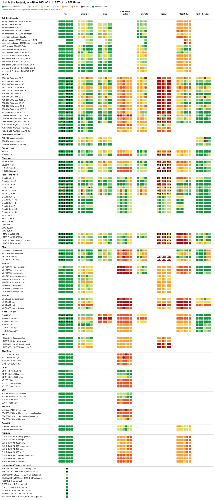
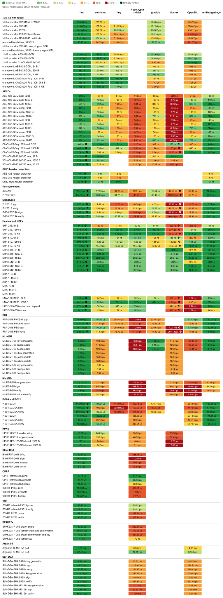

# Benchmarks

<!-- Generated by `admin/bench-report render` from benchmarks/data, benchmarks/verified.toml, and benchmarks/gaps.toml. -->

How long rind and the usual Rust crypto libraries take for the same operations, on six machines, and what each costs to build. Every library runs its native path on each host. A ✓ marks an operation whose whole computation a published formal proof covers, as [Verified code](#verified-code) lists.

## Hosts

| Host | CPU | OS | Measured |
|---|---|---|---|
| `nixos` | AMD Ryzen 9 5900XT 16-Core Processor | NixOS 26.11 (Zokor) (Linux 6.18.63) | 2026-11-24 at [`d481966c`](https://github.com/kixel-ai/rind/commit/d481966c12a136fa82b10afbf81e25d26f7fb0cd) |
| `desktop` | Intel(R) Core(TM) Ultra 7 270K Plus | Ubuntu 26.04.1 LTS (Linux 7.0.0-42-generic) | 2026-11-07 at [`9e7f6a5a`](https://github.com/kixel-ai/rind/commit/9e7f6a5a9ea59a0cf1251c24af6c5d4f21c2b0fd) |
| `fedora` | AMD Ryzen 9 9950X 16-Core Processor | Fedora Linux 45 (Workstation Edition) (Linux 7.3.3-300.fc45.x86_64) | 2026-11-24 at [`d481966c`](https://github.com/kixel-ai/rind/commit/d481966c12a136fa82b10afbf81e25d26f7fb0cd) |
| `kixtop` | Apple M4 | macOS 26.6.2 (25.6.0) | 2026-11-24 at [`3f76a53f`](https://github.com/kixel-ai/rind/commit/3f76a53f35ae185f0e9ea0a58f3455766fc4d643) |
| `ovh-iad` | Intel Core Processor (Haswell, no TSX) | NixOS 26.11 (Zokor) (Linux 6.18.40) | 2026-11-24 at [`3f76a53f`](https://github.com/kixel-ai/rind/commit/3f76a53f35ae185f0e9ea0a58f3455766fc4d643) |
| `ovh-sea` | Intel Core Processor (Haswell, no TSX) | NixOS 26.11 (Zokor) (Linux 6.18.40) | 2026-11-24 at [`3f76a53f`](https://github.com/kixel-ai/rind/commit/3f76a53f35ae185f0e9ea0a58f3455766fc4d643) |

Each host builds with the pinned toolchain in the Nix dev shell, and runs `admin/bench-report` only when idle. Times are criterion's estimates.

## Speed

Each row is one operation and each column one library. Each cell holds a square per host, colored by that library's time over the fastest library's on the same host, as the legend shows. A shield in a square marks verified code. Each square's tooltip, in the SVG opened on its own, gives its time; the tables below each host give them all. A library with no square doesn't offer the operation, or the host didn't time it, as its section says.

The rustls rows run both peers in one process. The every-logical-CPU rows run one handshake per thread on all of the host's logical CPUs at once, each thread with its own client and server, and give the machine's time per handshake; each host's text gives rind-rustls's throughput there over its one-thread rate. A full handshake over rind-rustls's default provider, both peers, makes 245 heap allocations with an ECDSA P-256 certificate on x86_64, which `rind-rustls/tests/allocations.rs` pins. Over rustls's aws-lc-rs provider it makes 214 through Rust's allocator and about 90 more in AWS-LC's C code, which only a process-wide count such as valgrind's sees (2026-11-13).

<picture>
  <source media="(prefers-color-scheme: dark)" srcset="benchmarks/overview-dark.svg">
  
</picture>

### `nixos`: AMD Ryzen 9 5900XT 16-Core Processor

Measured 2026-11-24 at [`d481966c`](https://github.com/kixel-ai/rind/commit/d481966c12a136fa82b10afbf81e25d26f7fb0cd), on NixOS 26.11 (Zokor) (Linux 6.18.63) with rustc 1.98.1 (48a229cea 2026-09-01).

Not timed on `nixos`: one record, AES-128-GCM, 64 B, one record, AES-128-GCM, 256 B, one record, AES-128-GCM, 1 KB, one record, ChaCha20-Poly1305, 64 B, one record, ChaCha20-Poly1305, 256 B, one record, ChaCha20-Poly1305, 1 KB, SHA-1, 64 B, SHA-1, 1350 B, SHA-1, 16 KB, MD5, 64 B, MD5, 1350 B, MD5, 16 KB, SLH-DSA-SHA2-128s key generation, SLH-DSA-SHA2-128s sign, SLH-DSA-SHA2-128s verify, SLH-DSA-SHA2-128f key generation, SLH-DSA-SHA2-128f sign, SLH-DSA-SHA2-128f verify, SLH-DSA-SHAKE-128f key generation, SLH-DSA-SHAKE-128f sign, SLH-DSA-SHAKE-128f verify.

rind-rustls on all 32 logical CPUs runs full handshakes at 12.5 times and resumed handshakes at 12.8 times its one-thread rate.

<picture>
  <source media="(prefers-color-scheme: dark)" srcset="benchmarks/nixos-dark.svg">
  
</picture>

Times on nixos

| Operation | rind | aws-lc-rs | ring | RustCrypto + dalek | graviola | libcrux | OpenSSL | verified-garbage |
|---|---|---|---|---|---|---|---|---|
| full handshake, X25519MLKEM768 | 206.71 µs | 302.86 µs | - | - | 246.03 µs | - | 644.30 µs | - |
| full handshake, X25519 | 180.51 µs | 258.67 µs | 284.31 µs | - | 213.74 µs | - | 548.31 µs | - |
| full handshake, P-256 | 208.53 µs | 295.35 µs | 281.39 µs | - | 249.78 µs | - | 600.42 µs | - |
| full handshake, Ed25519 certificate | 154.27 µs | 215.55 µs | 273.68 µs | - | 164.48 µs | - | 615.37 µs | - |
| full handshake, RSA-2048 certificate | 517.28 µs | 612.97 µs | 634.31 µs | - | 545.71 µs | - | 877.39 µs | - |
| resumed handshake, X25519 | 74.66 µs | 128.16 µs | 153.82 µs | - | 76.23 µs | - | 359.95 µs | - |
| full handshake, X25519, every logical CPU | 14.47 µs | 21.81 µs | 21.82 µs | - | 18.06 µs | - | 54.26 µs | - |
| resumed handshake, X25519, every logical CPU | 5.85 µs | 11.16 µs | 11.72 µs | - | 5.99 µs | - | 49.43 µs | - |
| 1 MB transfer, AES-128-GCM | 271.30 µs | 422.44 µs | 267.29 µs | - | 420.85 µs | - | 469.73 µs | - |
| 1 MB transfer, AES-256-GCM | 288.07 µs | 458.76 µs | 292.94 µs | - | 473.49 µs | - | 495.25 µs | - |
| 1 MB transfer, ChaCha20-Poly1305 | 681.91 µs | 680.77 µs | 678.28 µs | - | 1.37 ms | - | 785.82 µs | - |
| one record, AES-128-GCM, 64 B | - | - | - | - | - | - | - | - |
| one record, AES-128-GCM, 256 B | - | - | - | - | - | - | - | - |
| one record, AES-128-GCM, 1 KB | - | - | - | - | - | - | - | - |
| one record, ChaCha20-Poly1305, 64 B | - | - | - | - | - | - | - | - |
| one record, ChaCha20-Poly1305, 256 B | - | - | - | - | - | - | - | - |
| one record, ChaCha20-Poly1305, 1 KB | - | - | - | - | - | - | - | - |
| AES-128-GCM seal, 32 B | 38 ns | 73 ns | 55 ns | 96 ns | 68 ns | 312 ns | 118 ns | 51 ns |
| AES-128-GCM seal, 1350 B | 162 ns | 283 ns | 186 ns | 435 ns | 297 ns | 4.50 µs | 317 ns | 188 ns |
| AES-128-GCM seal, 16 KB | 1.35 µs | 2.60 µs | 1.36 µs | 4.14 µs | 2.57 µs | 55.27 µs | 2.63 µs | 1.45 µs |
| AES-128-GCM open, 32 B | 33 ns | 72 ns | 59 ns | 102 ns | 65 ns | 321 ns | 121 ns | 53 ns |
| AES-128-GCM open, 1350 B | 159 ns | 296 ns | 184 ns | 455 ns | 306 ns | 3.94 µs | 333 ns | 195 ns |
| AES-128-GCM open, 16 KB | 1.46 µs | 2.71 µs | 1.47 µs | 4.29 µs | 2.70 µs | 44.94 µs | 2.74 µs | 1.57 µs |
| AES-256-GCM seal, 32 B | 42 ns | 80 ns | 58 ns | 102 ns | 76 ns | 428 ns | 121 ns | 53 ns |
| AES-256-GCM seal, 1350 B | 195 ns | 310 ns | 213 ns | 488 ns | 338 ns | 7.00 µs | 343 ns | 210 ns |
| AES-256-GCM seal, 16 KB | 1.53 µs | 2.80 µs | 1.55 µs | 4.80 µs | 3.02 µs | 81.13 µs | 2.82 µs | 1.65 µs |
| AES-256-GCM open, 32 B | 37 ns | 80 ns | 62 ns | 109 ns | 68 ns | 448 ns | 123 ns | 54 ns |
| AES-256-GCM open, 1350 B | 175 ns | 321 ns | 203 ns | 513 ns | 343 ns | 6.79 µs | 353 ns | 211 ns |
| AES-256-GCM open, 16 KB | 1.62 µs | 2.90 µs | 1.62 µs | 4.90 µs | 3.09 µs | 80.22 µs | 2.94 µs | 1.78 µs |
| ChaCha20-Poly1305 seal, 32 B | 115 ns | 119 ns | 114 ns | 1.21 µs | 218 ns | 218 ns ✓ | 252 ns | 118 ns |
| ChaCha20-Poly1305 seal, 1350 B | 533 ns | 532 ns | 536 ns | 1.94 µs | 1.09 µs | 2.33 µs ✓ | 742 ns | 558 ns |
| ChaCha20-Poly1305 seal, 16 KB | 4.67 µs | 4.61 µs | 4.63 µs | 9.63 µs | 9.95 µs | 26.30 µs ✓ | 5.10 µs | 4.65 µs |
| XChaCha20-Poly1305 seal, 32 B | 223 ns | 253 ns | - | 1.32 µs | 341 ns | 333 ns | - | - |
| XChaCha20-Poly1305 seal, 1350 B | 635 ns | 668 ns | - | 2.07 µs | 1.20 µs | 2.48 µs | - | - |
| XChaCha20-Poly1305 seal, 16 KB | 4.72 µs | 4.70 µs | - | 9.78 µs | 9.95 µs | 25.98 µs | - | - |
| AES-128 header protection | 4 ns ✓ | 6 ns | 7 ns | - | - | - | - | 4 ns |
| AES-256 header protection | 5 ns ✓ | 8 ns | 9 ns | - | - | - | - | 6 ns |
| ChaCha20 header protection | 74 ns ✓ | 81 ns | 74 ns | - | - | - | - | 81 ns |
| X25519 | 23.68 µs ✓ | 24.30 µs | 45.17 µs | 51.32 µs | 23.80 µs | 61.90 µs ✓ | 47.50 µs | 23.46 µs |
| P-256 ECDH | 38.00 µs ✓ | 41.63 µs | 42.93 µs | 259.76 µs | 42.67 µs | 252.57 µs ✓ | 70.40 µs | 37.87 µs |
| Ed25519 sign | 5.74 µs ✓ | 6.05 µs | 17.15 µs | 13.51 µs | 5.80 µs | 41.17 µs ✓ | 23.34 µs | 5.84 µs |
| Ed25519 verify | 20.05 µs | 27.32 µs | 34.71 µs | 26.02 µs | 25.06 µs | 54.63 µs ✓ | 78.40 µs | 22.11 µs |
| P-256 ECDSA sign | 8.97 µs ✓ | 12.21 µs | 13.05 µs | 66.28 µs | 10.48 µs | 88.39 µs ✓ | 16.58 µs | 8.63 µs |
| P-256 ECDSA verify | 31.27 µs ✓ | 39.80 µs | 39.95 µs | 222.50 µs | 42.90 µs | 213.12 µs ✓ | 57.62 µs | 31.80 µs |
| SHA-256, 64 B | 57 ns ✓ | 92 ns | 79 ns | 58 ns | 62 ns | 350 ns ✓ | 233 ns | 73 ns |
| SHA-256, 1350 B | 574 ns ✓ | 626 ns | 609 ns | 594 ns | 593 ns | 3.58 µs ✓ | 766 ns | 611 ns |
| SHA-256, 16 KB | 6.81 µs ✓ | 6.80 µs | 6.79 µs | 6.81 µs | 6.76 µs | 41.95 µs ✓ | 6.95 µs | 6.76 µs |
| SHA-512, 64 B | 131 ns ✓ | 208 ns | 187 ns | 189 ns | 183 ns | 238 ns ✓ | 320 ns | 146 ns |
| SHA-512, 1350 B | 1.24 µs ✓ | 1.77 µs | 1.76 µs | 1.77 µs | 1.75 µs | 2.47 µs ✓ | 1.44 µs | 1.35 µs |
| SHA-512, 16 KB | 14.09 µs ✓ | 20.29 µs | 20.27 µs | 20.30 µs | 20.07 µs | 28.22 µs ✓ | 14.61 µs | 15.39 µs |
| SHA3-256, 64 B | 235 ns ✓ | 277 ns | - | 273 ns | - | 275 ns | - | 232 ns |
| SHA3-256, 1350 B | 2.11 µs ✓ | 2.14 µs | - | 2.63 µs | - | 2.58 µs | - | 2.16 µs |
| SHA3-256, 16 KB | 25.14 µs ✓ | 24.90 µs | - | 31.95 µs | - | 30.94 µs | - | 26.08 µs |
| SHA3-512, 64 B | 235 ns ✓ | 279 ns | - | 276 ns | - | 269 ns | - | 232 ns |
| SHA3-512, 1350 B | 3.95 µs ✓ | 3.99 µs | - | 4.97 µs | - | 4.86 µs | - | 4.03 µs |
| SHA3-512, 16 KB | 46.78 µs ✓ | 47.08 µs | - | 60.02 µs | - | 57.12 µs | - | 48.42 µs |
| SHA-1, 64 B | - | - | - | - | - | - | - | - |
| SHA-1, 1350 B | - | - | - | - | - | - | - | - |
| SHA-1, 16 KB | - | - | - | - | - | - | - | - |
| MD5, 64 B | - | - | - | - | - | - | - | - |
| MD5, 1350 B | - | - | - | - | - | - | - | - |
| MD5, 16 KB | - | - | - | - | - | - | - | - |
| HMAC-SHA256, 64 B | 140 ns ✓ | 281 ns | 215 ns | 167 ns | 171 ns | 819 ns ✓ | 2.49 µs | 162 ns |
| HMAC-SHA256, 1350 B | 675 ns ✓ | 811 ns | 761 ns | 692 ns | 697 ns | 4.10 µs ✓ | 3.01 µs | 695 ns |
| HKDF-SHA256 extract and expand | 265 ns ✓ | 372 ns | 407 ns | 314 ns | - | 1.38 µs ✓ | 2.76 µs | 284 ns |
| HKDF-SHA256 expand | 89 ns ✓ | 178 ns | 148 ns | 106 ns | - | 712 ns ✓ | 2.01 µs | 152 ns |
| RSA-2048 PKCS#1 sign | 400.58 µs | 430.95 µs | 421.80 µs | 1.75 ms | 408.89 µs | - | 438.93 µs | 456.24 µs |
| RSA-2048 PKCS#1 verify | 10.81 µs ✓ | 13.68 µs | 15.36 µs | 47.38 µs | 17.64 µs | - | 20.74 µs | 11.62 µs |
| RSA-2048 PSS sign | 400.24 µs | 434.63 µs | 425.34 µs | 1.76 ms | 409.39 µs | 4.84 ms ✓ | 442.15 µs | 454.60 µs |
| RSA-2048 PSS verify | 11.24 µs ✓ | 14.22 µs | 15.99 µs | 55.87 µs | 17.82 µs | 282.44 µs ✓ | 21.97 µs | 12.01 µs |
| ML-KEM-768 key generation | 8.12 µs | 9.16 µs | - | 57.71 µs | 8.53 µs | 17.11 µs | 25.93 µs | 6.47 µs |
| ML-KEM-768 encapsulate | 5.84 µs | 9.41 µs | - | 67.96 µs | 10.31 µs | 15.06 µs | 27.23 µs | 5.79 µs |
| ML-KEM-768 decapsulate | 5.71 µs | 11.31 µs | - | 87.10 µs | 7.21 µs | 15.94 µs | 22.33 µs | 6.23 µs |
| ML-KEM-1024 key generation | 11.74 µs | 12.70 µs | - | - | - | 23.08 µs | - | - |
| ML-KEM-1024 encapsulate | 11.52 µs | 13.34 µs | - | - | - | 20.69 µs | - | - |
| ML-KEM-1024 decapsulate | 7.60 µs | 15.66 µs | - | - | - | 23.80 µs | - | - |
| ML-KEM-512 key generation | 4.93 µs | 5.62 µs | - | - | - | 13.01 µs | - | - |
| ML-KEM-512 encapsulate | 5.24 µs | 6.06 µs | - | - | - | 11.26 µs | - | - |
| ML-KEM-512 decapsulate | 4.65 µs | 7.29 µs | - | - | - | 11.72 µs | - | - |
| ML-DSA-65 key generation | 28.26 µs | 33.47 µs | - | 252.23 µs | - | 44.82 µs | 130.86 µs | 47.49 µs |
| ML-DSA-65 sign | 50.79 µs | 94.11 µs | - | 943.01 µs | - | 113.55 µs | 729.28 µs | 79.90 µs |
| ML-DSA-65 verify | 5.98 µs | 30.02 µs | - | 100.98 µs | - | 47.77 µs | 132.19 µs | 24.52 µs |
| ML-DSA-65 load and verify | 25.92 µs | 30.00 µs | - | 182.94 µs | - | 47.72 µs | 138.16 µs | - |
| P-384 ECDH | 123.97 µs ✓ | 147.27 µs | 595.59 µs | 768.48 µs | 208.49 µs | - | 458.96 µs | 127.89 µs |
| P-384 ECDSA sign | 25.83 µs ✓ | 64.10 µs | 317.78 µs | 182.53 µs | 109.50 µs | - | 152.24 µs | 23.82 µs |
| P-384 ECDSA verify | 111.13 µs ✓ | 151.95 µs | 567.27 µs | 668.45 µs | 205.63 µs | - | 374.23 µs | 110.42 µs |
| P-521 ECDH | 218.24 µs | 234.82 µs | - | 608.72 µs | - | - | 393.08 µs | 224.63 µs |
| P-521 ECDSA sign | 56.03 µs | 127.78 µs | - | 145.69 µs | - | - | 186.16 µs | 59.47 µs |
| P-521 ECDSA verify | 190.77 µs | 257.09 µs | - | 490.03 µs | - | - | 385.83 µs | 209.54 µs |
| HPKE X25519 sender setup | 25.21 µs | 27.15 µs | - | 65.43 µs | - | 72.53 µs | - | - |
| HPKE X25519 recipient setup | 19.79 µs | 26.72 µs | - | 52.54 µs | - | 69.51 µs | - | - |
| HPKE AES-128-GCM seal, 1350 B | 182 ns | 464 ns | - | 444 ns | - | 4.61 µs | - | - |
| HPKE AES-128-GCM open, 1350 B | 155 ns | 453 ns | - | 446 ns | - | 4.03 µs | - | - |
| Blind RSA-2048 blind | 54.43 µs | - | - | 405.18 µs | - | - | - | - |
| Blind RSA-2048 sign | 397.55 µs | - | - | 1.75 ms | - | - | - | - |
| Blind RSA-2048 finalize | 10.82 µs | - | - | 54.38 µs | - | - | - | - |
| Blind RSA-2048 verify | 10.61 µs | - | - | 48.54 µs | - | - | - | - |
| OPRF ristretto255 blind | 37.06 µs | - | - | 34.05 µs | - | - | - | - |
| OPRF ristretto255 evaluate | 27.82 µs | - | - | 21.99 µs | - | - | - | - |
| OPRF ristretto255 finalize | 28.67 µs | - | - | 36.70 µs | - | - | - | - |
| VOPRF P-384 blind | 130.60 µs | - | - | 717.90 µs | - | - | - | - |
| VOPRF P-384 evaluate | 457.29 µs | - | - | 3.15 ms | - | - | - | - |
| VOPRF P-384 finalize | 661.94 µs | - | - | 4.42 ms | - | - | - | - |
| ECVRF edwards25519 prove | 76.85 µs | - | - | 96.96 µs | - | - | - | - |
| ECVRF edwards25519 verify | 98.33 µs | - | - | 108.77 µs | - | - | - | - |
| ECVRF P-256 prove | 85.06 µs | - | - | 524.38 µs | - | - | - | - |
| ECVRF P-256 verify | 117.71 µs | - | - | 675.81 µs | - | - | - | - |
| SPAKE2+ P-256 prover share | 40.27 µs | - | - | 403.65 µs | - | - | - | - |
| SPAKE2+ P-256 verifier share and confirmation | 140.82 µs | - | - | 1.02 ms | - | - | - | - |
| SPAKE2+ P-256 prover confirmation and key | 100.93 µs | - | - | 605.19 µs | - | - | - | - |
| SPAKE2+ P-256 verifier key | 28 ns | - | - | 60 ns | - | - | - | - |
| Argon2id 16 MiB t=1 p=1 | 3.01 ms | - | - | 4.24 ms | - | - | 5.82 ms | - |
| Argon2id 64 MiB t=3 p=4 | 83.75 ms | - | - | 103.46 ms | - | - | 126.37 ms | - |
| SLH-DSA-SHA2-128s key generation | - | - | - | - | - | - | - | - |
| SLH-DSA-SHA2-128s sign | - | - | - | - | - | - | - | - |
| SLH-DSA-SHA2-128s verify | - | - | - | - | - | - | - | - |
| SLH-DSA-SHA2-128f key generation | - | - | - | - | - | - | - | - |
| SLH-DSA-SHA2-128f sign | - | - | - | - | - | - | - | - |
| SLH-DSA-SHA2-128f verify | - | - | - | - | - | - | - | - |
| SLH-DSA-SHAKE-128f key generation | - | - | - | - | - | - | - | - |
| SLH-DSA-SHAKE-128f sign | - | - | - | - | - | - | - | - |
| SLH-DSA-SHAKE-128f verify | - | - | - | - | - | - | - | - |

### `desktop`: Intel(R) Core(TM) Ultra 7 270K Plus

Measured 2026-11-07 at [`9e7f6a5a`](https://github.com/kixel-ai/rind/commit/9e7f6a5a9ea59a0cf1251c24af6c5d4f21c2b0fd), on Ubuntu 26.04.1 LTS (Linux 7.0.0-42-generic) with rustc 1.98.1 (48a229cea 2026-09-01).

Not timed on `desktop`: full handshake, X25519, every logical CPU, resumed handshake, X25519, every logical CPU, one record, AES-128-GCM, 64 B, one record, AES-128-GCM, 256 B, one record, AES-128-GCM, 1 KB, one record, ChaCha20-Poly1305, 64 B, one record, ChaCha20-Poly1305, 256 B, one record, ChaCha20-Poly1305, 1 KB, SHA3-256, 64 B, SHA3-256, 1350 B, SHA3-256, 16 KB, SHA3-512, 64 B, SHA3-512, 1350 B, SHA3-512, 16 KB, SHA-1, 64 B, SHA-1, 1350 B, SHA-1, 16 KB, MD5, 64 B, MD5, 1350 B, MD5, 16 KB, ML-KEM-1024 key generation, ML-KEM-1024 encapsulate, ML-KEM-1024 decapsulate, ML-KEM-512 key generation, ML-KEM-512 encapsulate, ML-KEM-512 decapsulate, ML-DSA-65 key generation, ML-DSA-65 sign, ML-DSA-65 verify, ML-DSA-65 load and verify, HPKE X25519 sender setup, HPKE X25519 recipient setup, HPKE AES-128-GCM seal, 1350 B, HPKE AES-128-GCM open, 1350 B, Blind RSA-2048 blind, Blind RSA-2048 sign, Blind RSA-2048 finalize, Blind RSA-2048 verify, OPRF ristretto255 blind, OPRF ristretto255 evaluate, OPRF ristretto255 finalize, VOPRF P-384 blind, VOPRF P-384 evaluate, VOPRF P-384 finalize, ECVRF edwards25519 prove, ECVRF edwards25519 verify, ECVRF P-256 prove, ECVRF P-256 verify, SPAKE2+ P-256 prover share, SPAKE2+ P-256 verifier share and confirmation, SPAKE2+ P-256 prover confirmation and key, SPAKE2+ P-256 verifier key, Argon2id 16 MiB t=1 p=1, Argon2id 64 MiB t=3 p=4, SLH-DSA-SHA2-128s key generation, SLH-DSA-SHA2-128s sign, SLH-DSA-SHA2-128s verify, SLH-DSA-SHA2-128f key generation, SLH-DSA-SHA2-128f sign, SLH-DSA-SHA2-128f verify, SLH-DSA-SHAKE-128f key generation, SLH-DSA-SHAKE-128f sign, SLH-DSA-SHAKE-128f verify.

<picture>
  <source media="(prefers-color-scheme: dark)" srcset="benchmarks/desktop-dark.svg">
  
</picture>

Times on desktop

| Operation | rind | aws-lc-rs | ring | RustCrypto + dalek | graviola | libcrux | OpenSSL |
|---|---|---|---|---|---|---|---|
| full handshake, X25519MLKEM768 | 172.30 µs | 233.73 µs | - | - | 188.19 µs | - | 438.88 µs |
| full handshake, X25519 | 151.32 µs | 201.93 µs | 221.01 µs | - | 161.40 µs | - | 366.38 µs |
| full handshake, P-256 | 174.55 µs | 227.86 µs | 219.51 µs | - | 191.81 µs | - | 400.76 µs |
| full handshake, Ed25519 certificate | 121.90 µs | 166.63 µs | 202.04 µs | - | 123.71 µs | - | 368.21 µs |
| full handshake, RSA-2048 certificate | 432.83 µs | 480.43 µs | 488.22 µs | - | 440.42 µs | - | 670.54 µs |
| resumed handshake, X25519 | 54.39 µs | 101.36 µs | 111.29 µs | - | 55.62 µs | - | 232.44 µs |
| full handshake, X25519, every logical CPU | - | - | - | - | - | - | - |
| resumed handshake, X25519, every logical CPU | - | - | - | - | - | - | - |
| 1 MB transfer, AES-128-GCM | 168.21 µs | 233.34 µs | 170.08 µs | - | 289.61 µs | - | 250.85 µs |
| 1 MB transfer, AES-256-GCM | 184.54 µs | 265.29 µs | 188.67 µs | - | 337.96 µs | - | 285.79 µs |
| 1 MB transfer, ChaCha20-Poly1305 | 596.91 µs | 595.41 µs | 590.49 µs | - | 1.16 ms | - | 658.48 µs |
| one record, AES-128-GCM, 64 B | - | - | - | - | - | - | - |
| one record, AES-128-GCM, 256 B | - | - | - | - | - | - | - |
| one record, AES-128-GCM, 1 KB | - | - | - | - | - | - | - |
| one record, ChaCha20-Poly1305, 64 B | - | - | - | - | - | - | - |
| one record, ChaCha20-Poly1305, 256 B | - | - | - | - | - | - | - |
| one record, ChaCha20-Poly1305, 1 KB | - | - | - | - | - | - | - |
| AES-128-GCM seal, 32 B | 20 ns | 38 ns | 41 ns | 73 ns | 42 ns | 171 ns | 57 ns |
| AES-128-GCM seal, 1350 B | 93 ns | 159 ns | 119 ns | 278 ns | 226 ns | 1.98 µs | 160 ns |
| AES-128-GCM seal, 16 KB | 799 ns | 1.32 µs | 818 ns | 2.49 µs | 2.05 µs | 22.05 µs | 1.35 µs |
| AES-128-GCM open, 32 B | 15 ns | 38 ns | 41 ns | 78 ns | 36 ns | 162 ns | 59 ns |
| AES-128-GCM open, 1350 B | 89 ns | 151 ns | 114 ns | 283 ns | 175 ns | 1.99 µs | 162 ns |
| AES-128-GCM open, 16 KB | 793 ns | 1.26 µs | 814 ns | 2.51 µs | 1.40 µs | 21.94 µs | 1.29 µs |
| AES-256-GCM seal, 32 B | 21 ns | 39 ns | 43 ns | 78 ns | 45 ns | 217 ns | 61 ns |
| AES-256-GCM seal, 1350 B | 107 ns | 175 ns | 134 ns | 313 ns | 257 ns | 2.87 µs | 184 ns |
| AES-256-GCM seal, 16 KB | 954 ns | 1.58 µs | 975 ns | 2.90 µs | 2.46 µs | 32.86 µs | 1.60 µs |
| AES-256-GCM open, 32 B | 16 ns | 38 ns | 43 ns | 82 ns | 38 ns | 215 ns | 61 ns |
| AES-256-GCM open, 1350 B | 99 ns | 172 ns | 121 ns | 318 ns | 201 ns | 2.85 µs | 189 ns |
| AES-256-GCM open, 16 KB | 899 ns | 1.55 µs | 933 ns | 2.92 µs | 1.71 µs | 32.61 µs | 1.58 µs |
| ChaCha20-Poly1305 seal, 32 B | 98 ns | 103 ns | 99 ns | 1.05 µs | 177 ns | 157 ns ✓ | 175 ns |
| ChaCha20-Poly1305 seal, 1350 B | 440 ns | 446 ns | 448 ns | 1.64 µs | 890 ns | 1.77 µs ✓ | 587 ns |
| ChaCha20-Poly1305 seal, 16 KB | 4.19 µs | 4.13 µs | 4.12 µs | 8.03 µs | 8.29 µs | 19.31 µs ✓ | 4.35 µs |
| XChaCha20-Poly1305 seal, 32 B | 186 ns | 199 ns | - | 1.15 µs | 255 ns | 244 ns | - |
| XChaCha20-Poly1305 seal, 1350 B | 529 ns | 539 ns | - | 1.73 µs | 974 ns | 1.83 µs | - |
| XChaCha20-Poly1305 seal, 16 KB | 4.17 µs | 4.23 µs | - | 8.15 µs | 8.40 µs | 19.61 µs | - |
| AES-128 header protection | 2 ns ✓ | 3 ns | 3 ns | - | - | - | - |
| AES-256 header protection | 2 ns ✓ | 5 ns | 5 ns | - | - | - | - |
| ChaCha20 header protection | 53 ns ✓ | 68 ns | 60 ns | - | - | - | - |
| X25519 | 18.20 µs ✓ | 19.24 µs | 35.63 µs | 36.06 µs | 18.09 µs | 42.68 µs ✓ | 33.95 µs |
| P-256 ECDH | 29.52 µs ✓ | 31.77 µs | 33.64 µs | 121.30 µs | 33.67 µs | 171.68 µs ✓ | 52.92 µs |
| Ed25519 sign | - | 4.49 µs | 13.11 µs | 9.60 µs | 4.40 µs | 28.54 µs ✓ | 13.67 µs |
| Ed25519 verify | 21.43 µs | 21.41 µs | 25.93 µs | 21.87 µs | 21.45 µs | 41.83 µs ✓ | 44.79 µs |
| P-256 ECDSA sign | 6.74 µs ✓ | 12.25 µs | 12.20 µs | 31.32 µs | 8.97 µs | 61.81 µs ✓ | 14.45 µs |
| P-256 ECDSA verify | 30.59 µs ✓ | 29.75 µs | 33.23 µs | 103.24 µs | 32.36 µs | 147.27 µs ✓ | 46.46 µs |
| SHA-256, 64 B | 28 ns ✓ | 57 ns | 56 ns | 39 ns | 40 ns | 218 ns ✓ | 158 ns |
| SHA-256, 1350 B | 269 ns ✓ | 306 ns | 304 ns | 296 ns | 292 ns | 2.29 µs ✓ | 406 ns |
| SHA-256, 16 KB | 3.19 µs ✓ | 3.23 µs | 3.22 µs | 3.22 µs | 3.22 µs | 26.90 µs ✓ | 3.36 µs |
| SHA-512, 64 B | - | 134 ns ✓ | 140 ns | 120 ns | 148 ns | 166 ns ✓ | 226 ns |
| SHA-512, 1350 B | - | 1.24 µs ✓ | 1.26 µs | 1.17 µs | 1.49 µs | 1.72 µs ✓ | 1.17 µs |
| SHA-512, 16 KB | - | 14.12 µs ✓ | 14.10 µs | 13.51 µs | 17.50 µs | 20.10 µs ✓ | 12.29 µs |
| SHA3-256, 64 B | - | - | - | - | - | - | - |
| SHA3-256, 1350 B | - | - | - | - | - | - | - |
| SHA3-256, 16 KB | - | - | - | - | - | - | - |
| SHA3-512, 64 B | - | - | - | - | - | - | - |
| SHA3-512, 1350 B | - | - | - | - | - | - | - |
| SHA3-512, 16 KB | - | - | - | - | - | - | - |
| SHA-1, 64 B | - | - | - | - | - | - | - |
| SHA-1, 1350 B | - | - | - | - | - | - | - |
| SHA-1, 16 KB | - | - | - | - | - | - | - |
| MD5, 64 B | - | - | - | - | - | - | - |
| MD5, 1350 B | - | - | - | - | - | - | - |
| MD5, 16 KB | - | - | - | - | - | - | - |
| HMAC-SHA256, 64 B | 75 ns ✓ | 180 ns | 145 ns | 103 ns | 110 ns | 537 ns ✓ | 1.55 µs |
| HMAC-SHA256, 1350 B | 328 ns ✓ | 435 ns | 397 ns | 356 ns | 358 ns | 2.68 µs ✓ | 1.81 µs |
| HKDF-SHA256 extract and expand | 158 ns ✓ | 285 ns | 303 ns | 223 ns | - | 965 ns ✓ | 1.72 µs |
| HKDF-SHA256 expand | 66 ns ✓ | 124 ns | 120 ns | 84 ns | - | 480 ns ✓ | 1.23 µs |
| RSA-2048 PKCS#1 sign | 341.49 µs | 344.24 µs | 336.10 µs | 580.18 µs | 343.75 µs | - | 393.45 µs |
| RSA-2048 PKCS#1 verify | 8.92 µs ✓ | 10.96 µs | 12.78 µs | 29.01 µs | 13.98 µs | - | 15.51 µs |
| RSA-2048 PSS sign | 341.45 µs | 346.55 µs | 342.49 µs | 581.16 µs | 344.58 µs | 3.69 ms ✓ | 390.44 µs |
| RSA-2048 PSS verify | 9.15 µs ✓ | 11.16 µs | 13.19 µs | 35.27 µs | 14.30 µs | 251.91 µs ✓ | 16.25 µs |
| ML-KEM-768 key generation | 6.35 µs | 8.13 µs | - | 39.63 µs | 7.37 µs | 15.02 µs | 19.81 µs |
| ML-KEM-768 encapsulate | 6.50 µs | 8.48 µs | - | 41.38 µs | 9.00 µs | 12.80 µs | 18.77 µs |
| ML-KEM-768 decapsulate | 4.64 µs | 8.90 µs | - | 54.87 µs | 6.54 µs | 13.44 µs | 15.77 µs |
| ML-KEM-1024 key generation | - | - | - | - | - | - | - |
| ML-KEM-1024 encapsulate | - | - | - | - | - | - | - |
| ML-KEM-1024 decapsulate | - | - | - | - | - | - | - |
| ML-KEM-512 key generation | - | - | - | - | - | - | - |
| ML-KEM-512 encapsulate | - | - | - | - | - | - | - |
| ML-KEM-512 decapsulate | - | - | - | - | - | - | - |
| ML-DSA-65 key generation | - | - | - | - | - | - | - |
| ML-DSA-65 sign | - | - | - | - | - | - | - |
| ML-DSA-65 verify | - | - | - | - | - | - | - |
| ML-DSA-65 load and verify | - | - | - | - | - | - | - |
| P-384 ECDH | 100.20 µs ✓ | 109.34 µs | 369.83 µs | 402.09 µs | 174.12 µs | - | 265.21 µs |
| P-384 ECDSA sign | 23.48 µs ✓ | 46.55 µs | 197.31 µs | 85.50 µs | 90.29 µs | - | 88.98 µs |
| P-384 ECDSA verify | 100.10 µs ✓ | 115.71 µs | 357.26 µs | 359.61 µs | 166.49 µs | - | 216.27 µs |
| P-521 ECDH | 159.57 µs | 171.50 µs | - | 428.27 µs | - | - | 276.64 µs |
| P-521 ECDSA sign | 40.09 µs | 88.28 µs | - | 94.09 µs | - | - | 127.93 µs |
| P-521 ECDSA verify | 145.10 µs | 186.69 µs | - | 352.95 µs | - | - | 261.10 µs |
| HPKE X25519 sender setup | - | - | - | - | - | - | - |
| HPKE X25519 recipient setup | - | - | - | - | - | - | - |
| HPKE AES-128-GCM seal, 1350 B | - | - | - | - | - | - | - |
| HPKE AES-128-GCM open, 1350 B | - | - | - | - | - | - | - |
| Blind RSA-2048 blind | - | - | - | - | - | - | - |
| Blind RSA-2048 sign | - | - | - | - | - | - | - |
| Blind RSA-2048 finalize | - | - | - | - | - | - | - |
| Blind RSA-2048 verify | - | - | - | - | - | - | - |
| OPRF ristretto255 blind | - | - | - | - | - | - | - |
| OPRF ristretto255 evaluate | - | - | - | - | - | - | - |
| OPRF ristretto255 finalize | - | - | - | - | - | - | - |
| VOPRF P-384 blind | - | - | - | - | - | - | - |
| VOPRF P-384 evaluate | - | - | - | - | - | - | - |
| VOPRF P-384 finalize | - | - | - | - | - | - | - |
| ECVRF edwards25519 prove | - | - | - | - | - | - | - |
| ECVRF edwards25519 verify | - | - | - | - | - | - | - |
| ECVRF P-256 prove | - | - | - | - | - | - | - |
| ECVRF P-256 verify | - | - | - | - | - | - | - |
| SPAKE2+ P-256 prover share | - | - | - | - | - | - | - |
| SPAKE2+ P-256 verifier share and confirmation | - | - | - | - | - | - | - |
| SPAKE2+ P-256 prover confirmation and key | - | - | - | - | - | - | - |
| SPAKE2+ P-256 verifier key | - | - | - | - | - | - | - |
| Argon2id 16 MiB t=1 p=1 | - | - | - | - | - | - | - |
| Argon2id 64 MiB t=3 p=4 | - | - | - | - | - | - | - |
| SLH-DSA-SHA2-128s key generation | - | - | - | - | - | - | - |
| SLH-DSA-SHA2-128s sign | - | - | - | - | - | - | - |
| SLH-DSA-SHA2-128s verify | - | - | - | - | - | - | - |
| SLH-DSA-SHA2-128f key generation | - | - | - | - | - | - | - |
| SLH-DSA-SHA2-128f sign | - | - | - | - | - | - | - |
| SLH-DSA-SHA2-128f verify | - | - | - | - | - | - | - |
| SLH-DSA-SHAKE-128f key generation | - | - | - | - | - | - | - |
| SLH-DSA-SHAKE-128f sign | - | - | - | - | - | - | - |
| SLH-DSA-SHAKE-128f verify | - | - | - | - | - | - | - |

### `fedora`: AMD Ryzen 9 9950X 16-Core Processor

Measured 2026-11-24 at [`d481966c`](https://github.com/kixel-ai/rind/commit/d481966c12a136fa82b10afbf81e25d26f7fb0cd), on Fedora Linux 45 (Workstation Edition) (Linux 7.3.3-300.fc45.x86_64) with rustc 1.98.1 (48a229cea 2026-09-01).

The maintainer's Fedora workstation and the report's only AVX-512 host, so the one whose table times rind's AVX-512 AES-GCM, IFMA RSA, and 8-way ML-KEM sampler against every library. It also runs CI runners and agent sessions, so its times are noisier than the other dedicated hosts'. Zen 5 keeps its clock with 512-bit vectors, so this host cannot show what they cost on the Intel cores that slow down.

Not timed on `fedora`: one record, AES-128-GCM, 64 B, one record, AES-128-GCM, 256 B, one record, AES-128-GCM, 1 KB, one record, ChaCha20-Poly1305, 64 B, one record, ChaCha20-Poly1305, 256 B, one record, ChaCha20-Poly1305, 1 KB, SHA-1, 64 B, SHA-1, 1350 B, SHA-1, 16 KB, MD5, 64 B, MD5, 1350 B, MD5, 16 KB, SLH-DSA-SHA2-128s key generation, SLH-DSA-SHA2-128s sign, SLH-DSA-SHA2-128s verify, SLH-DSA-SHA2-128f key generation, SLH-DSA-SHA2-128f sign, SLH-DSA-SHA2-128f verify, SLH-DSA-SHAKE-128f key generation, SLH-DSA-SHAKE-128f sign, SLH-DSA-SHAKE-128f verify.

rind-rustls on all 32 logical CPUs runs full handshakes at 26.0 times and resumed handshakes at 18.3 times its one-thread rate.

<picture>
  <source media="(prefers-color-scheme: dark)" srcset="benchmarks/fedora-dark.svg">
  
</picture>

Times on fedora

| Operation | rind | aws-lc-rs | ring | RustCrypto + dalek | graviola | libcrux | OpenSSL | verified-garbage |
|---|---|---|---|---|---|---|---|---|
| full handshake, X25519MLKEM768 | 120.30 µs | 210.27 µs | - | - | 171.70 µs | - | 410.10 µs | - |
| full handshake, X25519 | 142.68 µs | 169.61 µs | 240.87 µs | - | 153.56 µs | - | 338.07 µs | - |
| full handshake, P-256 | 124.86 µs | 188.19 µs | 183.54 µs | - | 182.84 µs | - | 359.64 µs | - |
| full handshake, Ed25519 certificate | 80.62 µs | 136.41 µs | 182.21 µs | - | 107.85 µs | - | 364.26 µs | - |
| full handshake, RSA-2048 certificate | 190.86 µs | 269.78 µs | 454.07 µs | - | 383.13 µs | - | 424.43 µs | - |
| resumed handshake, X25519 | 40.32 µs | 83.30 µs | 101.45 µs | - | 51.60 µs | - | 229.02 µs | - |
| full handshake, X25519, every logical CPU | 5.48 µs | 10.97 µs | 11.91 µs | - | 9.25 µs | - | 40.54 µs | - |
| resumed handshake, X25519, every logical CPU | 2.20 µs | 5.66 µs | 6.45 µs | - | 3.10 µs | - | 45.28 µs | - |
| 1 MB transfer, AES-128-GCM | 113.43 µs | 118.66 µs | 187.41 µs | - | 136.32 µs | - | 140.25 µs | - |
| 1 MB transfer, AES-256-GCM | 121.38 µs | 126.11 µs | 196.65 µs | - | 148.76 µs | - | 147.17 µs | - |
| 1 MB transfer, ChaCha20-Poly1305 | 392.55 µs | 612.84 µs | 615.77 µs | - | 1.18 ms | - | 402.05 µs | - |
| one record, AES-128-GCM, 64 B | - | - | - | - | - | - | - | - |
| one record, AES-128-GCM, 256 B | - | - | - | - | - | - | - | - |
| one record, AES-128-GCM, 1 KB | - | - | - | - | - | - | - | - |
| one record, ChaCha20-Poly1305, 64 B | - | - | - | - | - | - | - | - |
| one record, ChaCha20-Poly1305, 256 B | - | - | - | - | - | - | - | - |
| one record, ChaCha20-Poly1305, 1 KB | - | - | - | - | - | - | - | - |
| AES-128-GCM seal, 32 B | 26 ns | 51 ns | 43 ns | 99 ns | 51 ns | 199 ns | 63 ns | 33 ns |
| AES-128-GCM seal, 1350 B | 86 ns | 114 ns | 150 ns | 384 ns | 140 ns | 2.40 µs | 131 ns | 84 ns |
| AES-128-GCM seal, 16 KB | 510 ns | 533 ns | 1.10 µs | 3.45 µs | 741 ns | 27.57 µs | 549 ns | 452 ns |
| AES-128-GCM open, 32 B | 27 ns | 50 ns | 62 ns | 104 ns | 48 ns | 241 ns | 61 ns | 32 ns |
| AES-128-GCM open, 1350 B | 86 ns | 121 ns | 162 ns | 399 ns | 137 ns | 2.49 µs | 132 ns | 107 ns |
| AES-128-GCM open, 16 KB | 602 ns | 618 ns | 1.14 µs | 3.50 µs | 693 ns | 27.39 µs | 611 ns | 495 ns |
| AES-256-GCM seal, 32 B | 28 ns | 55 ns | 46 ns | 125 ns | 53 ns | 282 ns | 69 ns | 36 ns |
| AES-256-GCM seal, 1350 B | 105 ns | 126 ns | 167 ns | 435 ns | 159 ns | 3.40 µs | 140 ns | 93 ns |
| AES-256-GCM seal, 16 KB | 590 ns | 605 ns | 1.20 µs | 3.55 µs | 916 ns | 39.49 µs | 628 ns | 533 ns |
| AES-256-GCM open, 32 B | 27 ns | 51 ns | 63 ns | 127 ns | 50 ns | 309 ns | 64 ns | 34 ns |
| AES-256-GCM open, 1350 B | 90 ns | 126 ns | 169 ns | 449 ns | 144 ns | 3.40 µs | 138 ns | 109 ns |
| AES-256-GCM open, 16 KB | 625 ns | 647 ns | 1.19 µs | 3.50 µs | 711 ns | 37.94 µs | 691 ns | 581 ns |
| ChaCha20-Poly1305 seal, 32 B | 134 ns | 140 ns | 135 ns | 977 ns | 273 ns | 147 ns ✓ | 272 ns | 130 ns |
| ChaCha20-Poly1305 seal, 1350 B | 395 ns | 484 ns | 490 ns | 1.85 µs | 1.16 µs | 1.56 µs ✓ | 612 ns | 372 ns |
| ChaCha20-Poly1305 seal, 16 KB | 2.70 µs | 4.52 µs | 4.42 µs | 10.67 µs | 8.98 µs | 17.65 µs ✓ | 2.61 µs | 2.70 µs |
| XChaCha20-Poly1305 seal, 32 B | 242 ns | 251 ns | - | 1.08 µs | 448 ns | 258 ns | - | - |
| XChaCha20-Poly1305 seal, 1350 B | 507 ns | 600 ns | - | 1.97 µs | 1.29 µs | 1.67 µs | - | - |
| XChaCha20-Poly1305 seal, 16 KB | 2.78 µs | 4.56 µs | - | 10.64 µs | 9.03 µs | 17.66 µs | - | - |
| AES-128 header protection | 2 ns ✓ | 3 ns | 4 ns | - | - | - | - | 2 ns |
| AES-256 header protection | 3 ns ✓ | 5 ns | 6 ns | - | - | - | - | 3 ns |
| ChaCha20 header protection | 51 ns ✓ | 58 ns | 52 ns | - | - | - | - | 58 ns |
| X25519 | 10.95 µs ✓ | 15.77 µs | 30.72 µs | 34.70 µs | 15.39 µs | 42.06 µs ✓ | 31.99 µs | 11.03 µs |
| P-256 ECDH | 22.57 µs ✓ | 26.91 µs | 28.03 µs | 127.14 µs | 31.30 µs | 168.09 µs ✓ | 44.83 µs | 22.64 µs |
| Ed25519 sign | 2.37 µs ✓ | 3.96 µs | 11.96 µs | 9.43 µs | 3.78 µs | 30.18 µs ✓ | 13.93 µs | 2.40 µs |
| Ed25519 verify | 11.07 µs ✓ | 17.52 µs | 23.19 µs | 20.02 µs | 16.17 µs | 36.95 µs ✓ | 43.91 µs | 11.18 µs |
| P-256 ECDSA sign | 5.87 µs ✓ | 8.40 µs | 8.73 µs | 35.39 µs | 7.61 µs | 59.33 µs ✓ | 11.01 µs | 5.57 µs |
| P-256 ECDSA verify | 18.35 µs ✓ | 25.64 µs | 27.02 µs | 106.24 µs | 30.02 µs | 141.24 µs ✓ | 38.20 µs | 18.16 µs |
| SHA-256, 64 B | 38 ns ✓ | 75 ns | 62 ns | 53 ns | 56 ns | 200 ns ✓ | 179 ns | 56 ns |
| SHA-256, 1350 B | 512 ns ✓ | 541 ns | 526 ns | 513 ns | 515 ns | 2.17 µs ✓ | 639 ns | 527 ns |
| SHA-256, 16 KB | 5.94 µs ✓ | 5.89 µs | 5.88 µs | 5.87 µs | 5.85 µs | 24.92 µs ✓ | 6.00 µs | 5.93 µs |
| SHA-512, 64 B | 94 ns ✓ | 136 ns | 133 ns | 120 ns | 145 ns | 130 ns ✓ | 225 ns | 112 ns |
| SHA-512, 1350 B | 882 ns ✓ | 1.21 µs | 1.21 µs | 1.20 µs | 1.39 µs | 1.34 µs ✓ | 1.01 µs | 950 ns |
| SHA-512, 16 KB | 10.12 µs ✓ | 13.90 µs | 13.85 µs | 13.87 µs | 16.23 µs | 15.54 µs ✓ | 10.28 µs | 10.47 µs |
| SHA3-256, 64 B | 191 ns ✓ | 199 ns | - | 200 ns | - | 193 ns | - | 176 ns |
| SHA3-256, 1350 B | 1.66 µs ✓ | 1.67 µs | - | 1.91 µs | - | 1.91 µs | - | 1.70 µs |
| SHA3-256, 16 KB | 19.78 µs ✓ | 19.79 µs | - | 22.94 µs | - | 23.05 µs | - | 20.28 µs |
| SHA3-512, 64 B | 187 ns ✓ | 205 ns | - | 202 ns | - | 204 ns | - | 176 ns |
| SHA3-512, 1350 B | 3.30 µs ✓ | 3.16 µs | - | 3.76 µs | - | 3.92 µs | - | 3.25 µs |
| SHA3-512, 16 KB | 37.67 µs ✓ | 38.09 µs | - | 43.24 µs | - | 43.45 µs | - | 37.21 µs |
| SHA-1, 64 B | - | - | - | - | - | - | - | - |
| SHA-1, 1350 B | - | - | - | - | - | - | - | - |
| SHA-1, 16 KB | - | - | - | - | - | - | - | - |
| MD5, 64 B | - | - | - | - | - | - | - | - |
| MD5, 1350 B | - | - | - | - | - | - | - | - |
| MD5, 16 KB | - | - | - | - | - | - | - | - |
| HMAC-SHA256, 64 B | 113 ns ✓ | 210 ns | 170 ns | 141 ns | 142 ns | 516 ns ✓ | 1.69 µs | 136 ns |
| HMAC-SHA256, 1350 B | 567 ns ✓ | 677 ns | 632 ns | 593 ns | 596 ns | 2.44 µs ✓ | 2.14 µs | 598 ns |
| HKDF-SHA256 extract and expand | 236 ns ✓ | 329 ns | 342 ns | 292 ns | - | 823 ns ✓ | 1.93 µs | 262 ns |
| HKDF-SHA256 expand | 74 ns ✓ | 140 ns | 115 ns | 89 ns | - | 413 ns ✓ | 1.37 µs | 122 ns |
| RSA-2048 PKCS#1 sign | 134.57 µs | 155.75 µs | 324.42 µs | 1.13 ms | 294.00 µs | - | 162.40 µs | 135.54 µs |
| RSA-2048 PKCS#1 verify | 5.45 µs ✓ | 10.04 µs | 11.77 µs | 30.42 µs | 12.40 µs | - | 14.82 µs | 4.84 µs |
| RSA-2048 PSS sign | 136.91 µs | 155.97 µs | 316.06 µs | 1.12 ms | 289.91 µs | 3.56 ms ✓ | 161.04 µs | 139.48 µs |
| RSA-2048 PSS verify | 5.82 µs ✓ | 10.55 µs | 12.21 µs | 37.24 µs | 13.06 µs | 235.52 µs ✓ | 16.09 µs | 5.29 µs |
| ML-KEM-768 key generation | 4.42 µs | 10.02 µs | - | 40.71 µs | 4.52 µs | 13.38 µs | 21.62 µs | 4.61 µs |
| ML-KEM-768 encapsulate | 3.99 µs | 9.92 µs | - | 41.67 µs | 4.77 µs | 11.32 µs | 19.87 µs | 3.85 µs |
| ML-KEM-768 decapsulate | 4.24 µs | 11.66 µs | - | 54.02 µs | 4.12 µs | 12.03 µs | 17.12 µs | 4.18 µs |
| ML-KEM-1024 key generation | 6.79 µs | 14.21 µs | - | - | - | 17.40 µs | - | - |
| ML-KEM-1024 encapsulate | 6.46 µs | 14.55 µs | - | - | - | 14.88 µs | - | - |
| ML-KEM-1024 decapsulate | 5.47 µs | 16.82 µs | - | - | - | 16.03 µs | - | - |
| ML-KEM-512 key generation | 4.20 µs | 5.89 µs | - | - | - | 10.08 µs | - | - |
| ML-KEM-512 encapsulate | 5.68 µs | 7.04 µs | - | - | - | 10.04 µs | - | - |
| ML-KEM-512 decapsulate | 4.18 µs | 7.85 µs | - | - | - | 9.02 µs | - | - |
| ML-DSA-65 key generation | 22.88 µs | 29.45 µs | - | 163.19 µs | - | 33.67 µs | 104.87 µs | 36.71 µs |
| ML-DSA-65 sign | 40.38 µs | 82.88 µs | - | 565.82 µs | - | 92.67 µs | 528.85 µs | 72.67 µs |
| ML-DSA-65 verify | 4.50 µs | 34.00 µs | - | 95.75 µs | - | 47.80 µs | 159.46 µs | 17.38 µs |
| ML-DSA-65 load and verify | 23.57 µs | 25.80 µs | - | 118.36 µs | - | 37.09 µs | 111.60 µs | - |
| P-384 ECDH | 83.21 µs ✓ | 98.70 µs | 366.56 µs | 432.18 µs | 149.23 µs | - | 314.02 µs | 112.60 µs |
| P-384 ECDSA sign | 16.73 µs ✓ | 43.86 µs | 198.47 µs | 105.06 µs | 90.99 µs | - | 104.06 µs | 15.84 µs |
| P-384 ECDSA verify | 79.15 µs ✓ | 103.22 µs | 355.04 µs | 366.80 µs | 146.72 µs | - | 255.98 µs | 83.45 µs |
| P-521 ECDH | 153.59 µs | 164.35 µs | - | 411.51 µs | - | - | 245.23 µs | 154.77 µs |
| P-521 ECDSA sign | 37.96 µs | 85.51 µs | - | 95.42 µs | - | - | 119.31 µs | 45.50 µs |
| P-521 ECDSA verify | 145.53 µs | 178.97 µs | - | 319.09 µs | - | - | 240.60 µs | 145.89 µs |
| HPKE X25519 sender setup | 12.69 µs | 24.86 µs | - | 51.43 µs | - | 55.84 µs | - | - |
| HPKE X25519 recipient setup | 10.20 µs | 18.20 µs | - | 36.86 µs | - | 62.14 µs | - | - |
| HPKE AES-128-GCM seal, 1350 B | 161 ns | 279 ns | - | 545 ns | - | 2.77 µs | - | - |
| HPKE AES-128-GCM open, 1350 B | 88 ns | 329 ns | - | 568 ns | - | 2.71 µs | - | - |
| Blind RSA-2048 blind | 35.17 µs | - | - | 235.95 µs | - | - | - | - |
| Blind RSA-2048 sign | 135.82 µs | - | - | 1.13 ms | - | - | - | - |
| Blind RSA-2048 finalize | 5.50 µs | - | - | 36.13 µs | - | - | - | - |
| Blind RSA-2048 verify | 5.22 µs | - | - | 31.72 µs | - | - | - | - |
| OPRF ristretto255 blind | 25.35 µs | - | - | 25.66 µs | - | - | - | - |
| OPRF ristretto255 evaluate | 18.33 µs | - | - | 18.24 µs | - | - | - | - |
| OPRF ristretto255 finalize | 19.29 µs | - | - | 27.26 µs | - | - | - | - |
| VOPRF P-384 blind | 106.47 µs | - | - | 407.42 µs | - | - | - | - |
| VOPRF P-384 evaluate | 382.87 µs | - | - | 1.74 ms | - | - | - | - |
| VOPRF P-384 finalize | 540.41 µs | - | - | 2.43 ms | - | - | - | - |
| ECVRF edwards25519 prove | 52.17 µs | - | - | 73.51 µs | - | - | - | - |
| ECVRF edwards25519 verify | 65.26 µs | - | - | 84.04 µs | - | - | - | - |
| ECVRF P-256 prove | 55.43 µs | - | - | 258.45 µs | - | - | - | - |
| ECVRF P-256 verify | 76.93 µs | - | - | 327.21 µs | - | - | - | - |
| SPAKE2+ P-256 prover share | 26.53 µs | - | - | 199.08 µs | - | - | - | - |
| SPAKE2+ P-256 verifier share and confirmation | 91.14 µs | - | - | 500.46 µs | - | - | - | - |
| SPAKE2+ P-256 prover confirmation and key | 64.62 µs | - | - | 301.98 µs | - | - | - | - |
| SPAKE2+ P-256 verifier key | 17 ns | - | - | 36 ns | - | - | - | - |
| Argon2id 16 MiB t=1 p=1 | 2.42 ms | - | - | 3.31 ms | - | - | 4.29 ms | - |
| Argon2id 64 MiB t=3 p=4 | 53.00 ms | - | - | 65.24 ms | - | - | 75.55 ms | - |
| SLH-DSA-SHA2-128s key generation | - | - | - | - | - | - | - | - |
| SLH-DSA-SHA2-128s sign | - | - | - | - | - | - | - | - |
| SLH-DSA-SHA2-128s verify | - | - | - | - | - | - | - | - |
| SLH-DSA-SHA2-128f key generation | - | - | - | - | - | - | - | - |
| SLH-DSA-SHA2-128f sign | - | - | - | - | - | - | - | - |
| SLH-DSA-SHA2-128f verify | - | - | - | - | - | - | - | - |
| SLH-DSA-SHAKE-128f key generation | - | - | - | - | - | - | - | - |
| SLH-DSA-SHAKE-128f sign | - | - | - | - | - | - | - | - |
| SLH-DSA-SHAKE-128f verify | - | - | - | - | - | - | - | - |

### `kixtop`: Apple M4

Measured 2026-11-24 at [`3f76a53f`](https://github.com/kixel-ai/rind/commit/3f76a53f35ae185f0e9ea0a58f3455766fc4d643), on macOS 26.6.2 (25.6.0) with rustc 1.98.1 (48a229cea 2026-09-01).

The maintainer's MacBook, in daily use. Its cores have DIT, and every rind row holds `rind::cpu::Dit::hold()` across calls, as MoQ does, so the rustls rows run rustls' own code with DIT on too.

Not timed on `kixtop`: one record, AES-128-GCM, 64 B, one record, AES-128-GCM, 256 B, one record, AES-128-GCM, 1 KB, one record, ChaCha20-Poly1305, 64 B, one record, ChaCha20-Poly1305, 256 B, one record, ChaCha20-Poly1305, 1 KB, SHA-1, 64 B, SHA-1, 1350 B, SHA-1, 16 KB, MD5, 64 B, MD5, 1350 B, MD5, 16 KB, SLH-DSA-SHA2-128s key generation, SLH-DSA-SHA2-128s sign, SLH-DSA-SHA2-128s verify, SLH-DSA-SHA2-128f key generation, SLH-DSA-SHA2-128f sign, SLH-DSA-SHA2-128f verify, SLH-DSA-SHAKE-128f key generation, SLH-DSA-SHAKE-128f sign, SLH-DSA-SHAKE-128f verify, AES-128-GCM seal, 32 B, DIT set per call, AES-128-GCM seal, 1350 B, DIT set per call, ChaCha20-Poly1305 seal, 32 B, DIT set per call, ChaCha20-Poly1305 seal, 1350 B, DIT set per call, X25519, DIT set per call, Ed25519 sign, DIT set per call, Ed25519 verify, DIT set per call, P-256 ECDSA sign, DIT set per call, P-256 ECDSA verify, DIT set per call, one record, AES-128-GCM, 64 B, DIT set per call.

rind-rustls on all 10 logical CPUs runs full handshakes at 5.0 times and resumed handshakes at 4.6 times its one-thread rate.

<picture>
  <source media="(prefers-color-scheme: dark)" srcset="benchmarks/kixtop-dark.svg">
  
</picture>

Times on kixtop

| Operation | rind | aws-lc-rs | ring | RustCrypto + dalek | graviola | libcrux | OpenSSL | verified-garbage |
|---|---|---|---|---|---|---|---|---|
| full handshake, X25519MLKEM768 | 155.01 µs | 216.94 µs | - | - | 182.56 µs | - | 459.12 µs | - |
| full handshake, X25519 | 132.87 µs | 185.16 µs | 185.47 µs | - | 159.42 µs | - | 375.62 µs | - |
| full handshake, P-256 | 151.14 µs | 207.37 µs | 201.43 µs | - | 190.23 µs | - | 400.92 µs | - |
| full handshake, Ed25519 certificate | 118.88 µs | 151.69 µs | 159.78 µs | - | 123.81 µs | - | 381.97 µs | - |
| full handshake, RSA-2048 certificate | 363.72 µs | 413.68 µs | 446.38 µs | - | 684.12 µs | - | 641.40 µs | - |
| resumed handshake, X25519 | 58.21 µs | 92.58 µs | 87.97 µs | - | 61.70 µs | - | 256.57 µs | - |
| full handshake, X25519, every logical CPU | 26.50 µs | 34.77 µs | 35.94 µs | - | 31.40 µs | - | 132.29 µs | - |
| resumed handshake, X25519, every logical CPU | 12.63 µs | 18.53 µs | 18.31 µs | - | 12.87 µs | - | 183.47 µs | - |
| 1 MB transfer, AES-128-GCM | 296.49 µs | 299.52 µs | 365.08 µs | - | 318.45 µs | - | 331.98 µs | - |
| 1 MB transfer, AES-256-GCM | 331.41 µs | 333.06 µs | 377.56 µs | - | 390.22 µs | - | 364.80 µs | - |
| 1 MB transfer, ChaCha20-Poly1305 | 1.14 ms | 1.15 ms | 1.13 ms | - | 1.88 ms | - | 1.12 ms | - |
| one record, AES-128-GCM, 64 B | - | - | - | - | - | - | - | - |
| one record, AES-128-GCM, 256 B | - | - | - | - | - | - | - | - |
| one record, AES-128-GCM, 1 KB | - | - | - | - | - | - | - | - |
| one record, ChaCha20-Poly1305, 64 B | - | - | - | - | - | - | - | - |
| one record, ChaCha20-Poly1305, 256 B | - | - | - | - | - | - | - | - |
| one record, ChaCha20-Poly1305, 1 KB | - | - | - | - | - | - | - | - |
| AES-128-GCM seal, 32 B | 10 ns | 49 ns | 42 ns | 24 ns | 78 ns | 53 ns | 70 ns | 93 ns |
| AES-128-GCM seal, 1350 B | 162 ns | 181 ns | 208 ns | 216 ns | 215 ns | 634 ns | 198 ns | 231 ns |
| AES-128-GCM seal, 16 KB | 1.44 µs | 1.46 µs | 1.96 µs | 2.32 µs | 1.59 µs | 7.06 µs | 1.51 µs | 1.56 µs |
| AES-128-GCM open, 32 B | 13 ns | 47 ns | 39 ns | 28 ns | 86 ns | 66 ns | 67 ns | 98 ns |
| AES-128-GCM open, 1350 B | 168 ns | 195 ns | 247 ns | 236 ns | 228 ns | 660 ns | 197 ns | 237 ns |
| AES-128-GCM open, 16 KB | 1.56 µs | 1.58 µs | 2.19 µs | 2.48 µs | 1.72 µs | 7.02 µs | 1.66 µs | 1.69 µs |
| AES-256-GCM seal, 32 B | 11 ns | 52 ns | 45 ns | 25 ns | 80 ns | 54 ns | 66 ns | 92 ns |
| AES-256-GCM seal, 1350 B | 188 ns | 203 ns | 218 ns | 248 ns | 260 ns | 653 ns | 221 ns | 255 ns |
| AES-256-GCM seal, 16 KB | 1.71 µs | 1.73 µs | 2.07 µs | 2.73 µs | 2.16 µs | 7.34 µs | 1.79 µs | 1.84 µs |
| AES-256-GCM open, 32 B | 13 ns | 50 ns | 40 ns | 41 ns | 85 ns | 67 ns | 67 ns | 93 ns |
| AES-256-GCM open, 1350 B | 191 ns | 218 ns | 252 ns | 269 ns | 264 ns | 673 ns | 225 ns | 263 ns |
| AES-256-GCM open, 16 KB | 1.81 µs | 1.83 µs | 2.25 µs | 2.91 µs | 2.19 µs | 7.36 µs | 1.92 µs | 1.97 µs |
| ChaCha20-Poly1305 seal, 32 B | 150 ns | 164 ns | 150 ns | 373 ns | 196 ns | 170 ns ✓ | 216 ns | 195 ns |
| ChaCha20-Poly1305 seal, 1350 B | 763 ns | 775 ns | 757 ns | 1.83 µs | 1.24 µs | 1.97 µs ✓ | 841 ns | 757 ns |
| ChaCha20-Poly1305 seal, 16 KB | 8.08 µs | 7.75 µs | 7.68 µs | 15.49 µs | 12.84 µs | 22.01 µs ✓ | 7.45 µs | 5.51 µs |
| XChaCha20-Poly1305 seal, 32 B | 700 ns | 883 ns | - | 1.07 µs | 922 ns | 914 ns | - | - |
| XChaCha20-Poly1305 seal, 1350 B | 1.31 µs | 1.48 µs | - | 2.52 µs | 1.98 µs | 2.74 µs | - | - |
| XChaCha20-Poly1305 seal, 16 KB | 8.21 µs | 8.37 µs | - | 15.83 µs | 13.61 µs | 22.87 µs | - | - |
| AES-128 header protection | 4 ns ✓ | 3 ns | 3 ns | - | - | - | - | 36 ns |
| AES-256 header protection | 4 ns ✓ | 3 ns | 4 ns | - | - | - | - | 38 ns |
| ChaCha20 header protection | 59 ns ✓ | 73 ns | 68 ns | - | - | - | - | 111 ns |
| X25519 | 16.51 µs | 17.76 µs | 24.40 µs | 29.61 µs | 16.62 µs | 37.30 µs ✓ | 36.31 µs | 16.69 µs |
| P-256 ECDH | 25.66 µs ✓ | 28.56 µs | 32.48 µs | 182.26 µs | 31.16 µs | 183.65 µs ✓ | 50.16 µs | 26.08 µs |
| Ed25519 sign | 3.90 µs | 4.10 µs | 7.04 µs | 8.64 µs | 4.16 µs | 22.15 µs ✓ | 16.48 µs | 4.04 µs |
| Ed25519 verify | 16.60 µs | 18.62 µs | 20.06 µs | 18.58 µs | 16.64 µs | 29.37 µs ✓ | 40.82 µs | 21.08 µs |
| P-256 ECDSA sign | 6.89 µs ✓ | 11.36 µs | 11.05 µs | 45.09 µs | 8.76 µs | 67.28 µs ✓ | 12.52 µs | 6.69 µs |
| P-256 ECDSA verify | 21.26 µs ✓ | 27.37 µs | 29.49 µs | 153.89 µs | 28.39 µs | 156.84 µs ✓ | 42.04 µs | 20.95 µs |
| SHA-256, 64 B | 37 ns ✓ | 71 ns | 46 ns | 39 ns | 36 ns | 228 ns ✓ | 161 ns | 41 ns |
| SHA-256, 1350 B | 411 ns ✓ | 443 ns | 412 ns | 472 ns | 472 ns | 2.52 µs ✓ | 547 ns | 412 ns |
| SHA-256, 16 KB | 4.84 µs ✓ | 4.92 µs | 4.89 µs | 5.67 µs | 5.76 µs | 29.41 µs ✓ | 4.98 µs | 4.83 µs |
| SHA-512, 64 B | 77 ns ✓ | 110 ns | 89 ns | 86 ns | 175 ns | 141 ns ✓ | 213 ns | 82 ns |
| SHA-512, 1350 B | 748 ns ✓ | 786 ns | 748 ns | 732 ns | 1.86 µs | 1.57 µs ✓ | 887 ns | 686 ns |
| SHA-512, 16 KB | 8.89 µs ✓ | 8.88 µs | 8.77 µs | 8.71 µs | 21.71 µs | 18.41 µs ✓ | 8.92 µs | 7.89 µs |
| SHA3-256, 64 B | 143 ns ✓ | 178 ns | - | 133 ns | - | 153 ns | - | 138 ns |
| SHA3-256, 1350 B | 1.33 µs ✓ | 1.37 µs | - | 1.30 µs | - | 1.66 µs | - | 1.29 µs |
| SHA3-256, 16 KB | 16.19 µs ✓ | 16.02 µs | - | 15.56 µs | - | 20.26 µs | - | 15.54 µs |
| SHA3-512, 64 B | 141 ns ✓ | 173 ns | - | 141 ns | - | 175 ns | - | 141 ns |
| SHA3-512, 1350 B | 2.54 µs ✓ | 2.54 µs | - | 2.45 µs | - | 3.19 µs | - | 2.42 µs |
| SHA3-512, 16 KB | 30.57 µs ✓ | 30.60 µs | - | 29.12 µs | - | 38.26 µs | - | 29.19 µs |
| SHA-1, 64 B | - | - | - | - | - | - | - | - |
| SHA-1, 1350 B | - | - | - | - | - | - | - | - |
| SHA-1, 16 KB | - | - | - | - | - | - | - | - |
| MD5, 64 B | - | - | - | - | - | - | - | - |
| MD5, 1350 B | - | - | - | - | - | - | - | - |
| MD5, 16 KB | - | - | - | - | - | - | - | - |
| HMAC-SHA256, 64 B | 107 ns ✓ | 249 ns | 150 ns | 128 ns | 115 ns | 570 ns ✓ | 2.10 µs | 227 ns |
| HMAC-SHA256, 1350 B | 477 ns ✓ | 625 ns | 522 ns | 565 ns | 558 ns | 2.85 µs ✓ | 2.46 µs | 607 ns |
| HKDF-SHA256 extract and expand | 232 ns ✓ | 334 ns | 282 ns | 250 ns | - | 946 ns ✓ | 2.19 µs | 374 ns |
| HKDF-SHA256 expand | 69 ns ✓ | 154 ns | 94 ns | 76 ns | - | 492 ns ✓ | 1.57 µs | 247 ns |
| RSA-2048 PKCS#1 sign | 275.11 µs | 283.99 µs | 322.32 µs | 1.09 ms | 558.57 µs | - | 341.83 µs | 283.75 µs |
| RSA-2048 PKCS#1 verify | 8.11 µs | 9.43 µs | 11.06 µs | 30.98 µs | 18.75 µs | - | 16.56 µs | 7.86 µs |
| RSA-2048 PSS sign | 276.19 µs | 285.47 µs | 323.94 µs | 1.10 ms | 557.63 µs | 4.46 ms ✓ | 344.10 µs | 284.95 µs |
| RSA-2048 PSS verify | 8.37 µs | 9.79 µs | 11.44 µs | 39.33 µs | 18.92 µs | 298.23 µs ✓ | 17.40 µs | 8.45 µs |
| ML-KEM-768 key generation | 6.36 µs | 7.56 µs | - | 26.88 µs | 6.30 µs | 11.96 µs | 24.96 µs | 5.22 µs |
| ML-KEM-768 encapsulate | 4.78 µs | 8.02 µs | - | 27.77 µs | 6.45 µs | 9.55 µs | 23.77 µs | 5.00 µs |
| ML-KEM-768 decapsulate | 4.21 µs | 7.70 µs | - | 33.89 µs | 4.06 µs | 9.70 µs | 24.66 µs | 4.79 µs |
| ML-KEM-1024 key generation | 9.75 µs | 10.02 µs | - | - | - | 18.03 µs | - | - |
| ML-KEM-1024 encapsulate | 9.38 µs | 10.77 µs | - | - | - | 13.73 µs | - | - |
| ML-KEM-1024 decapsulate | 5.52 µs | 11.05 µs | - | - | - | 14.00 µs | - | - |
| ML-KEM-512 key generation | 4.09 µs | 5.12 µs | - | - | - | 6.24 µs | - | - |
| ML-KEM-512 encapsulate | 4.17 µs | 5.67 µs | - | - | - | 5.41 µs | - | - |
| ML-KEM-512 decapsulate | 3.16 µs | 5.03 µs | - | - | - | 5.35 µs | - | - |
| ML-DSA-65 key generation | 22.27 µs | 24.05 µs | - | 132.79 µs | - | 46.49 µs | 82.49 µs | 21.36 µs |
| ML-DSA-65 sign | 36.10 µs | 63.96 µs | - | 471.66 µs | - | 131.30 µs | 402.20 µs | 52.96 µs |
| ML-DSA-65 verify | 4.10 µs | 20.32 µs | - | 50.91 µs | - | 35.96 µs | 73.58 µs | 17.54 µs |
| ML-DSA-65 load and verify | 19.28 µs | 20.65 µs | - | 92.37 µs | - | 36.11 µs | 77.21 µs | - |
| P-384 ECDH | 87.56 µs ✓ | 104.82 µs | 411.20 µs | 495.56 µs | 153.74 µs | - | 279.69 µs | 96.08 µs |
| P-384 ECDSA sign | 18.82 µs ✓ | 49.42 µs | 222.20 µs | 112.70 µs | 81.35 µs | - | 103.82 µs | 17.96 µs |
| P-384 ECDSA verify | 82.99 µs ✓ | 110.96 µs | 397.03 µs | 426.72 µs | 152.01 µs | - | 236.67 µs | 82.19 µs |
| P-521 ECDH | 130.46 µs | 143.65 µs | - | 399.46 µs | - | - | 246.75 µs | 150.54 µs |
| P-521 ECDSA sign | 35.97 µs | 84.58 µs | - | 80.47 µs | - | - | 132.42 µs | 48.95 µs |
| P-521 ECDSA verify | 118.77 µs | 167.52 µs | - | 253.03 µs | - | - | 254.13 µs | 168.35 µs |
| HPKE X25519 sender setup | 17.66 µs | 20.86 µs | - | 39.95 µs | - | 45.54 µs | - | - |
| HPKE X25519 recipient setup | 13.48 µs | 19.02 µs | - | 30.20 µs | - | 44.00 µs | - | - |
| HPKE AES-128-GCM seal, 1350 B | 182 ns | 329 ns | - | 241 ns | - | 700 ns | - | - |
| HPKE AES-128-GCM open, 1350 B | 152 ns | 315 ns | - | 225 ns | - | 759 ns | - | - |
| Blind RSA-2048 blind | 34.26 µs | - | - | 299.55 µs | - | - | - | - |
| Blind RSA-2048 sign | 275.05 µs | - | - | 1.12 ms | - | - | - | - |
| Blind RSA-2048 finalize | 7.90 µs | - | - | 38.01 µs | - | - | - | - |
| Blind RSA-2048 verify | 7.27 µs | - | - | 31.95 µs | - | - | - | - |
| OPRF ristretto255 blind | 27.21 µs | - | - | 35.70 µs | - | - | - | - |
| OPRF ristretto255 evaluate | 18.99 µs | - | - | 18.63 µs | - | - | - | - |
| OPRF ristretto255 finalize | 19.97 µs | - | - | 29.34 µs | - | - | - | - |
| VOPRF P-384 blind | 93.24 µs | - | - | 472.36 µs | - | - | - | - |
| VOPRF P-384 evaluate | 319.74 µs | - | - | 2.03 ms | - | - | - | - |
| VOPRF P-384 finalize | 464.16 µs | - | - | 2.84 ms | - | - | - | - |
| ECVRF edwards25519 prove | 55.23 µs | - | - | 73.71 µs | - | - | - | - |
| ECVRF edwards25519 verify | 69.47 µs | - | - | 83.27 µs | - | - | - | - |
| ECVRF P-256 prove | 55.97 µs | - | - | 367.68 µs | - | - | - | - |
| ECVRF P-256 verify | 77.41 µs | - | - | 475.50 µs | - | - | - | - |
| SPAKE2+ P-256 prover share | 27.52 µs | - | - | 266.38 µs | - | - | - | - |
| SPAKE2+ P-256 verifier share and confirmation | 91.86 µs | - | - | 668.75 µs | - | - | - | - |
| SPAKE2+ P-256 prover confirmation and key | 64.63 µs | - | - | 404.72 µs | - | - | - | - |
| SPAKE2+ P-256 verifier key | 19 ns | - | - | 46 ns | - | - | - | - |
| Argon2id 16 MiB t=1 p=1 | 4.48 ms | - | - | 4.27 ms | - | - | 5.25 ms | - |
| Argon2id 64 MiB t=3 p=4 | 67.27 ms | - | - | 67.63 ms | - | - | 79.46 ms | - |
| SLH-DSA-SHA2-128s key generation | - | - | - | - | - | - | - | - |
| SLH-DSA-SHA2-128s sign | - | - | - | - | - | - | - | - |
| SLH-DSA-SHA2-128s verify | - | - | - | - | - | - | - | - |
| SLH-DSA-SHA2-128f key generation | - | - | - | - | - | - | - | - |
| SLH-DSA-SHA2-128f sign | - | - | - | - | - | - | - | - |
| SLH-DSA-SHA2-128f verify | - | - | - | - | - | - | - | - |
| SLH-DSA-SHAKE-128f key generation | - | - | - | - | - | - | - | - |
| SLH-DSA-SHAKE-128f sign | - | - | - | - | - | - | - | - |
| SLH-DSA-SHAKE-128f verify | - | - | - | - | - | - | - | - |
| AES-128-GCM seal, 32 B, DIT set per call | - | - | - | - | - | - | - | - |
| AES-128-GCM seal, 1350 B, DIT set per call | - | - | - | - | - | - | - | - |
| ChaCha20-Poly1305 seal, 32 B, DIT set per call | - | - | - | - | - | - | - | - |
| ChaCha20-Poly1305 seal, 1350 B, DIT set per call | - | - | - | - | - | - | - | - |
| X25519, DIT set per call | - | - | - | - | - | - | - | - |
| Ed25519 sign, DIT set per call | - | - | - | - | - | - | - | - |
| Ed25519 verify, DIT set per call | - | - | - | - | - | - | - | - |
| P-256 ECDSA sign, DIT set per call | - | - | - | - | - | - | - | - |
| P-256 ECDSA verify, DIT set per call | - | - | - | - | - | - | - | - |
| one record, AES-128-GCM, 64 B, DIT set per call | - | - | - | - | - | - | - | - |

### `ovh-iad`: Intel Core Processor (Haswell, no TSX)

Measured 2026-11-24 at [`3f76a53f`](https://github.com/kixel-ai/rind/commit/3f76a53f35ae185f0e9ea0a58f3455766fc4d643), on NixOS 26.11 (Zokor) (Linux 6.18.40) with rustc 1.98.1 (48a229cea 2026-09-01).

OVH VPS in Virginia, 4 shared vCPUs: other tenants add noise that a dedicated host's times lack.

Not timed on `ovh-iad`: one record, AES-128-GCM, 64 B, one record, AES-128-GCM, 256 B, one record, AES-128-GCM, 1 KB, one record, ChaCha20-Poly1305, 64 B, one record, ChaCha20-Poly1305, 256 B, one record, ChaCha20-Poly1305, 1 KB, SHA-1, 64 B, SHA-1, 1350 B, SHA-1, 16 KB, MD5, 64 B, MD5, 1350 B, MD5, 16 KB, SLH-DSA-SHA2-128s key generation, SLH-DSA-SHA2-128s sign, SLH-DSA-SHA2-128s verify, SLH-DSA-SHA2-128f key generation, SLH-DSA-SHA2-128f sign, SLH-DSA-SHA2-128f verify, SLH-DSA-SHAKE-128f key generation, SLH-DSA-SHAKE-128f sign, SLH-DSA-SHAKE-128f verify.

rind-rustls on all 4 logical CPUs runs full handshakes at 3.3 times and resumed handshakes at 3.5 times its one-thread rate.

graviola isn't timed on `ovh-iad`: it requires ADX, which this CPU lacks.

<picture>
  <source media="(prefers-color-scheme: dark)" srcset="benchmarks/ovh-iad-dark.svg">
  
</picture>

Times on ovh-iad

| Operation | rind | aws-lc-rs | ring | RustCrypto + dalek | libcrux | OpenSSL | verified-garbage |
|---|---|---|---|---|---|---|---|
| full handshake, X25519MLKEM768 | 633.64 µs | 728.68 µs | - | - | - | 1.37 ms | - |
| full handshake, X25519 | 501.20 µs | 590.21 µs | 631.46 µs | - | - | 1.24 ms | - |
| full handshake, P-256 | 564.20 µs | 644.92 µs | 595.96 µs | - | - | 1.34 ms | - |
| full handshake, Ed25519 certificate | 397.85 µs | 484.29 µs | 518.54 µs | - | - | 1.25 ms | - |
| full handshake, RSA-2048 certificate | 1.16 ms | 1.30 ms | 1.57 ms | - | - | 1.93 ms | - |
| resumed handshake, X25519 | 201.68 µs | 272.79 µs | 289.90 µs | - | - | 762.59 µs | - |
| full handshake, X25519, every logical CPU | 152.51 µs | 174.26 µs | 157.94 µs | - | - | 371.11 µs | - |
| resumed handshake, X25519, every logical CPU | 58.38 µs | 77.53 µs | 88.86 µs | - | - | 256.17 µs | - |
| 1 MB transfer, AES-128-GCM | 728.42 µs | 697.81 µs | 711.09 µs | - | - | 773.59 µs | - |
| 1 MB transfer, AES-256-GCM | 886.45 µs | 906.86 µs | 881.62 µs | - | - | 980.52 µs | - |
| 1 MB transfer, ChaCha20-Poly1305 | 1.49 ms | 1.51 ms | 1.51 ms | - | - | 1.75 ms | - |
| one record, AES-128-GCM, 64 B | - | - | - | - | - | - | - |
| one record, AES-128-GCM, 256 B | - | - | - | - | - | - | - |
| one record, AES-128-GCM, 1 KB | - | - | - | - | - | - | - |
| one record, ChaCha20-Poly1305, 64 B | - | - | - | - | - | - | - |
| one record, ChaCha20-Poly1305, 256 B | - | - | - | - | - | - | - |
| one record, ChaCha20-Poly1305, 1 KB | - | - | - | - | - | - | - |
| AES-128-GCM seal, 32 B | 71 ns ✓ | 157 ns | 128 ns | 167 ns | 460 ns | 253 ns | 105 ns |
| AES-128-GCM seal, 1350 B | 409 ns ✓ | 459 ns | 478 ns | 879 ns | 5.49 µs | 616 ns | 465 ns |
| AES-128-GCM seal, 16 KB | 3.88 µs ✓ | 4.12 µs | 4.11 µs | 8.91 µs | 62.82 µs | 4.32 µs | 3.92 µs |
| AES-128-GCM open, 32 B | 64 ns ✓ | 154 ns | 138 ns | 170 ns | 488 ns | 272 ns | 123 ns |
| AES-128-GCM open, 1350 B | 401 ns ✓ | 465 ns | 495 ns | 899 ns | 5.49 µs | 574 ns | 484 ns |
| AES-128-GCM open, 16 KB | 4.18 µs ✓ | 4.21 µs | 4.23 µs | 9.36 µs | 62.86 µs | 4.27 µs | 4.17 µs |
| AES-256-GCM seal, 32 B | 81 ns ✓ | 161 ns | 124 ns | 176 ns | 560 ns | 277 ns | 120 ns |
| AES-256-GCM seal, 1350 B | 540 ns ✓ | 606 ns | 574 ns | 1.04 µs | 7.20 µs | 694 ns | 625 ns |
| AES-256-GCM seal, 16 KB | 5.22 µs ✓ | 5.48 µs | 5.47 µs | 10.44 µs | 84.01 µs | 5.54 µs | 5.44 µs |
| AES-256-GCM open, 32 B | 73 ns ✓ | 153 ns | 142 ns | 181 ns | 597 ns | 268 ns | 122 ns |
| AES-256-GCM open, 1350 B | 526 ns ✓ | 624 ns | 588 ns | 1.05 µs | 7.25 µs | 722 ns | 614 ns |
| AES-256-GCM open, 16 KB | 5.61 µs ✓ | 5.74 µs | 5.91 µs | 10.72 µs | 84.51 µs | 5.68 µs | 5.59 µs |
| ChaCha20-Poly1305 seal, 32 B | 198 ns | 218 ns | 196 ns | 1.85 µs | 495 ns ✓ | 533 ns | 216 ns |
| ChaCha20-Poly1305 seal, 1350 B | 1.17 µs | 1.10 µs | 1.12 µs | 3.31 µs | 4.87 µs ✓ | 1.67 µs | 1.18 µs |
| ChaCha20-Poly1305 seal, 16 KB | 10.49 µs | 9.88 µs | 10.06 µs | 19.96 µs | 56.56 µs ✓ | 11.24 µs | 11.06 µs |
| XChaCha20-Poly1305 seal, 32 B | 415 ns | 457 ns | - | 2.14 µs | 678 ns | - | - |
| XChaCha20-Poly1305 seal, 1350 B | 1.35 µs | 1.37 µs | - | 3.62 µs | 5.09 µs | - | - |
| XChaCha20-Poly1305 seal, 16 KB | 11.43 µs | 10.37 µs | - | 19.30 µs | 54.42 µs | - | - |
| AES-128 header protection | 8 ns ✓ | 13 ns | 13 ns | - | - | - | 9 ns |
| AES-256 header protection | 10 ns ✓ | 15 ns | 16 ns | - | - | - | 11 ns |
| ChaCha20 header protection | 151 ns ✓ | 157 ns | 144 ns | - | - | - | 179 ns |
| X25519 | 52.31 µs ✓ | 52.60 µs | 78.35 µs | 94.06 µs | 119.61 µs ✓ | 103.69 µs | 54.29 µs |
| P-256 ECDH | 83.00 µs ✓ | 88.20 µs | 88.59 µs | 391.62 µs | 461.05 µs ✓ | 141.28 µs | 114.64 µs |
| Ed25519 sign | 13.13 µs ✓ | 13.12 µs | 31.16 µs | 26.39 µs | 77.49 µs ✓ | 44.70 µs | 14.17 µs |
| Ed25519 verify | 38.60 µs | 63.27 µs | 69.61 µs | 47.73 µs | 102.13 µs ✓ | 151.83 µs | 53.77 µs |
| P-256 ECDSA sign | 21.94 µs ✓ | 25.19 µs | 27.24 µs | 115.21 µs | 169.36 µs ✓ | 32.49 µs | 26.73 µs |
| P-256 ECDSA verify | 79.95 µs ✓ | 79.83 µs | 82.18 µs | 329.95 µs | 395.75 µs ✓ | 120.76 µs | 82.26 µs |
| SHA-256, 64 B | 382 ns ✓ | 511 ns | 454 ns | 745 ns | 789 ns ✓ | 819 ns | 448 ns |
| SHA-256, 1350 B | 3.88 µs ✓ | 4.41 µs | 4.37 µs | 7.90 µs | 9.09 µs ✓ | 4.41 µs | 4.36 µs |
| SHA-256, 16 KB | 45.17 µs ✓ | 50.29 µs | 53.12 µs | 91.61 µs | 101.65 µs ✓ | 44.80 µs | 49.64 µs |
| SHA-512, 64 B | 322 ns ✓ | 365 ns ✓ | 331 ns | 437 ns | 474 ns ✓ | 691 ns | 342 ns |
| SHA-512, 1350 B | 2.69 µs ✓ | 3.18 µs ✓ | 3.17 µs | 4.56 µs | 5.03 µs ✓ | 3.17 µs | 3.01 µs |
| SHA-512, 16 KB | 31.39 µs ✓ | 35.27 µs ✓ | 34.90 µs | 52.36 µs | 57.46 µs ✓ | 30.59 µs | 32.54 µs |
| SHA3-256, 64 B | 498 ns ✓ | 605 ns | - | 625 ns | 646 ns | - | 483 ns |
| SHA3-256, 1350 B | 4.67 µs ✓ | 4.75 µs | - | 5.82 µs | 6.18 µs | - | 4.54 µs |
| SHA3-256, 16 KB | 56.68 µs ✓ | 57.66 µs | - | 72.81 µs | 76.13 µs | - | 60.26 µs |
| SHA3-512, 64 B | 486 ns ✓ | 612 ns | - | 645 ns | 641 ns | - | 467 ns |
| SHA3-512, 1350 B | 8.86 µs ✓ | 8.96 µs | - | 11.49 µs | 11.27 µs | - | 8.63 µs |
| SHA3-512, 16 KB | 103.68 µs ✓ | 106.39 µs | - | 136.00 µs | 137.97 µs | - | 102.72 µs |
| SHA-1, 64 B | - | - | - | - | - | - | - |
| SHA-1, 1350 B | - | - | - | - | - | - | - |
| SHA-1, 16 KB | - | - | - | - | - | - | - |
| MD5, 64 B | - | - | - | - | - | - | - |
| MD5, 1350 B | - | - | - | - | - | - | - |
| MD5, 16 KB | - | - | - | - | - | - | - |
| HMAC-SHA256, 64 B | 1.06 µs ✓ | 1.35 µs | 1.20 µs | 1.96 µs | 1.98 µs ✓ | 5.97 µs | 1.15 µs |
| HMAC-SHA256, 1350 B | 4.67 µs ✓ | 5.44 µs | 5.21 µs | 9.54 µs | 10.08 µs ✓ | 10.45 µs | 5.03 µs |
| HKDF-SHA256 extract and expand | 1.84 µs ✓ | 2.07 µs | 2.06 µs | 3.19 µs | 3.29 µs ✓ | 7.60 µs | 1.92 µs |
| HKDF-SHA256 expand | 502 ns ✓ | 1.07 µs | 566 ns | 853 ns | 1.71 µs ✓ | 4.85 µs | 972 ns |
| RSA-2048 PKCS#1 sign | 799.01 µs | 833.56 µs | 1.05 ms | 3.26 ms | - | 824.69 µs | 1.77 ms |
| RSA-2048 PKCS#1 verify | 33.03 µs | 34.48 µs | 39.05 µs | 87.12 µs | - | 51.85 µs | 68.96 µs |
| RSA-2048 PSS sign | 801.25 µs | 833.56 µs | 1.05 ms | 3.37 ms | 11.55 ms ✓ | 841.21 µs | 1.72 ms |
| RSA-2048 PSS verify | 34.67 µs | 37.73 µs | 45.76 µs | 107.51 µs | 598.28 µs ✓ | 52.33 µs | 69.08 µs |
| ML-KEM-768 key generation | 19.03 µs | 24.92 µs | - | 96.26 µs | 35.23 µs | 67.73 µs | 15.61 µs |
| ML-KEM-768 encapsulate | 16.27 µs | 25.58 µs | - | 116.37 µs | 39.57 µs | 68.21 µs | 14.36 µs |
| ML-KEM-768 decapsulate | 13.95 µs | 30.14 µs | - | 138.36 µs | 35.75 µs | 53.32 µs | 16.13 µs |
| ML-KEM-1024 key generation | 29.10 µs | 37.26 µs | - | - | 51.89 µs | - | - |
| ML-KEM-1024 encapsulate | 30.06 µs | 37.45 µs | - | - | 48.16 µs | - | - |
| ML-KEM-1024 decapsulate | 17.38 µs | 42.89 µs | - | - | 50.30 µs | - | - |
| ML-KEM-512 key generation | 11.81 µs | 14.78 µs | - | - | 26.71 µs | - | - |
| ML-KEM-512 encapsulate | 12.01 µs | 16.09 µs | - | - | 25.66 µs | - | - |
| ML-KEM-512 decapsulate | 11.34 µs | 18.71 µs | - | - | 25.76 µs | - | - |
| ML-DSA-65 key generation | 67.74 µs | 86.17 µs | - | 471.35 µs | 100.64 µs | 291.94 µs | 115.01 µs |
| ML-DSA-65 sign | 113.84 µs | 241.79 µs | - | 1.45 ms | 252.46 µs | 1.50 ms | 228.71 µs |
| ML-DSA-65 verify | 13.25 µs | 74.27 µs | - | 156.61 µs | 104.26 µs | 296.56 µs | 64.03 µs |
| ML-DSA-65 load and verify | 63.06 µs | 73.35 µs | - | 327.28 µs | 105.48 µs | 300.00 µs | - |
| P-384 ECDH | 281.26 µs ✓ | 315.80 µs | 1.05 ms | 1.27 ms | - | 849.52 µs | 301.81 µs |
| P-384 ECDSA sign | 66.17 µs ✓ | 129.52 µs | 567.48 µs | 298.99 µs | - | 274.42 µs | 59.47 µs |
| P-384 ECDSA verify | 264.70 µs ✓ | 318.60 µs | 1.02 ms | 1.12 ms | - | 659.76 µs | 256.29 µs |
| P-521 ECDH | 478.90 µs | 519.49 µs | - | 1.35 ms | - | 788.49 µs | 622.98 µs |
| P-521 ECDSA sign | 131.82 µs | 271.48 µs | - | 300.90 µs | - | 381.92 µs | 146.44 µs |
| P-521 ECDSA verify | 432.20 µs | 582.05 µs | - | 1.05 ms | - | 806.94 µs | 557.66 µs |
| HPKE X25519 sender setup | 67.06 µs | 66.85 µs | - | 136.18 µs | 143.46 µs | - | - |
| HPKE X25519 recipient setup | 51.87 µs | 66.05 µs | - | 108.08 µs | 144.39 µs | - | - |
| HPKE AES-128-GCM seal, 1350 B | 464 ns | 901 ns | - | 957 ns | 5.80 µs | - | - |
| HPKE AES-128-GCM open, 1350 B | 513 ns | 1.35 µs | - | 1.19 µs | 6.75 µs | - | - |
| Blind RSA-2048 blind | 116.67 µs | - | - | 695.26 µs | - | - | - |
| Blind RSA-2048 sign | 808.61 µs | - | - | 3.19 ms | - | - | - |
| Blind RSA-2048 finalize | 37.25 µs | - | - | 104.68 µs | - | - | - |
| Blind RSA-2048 verify | 30.63 µs | - | - | 90.41 µs | - | - | - |
| OPRF ristretto255 blind | 83.90 µs | - | - | 64.42 µs | - | - | - |
| OPRF ristretto255 evaluate | 62.21 µs | - | - | 44.83 µs | - | - | - |
| OPRF ristretto255 finalize | 64.36 µs | - | - | 69.83 µs | - | - | - |
| VOPRF P-384 blind | 279.85 µs | - | - | 1.23 ms | - | - | - |
| VOPRF P-384 evaluate | 952.55 µs | - | - | 5.22 ms | - | - | - |
| VOPRF P-384 finalize | 1.42 ms | - | - | 7.20 ms | - | - | - |
| ECVRF edwards25519 prove | 162.23 µs | - | - | 189.55 µs | - | - | - |
| ECVRF edwards25519 verify | 211.36 µs | - | - | 209.38 µs | - | - | - |
| ECVRF P-256 prove | 187.76 µs | - | - | 795.76 µs | - | - | - |
| ECVRF P-256 verify | 241.43 µs | - | - | 992.28 µs | - | - | - |
| SPAKE2+ P-256 prover share | 88.07 µs | - | - | 601.32 µs | - | - | - |
| SPAKE2+ P-256 verifier share and confirmation | 306.75 µs | - | - | 1.54 ms | - | - | - |
| SPAKE2+ P-256 prover confirmation and key | 224.51 µs | - | - | 919.08 µs | - | - | - |
| SPAKE2+ P-256 verifier key | 179 ns | - | - | 183 ns | - | - | - |
| Argon2id 16 MiB t=1 p=1 | 12.32 ms | - | - | 13.82 ms | - | 19.51 ms | - |
| Argon2id 64 MiB t=3 p=4 | 180.70 ms | - | - | 225.50 ms | - | 280.79 ms | - |
| SLH-DSA-SHA2-128s key generation | - | - | - | - | - | - | - |
| SLH-DSA-SHA2-128s sign | - | - | - | - | - | - | - |
| SLH-DSA-SHA2-128s verify | - | - | - | - | - | - | - |
| SLH-DSA-SHA2-128f key generation | - | - | - | - | - | - | - |
| SLH-DSA-SHA2-128f sign | - | - | - | - | - | - | - |
| SLH-DSA-SHA2-128f verify | - | - | - | - | - | - | - |
| SLH-DSA-SHAKE-128f key generation | - | - | - | - | - | - | - |
| SLH-DSA-SHAKE-128f sign | - | - | - | - | - | - | - |
| SLH-DSA-SHAKE-128f verify | - | - | - | - | - | - | - |

### `ovh-sea`: Intel Core Processor (Haswell, no TSX)

Measured 2026-11-24 at [`3f76a53f`](https://github.com/kixel-ai/rind/commit/3f76a53f35ae185f0e9ea0a58f3455766fc4d643), on NixOS 26.11 (Zokor) (Linux 6.18.40) with rustc 1.98.1 (48a229cea 2026-09-01).

OVH VPS in Oregon, 4 shared vCPUs: other tenants add noise that a dedicated host's times lack.

Not timed on `ovh-sea`: one record, AES-128-GCM, 64 B, one record, AES-128-GCM, 256 B, one record, AES-128-GCM, 1 KB, one record, ChaCha20-Poly1305, 64 B, one record, ChaCha20-Poly1305, 256 B, one record, ChaCha20-Poly1305, 1 KB, SHA-1, 64 B, SHA-1, 1350 B, SHA-1, 16 KB, MD5, 64 B, MD5, 1350 B, MD5, 16 KB, SLH-DSA-SHA2-128s key generation, SLH-DSA-SHA2-128s sign, SLH-DSA-SHA2-128s verify, SLH-DSA-SHA2-128f key generation, SLH-DSA-SHA2-128f sign, SLH-DSA-SHA2-128f verify, SLH-DSA-SHAKE-128f key generation, SLH-DSA-SHAKE-128f sign, SLH-DSA-SHAKE-128f verify.

rind-rustls on all 4 logical CPUs runs full handshakes at 3.4 times and resumed handshakes at 3.7 times its one-thread rate.

graviola isn't timed on `ovh-sea`: it requires ADX, which this CPU lacks.

<picture>
  <source media="(prefers-color-scheme: dark)" srcset="benchmarks/ovh-sea-dark.svg">
  
</picture>

Times on ovh-sea

| Operation | rind | aws-lc-rs | ring | RustCrypto + dalek | libcrux | OpenSSL | verified-garbage |
|---|---|---|---|---|---|---|---|
| full handshake, X25519MLKEM768 | 587.52 µs | 692.58 µs | - | - | - | 1.35 ms | - |
| full handshake, X25519 | 463.54 µs | 535.21 µs | 534.93 µs | - | - | 1.12 ms | - |
| full handshake, P-256 | 517.83 µs | 602.91 µs | 554.71 µs | - | - | 1.20 ms | - |
| full handshake, Ed25519 certificate | 372.77 µs | 447.45 µs | 483.22 µs | - | - | 1.19 ms | - |
| full handshake, RSA-2048 certificate | 1.12 ms | 1.23 ms | 1.42 ms | - | - | 1.80 ms | - |
| resumed handshake, X25519 | 195.94 µs | 256.98 µs | 265.55 µs | - | - | 740.99 µs | - |
| full handshake, X25519, every logical CPU | 136.13 µs | 169.46 µs | 149.86 µs | - | - | 323.08 µs | - |
| resumed handshake, X25519, every logical CPU | 52.81 µs | 68.04 µs | 77.36 µs | - | - | 275.26 µs | - |
| 1 MB transfer, AES-128-GCM | 692.81 µs | 695.62 µs | 683.15 µs | - | - | 759.69 µs | - |
| 1 MB transfer, AES-256-GCM | 847.20 µs | 863.89 µs | 851.83 µs | - | - | 940.70 µs | - |
| 1 MB transfer, ChaCha20-Poly1305 | 1.44 ms | 1.47 ms | 1.46 ms | - | - | 1.74 ms | - |
| one record, AES-128-GCM, 64 B | - | - | - | - | - | - | - |
| one record, AES-128-GCM, 256 B | - | - | - | - | - | - | - |
| one record, AES-128-GCM, 1 KB | - | - | - | - | - | - | - |
| one record, ChaCha20-Poly1305, 64 B | - | - | - | - | - | - | - |
| one record, ChaCha20-Poly1305, 256 B | - | - | - | - | - | - | - |
| one record, ChaCha20-Poly1305, 1 KB | - | - | - | - | - | - | - |
| AES-128-GCM seal, 32 B | 65 ns ✓ | 139 ns | 109 ns | 162 ns | 434 ns | 232 ns | 99 ns |
| AES-128-GCM seal, 1350 B | 379 ns ✓ | 452 ns | 430 ns | 865 ns | 5.43 µs | 548 ns | 447 ns |
| AES-128-GCM seal, 16 KB | 3.62 µs ✓ | 3.69 µs | 3.69 µs | 8.58 µs | 60.59 µs | 3.76 µs | 3.76 µs |
| AES-128-GCM open, 32 B | 59 ns ✓ | 137 ns | 122 ns | 164 ns | 469 ns | 243 ns | 114 ns |
| AES-128-GCM open, 1350 B | 371 ns ✓ | 441 ns | 426 ns | 906 ns | 5.35 µs | 562 ns | 461 ns |
| AES-128-GCM open, 16 KB | 3.75 µs ✓ | 3.85 µs | 3.87 µs | 8.81 µs | 60.74 µs | 4.01 µs | 3.84 µs |
| AES-256-GCM seal, 32 B | 71 ns ✓ | 152 ns | 117 ns | 168 ns | 528 ns | 249 ns | 106 ns |
| AES-256-GCM seal, 1350 B | 495 ns ✓ | 575 ns | 546 ns | 967 ns | 6.90 µs | 652 ns | 563 ns |
| AES-256-GCM seal, 16 KB | 4.97 µs ✓ | 5.13 µs | 4.99 µs | 9.90 µs | 79.37 µs | 5.21 µs | 5.20 µs |
| AES-256-GCM open, 32 B | 66 ns ✓ | 143 ns | 128 ns | 174 ns | 561 ns | 251 ns | 119 ns |
| AES-256-GCM open, 1350 B | 479 ns ✓ | 566 ns | 542 ns | 990 ns | 6.87 µs | 652 ns | 579 ns |
| AES-256-GCM open, 16 KB | 5.25 µs ✓ | 5.23 µs | 5.18 µs | 10.14 µs | 79.42 µs | 5.34 µs | 5.21 µs |
| ChaCha20-Poly1305 seal, 32 B | 191 ns | 210 ns | 192 ns | 1.80 µs | 436 ns ✓ | 493 ns | 202 ns |
| ChaCha20-Poly1305 seal, 1350 B | 1.05 µs | 1.09 µs | 1.05 µs | 3.24 µs | 4.68 µs ✓ | 1.60 µs | 1.18 µs |
| ChaCha20-Poly1305 seal, 16 KB | 9.73 µs | 9.70 µs | 9.60 µs | 18.51 µs | 52.72 µs ✓ | 10.86 µs | 10.36 µs |
| XChaCha20-Poly1305 seal, 32 B | 395 ns | 430 ns | - | 1.99 µs | 625 ns | - | - |
| XChaCha20-Poly1305 seal, 1350 B | 1.24 µs | 1.31 µs | - | 3.48 µs | 4.77 µs | - | - |
| XChaCha20-Poly1305 seal, 16 KB | 10.14 µs | 9.86 µs | - | 18.71 µs | 52.83 µs | - | - |
| AES-128 header protection | 7 ns ✓ | 12 ns | 12 ns | - | - | - | 8 ns |
| AES-256 header protection | 9 ns ✓ | 15 ns | 15 ns | - | - | - | 10 ns |
| ChaCha20 header protection | 143 ns ✓ | 153 ns | 138 ns | - | - | - | 169 ns |
| X25519 | 49.19 µs ✓ | 50.76 µs | 75.98 µs | 88.08 µs | 114.47 µs ✓ | 96.41 µs | 50.68 µs |
| P-256 ECDH | 79.78 µs ✓ | 83.69 µs | 83.96 µs | 364.18 µs | 432.01 µs ✓ | 132.85 µs | 98.08 µs |
| Ed25519 sign | 11.77 µs ✓ | 12.53 µs | 28.81 µs | 24.00 µs | 73.33 µs ✓ | 41.16 µs | 13.10 µs |
| Ed25519 verify | 37.19 µs | 59.57 µs | 61.72 µs | 45.44 µs | 95.31 µs ✓ | 133.25 µs | 48.93 µs |
| P-256 ECDSA sign | 21.63 µs ✓ | 23.86 µs | 25.04 µs | 106.22 µs | 154.55 µs ✓ | 31.76 µs | 25.29 µs |
| P-256 ECDSA verify | 77.47 µs ✓ | 76.40 µs | 78.27 µs | 315.66 µs | 372.54 µs ✓ | 114.81 µs | 79.35 µs |
| SHA-256, 64 B | 375 ns ✓ | 481 ns | 431 ns | 730 ns | 745 ns ✓ | 786 ns | 448 ns |
| SHA-256, 1350 B | 3.80 µs ✓ | 4.35 µs | 4.26 µs | 7.77 µs | 8.14 µs ✓ | 4.14 µs | 4.00 µs |
| SHA-256, 16 KB | 42.85 µs ✓ | 48.68 µs | 48.85 µs | 89.88 µs | 94.83 µs ✓ | 43.61 µs | 45.95 µs |
| SHA-512, 64 B | 293 ns ✓ | 353 ns ✓ | 316 ns | 429 ns | 449 ns ✓ | 675 ns | 330 ns |
| SHA-512, 1350 B | 2.56 µs ✓ | 2.98 µs ✓ | 2.98 µs | 4.20 µs | 4.69 µs ✓ | 2.98 µs | 2.76 µs |
| SHA-512, 16 KB | 28.64 µs ✓ | 33.71 µs ✓ | 33.84 µs | 49.37 µs | 55.03 µs ✓ | 29.68 µs | 30.93 µs |
| SHA3-256, 64 B | 482 ns ✓ | 568 ns | - | 607 ns | 604 ns | - | 459 ns |
| SHA3-256, 1350 B | 4.44 µs ✓ | 4.58 µs | - | 5.89 µs | 6.07 µs | - | 4.53 µs |
| SHA3-256, 16 KB | 53.70 µs ✓ | 53.24 µs | - | 69.68 µs | 71.90 µs | - | 55.02 µs |
| SHA3-512, 64 B | 475 ns ✓ | 582 ns | - | 606 ns | 641 ns | - | 465 ns |
| SHA3-512, 1350 B | 8.30 µs ✓ | 8.82 µs | - | 10.93 µs | 11.12 µs | - | 8.24 µs |
| SHA3-512, 16 KB | 102.75 µs ✓ | 99.34 µs | - | 130.67 µs | 135.61 µs | - | 98.02 µs |
| SHA-1, 64 B | - | - | - | - | - | - | - |
| SHA-1, 1350 B | - | - | - | - | - | - | - |
| SHA-1, 16 KB | - | - | - | - | - | - | - |
| MD5, 64 B | - | - | - | - | - | - | - |
| MD5, 1350 B | - | - | - | - | - | - | - |
| MD5, 16 KB | - | - | - | - | - | - | - |
| HMAC-SHA256, 64 B | 1.02 µs ✓ | 1.27 µs | 1.10 µs | 1.91 µs | 1.87 µs ✓ | 5.72 µs | 1.11 µs |
| HMAC-SHA256, 1350 B | 4.41 µs ✓ | 5.17 µs | 4.98 µs | 9.19 µs | 9.48 µs ✓ | 9.22 µs | 4.66 µs |
| HKDF-SHA256 extract and expand | 1.69 µs ✓ | 2.01 µs | 1.90 µs | 3.08 µs | 3.08 µs ✓ | 6.76 µs | 1.78 µs |
| HKDF-SHA256 expand | 460 ns ✓ | 977 ns | 517 ns | 791 ns | 1.57 µs ✓ | 4.57 µs | 895 ns |
| RSA-2048 PKCS#1 sign | 744.33 µs | 781.29 µs | 994.67 µs | 3.13 ms | - | 803.26 µs | 1.67 ms |
| RSA-2048 PKCS#1 verify | 31.10 µs | 33.25 µs | 38.37 µs | 82.46 µs | - | 48.19 µs | 64.34 µs |
| RSA-2048 PSS sign | 747.19 µs | 771.97 µs | 1.01 ms | 3.11 ms | 11.18 ms ✓ | 788.16 µs | 1.67 ms |
| RSA-2048 PSS verify | 33.35 µs | 35.67 µs | 41.11 µs | 103.28 µs | 575.01 µs ✓ | 52.09 µs | 66.54 µs |
| ML-KEM-768 key generation | 17.88 µs | 23.56 µs | - | 93.82 µs | 33.78 µs | 62.34 µs | 15.07 µs |
| ML-KEM-768 encapsulate | 13.60 µs | 23.96 µs | - | 103.47 µs | 32.62 µs | 64.42 µs | 13.76 µs |
| ML-KEM-768 decapsulate | 12.09 µs | 27.55 µs | - | 127.99 µs | 34.04 µs | 49.06 µs | 14.68 µs |
| ML-KEM-1024 key generation | 25.70 µs | 33.21 µs | - | - | 46.57 µs | - | - |
| ML-KEM-1024 encapsulate | 25.45 µs | 35.34 µs | - | - | 43.70 µs | - | - |
| ML-KEM-1024 decapsulate | 17.00 µs | 40.09 µs | - | - | 47.87 µs | - | - |
| ML-KEM-512 key generation | 11.16 µs | 14.56 µs | - | - | 25.45 µs | - | - |
| ML-KEM-512 encapsulate | 11.31 µs | 15.16 µs | - | - | 23.09 µs | - | - |
| ML-KEM-512 decapsulate | 9.81 µs | 17.49 µs | - | - | 24.28 µs | - | - |
| ML-DSA-65 key generation | 62.19 µs | 80.37 µs | - | 437.20 µs | 96.01 µs | 275.09 µs | 110.96 µs |
| ML-DSA-65 sign | 110.50 µs | 222.51 µs | - | 1.43 ms | 245.67 µs | 1.44 ms | 204.23 µs |
| ML-DSA-65 verify | 12.82 µs | 69.64 µs | - | 154.47 µs | 99.84 µs | 279.24 µs | 59.08 µs |
| ML-DSA-65 load and verify | 55.74 µs | 69.16 µs | - | 305.35 µs | 99.49 µs | 285.78 µs | - |
| P-384 ECDH | 261.58 µs ✓ | 293.48 µs | 999.83 µs | 1.20 ms | - | 761.55 µs | 278.79 µs |
| P-384 ECDSA sign | 59.52 µs ✓ | 125.13 µs | 536.29 µs | 288.26 µs | - | 255.93 µs | 56.15 µs |
| P-384 ECDSA verify | 251.75 µs ✓ | 301.80 µs | 975.83 µs | 1.07 ms | - | 640.40 µs | 242.94 µs |
| P-521 ECDH | 445.79 µs | 493.47 µs | - | 1.22 ms | - | 735.07 µs | 575.08 µs |
| P-521 ECDSA sign | 118.45 µs | 257.74 µs | - | 285.72 µs | - | 344.36 µs | 135.13 µs |
| P-521 ECDSA verify | 405.18 µs | 526.52 µs | - | 983.01 µs | - | 708.29 µs | 504.69 µs |
| HPKE X25519 sender setup | 57.70 µs | 63.28 µs | - | 128.71 µs | 137.37 µs | - | - |
| HPKE X25519 recipient setup | 47.05 µs | 61.36 µs | - | 103.42 µs | 126.89 µs | - | - |
| HPKE AES-128-GCM seal, 1350 B | 431 ns | 820 ns | - | 903 ns | 5.50 µs | - | - |
| HPKE AES-128-GCM open, 1350 B | 403 ns | 878 ns | - | 889 ns | 5.53 µs | - | - |
| Blind RSA-2048 blind | 112.56 µs | - | - | 676.36 µs | - | - | - |
| Blind RSA-2048 sign | 740.72 µs | - | - | 3.12 ms | - | - | - |
| Blind RSA-2048 finalize | 33.62 µs | - | - | 98.66 µs | - | - | - |
| Blind RSA-2048 verify | 28.08 µs | - | - | 85.94 µs | - | - | - |
| OPRF ristretto255 blind | 77.94 µs | - | - | 59.66 µs | - | - | - |
| OPRF ristretto255 evaluate | 57.55 µs | - | - | 41.27 µs | - | - | - |
| OPRF ristretto255 finalize | 59.80 µs | - | - | 65.68 µs | - | - | - |
| VOPRF P-384 blind | 266.25 µs | - | - | 1.16 ms | - | - | - |
| VOPRF P-384 evaluate | 927.85 µs | - | - | 4.97 ms | - | - | - |
| VOPRF P-384 finalize | 1.36 ms | - | - | 6.95 ms | - | - | - |
| ECVRF edwards25519 prove | 154.05 µs | - | - | 184.28 µs | - | - | - |
| ECVRF edwards25519 verify | 196.52 µs | - | - | 202.09 µs | - | - | - |
| ECVRF P-256 prove | 174.40 µs | - | - | 758.34 µs | - | - | - |
| ECVRF P-256 verify | 241.28 µs | - | - | 948.54 µs | - | - | - |
| SPAKE2+ P-256 prover share | 81.94 µs | - | - | 575.85 µs | - | - | - |
| SPAKE2+ P-256 verifier share and confirmation | 285.67 µs | - | - | 1.44 ms | - | - | - |
| SPAKE2+ P-256 prover confirmation and key | 209.17 µs | - | - | 869.46 µs | - | - | - |
| SPAKE2+ P-256 verifier key | 80 ns | - | - | 165 ns | - | - | - |
| Argon2id 16 MiB t=1 p=1 | 10.90 ms | - | - | 12.07 ms | - | 17.04 ms | - |
| Argon2id 64 MiB t=3 p=4 | 165.29 ms | - | - | 206.25 ms | - | 258.64 ms | - |
| SLH-DSA-SHA2-128s key generation | - | - | - | - | - | - | - |
| SLH-DSA-SHA2-128s sign | - | - | - | - | - | - | - |
| SLH-DSA-SHA2-128s verify | - | - | - | - | - | - | - |
| SLH-DSA-SHA2-128f key generation | - | - | - | - | - | - | - |
| SLH-DSA-SHA2-128f sign | - | - | - | - | - | - | - |
| SLH-DSA-SHA2-128f verify | - | - | - | - | - | - | - |
| SLH-DSA-SHAKE-128f key generation | - | - | - | - | - | - | - |
| SLH-DSA-SHAKE-128f sign | - | - | - | - | - | - | - |
| SLH-DSA-SHAKE-128f verify | - | - | - | - | - | - | - |

## Build cost

A cold `cargo build --release` of a minimal binary per library (AES-128-GCM, SHA-256, ECDSA P-256, and X25519) and of a rustls client per provider, by `admin/build-cost`: the median of three builds with an empty target directory and a warm download cache, their CPU time, the stripped binary's size, the build tools it needs beyond rustc and a linker, and the crates it compiles. The system OpenSSL build leaves the library itself out of its size; the vendored build is the static figure. verified-garbage has no P-256 key generation, so its binary imports a random scalar instead, and no rustls provider, so it has no rustls build.

### `nixos`

Measured 2026-11-24 at [`d481966c`](https://github.com/kixel-ai/rind/commit/d481966c12a136fa82b10afbf81e25d26f7fb0cd), with rustc 1.98.1 (48a229cea 2026-09-01), gcc (GCC) 16.2.0, and 16 jobs.

| Build | Wall s (range) | CPU s | Stripped MB | Tools needed | Crates |
|---|---|---|---|---|---|
| rind | 7.0 (7.0 to 7.0) | 25 | 1.43 | none | 5 |
| aws-lc-rs | 16.3 (16.3 to 16.3) | 55 | 2.99 | cc | 14 |
| ring | 6.8 (6.7 to 6.8) | 10 | 0.74 | cc | 9 |
| RustCrypto + dalek | 4.0 (4.0 to 4.0) | 20 | 0.54 | none | 57 |
| graviola | 2.5 (2.5 to 2.6) | 5 | 0.91 | none | 5 |
| libcrux | 6.7 (6.6 to 6.7) | 15 | 0.75 | none | 27 |
| verified-garbage | 2.0 (2.0 to 2.0) | 5 | 1.56 | none | 7 |
| OpenSSL, the system's, linked dynamically | 3.8 (3.7 to 3.8) | 9 | 0.38 | cc, pkg-config | 18 |
| OpenSSL, vendored | 24.3 (23.0 to 27.9) | 206 | 5.13 | cc, make, perl | 19 |
| rustls + rind-rustls | 7.7 (7.7 to 7.8) | 41 | 5.66 | none | 14 |
| rustls + aws-lc-rs | 19.8 (19.8 to 19.9) | 70 | 4.11 | cc | 20 |
| rustls + ring | 10.2 (10.1 to 10.2) | 24 | 1.94 | cc | 16 |

### `desktop`

Measured 2026-11-07 at [`9e7f6a5a`](https://github.com/kixel-ai/rind/commit/9e7f6a5a9ea59a0cf1251c24af6c5d4f21c2b0fd), with rustc 1.98.1 (48a229cea 2026-09-01), gcc (GCC) 16.2.0, and 12 jobs.

| Build | Wall s (range) | CPU s | Stripped MB | Tools needed | Crates |
|---|---|---|---|---|---|
| rind | 3.4 (3.3 to 3.4) | 8 | 0.88 | none | 5 |
| aws-lc-rs | 11.8 (11.8 to 12.1) | 37 | 2.99 | cc | 14 |
| ring | 5.0 (5.0 to 5.0) | 7 | 0.74 | cc | 9 |
| RustCrypto + dalek | 2.8 (2.8 to 2.9) | 16 | 0.54 | none | 57 |
| graviola | 2.1 (2.0 to 2.1) | 4 | 0.91 | none | 5 |
| libcrux | 5.8 (5.7 to 6.4) | 13 | 0.75 | none | 27 |
| OpenSSL, the system's, linked dynamically | 3.4 (3.2 to 3.6) | 9 | 0.38 | cc, pkg-config | 18 |
| OpenSSL, vendored | 24.7 (19.5 to 32.2) | 161 | 5.13 | cc, make, perl | 19 |
| rustls + rind-rustls | 4.2 (4.2 to 7.3) | 21 | 3.00 | none | 14 |
| rustls + aws-lc-rs | 16.6 (16.2 to 16.8) | 55 | 4.11 | cc | 20 |
| rustls + ring | 7.8 (7.7 to 7.8) | 19 | 1.94 | cc | 16 |

### `fedora`

Measured 2026-11-24 at [`d481966c`](https://github.com/kixel-ai/rind/commit/d481966c12a136fa82b10afbf81e25d26f7fb0cd), with rustc 1.98.1 (48a229cea 2026-09-01), gcc (GCC) 16.2.0, and 16 jobs.

| Build | Wall s (range) | CPU s | Stripped MB | Tools needed | Crates |
|---|---|---|---|---|---|
| rind | 4.9 (4.8 to 5.2) | 18 | 1.43 | none | 5 |
| aws-lc-rs | 11.0 (11.0 to 11.1) | 34 | 2.99 | cc | 14 |
| ring | 4.9 (4.7 to 4.9) | 7 | 0.74 | cc | 9 |
| RustCrypto + dalek | 2.7 (2.7 to 2.7) | 15 | 0.54 | none | 57 |
| graviola | 1.8 (1.8 to 1.9) | 4 | 0.91 | none | 5 |
| libcrux | 4.3 (4.3 to 4.4) | 10 | 0.75 | none | 27 |
| verified-garbage | 1.3 (1.3 to 1.3) | 3 | 1.56 | none | 7 |
| OpenSSL, the system's, linked dynamically | 3.7 (3.3 to 4.1) | 9 | 0.38 | cc, pkg-config | 18 |
| OpenSSL, vendored | 15.2 (14.6 to 50.1) | 143 | 5.13 | cc, make, perl | 19 |
| rustls + rind-rustls | 6.1 (6.0 to 6.1) | 32 | 5.66 | none | 14 |
| rustls + aws-lc-rs | 14.5 (14.3 to 14.5) | 51 | 4.11 | cc | 20 |
| rustls + ring | 7.3 (7.2 to 7.4) | 18 | 1.94 | cc | 16 |

### `kixtop`

Measured 2026-11-24 at [`3f76a53f`](https://github.com/kixel-ai/rind/commit/3f76a53f35ae185f0e9ea0a58f3455766fc4d643), with rustc 1.98.1 (48a229cea 2026-09-01), clang version 21.1.8, and 4 jobs.

| Build | Wall s (range) | CPU s | Stripped MB | Tools needed | Crates |
|---|---|---|---|---|---|
| rind | 6.7 (6.7 to 6.7) | 15 | 0.87 | none | 5 |
| aws-lc-rs | 29.8 (29.4 to 30.8) | 96 | 2.14 | cc | 14 |
| ring | 8.2 (8.2 to 8.2) | 10 | 0.64 | cc | 9 |
| RustCrypto + dalek | 5.3 (5.3 to 5.3) | 17 | 0.46 | none | 52 |
| graviola | 3.1 (3.1 to 3.1) | 6 | 0.82 | none | 5 |
| libcrux | 8.3 (8.3 to 8.5) | 19 | 0.59 | none | 27 |
| verified-garbage | 2.5 (2.4 to 2.5) | 5 | 0.84 | none | 7 |
| OpenSSL, the system's, linked dynamically | 4.7 (4.7 to 4.9) | 10 | 0.36 | cc | 18 |
| OpenSSL, vendored | 139.9 (132.7 to 143.9) | 452 | 3.75 | cc, make, perl | 19 |
| rustls + rind-rustls | 9.5 (9.3 to 9.6) | 32 | 3.31 | none | 14 |
| rustls + aws-lc-rs | 37.3 (34.9 to 39.9) | 120 | 3.06 | cc | 20 |
| rustls + ring | 12.5 (12.4 to 12.5) | 24 | 1.60 | cc | 16 |

### `ovh-iad`

Measured 2026-11-24 at [`3f76a53f`](https://github.com/kixel-ai/rind/commit/3f76a53f35ae185f0e9ea0a58f3455766fc4d643), with rustc 1.98.1 (48a229cea 2026-09-01), gcc (GCC) 16.2.0, and 4 jobs.

| Build | Wall s (range) | CPU s | Stripped MB | Tools needed | Crates |
|---|---|---|---|---|---|
| rind | 24.4 (24.1 to 24.5) | 54 | 1.43 | none | 5 |
| aws-lc-rs | 43.9 (43.8 to 44.2) | 109 | 2.99 | cc | 14 |
| ring | 16.2 (16.1 to 16.3) | 21 | 0.74 | cc | 9 |
| RustCrypto + dalek | 12.2 (11.6 to 12.3) | 41 | 0.54 | none | 57 |
| libcrux | 16.7 (16.7 to 17.8) | 34 | 0.75 | none | 27 |
| verified-garbage | 4.7 (4.7 to 4.8) | 11 | 1.56 | none | 7 |
| OpenSSL, the system's, linked dynamically | 9.6 (9.5 to 9.9) | 20 | 0.38 | cc, pkg-config | 18 |
| OpenSSL, vendored | 105.7 (105.5 to 109.8) | 359 | 5.13 | cc, make, perl | 19 |
| rustls + rind-rustls | 27.5 (26.8 to 28.6) | 90 | 5.66 | none | 14 |
| rustls + aws-lc-rs | 56.9 (55.8 to 59.3) | 146 | 4.11 | cc | 20 |
| rustls + ring | 27.8 (27.4 to 28.1) | 53 | 1.94 | cc | 16 |

### `ovh-sea`

Measured 2026-11-24 at [`3f76a53f`](https://github.com/kixel-ai/rind/commit/3f76a53f35ae185f0e9ea0a58f3455766fc4d643), with rustc 1.98.1 (48a229cea 2026-09-01), gcc (GCC) 16.2.0, and 4 jobs.

| Build | Wall s (range) | CPU s | Stripped MB | Tools needed | Crates |
|---|---|---|---|---|---|
| rind | 21.4 (21.2 to 21.5) | 47 | 1.43 | none | 5 |
| aws-lc-rs | 38.5 (38.3 to 38.6) | 95 | 2.99 | cc | 14 |
| ring | 14.7 (14.6 to 14.8) | 19 | 0.74 | cc | 9 |
| RustCrypto + dalek | 10.5 (10.4 to 10.6) | 37 | 0.54 | none | 57 |
| libcrux | 15.2 (15.2 to 15.3) | 32 | 0.75 | none | 27 |
| verified-garbage | 4.5 (4.3 to 4.5) | 11 | 1.56 | none | 7 |
| OpenSSL, the system's, linked dynamically | 8.8 (8.7 to 9.2) | 18 | 0.38 | cc, pkg-config | 18 |
| OpenSSL, vendored | 95.5 (95.5 to 95.7) | 324 | 5.13 | cc, make, perl | 19 |
| rustls + rind-rustls | 23.0 (22.9 to 23.2) | 77 | 5.66 | none | 14 |
| rustls + aws-lc-rs | 49.0 (48.9 to 49.3) | 126 | 4.11 | cc | 20 |
| rustls + ring | 25.0 (24.6 to 25.3) | 48 | 1.94 | cc | 16 |

## CPU tiers

GitHub's runners, timed by the weekly `bench` workflow with CPU features denied as `bench.yml` describes: x86_64 runs every feature, its name suffixed with the AES-GCM tier the runner drew (AVX-512 or VAES AVX2); no IFMA denies AVX-512 IFMA, and no AVX-512 all of AVX-512 but VAES and VPCLMULQDQ; from no ADX, each column denies more (no ADX: ADX and AVX-512 IFMA; no AVX2: also AVX2, BMI2, SHA-NI, AVX-512, VAES, and VPCLMULQDQ; no AVX: also AVX; no AES-NI: also AES-NI, PCLMULQDQ, and SSE4.1; SSE2: also SSSE3). aarch64 runs with the crypto extension, no SHA-3 without the SHA-512 and SHA-3 instructions, no crypto without any of them, armv7 in 32-bit mode on the same core, and armv7 NEON there without the crypto extension. portable times rind's portable backend, forced with `--cfg rind_portable`, against aws-lc's C built without assembly; ring has no such build, and verified-garbage runs its assembly there, so both sit that column out. Each cell is rind's time over the fastest of aws-lc-rs, ring, and verified-garbage (without ring where a feature is denied, since ring can't be denied one), in the row's benchmark where rind trails most. Argon2id, SLH-DSA, and the protocols, which neither aws-lc-rs nor ring offers, are timed against RustCrypto instead, on the x86_64, aarch64, and armv7 columns alone, since RustCrypto's CPU detection can't be denied a feature. Known gaps compares a tier against aws-lc-rs, ring, and RustCrypto only, so a cell that only verified-garbage beats gets a quest that switches rind to its proven code, not an entry there. An empty cell isn't timed: it runs the same code as the cell to its left, or, in a row built on other primitives such as `rustls-bulk/*` or HPKE, its tier times only those primitives, whose own rows show the difference.

From [run 44941104585](https://github.com/kixel-ai/rind/actions/runs/44941104585), 2026-11-21 at [`b26ffd6f`](https://github.com/kixel-ai/rind/commit/b26ffd6f008ce6d5f119968daab05518a6fe0518), on AMD EPYC 7763 64-Core Processor, Intel(R) Xeon(R) 6975P-C, Neoverse-N2.

<picture>
  <source media="(prefers-color-scheme: dark)" srcset="benchmarks/tiers-dark.svg">
  
</picture>

Every benchmark

| Benchmark | x86_64 AVX-512 | no IFMA | no AVX-512 | no ADX | no AVX2 | no AVX | no AES-NI | SSE2 | aarch64 | no SHA-3 | no crypto | armv7 | armv7 NEON | portable |
|---|---|---|---|---|---|---|---|---|---|---|---|---|---|---|
| `aes128-cbc-decrypt/*/1200B` | 1.08 |  |  |  | 0.92 | 0.93 | 1.01 | 0.84 | 0.88 |  | 0.92 | 0.90 | 0.33 | 1.23 |
| `aes128-cbc-decrypt/*/1350B` | 1.14 |  |  |  | 0.95 | 0.94 | 1.01 | 0.84 | 0.89 |  | 0.95 | 0.92 | 0.33 | 1.29 |
| `aes128-cbc-decrypt/*/16KB` | 1.80 |  |  |  | 1.00 | 1.00 | 1.01 | 0.84 | 1.02 |  | 1.00 | 0.99 | 0.29 | 1.30 |
| `aes128-cbc-decrypt/*/32B` | 0.51 |  |  |  | 0.70 | 0.66 | 0.91 | 0.81 | 0.69 |  | 0.66 | 0.52 | 0.99 | 0.57 |
| `aes128-cbc-encrypt/*/1200B` | 0.91 |  |  |  | 1.00 | 0.99 | 0.85 | 0.81 | 0.96 |  | 0.96 | 0.92 | 1.07 | 0.67 |
| `aes128-cbc-encrypt/*/1350B` | 0.92 |  |  |  | 1.00 | 1.00 | 0.85 | 0.81 | 0.96 |  | 0.96 | 0.93 | 1.07 | 0.67 |
| `aes128-cbc-encrypt/*/16KB` | 1.00 |  |  |  | 1.03 | 1.03 | 0.87 | 0.81 | 0.99 |  | 0.97 | 0.99 | 1.07 | 0.68 |
| `aes128-cbc-encrypt/*/32B` | 0.47 |  |  |  | 0.46 | 0.46 | 0.73 | 0.82 | 0.35 |  | 0.88 | 0.45 | 0.99 | 0.63 |
| `aes128-ctr/*/1200B` | 0.98 |  |  |  | 0.87 | 0.87 | 0.99 | 0.84 | 0.87 |  | 0.99 | 0.89 | 0.36 | 1.25 |
| `aes128-ctr/*/1350B` | 0.98 |  |  |  | 0.89 | 0.89 | 1.00 | 0.85 | 0.83 |  | 0.99 | 0.89 | 0.37 | 1.18 |
| `aes128-ctr/*/16KB` | 2.04 |  |  |  | 1.03 | 1.01 | 1.00 | 0.91 | 1.05 |  | 1.00 | 0.98 | 0.32 | 1.35 |
| `aes128-ctr/*/32B` | 0.47 |  |  |  | 0.50 | 0.50 | 0.71 | 0.81 | 0.68 |  | 0.78 | 0.37 | 0.91 | 0.54 |
| `aes128-gcm-open/*/1200B` | 0.75 |  | 0.80 |  | 0.90 | 0.71 | 1.00 | 0.83 | 0.88 | 0.92 | 0.99 | 0.91 | 0.98 | 1.00 |
| `aes128-gcm-open/*/1350B` | 0.69 |  | 0.77 |  | 0.88 | 0.71 | 1.00 | 0.84 | 0.87 | 0.90 | 0.99 | 0.93 | 0.99 | 0.98 |
| `aes128-gcm-open/*/16KB` | 1.03 |  | 1.01 |  | 1.01 | 0.84 | 1.00 | 0.86 | 0.90 | 0.95 | 0.99 | 0.99 | 1.00 | 1.07 |
| `aes128-gcm-open/*/32B` | 0.63 |  | 0.49 |  | 0.56 | 0.57 | 0.92 | 0.88 | 0.48 | 0.49 | 0.93 | 0.50 | 0.95 | 0.59 |
| `aes128-gcm-open/*/quic-128B` | 0.82 |  | 0.89 |  | 0.76 | 0.63 | 0.97 | 0.85 | 0.88 | 0.88 | 0.98 | 0.66 | 0.86 | 0.81 |
| `aes128-gcm-open/*/quic-256B` | 0.56 |  | 0.71 |  | 0.88 | 0.67 | 0.98 | 0.84 | 0.98 | 0.99 | 0.98 | 0.76 | 0.92 | 0.90 |
| `aes128-gcm-open/*/quic-32B` | 0.64 |  | 0.59 |  | 0.63 | 0.57 | 0.92 | 0.90 | 0.65 | 0.61 | 0.93 | 0.53 | 0.94 | 0.59 |
| `aes128-gcm-open/*/quic-512B` | 0.67 |  | 0.75 |  | 0.92 | 0.72 | 0.99 | 0.84 | 0.95 | 1.02 | 0.99 | 0.84 | 0.96 | 0.97 |
| `aes128-gcm-open/*/quic-64B` | 0.74 |  | 0.69 |  | 0.62 | 0.57 | 0.94 | 0.89 | 0.79 | 0.72 | 0.95 | 0.60 | 0.96 | 0.60 |
| `aes128-gcm/*/1200B` | 0.89 |  | 0.80 |  | 0.89 | 0.72 | 1.00 | 0.84 | 0.83 | 0.91 | 0.99 | 0.90 | 0.98 | 1.01 |
| `aes128-gcm/*/1350B` | 0.92 |  | 0.83 |  | 0.91 | 0.73 | 1.00 | 0.84 | 0.82 | 0.92 | 0.99 | 0.92 | 0.99 | 0.98 |
| `aes128-gcm/*/16KB` | 1.04 |  | 1.08 |  | 1.02 | 0.85 | 1.00 | 0.86 | 0.86 | 0.95 | 0.99 | 0.99 | 1.00 | 1.07 |
| `aes128-gcm/*/32B` | 0.59 |  | 0.40 |  | 0.58 | 0.58 | 0.91 | 0.89 | 0.46 | 0.45 | 0.93 | 0.47 | 0.94 | 0.58 |
| `aes128-gcm/*/key` | 0.92 |  | 1.14 |  | 1.15 | 1.54 | 0.71 | 0.98 | 1.27 | 1.28 | 0.97 | 0.77 | 1.07 | 0.77 |
| `aes128-gcm/*/quic-128B` | 0.82 |  | 0.64 |  | 0.57 | 0.57 | 0.98 | 0.84 | 1.00 | 1.00 | 0.98 | 0.64 | 0.86 | 0.81 |
| `aes128-gcm/*/quic-256B` | 0.59 |  | 0.62 |  | 0.98 | 0.64 | 0.99 | 0.83 | 0.94 | 1.04 | 0.99 | 0.74 | 0.92 | 0.90 |
| `aes128-gcm/*/quic-32B` | 0.58 |  | 0.42 |  | 0.62 | 0.57 | 0.90 | 0.90 | 0.60 | 0.65 | 0.93 | 0.49 | 0.94 | 0.59 |
| `aes128-gcm/*/quic-512B` | 0.67 |  | 0.72 |  | 0.88 | 0.69 | 1.00 | 0.83 | 0.91 | 1.01 | 0.99 | 0.82 | 0.96 | 0.97 |
| `aes128-gcm/*/quic-64B` | 0.63 |  | 0.47 |  | 0.54 | 0.53 | 0.95 | 0.89 | 0.77 | 0.78 | 0.96 | 0.57 | 0.96 | 0.61 |
| `aes128-kw-unwrap/*/16B` | 0.95 |  |  |  | 1.12 |  | 1.04 | 0.86 | 0.68 |  | 0.95 | 0.90 | 1.02 | 0.58 |
| `aes128-kw-unwrap/*/32B` | 1.00 |  |  |  | 1.07 |  | 1.02 | 0.86 | 0.69 |  | 0.96 | 0.90 | 1.01 | 0.58 |
| `aes128-kw-wrap/*/16B` | 0.68 |  |  |  | 0.76 |  | 1.03 | 0.85 | 0.66 |  | 0.96 | 0.96 | 1.06 | 0.56 |
| `aes128-kw-wrap/*/32B` | 0.72 |  |  |  | 0.80 |  | 1.04 | 0.85 | 0.70 |  | 0.97 | 0.98 | 1.04 | 0.55 |
| `aes128-kwp-unwrap/*/16B` | 0.88 |  |  |  | 1.08 |  | 1.02 | 0.86 | 0.72 |  | 0.96 | 0.90 | 1.02 | 0.58 |
| `aes128-kwp-unwrap/*/32B` | 0.92 |  |  |  | 1.05 |  | 1.01 | 0.86 | 0.73 |  | 0.96 | 0.91 | 1.01 | 0.57 |
| `aes128-kwp-wrap/*/16B` | 0.65 |  |  |  | 0.76 |  | 1.01 | 0.85 | 0.65 |  | 0.95 | 0.83 | 1.04 | 0.56 |
| `aes128-kwp-wrap/*/32B` | 0.69 |  |  |  | 0.79 |  | 1.03 | 0.85 | 0.69 |  | 0.96 | 0.90 | 1.03 | 0.55 |
| `aes192-cbc-decrypt/*/1200B` | 1.13 |  |  |  | 0.93 | 0.93 | 1.00 | 0.84 | 0.88 |  | 0.94 | 0.91 | 0.33 | 1.23 |
| `aes192-cbc-decrypt/*/1350B` | 1.26 |  |  |  | 0.94 | 0.95 | 1.00 | 0.84 | 0.89 |  | 0.96 | 0.92 | 0.33 | 1.29 |
| `aes192-cbc-decrypt/*/16KB` | 1.83 |  |  |  | 0.99 | 0.99 | 1.00 | 0.85 | 1.02 |  | 1.01 | 0.99 | 0.28 | 1.29 |
| `aes192-cbc-decrypt/*/32B` | 0.55 |  |  |  | 0.70 | 0.70 | 0.92 | 0.81 | 0.69 |  | 0.66 | 0.52 | 1.00 | 0.57 |
| `aes192-cbc-encrypt/*/1200B` | 0.91 |  |  |  | 1.00 | 0.99 | 0.87 | 0.82 | 0.97 |  | 0.97 | 0.93 | 1.06 | 0.67 |
| `aes192-cbc-encrypt/*/1350B` | 0.93 |  |  |  | 1.00 | 1.00 | 0.87 | 0.82 | 0.98 |  | 0.97 | 0.94 | 1.06 | 0.67 |
| `aes192-cbc-encrypt/*/16KB` | 1.00 |  |  |  | 1.03 | 1.03 | 0.88 | 0.82 | 1.01 |  | 0.97 | 0.99 | 1.07 | 0.67 |
| `aes192-cbc-encrypt/*/32B` | 0.54 |  |  |  | 0.47 | 0.48 | 0.77 | 0.83 | 0.39 |  | 0.89 | 0.47 | 0.99 | 0.63 |
| `aes192-ctr/*/1200B` | 1.06 |  |  |  | 0.88 | 0.88 | 0.99 | 0.87 | 0.90 |  | 1.00 | 0.84 | 0.35 | 1.24 |
| `aes192-ctr/*/1350B` | 1.03 |  |  |  | 0.89 | 0.89 | 0.99 | 0.88 | 0.84 |  | 0.99 | 0.84 | 0.36 | 1.18 |
| `aes192-ctr/*/16KB` | 2.00 |  |  |  | 0.99 | 0.99 | 0.99 | 0.92 | 1.05 |  | 1.00 | 0.92 | 0.32 | 1.34 |
| `aes192-ctr/*/32B` | 0.50 |  |  |  | 0.52 | 0.52 | 0.81 | 0.82 | 0.71 |  | 0.81 | 0.40 | 0.92 | 0.54 |
| `aes192-gcm-open/*/1200B` | 0.77 |  | 0.83 |  | 0.92 | 0.73 | 1.00 | 0.85 | 0.88 | 1.16 | 0.99 | 0.89 | 0.98 | 1.01 |
| `aes192-gcm-open/*/1350B` | 0.69 |  | 0.83 |  | 0.89 | 0.72 | 1.00 | 0.85 | 0.87 | 1.13 | 0.99 | 0.90 | 0.99 | 1.00 |
| `aes192-gcm-open/*/16KB` | 1.04 |  | 1.03 |  | 1.02 | 0.87 | 1.00 | 0.87 | 0.89 | 1.17 | 0.99 | 0.96 | 1.00 | 1.09 |
| `aes192-gcm-open/*/32B` | 0.68 |  | 0.45 |  | 0.60 | 0.59 | 0.94 | 0.89 | 0.49 | 0.49 | 0.94 | 0.51 | 0.95 | 0.58 |
| `aes192-gcm-open/*/quic-128B` | 1.01 |  | 0.82 |  | 0.74 | 0.65 | 0.97 | 0.85 | 0.91 | 0.91 | 0.98 | 0.67 | 0.86 | 0.81 |
| `aes192-gcm-open/*/quic-256B` | 0.62 |  | 0.78 |  | 0.88 | 0.70 | 0.98 | 0.84 | 1.01 | 1.01 | 0.99 | 0.75 | 0.92 | 0.90 |
| `aes192-gcm-open/*/quic-32B` | 0.67 |  | 0.55 |  | 0.69 | 0.60 | 0.91 | 0.90 | 0.64 | 0.63 | 0.94 | 0.53 | 0.95 | 0.58 |
| `aes192-gcm-open/*/quic-512B` | 0.67 |  | 0.83 |  | 0.92 | 0.73 | 0.99 | 0.84 | 0.97 | 1.15 | 0.99 | 0.83 | 0.96 | 0.99 |
| `aes192-gcm-open/*/quic-64B` | 0.79 |  | 0.67 |  | 0.65 | 0.58 | 0.93 | 0.90 | 0.80 | 0.75 | 0.96 | 0.60 | 0.97 | 0.60 |
| `aes192-gcm/*/1200B` | 0.91 |  | 0.84 |  | 0.90 | 0.76 | 1.00 | 0.85 | 0.84 | 1.17 | 0.99 | 0.87 | 0.98 | 1.01 |
| `aes192-gcm/*/1350B` | 0.93 |  | 0.82 |  | 0.93 | 0.76 | 1.00 | 0.86 | 0.84 | 1.16 | 0.99 | 0.89 | 0.99 | 0.99 |
| `aes192-gcm/*/16KB` | 1.04 |  | 1.08 |  | 1.04 | 0.90 | 1.00 | 0.87 | 0.86 | 1.23 | 1.00 | 0.95 | 1.00 | 1.09 |
| `aes192-gcm/*/32B` | 0.61 |  | 0.42 |  | 0.58 | 0.61 | 0.92 | 0.89 | 0.48 | 0.47 | 0.94 | 0.48 | 0.95 | 0.59 |
| `aes192-gcm/*/key` | 1.15 |  | 1.34 |  | 1.17 | 1.58 | 0.72 | 0.97 | 1.26 | 1.26 | 0.97 | 0.77 | 1.05 | 0.82 |
| `aes192-gcm/*/quic-128B` | 0.84 |  | 0.66 |  | 0.58 | 0.59 | 0.96 | 0.84 | 1.03 | 1.03 | 0.99 | 0.64 | 0.87 | 0.82 |
| `aes192-gcm/*/quic-256B` | 0.61 |  | 0.64 |  | 0.74 | 0.67 | 1.00 | 0.83 | 0.98 | 1.09 | 0.99 | 0.73 | 0.92 | 0.91 |
| `aes192-gcm/*/quic-32B` | 0.60 |  | 0.43 |  | 0.62 | 0.58 | 0.92 | 0.91 | 0.59 | 0.66 | 0.94 | 0.50 | 0.94 | 0.58 |
| `aes192-gcm/*/quic-512B` | 0.69 |  | 0.74 |  | 0.83 | 0.71 | 1.00 | 0.83 | 0.94 | 1.15 | 0.99 | 0.80 | 0.96 | 0.98 |
| `aes192-gcm/*/quic-64B` | 0.68 |  | 0.52 |  | 0.57 | 0.57 | 0.94 | 0.90 | 0.78 | 0.78 | 0.96 | 0.57 | 0.96 | 0.61 |
| `aes256-cbc-decrypt/*/1200B` | 1.16 |  |  |  | 0.93 | 0.97 | 1.00 | 0.85 | 0.88 |  | 0.94 | 0.91 | 0.32 | 1.22 |
| `aes256-cbc-decrypt/*/1350B` | 1.29 |  |  |  | 0.96 | 0.97 | 1.00 | 0.85 | 0.89 |  | 0.97 | 0.93 | 0.33 | 1.29 |
| `aes256-cbc-decrypt/*/16KB` | 1.86 |  |  |  | 0.99 | 1.00 | 1.00 | 0.85 | 1.01 |  | 1.02 | 0.99 | 0.28 | 1.29 |
| `aes256-cbc-decrypt/*/32B` | 0.59 |  |  |  | 0.75 | 0.71 | 0.94 | 0.82 | 0.73 |  | 0.67 | 0.53 | 1.00 | 0.57 |
| `aes256-cbc-encrypt/*/1200B` | 0.93 |  |  |  | 0.99 | 0.99 | 0.89 | 0.83 | 0.98 |  | 0.97 | 0.94 | 1.05 | 0.67 |
| `aes256-cbc-encrypt/*/1350B` | 0.94 |  |  |  | 1.00 | 0.99 | 0.89 | 0.83 | 0.98 |  | 0.97 | 0.95 | 1.05 | 0.67 |
| `aes256-cbc-encrypt/*/16KB` | 1.00 |  |  |  | 1.03 | 1.03 | 0.90 | 0.83 | 1.00 |  | 0.98 | 1.00 | 1.06 | 0.68 |
| `aes256-cbc-encrypt/*/32B` | 0.50 |  |  |  | 0.49 | 0.49 | 0.80 | 0.83 | 0.40 |  | 0.91 | 0.48 | 0.99 | 0.62 |
| `aes256-ctr/*/1200B` | 1.06 |  |  |  | 0.89 | 0.89 | 0.99 | 0.86 | 0.91 |  | 1.00 | 0.92 | 0.34 | 1.24 |
| `aes256-ctr/*/1350B` | 1.04 |  |  |  | 0.89 | 0.90 | 1.00 | 0.87 | 0.86 |  | 0.99 | 0.91 | 0.36 | 1.18 |
| `aes256-ctr/*/16KB` | 1.99 |  |  |  | 0.99 | 0.99 | 1.00 | 0.93 | 1.04 |  | 1.00 | 0.99 | 0.31 | 1.33 |
| `aes256-ctr/*/32B` | 0.52 |  |  |  | 0.54 | 0.54 | 0.76 | 0.82 | 0.75 |  | 0.83 | 0.40 | 0.93 | 0.54 |
| `aes256-gcm-open/*/1200B` | 0.83 |  | 0.81 |  | 0.93 | 0.75 | 1.00 | 0.86 | 0.88 | 0.97 | 0.99 | 0.92 | 0.98 | 1.03 |
| `aes256-gcm-open/*/1350B` | 0.69 |  | 0.81 |  | 0.87 | 0.74 | 1.00 | 0.86 | 0.86 | 0.91 | 0.99 | 0.93 | 0.99 | 1.01 |
| `aes256-gcm-open/*/16KB` | 0.97 |  | 1.03 |  | 1.01 | 0.89 | 1.00 | 0.88 | 0.88 | 0.97 | 1.00 | 0.99 | 1.00 | 1.10 |
| `aes256-gcm-open/*/32B` | 0.70 |  | 0.56 |  | 0.60 | 0.63 | 0.94 | 0.90 | 0.49 | 0.49 | 0.94 | 0.52 | 0.96 | 0.58 |
| `aes256-gcm-open/*/quic-128B` | 0.90 |  | 0.98 |  | 0.77 | 0.68 | 0.96 | 0.84 | 0.93 | 0.94 | 0.98 | 0.68 | 0.87 | 0.81 |
| `aes256-gcm-open/*/quic-256B` | 0.62 |  | 0.76 |  | 0.97 | 0.70 | 0.99 | 0.84 | 1.03 | 1.04 | 0.99 | 0.79 | 0.92 | 0.91 |
| `aes256-gcm-open/*/quic-32B` | 0.70 |  | 0.65 |  | 0.69 | 0.63 | 0.92 | 0.91 | 0.62 | 0.62 | 0.94 | 0.54 | 0.95 | 0.57 |
| `aes256-gcm-open/*/quic-512B` | 0.75 |  | 0.83 |  | 0.92 | 0.74 | 0.99 | 0.84 | 0.96 | 1.06 | 0.99 | 0.86 | 0.95 | 0.99 |
| `aes256-gcm-open/*/quic-64B` | 0.80 |  | 0.82 |  | 0.73 | 0.61 | 0.95 | 0.90 | 0.81 | 0.76 | 0.96 | 0.62 | 0.97 | 0.59 |
| `aes256-gcm/*/1200B` | 0.95 |  | 0.84 |  | 0.91 | 0.78 | 1.00 | 0.86 | 0.84 | 0.92 | 0.99 | 0.92 | 0.98 | 1.03 |
| `aes256-gcm/*/1350B` | 0.94 |  | 0.84 |  | 0.92 | 0.78 | 1.00 | 0.87 | 0.84 | 0.91 | 0.99 | 0.93 | 0.99 | 1.00 |
| `aes256-gcm/*/16KB` | 0.97 |  | 1.09 |  | 1.02 | 0.91 | 1.00 | 0.88 | 0.87 | 0.95 | 1.00 | 0.99 | 1.00 | 1.10 |
| `aes256-gcm/*/32B` | 0.61 |  | 0.43 |  | 0.63 | 0.66 | 0.92 | 0.90 | 0.49 | 0.48 | 0.94 | 0.49 | 0.96 | 0.58 |
| `aes256-gcm/*/key` | 0.90 |  | 0.94 |  | 1.04 | 1.36 | 0.73 | 0.97 | 1.10 | 1.11 | 0.97 | 0.77 | 1.06 | 0.72 |
| `aes256-gcm/*/quic-128B` | 0.86 |  | 0.68 |  | 0.61 | 0.62 | 0.99 | 0.84 | 1.08 | 1.09 | 0.99 | 0.65 | 0.86 | 0.81 |
| `aes256-gcm/*/quic-256B` | 0.65 |  | 0.65 |  | 1.15 | 0.70 | 0.98 | 0.84 | 0.95 | 1.05 | 0.99 | 0.76 | 0.92 | 0.91 |
| `aes256-gcm/*/quic-32B` | 0.60 |  | 0.44 |  | 0.66 | 0.63 | 0.92 | 0.91 | 0.57 | 0.65 | 0.94 | 0.50 | 0.95 | 0.58 |
| `aes256-gcm/*/quic-512B` | 0.77 |  | 0.75 |  | 0.92 | 0.73 | 1.00 | 0.84 | 0.92 | 1.02 | 0.99 | 0.83 | 0.96 | 1.00 |
| `aes256-gcm/*/quic-64B` | 0.70 |  | 0.51 |  | 0.61 | 0.60 | 0.96 | 0.90 | 0.79 | 0.80 | 0.96 | 0.58 | 0.97 | 0.60 |
| `aes256-kw-unwrap/*/16B` | 0.94 |  |  |  | 1.08 |  | 1.02 | 0.83 | 0.71 |  | 0.97 | 0.90 | 1.01 | 0.58 |
| `aes256-kw-unwrap/*/32B` | 0.97 |  |  |  | 1.08 |  | 1.03 | 0.84 | 0.73 |  | 0.97 | 0.92 | 1.01 | 0.58 |
| `aes256-kw-wrap/*/16B` | 0.58 |  |  |  | 0.84 |  | 1.02 | 0.81 | 0.68 |  | 0.97 | 0.96 | 1.05 | 0.55 |
| `aes256-kw-wrap/*/32B` | 0.66 |  |  |  | 0.90 |  | 1.03 | 0.82 | 0.72 |  | 0.97 | 0.99 | 1.03 | 0.55 |
| `aes256-kwp-unwrap/*/16B` | 0.87 |  |  |  | 1.05 |  | 1.01 | 0.83 | 0.75 |  | 0.97 | 0.91 | 1.02 | 0.59 |
| `aes256-kwp-unwrap/*/32B` | 0.93 |  |  |  | 1.07 |  | 1.03 | 0.84 | 0.76 |  | 0.98 | 0.92 | 1.01 | 0.58 |
| `aes256-kwp-wrap/*/16B` | 0.59 |  |  |  | 0.83 |  | 1.00 | 0.81 | 0.66 |  | 0.96 | 0.85 | 1.03 | 0.55 |
| `aes256-kwp-wrap/*/32B` | 0.66 |  |  |  | 0.89 |  | 1.02 | 0.82 | 0.70 |  | 0.97 | 0.91 | 1.02 | 0.55 |
| `chacha20/*/1200B` | 1.09 |  |  |  | 0.74 | 0.74 | 0.74 | 0.96 | 1.00 |  | 1.01 | 0.67 | 0.67 |  |
| `chacha20/*/1350B` | 1.01 |  |  |  | 0.78 | 0.77 | 0.78 | 0.95 | 1.00 |  | 1.00 | 0.67 | 0.67 |  |
| `chacha20/*/16KB` | 1.00 |  |  |  | 0.84 | 0.84 | 0.84 | 0.95 | 1.00 |  | 1.00 | 0.64 | 0.64 |  |
| `chacha20/*/32B` | 1.08 |  |  |  | 1.05 | 1.04 | 1.10 | 1.08 | 0.87 |  | 0.88 | 1.03 | 1.02 |  |
| `chacha20poly1305-open/*/1200B` | 1.37 |  |  |  | 1.00 |  | 1.07 | 1.07 | 1.01 | 1.09 | 1.09 | 0.96 | 0.96 | 0.76 |
| `chacha20poly1305-open/*/1350B` | 1.34 |  |  |  | 1.00 |  | 1.08 | 1.08 | 1.00 | 1.04 | 1.04 | 0.95 | 0.95 | 0.77 |
| `chacha20poly1305-open/*/16KB` | 1.71 |  |  |  | 1.00 |  | 1.18 | 1.11 | 1.00 | 1.11 | 1.11 | 1.00 | 0.99 | 0.78 |
| `chacha20poly1305-open/*/32B` | 1.16 |  |  |  | 0.95 |  | 1.02 | 1.04 | 1.02 | 0.96 | 0.96 | 1.37 | 1.37 | 0.65 |
| `chacha20poly1305-open/*/quic-128B` | 1.19 |  |  |  | 0.97 |  | 1.13 | 1.05 | 1.02 | 0.96 | 0.97 | 1.11 | 1.11 | 0.70 |
| `chacha20poly1305-open/*/quic-256B` | 1.11 |  |  |  | 0.98 |  | 1.01 | 1.05 | 1.01 | 1.36 | 1.36 | 0.90 | 0.90 | 0.73 |
| `chacha20poly1305-open/*/quic-512B` | 1.19 |  |  |  | 0.99 |  | 1.03 | 1.04 | 1.01 | 1.34 | 1.34 | 0.94 | 0.94 | 0.74 |
| `chacha20poly1305/*/1200B` | 1.37 |  |  |  | 0.99 |  | 1.10 | 1.06 | 1.00 | 1.00 | 1.00 | 0.96 | 0.95 | 0.77 |
| `chacha20poly1305/*/1350B` | 1.42 |  |  |  | 0.98 |  | 1.07 | 1.06 | 1.00 | 1.02 | 1.02 | 0.95 | 0.95 | 0.77 |
| `chacha20poly1305/*/16KB` | 1.73 |  |  |  | 1.00 |  | 1.18 | 1.11 | 1.00 | 1.13 | 1.13 | 0.99 | 0.99 | 0.78 |
| `chacha20poly1305/*/32B` | 1.16 |  |  |  | 0.93 |  | 1.07 | 1.06 | 1.00 | 0.95 | 0.95 | 1.34 | 1.34 | 0.66 |
| `chacha20poly1305/*/quic-128B` | 1.13 |  |  |  | 0.94 |  | 1.14 | 1.06 | 1.00 | 0.96 | 0.96 | 1.09 | 1.09 | 0.69 |
| `chacha20poly1305/*/quic-256B` | 1.03 |  |  |  | 0.97 |  | 1.00 | 1.05 | 1.00 | 1.08 | 1.09 | 0.90 | 0.89 | 0.72 |
| `chacha20poly1305/*/quic-512B` | 1.15 |  |  |  | 0.98 |  | 1.04 | 1.04 | 1.00 | 1.01 | 1.01 | 0.94 | 0.93 | 0.74 |
| `ed25519-keygen/*` | 1.05 |  |  | 1.00 | 1.01 |  |  |  | 0.98 |  | 0.98 | 0.96 | 0.96 | 0.62 |
| `ed25519-sign/*` | 0.98 |  |  | 0.96 | 0.95 |  |  |  | 0.91 |  | 0.91 | 0.93 | 0.93 | 0.65 |
| `ed25519-verify/*` | 1.00 |  |  | 0.67 | 0.87 |  |  |  | 0.82 |  | 0.79 | 0.82 | 0.59 | 0.58 |
| `hkdf-sha1/expand-aes-256-gcm-key/*` | 0.61 |  |  |  | 0.58 |  |  |  | 0.61 | 0.61 | 0.70 | 0.55 | 0.72 | 0.69 |
| `hkdf-sha1/expand/*` | 0.51 |  |  |  | 0.53 |  |  |  | 0.51 | 0.52 | 0.59 | 0.47 | 0.52 | 0.60 |
| `hkdf-sha1/extract-expand/*` | 0.76 |  |  |  | 0.71 |  |  |  | 0.71 | 0.72 | 0.79 | 0.60 | 0.71 | 0.86 |
| `hkdf-sha256/expand-aes-256-gcm-key/*` | 0.67 |  |  |  | 0.51 |  |  |  | 0.70 | 0.59 | 0.60 | 0.50 | 0.65 | 0.60 |
| `hkdf-sha256/expand/*` | 0.58 |  |  |  | 0.45 |  |  |  | 0.62 | 0.49 | 0.46 | 0.35 | 0.44 | 0.43 |
| `hkdf-sha256/extract-expand/*` | 0.94 |  |  |  | 0.82 |  |  |  | 0.88 | 0.88 | 0.88 | 0.59 | 0.87 | 0.81 |
| `hkdf-sha384/expand-aes-256-gcm-key/*` | 0.83 |  |  |  | 0.50 |  |  |  | 0.84 | 0.53 | 0.59 | 0.74 | 0.60 | 0.62 |
| `hkdf-sha384/expand/*` | 0.86 |  |  |  | 0.52 |  |  |  | 0.85 | 0.47 | 0.47 | 0.99 | 0.49 | 0.50 |
| `hkdf-sha384/extract-expand/*` | 1.19 |  |  |  | 0.99 |  |  |  | 0.98 | 0.89 | 0.89 | 1.00 | 0.95 | 0.94 |
| `hkdf-sha512/expand-aes-256-gcm-key/*` | 0.81 |  |  |  | 0.49 |  |  |  | 0.82 | 0.53 | 0.59 | 0.73 | 0.60 | 0.61 |
| `hkdf-sha512/expand/*` | 0.84 |  |  |  | 0.52 |  |  |  | 0.83 | 0.47 | 0.47 | 0.98 | 0.48 | 0.49 |
| `hkdf-sha512/extract-expand/*` | 1.19 |  |  |  | 1.01 |  |  |  | 0.94 | 0.88 | 0.88 | 1.00 | 0.95 | 0.94 |
| `hmac-sha1/*/1200B` | 0.93 |  |  |  | 0.84 |  |  |  | 0.93 | 0.93 | 0.91 | 0.62 | 0.79 | 1.06 |
| `hmac-sha1/*/1350B` | 0.93 |  |  |  | 0.86 |  |  |  | 0.94 | 0.94 | 0.92 | 0.64 | 0.80 | 1.09 |
| `hmac-sha1/*/16KB` | 0.99 |  |  |  | 0.98 |  |  |  | 1.00 | 1.00 | 0.99 | 0.94 | 0.95 | 1.23 |
| `hmac-sha1/*/32B` | 0.80 |  |  |  | 0.63 |  |  |  | 0.77 | 0.77 | 0.82 | 0.44 | 0.81 | 0.74 |
| `hmac-sha1/*/64B` | 0.79 |  |  |  | 0.60 |  |  |  | 0.80 | 0.81 | 0.84 | 0.40 | 0.79 | 0.80 |
| `hmac-sha1/*/8KB` | 0.98 |  |  |  | 0.97 |  |  |  | 0.99 | 1.00 | 0.98 | 0.89 | 0.93 | 1.22 |
| `hmac-sha1/*/reused-key/1200B` | 0.91 |  |  |  | 0.88 |  |  |  | 0.94 | 0.94 | 0.93 | 0.66 | 0.82 | 1.11 |
| `hmac-sha1/*/reused-key/1350B` | 0.91 |  |  |  | 0.89 |  |  |  | 0.95 | 0.95 | 0.94 | 0.69 | 0.84 | 1.13 |
| `hmac-sha1/*/reused-key/16KB` | 0.99 |  |  |  | 0.99 |  |  |  | 1.00 | 1.00 | 0.99 | 0.96 | 0.96 | 1.24 |
| `hmac-sha1/*/reused-key/32B` | 0.56 |  |  |  | 0.60 |  |  |  | 0.69 | 0.70 | 0.75 | 0.32 | 0.66 | 0.71 |
| `hmac-sha1/*/reused-key/64B` | 0.64 |  |  |  | 0.58 |  |  |  | 0.76 | 0.76 | 0.80 | 0.31 | 0.66 | 0.81 |
| `hmac-sha1/*/reused-key/8KB` | 0.98 |  |  |  | 0.97 |  |  |  | 1.00 | 1.00 | 0.99 | 0.92 | 0.94 | 1.23 |
| `hmac-sha256/*/1200B` | 0.95 |  |  |  | 0.93 |  |  |  | 0.92 | 0.93 | 0.95 | 0.64 | 0.82 | 0.84 |
| `hmac-sha256/*/1350B` | 0.95 |  |  |  | 0.94 |  |  |  | 0.93 | 0.93 | 0.95 | 0.66 | 0.82 | 0.83 |
| `hmac-sha256/*/16KB` | 1.00 |  |  |  | 1.00 |  |  |  | 0.99 | 0.99 | 1.00 | 0.95 | 0.91 | 0.85 |
| `hmac-sha256/*/32B` | 0.76 |  |  |  | 0.70 |  |  |  | 0.75 | 0.73 | 0.85 | 0.36 | 0.84 | 0.74 |
| `hmac-sha256/*/64B` | 0.83 |  |  |  | 0.73 |  |  |  | 0.78 | 0.78 | 0.86 | 0.39 | 0.82 | 0.78 |
| `hmac-sha256/*/8KB` | 0.99 |  |  |  | 1.00 |  |  |  | 0.98 | 0.98 | 0.99 | 0.90 | 0.90 | 0.84 |
| `hmac-sha256/*/reused-key/1200B` | 0.95 |  |  |  | 0.96 |  |  |  | 0.93 | 0.93 | 0.96 | 0.68 | 0.83 | 0.83 |
| `hmac-sha256/*/reused-key/1350B` | 0.95 |  |  |  | 0.96 |  |  |  | 0.94 | 0.94 | 0.96 | 0.71 | 0.85 | 0.84 |
| `hmac-sha256/*/reused-key/16KB` | 1.00 |  |  |  | 1.01 |  |  |  | 0.99 | 0.98 | 1.00 | 0.96 | 0.91 | 0.85 |
| `hmac-sha256/*/reused-key/32B` | 0.61 |  |  |  | 0.68 |  |  |  | 0.69 | 0.71 | 0.82 | 0.26 | 0.73 | 0.70 |
| `hmac-sha256/*/reused-key/64B` | 0.76 |  |  |  | 0.75 |  |  |  | 0.77 | 0.78 | 0.84 | 0.31 | 0.73 | 0.75 |
| `hmac-sha256/*/reused-key/8KB` | 0.99 |  |  |  | 1.00 |  |  |  | 0.98 | 0.98 | 0.99 | 0.93 | 0.91 | 0.85 |
| `hmac-sha384/*/1200B` | 1.02 |  |  |  | 0.98 |  |  |  | 0.99 | 0.93 | 0.93 | 1.00 | 0.95 | 0.94 |
| `hmac-sha384/*/1350B` | 1.02 |  |  |  | 0.96 |  |  |  | 0.99 | 0.94 | 0.94 | 1.00 | 0.95 | 0.94 |
| `hmac-sha384/*/16KB` | 0.99 |  |  |  | 0.99 |  |  |  | 1.03 | 0.99 | 0.99 | 1.00 | 0.99 | 0.99 |
| `hmac-sha384/*/32B` | 1.17 |  |  |  | 0.98 |  |  |  | 0.90 | 0.85 | 0.85 | 0.99 | 0.86 | 0.80 |
| `hmac-sha384/*/64B` | 1.18 |  |  |  | 0.98 |  |  |  | 0.90 | 0.85 | 0.85 | 0.99 | 0.86 | 0.80 |
| `hmac-sha384/*/8KB` | 0.99 |  |  |  | 0.99 |  |  |  | 1.02 | 0.99 | 0.99 | 1.00 | 0.99 | 0.98 |
| `hmac-sha384/*/reused-key/1200B` | 0.95 |  |  |  | 0.97 |  |  |  | 1.02 | 0.95 | 0.95 | 0.99 | 0.95 | 0.95 |
| `hmac-sha384/*/reused-key/1350B` | 0.97 |  |  |  | 0.96 |  |  |  | 1.01 | 0.95 | 0.95 | 0.99 | 0.96 | 0.95 |
| `hmac-sha384/*/reused-key/16KB` | 0.98 |  |  |  | 1.00 |  |  |  | 1.03 | 0.99 | 0.99 | 1.00 | 1.00 | 0.99 |
| `hmac-sha384/*/reused-key/32B` | 0.96 |  |  |  | 0.96 |  |  |  | 0.90 | 0.84 | 0.84 | 0.94 | 0.79 | 0.76 |
| `hmac-sha384/*/reused-key/64B` | 0.96 |  |  |  | 0.97 |  |  |  | 0.91 | 0.84 | 0.84 | 0.94 | 0.79 | 0.76 |
| `hmac-sha384/*/reused-key/8KB` | 0.98 |  |  |  | 0.98 |  |  |  | 1.03 | 0.99 | 0.99 | 1.00 | 0.99 | 0.99 |
| `hpke-x25519-aes128-gcm-open/*/1350B` | 0.28 |  |  |  | 0.61 |  |  |  | 0.49 |  | 0.94 | 0.59 | 0.90 | 0.88 |
| `hpke-x25519-aes128-gcm-seal/*/1350B` | 0.39 |  |  |  | 0.55 |  |  |  | 0.52 |  | 0.95 | 0.64 | 0.93 | 0.88 |
| `hpke-x25519-setup-recipient/*` | 0.52 |  |  |  | 0.75 |  |  |  | 0.61 |  | 0.64 | 0.32 | 0.33 | 0.57 |
| `hpke-x25519-setup-sender/*` | 0.66 |  |  |  | 0.94 |  |  |  | 0.77 |  | 0.78 | 0.49 | 0.50 | 0.72 |
| `jwt-eddsa-sign/*/load` | 0.64 |  |  |  | 0.96 |  |  |  | 0.74 |  | 0.74 | 0.70 | 0.69 | 0.66 |
| `jwt-eddsa-sign/*/token` | 0.64 |  |  |  | 0.95 |  |  |  | 0.73 |  | 0.74 | 0.70 | 0.69 | 0.66 |
| `jwt-eddsa-verify/*/load` | 69.27 |  |  |  | 78.15 |  |  |  | 52.29 |  | 52.36 | 132.33 | 146.20 | 76.47 |
| `jwt-eddsa-verify/*/token` | 0.75 |  |  |  | 0.87 |  |  |  | 0.71 |  | 0.71 | 0.64 | 0.63 | 0.63 |
| `jwt-es256-sign/*/load` | 0.78 |  |  |  | 0.81 |  |  |  | 0.92 |  | 0.92 | 0.33 | 0.36 | 0.50 |
| `jwt-es256-sign/*/token` | 0.73 |  |  |  | 0.89 |  |  |  | 0.83 |  | 0.93 | 0.37 | 0.40 | 0.56 |
| `jwt-es256-verify/*/load` | 4.95 |  |  |  | 6.03 |  |  |  | 4.19 |  | 4.20 | 8.71 | 10.44 | 7.30 |
| `jwt-es256-verify/*/token` | 0.53 |  |  |  | 1.04 |  |  |  | 0.86 |  | 0.85 | 0.63 | 0.64 | 0.73 |
| `jwt-es384-sign/*/load` | 0.48 |  |  |  | 0.60 |  |  |  | 0.44 |  | 0.44 | 0.30 | 0.32 | 0.55 |
| `jwt-es384-sign/*/token` | 0.45 |  |  |  | 0.54 |  |  |  | 0.40 |  | 0.41 | 0.35 | 0.36 | 0.57 |
| `jwt-es384-verify/*/load` | 5.69 |  |  |  | 7.00 |  |  |  | 4.80 |  | 4.82 | 14.81 | 18.43 | 9.15 |
| `jwt-es384-verify/*/token` | 0.71 |  |  |  | 0.82 |  |  |  | 0.67 |  | 0.68 | 0.45 | 0.44 | 0.64 |
| `jwt-hs256-sign/*/load` | 0.40 |  |  |  | 0.66 |  |  |  | 0.39 |  | 0.73 | 0.39 | 0.59 | 0.71 |
| `jwt-hs256-sign/*/token` | 0.55 |  |  |  | 0.75 |  |  |  | 0.47 |  | 0.80 | 0.39 | 0.62 | 0.74 |
| `jwt-hs256-verify/*/load` | 0.39 |  |  |  | 0.65 |  |  |  | 0.39 |  | 0.72 | 0.39 | 0.59 | 0.69 |
| `jwt-hs256-verify/*/token` | 0.56 |  |  |  | 0.76 |  |  |  | 0.48 |  | 0.80 | 0.39 | 0.62 | 0.72 |
| `jwt-rs256-sign/*/load` | 320.87 |  |  |  | 268.62 |  |  |  | 161.71 |  | 159.74 | 388.77 | 671.64 | 515.73 |
| `jwt-rs256-sign/*/token` | 0.41 |  |  |  | 0.67 |  |  |  | 0.45 |  | 0.44 | 0.71 | 0.71 | 0.64 |
| `jwt-rs256-verify/*/load` | 19.60 |  |  |  | 19.99 |  |  |  | 16.30 |  | 16.37 | 69.45 | 52.63 | 16.87 |
| `jwt-rs256-verify/*/token` | 0.53 |  |  |  | 0.92 |  |  |  | 0.62 |  | 0.62 | 0.95 | 0.94 | 0.83 |
| `md5/*/1200B` | 1.01 |  |  |  | 1.00 |  |  |  | 1.00 |  | 1.01 | 0.87 | 0.87 | 0.88 |
| `md5/*/1350B` | 1.01 |  |  |  | 0.99 |  |  |  | 1.01 |  | 1.01 | 0.87 | 0.87 | 0.88 |
| `md5/*/16KB` | 1.01 |  |  |  | 1.01 |  |  |  | 1.02 |  | 1.02 | 0.89 | 0.89 | 0.90 |
| `md5/*/32B` | 0.97 |  |  |  | 0.95 |  |  |  | 0.94 |  | 0.91 | 0.68 | 0.68 | 0.71 |
| `md5/*/64B` | 0.99 |  |  |  | 0.93 |  |  |  | 0.96 |  | 0.95 | 0.77 | 0.77 | 0.77 |
| `md5/*/8KB` | 1.01 |  |  |  | 1.01 |  |  |  | 1.02 |  | 1.02 | 0.89 | 0.89 | 0.90 |
| `mldsa44-keygen/*` | 0.90 |  |  |  | 1.16 |  |  |  | 0.71 | 0.86 | 0.85 | 0.83 | 0.84 | 1.02 |
| `mldsa44-load-verify/*` | 0.85 |  |  |  | 0.87 |  |  |  | 0.63 | 0.78 | 0.78 | 0.72 | 0.73 | 0.83 |
| `mldsa44-sign/*` | 0.75 |  |  |  | 1.03 |  |  |  | 0.51 | 0.58 | 0.58 | 0.59 | 0.63 | 0.61 |
| `mldsa44-verify/*` | 0.40 |  |  |  | 0.47 |  |  |  | 0.23 | 0.22 | 0.22 | 0.23 | 0.24 | 0.32 |
| `mldsa65-keygen/*` | 0.92 |  |  |  | 1.13 |  |  |  | 0.72 | 0.84 | 0.84 | 0.77 | 0.79 | 1.01 |
| `mldsa65-load-verify/*` | 0.83 |  |  |  | 0.90 |  |  |  | 0.63 | 0.79 | 0.79 | 0.72 | 0.72 | 0.84 |
| `mldsa65-sign/*` | 0.69 |  |  |  | 0.98 |  |  |  | 0.51 | 0.55 | 0.55 | 0.59 | 0.61 | 0.57 |
| `mldsa65-verify/*` | 0.30 |  |  |  | 0.36 |  |  |  | 0.18 | 0.17 | 0.17 | 0.19 | 0.19 | 0.27 |
| `mldsa87-keygen/*` | 0.93 |  |  |  | 1.09 |  |  |  | 0.70 | 0.82 | 0.81 | 0.77 | 0.78 | 1.02 |
| `mldsa87-load-verify/*` | 0.86 |  |  |  | 0.92 |  |  |  | 0.63 | 0.77 | 0.77 | 0.71 | 0.71 | 0.86 |
| `mldsa87-sign/*` | 0.65 |  |  |  | 0.83 |  |  |  | 0.45 | 0.45 | 0.46 | 0.48 | 0.49 | 0.52 |
| `mldsa87-verify/*` | 0.26 |  |  |  | 0.30 |  |  |  | 0.14 | 0.13 | 0.13 | 0.15 | 0.15 | 0.23 |
| `mlkem1024-decaps/*` | 0.49 |  | 0.49 |  | 0.51 |  |  |  | 0.33 | 0.40 | 0.40 | 0.31 | 0.32 | 0.32 |
| `mlkem1024-encaps/*` | 0.74 |  | 0.95 |  | 0.87 |  |  |  | 0.65 | 0.79 | 0.78 | 0.69 | 0.69 | 0.61 |
| `mlkem1024-keygen/*` | 0.83 |  | 1.05 |  | 0.95 |  |  |  | 0.70 | 0.86 | 0.84 | 0.71 | 0.69 | 0.72 |
| `mlkem512-decaps/*` | 0.64 |  | 0.64 |  | 0.62 |  |  |  | 0.46 | 0.56 | 0.56 | 0.39 | 0.40 | 0.39 |
| `mlkem512-encaps/*` | 0.92 |  | 0.92 |  | 0.82 |  |  |  | 0.67 | 0.81 | 0.78 | 0.59 | 0.59 | 0.53 |
| `mlkem512-keygen/*` | 0.97 |  | 0.96 |  | 0.91 |  |  |  | 0.68 | 0.86 | 0.81 | 0.64 | 0.63 | 0.64 |
| `mlkem768-combined/*` | 1.01 |  | 1.02 |  | 1.01 |  |  |  | 0.86 | 0.81 | 0.81 | 0.51 | 0.52 | 0.53 |
| `mlkem768-decaps/*` | 1.01 |  | 0.88 |  | 0.75 |  |  |  | 0.65 | 0.57 | 0.57 | 0.33 | 0.34 | 0.35 |
| `mlkem768-encaps/*` | 1.04 |  | 1.01 |  | 1.00 |  |  |  | 1.01 | 0.94 | 0.94 | 0.60 | 0.63 | 0.57 |
| `mlkem768-keygen/*` | 1.03 |  | 1.24 |  | 1.27 |  |  |  | 0.95 | 0.94 | 0.94 | 0.64 | 0.62 | 0.67 |
| `p256-ecdh-stored/*` | 1.00 |  |  | 0.96 | 0.95 |  |  |  | 1.00 |  | 1.00 | 0.55 | 0.54 | 0.66 |
| `p256-ecdh/*` | 1.00 |  |  | 0.96 | 0.95 |  |  |  | 1.00 |  | 1.00 | 0.53 | 0.49 | 0.61 |
| `p256-ecdsa-keygen/*` | 1.05 |  |  | 0.99 | 1.02 |  |  |  | 1.04 |  | 1.04 | 0.37 | 0.37 | 0.46 |
| `p256-ecdsa-sign-digest/*` | 1.13 |  |  | 0.89 | 0.94 |  |  |  | 1.02 |  | 1.10 | 0.43 | 0.44 | 0.59 |
| `p256-ecdsa-sign/*` | 1.13 |  |  | 0.88 | 0.93 |  |  |  | 1.02 |  | 1.09 | 0.43 | 0.44 | 0.60 |
| `p256-ecdsa-verify-digest/*` | 0.99 |  |  | 1.05 | 0.98 |  |  |  | 1.00 |  | 1.00 | 0.59 | 0.58 | 0.64 |
| `p256-ecdsa-verify-parsed/*` | 0.54 |  |  | 1.05 | 0.97 |  |  |  | 0.87 |  | 0.87 | 0.59 | 0.58 | 0.64 |
| `p256-ecdsa-verify/*` | 1.01 |  |  | 1.15 | 1.06 |  |  |  | 1.01 |  | 1.00 | 0.65 | 0.64 | 0.73 |
| `p256-keygen/*` | 1.01 |  |  | 0.97 | 0.98 |  |  |  | 1.00 |  | 1.00 | 0.37 | 0.37 | 0.45 |
| `p384-ecdh-stored/*` | 1.01 |  |  | 0.99 | 0.98 |  |  |  | 0.93 |  | 0.93 | 0.38 | 0.38 | 0.57 |
| `p384-ecdh/*` | 1.01 |  |  | 0.93 | 0.90 |  |  |  | 0.94 |  | 0.94 | 0.36 | 0.37 | 0.55 |
| `p384-ecdsa-sign-digest/*` | 1.12 |  |  | 1.10 | 1.10 |  |  |  | 1.04 |  | 1.06 | 0.42 | 0.42 | 0.58 |
| `p384-ecdsa-sign/*` | 1.12 |  |  | 1.10 | 1.09 |  |  |  | 1.04 |  | 1.06 | 0.42 | 0.42 | 0.58 |
| `p384-ecdsa-verify-digest/*` | 1.00 |  |  | 1.00 | 0.92 |  |  |  | 0.96 |  | 0.96 | 0.41 | 0.41 | 0.57 |
| `p384-ecdsa-verify-parsed/*` | 0.72 |  |  | 0.82 | 0.78 |  |  |  | 0.66 |  | 0.66 | 0.41 | 0.41 | 0.57 |
| `p384-ecdsa-verify/*` | 1.00 |  |  | 1.08 | 1.00 |  |  |  | 1.00 |  | 1.00 | 0.45 | 0.45 | 0.63 |
| `p384-keygen/*` | 1.01 |  |  | 1.01 | 1.01 |  |  |  | 1.00 |  | 1.00 | 0.38 | 0.38 | 0.52 |
| `p521-ecdh-stored/*` | 0.99 |  |  | 0.99 | 0.99 |  |  |  | 0.99 |  | 1.00 | 0.82 | 0.84 | 0.99 |
| `p521-ecdh/*` | 0.98 |  |  | 0.94 | 0.94 |  |  |  | 0.91 |  | 0.91 | 0.85 | 0.83 | 0.98 |
| `p521-ecdsa-sign-digest/*` | 1.00 |  |  | 0.90 | 0.78 |  |  |  | 0.76 |  | 0.77 | 0.86 | 0.81 | 0.86 |
| `p521-ecdsa-sign/*` | 1.00 |  |  | 0.90 | 0.77 |  |  |  | 0.76 |  | 0.77 | 0.86 | 0.81 | 0.86 |
| `p521-ecdsa-verify-digest/*` | 0.80 |  |  | 0.76 | 0.75 |  |  |  | 0.78 |  | 0.78 | 0.82 | 0.83 | 0.88 |
| `p521-ecdsa-verify-parsed/*` | 0.72 |  |  | 0.75 | 0.75 |  |  |  | 0.52 |  | 0.52 | 0.82 | 0.83 | 0.88 |
| `p521-ecdsa-verify/*` | 0.86 |  |  | 0.80 | 0.79 |  |  |  | 0.83 |  | 0.83 | 0.90 | 0.91 | 0.96 |
| `p521-keygen/*` | 0.93 |  |  | 0.84 | 0.80 |  |  |  | 0.72 |  | 0.73 | 0.91 | 0.81 | 0.97 |
| `pbkdf2-sha1/*` | 0.99 |  |  |  | 0.84 |  |  |  | 0.99 |  | 1.00 | 0.80 | 0.93 | 1.00 |
| `pbkdf2-sha256/*` | 0.99 |  |  |  | 0.91 |  |  |  | 1.02 |  | 0.95 | 0.81 | 0.92 | 0.75 |
| `pbkdf2-sha384/*` | 1.05 |  |  |  | 1.01 |  |  |  | 1.01 |  | 0.96 | 1.00 | 1.00 | 0.89 |
| `pbkdf2-sha512/*` | 1.02 |  |  |  | 1.02 |  |  |  | 1.00 |  | 0.95 | 1.00 | 0.99 | 0.86 |
| `quic-header-protection/aes128/*` | 0.87 |  |  |  | 0.80 | 0.79 | 0.98 | 0.85 | 0.91 |  | 1.00 | 0.60 | 0.99 | 0.53 |
| `quic-header-protection/aes256/*` | 0.73 |  |  |  | 0.85 | 0.85 | 0.99 | 0.86 | 0.77 |  | 1.00 | 0.65 | 0.99 | 0.54 |
| `quic-header-protection/chacha20/*` | 0.99 |  |  |  | 0.93 | 0.93 | 0.93 | 0.94 | 0.88 |  | 0.82 | 0.72 | 0.65 | 0.79 |
| `rsa1024-pkcs1-sha1-verify/*` | 1.13 |  |  | 0.78 | 0.79 |  |  |  | 1.04 |  | 1.03 | 0.97 | 0.96 | 0.74 |
| `rsa2048-key-generation/*` | 0.69 |  |  | 0.68 | 0.69 |  |  |  | 0.72 |  | 0.71 | 1.24 | 1.08 | 1.04 |
| `rsa2048-load/*` | 5.26 | 4.65 | 4.50 | 3.95 | 3.45 |  |  |  | 4.76 |  | 4.80 | 4.28 | 4.28 | 0.56 |
| `rsa2048-oaep-sha256-decrypt/*` | 0.98 | 1.06 | 1.06 | 0.97 | 0.99 |  |  |  | 0.92 |  | 0.92 | 0.94 | 0.93 | 0.82 |
| `rsa2048-oaep-sha256-encrypt/*` | 1.02 |  |  | 0.91 | 0.94 |  |  |  | 0.96 |  | 0.95 | 0.91 | 0.90 | 0.74 |
| `rsa2048-pkcs1-sha256-sign/*` | 1.01 | 1.07 | 1.07 | 0.97 | 0.98 |  |  |  | 0.92 |  | 0.92 | 0.95 | 0.93 | 0.82 |
| `rsa2048-pkcs1-sha256-verify-parsed/*` | 1.08 |  |  | 0.90 | 0.91 |  |  |  | 0.96 |  | 0.96 | 0.91 | 0.91 | 0.81 |
| `rsa2048-pkcs1-sha256-verify/*` | 1.28 |  |  | 0.92 | 0.93 |  |  |  | 1.05 |  | 1.05 | 0.95 | 0.94 | 0.82 |
| `rsa2048-pss-sha256-sign/*` | 1.01 | 1.07 | 1.07 | 0.97 | 0.98 |  |  |  | 0.92 |  | 0.92 | 0.95 | 0.93 | 0.83 |
| `rsa2048-pss-sha256-verify/*` | 1.25 |  |  | 0.93 | 0.93 |  |  |  | 1.03 |  | 1.02 | 0.94 | 0.94 | 0.81 |
| `rsa2056-pkcs1-sha256-sign/*` | 0.97 | 0.99 | 0.98 | 1.03 | 1.04 |  |  |  | 1.11 |  | 1.09 | 1.45 | 1.45 | 0.74 |
| `rsa2056-pkcs1-sha256-verify/*` | 0.94 |  |  | 0.94 | 0.92 |  |  |  | 1.19 |  | 1.19 | 0.99 | 0.99 | 0.82 |
| `rsa2560-pkcs1-sha256-sign/*` | 0.95 | 0.95 | 0.95 | 0.98 | 1.03 |  |  |  | 0.96 |  | 0.96 | 0.94 | 0.93 | 0.78 |
| `rsa3072-key-generation/*` | 0.75 |  |  | 0.70 | 0.76 |  |  |  | 0.79 |  | 0.74 | 1.02 | 1.05 | 1.36 |
| `rsa3072-pkcs1-sha256-sign/*` | 1.00 | 0.98 | 0.99 | 0.98 | 0.99 |  |  |  | 0.97 |  | 0.97 | 0.96 | 0.93 | 0.84 |
| `rsa3072-pkcs1-sha256-verify/*` | 1.33 |  |  | 0.97 | 0.96 |  |  |  | 1.06 |  | 1.06 | 0.93 | 0.93 | 0.90 |
| `rsa4096-key-generation/*` | 1.18 |  |  | 1.04 | 1.09 |  |  |  | 0.87 |  | 0.74 | 0.74 | 0.78 | 1.25 |
| `rsa4096-pkcs1-sha256-sign/*` | 1.00 | 0.99 | 0.99 | 0.98 | 0.99 |  |  |  | 0.97 |  | 0.97 | 0.96 | 0.93 | 0.82 |
| `rsa4096-pkcs1-sha256-verify/*` | 1.33 |  |  | 0.98 | 0.98 |  |  |  | 1.06 |  | 1.06 | 0.92 | 0.92 | 0.86 |
| `rsa6144-pkcs1-sha256-sign/*` | 0.97 | 1.02 | 1.02 | 0.97 | 0.97 |  |  |  | 1.00 |  | 1.00 | 0.88 | 0.87 | 0.85 |
| `rsa6144-pkcs1-sha256-verify/*` | 1.16 |  |  | 0.99 | 0.99 |  |  |  | 1.06 |  | 1.06 | 0.91 | 0.91 | 0.89 |
| `rsa8192-load/*` | 8.51 | 8.50 | 8.55 | 6.56 | 4.56 |  |  |  | 6.46 |  | 6.53 | 4.12 | 4.12 | 0.64 |
| `rsa8192-pkcs1-sha256-sign/*` | 0.99 | 1.04 | 1.04 | 0.96 | 0.97 |  |  |  | 1.00 |  | 1.00 | 0.90 | 0.90 | 0.81 |
| `rsa8192-pkcs1-sha256-verify/*` | 1.16 |  |  | 0.99 | 1.00 |  |  |  | 1.06 |  | 1.06 | 0.91 | 0.90 | 0.88 |
| `rustls-bulk/aes128-gcm/*` | 0.98 |  |  |  | 1.00 |  |  |  | 0.79 |  | 1.00 | 0.99 | 1.00 | 1.06 |
| `rustls-bulk/aes256-gcm/*` | 0.97 |  |  |  | 1.01 |  |  |  | 0.81 |  | 1.00 | 0.99 | 1.00 | 1.09 |
| `rustls-bulk/chacha20poly1305/*` | 1.01 |  |  |  | 1.00 |  |  |  | 0.83 |  | 1.00 | 1.00 | 0.99 | 0.76 |
| `rustls-full-handshake-group/secp256r1/*` | 0.56 |  |  |  | 0.91 |  |  |  | 0.85 |  | 0.76 | 0.55 | 0.56 | 0.64 |
| `rustls-full-handshake-group/secp384r1/*` | 0.69 |  |  |  | 0.88 |  |  |  | 0.78 |  | 0.78 | 0.43 | 0.44 | 0.59 |
| `rustls-full-handshake-group/x25519/*` | 0.53 |  |  |  | 0.90 |  |  |  | 0.79 |  | 0.77 | 0.57 | 0.58 | 0.67 |
| `rustls-full-handshake-group/x25519mlkem768/*` | 0.53 |  |  |  | 0.87 |  |  |  | 0.78 |  | 0.80 | 0.57 | 0.58 | 0.66 |
| `rustls-full-handshake-key/ecdsa-p256/*` | 0.53 |  |  |  | 0.90 |  |  |  | 0.80 |  | 0.78 | 0.57 | 0.59 | 0.67 |
| `rustls-full-handshake-key/ecdsa-p384/*` | 0.65 |  |  |  | 0.80 |  |  |  | 0.68 |  | 0.68 | 0.44 | 0.44 | 0.62 |
| `rustls-full-handshake-key/ecdsa-p521/*` | 0.70 |  |  |  | 0.75 |  |  |  | 0.55 |  | 0.55 | 0.84 | 0.85 | 0.88 |
| `rustls-full-handshake-key/ed25519/*` | 0.60 |  |  |  | 0.82 |  |  |  | 0.76 |  | 0.70 | 0.73 | 0.55 | 0.62 |
| `rustls-full-handshake-key/rsa-2048/*` | 0.64 |  |  |  | 0.94 |  |  |  | 0.83 |  | 0.57 | 0.89 | 0.84 | 0.78 |
| `rustls-full-handshake-key/rsa-3072/*` | 0.79 |  |  |  | 0.97 |  |  |  | 0.89 |  | 0.52 | 0.92 | 0.91 | 0.85 |
| `rustls-full-handshake-key/rsa-4096/*` | 0.85 |  |  |  | 0.98 |  |  |  | 0.91 |  | 0.61 | 0.94 | 0.94 | 0.84 |
| `rustls-full-handshake-threads/x25519/*` | 0.49 |  |  |  | 0.91 |  |  |  | 0.81 |  | 0.79 | 0.58 | 0.59 | 0.61 |
| `rustls-resumed-handshake-threads/x25519/*` | 0.45 |  |  |  | 0.72 |  |  |  | 0.68 |  | 0.70 | 0.61 | 0.46 | 0.58 |
| `rustls-resumed-handshake/secp256r1/*` | 0.58 |  |  |  | 0.78 |  |  |  | 0.85 |  | 0.70 | 0.52 | 0.48 | 0.58 |
| `rustls-resumed-handshake/secp384r1/*` | 0.74 |  |  |  | 0.83 |  |  |  | 0.73 |  | 0.73 | 0.36 | 0.37 | 0.55 |
| `rustls-resumed-handshake/x25519/*` | 0.48 |  |  |  | 0.75 |  |  |  | 0.69 |  | 0.71 | 0.63 | 0.46 | 0.61 |
| `rustls-resumed-handshake/x25519mlkem768/*` | 0.49 |  |  |  | 0.76 |  |  |  | 0.68 |  | 0.76 | 0.46 | 0.48 | 0.61 |
| `sha1/*/1200B` | 0.95 |  |  |  | 0.95 | 0.95 |  | 0.98 | 0.99 |  | 0.97 | 0.91 | 0.94 | 1.13 |
| `sha1/*/1350B` | 0.96 |  |  |  | 0.96 | 0.96 |  | 0.99 | 1.00 |  | 0.98 | 0.92 | 0.94 | 1.14 |
| `sha1/*/16KB` | 1.00 |  |  |  | 1.00 | 0.99 |  | 0.99 | 1.01 |  | 1.00 | 1.00 | 0.97 | 1.21 |
| `sha1/*/32B` | 0.53 |  |  |  | 0.61 | 0.63 |  | 0.84 | 0.77 |  | 0.82 | 0.56 | 0.71 | 0.74 |
| `sha1/*/64B` | 0.63 |  |  |  | 0.70 | 0.72 |  | 0.89 | 0.82 |  | 0.85 | 0.64 | 0.75 | 0.85 |
| `sha1/*/8KB` | 0.99 |  |  |  | 0.99 | 0.99 |  | 0.99 | 1.00 |  | 1.00 | 0.99 | 0.97 | 1.20 |
| `sha256-updates/*/16B` | 0.73 |  |  |  | 0.99 | 0.98 |  | 0.98 | 0.84 | 0.87 | 0.96 | 0.73 | 0.85 | 0.97 |
| `sha256-updates/*/1B` | 0.67 |  |  |  | 0.64 | 0.65 |  | 0.81 | 0.56 | 0.64 | 0.72 | 0.50 | 0.55 | 0.68 |
| `sha256/*/1200B` | 0.96 |  |  |  | 1.00 | 0.99 |  | 0.98 | 1.00 | 1.00 | 0.98 | 0.92 | 0.90 | 0.85 |
| `sha256/*/1350B` | 0.97 |  |  |  | 1.00 | 1.00 |  | 0.99 | 1.00 | 1.00 | 0.99 | 0.93 | 0.91 | 0.85 |
| `sha256/*/16KB` | 1.00 |  |  |  | 1.01 | 1.01 |  | 1.00 | 1.00 | 0.99 | 1.00 | 0.99 | 0.92 | 0.86 |
| `sha256/*/32B` | 0.54 |  |  |  | 0.80 | 0.80 |  | 0.93 | 0.84 | 0.82 | 0.86 | 0.56 | 0.77 | 0.73 |
| `sha256/*/64B` | 0.71 |  |  |  | 0.86 | 0.86 |  | 0.93 | 0.89 | 0.89 | 0.88 | 0.68 | 0.78 | 0.83 |
| `sha256/*/8KB` | 1.00 |  |  |  | 1.01 | 1.01 |  | 0.99 | 0.99 | 0.99 | 1.00 | 0.99 | 0.92 | 0.85 |
| `sha3-256/*/1200B` | 1.03 |  |  |  | 0.97 |  |  |  | 1.01 | 1.01 | 1.01 | 0.63 | 0.65 | 0.91 |
| `sha3-256/*/1350B` | 1.03 |  |  |  | 0.97 |  |  |  | 1.01 | 1.01 | 1.01 | 0.63 | 0.65 | 0.91 |
| `sha3-256/*/16KB` | 1.02 |  |  |  | 0.98 |  |  |  | 1.02 | 1.02 | 1.02 | 0.64 | 0.65 | 0.92 |
| `sha3-256/*/32B` | 1.09 |  |  |  | 1.03 |  |  |  | 0.96 | 0.96 | 0.96 | 0.69 | 0.69 | 0.83 |
| `sha3-256/*/64B` | 1.07 |  |  |  | 1.02 |  |  |  | 0.95 | 0.95 | 0.95 | 0.67 | 0.67 | 0.83 |
| `sha3-256/*/8KB` | 1.02 |  |  |  | 0.98 |  |  |  | 1.02 | 1.02 | 1.02 | 0.64 | 0.65 | 0.92 |
| `sha3-384/*/1200B` | 1.04 |  |  |  | 0.97 |  |  |  | 1.01 | 1.01 | 1.01 | 0.64 | 0.65 | 0.92 |
| `sha3-384/*/1350B` | 1.03 |  |  |  | 0.98 |  |  |  | 1.01 | 1.01 | 1.01 | 0.64 | 0.64 | 0.92 |
| `sha3-384/*/16KB` | 1.02 |  |  |  | 1.00 |  |  |  | 1.02 | 1.02 | 1.02 | 0.64 | 0.65 | 0.91 |
| `sha3-384/*/32B` | 1.08 |  |  |  | 1.03 |  |  |  | 0.95 | 0.95 | 0.95 | 0.68 | 0.68 | 0.82 |
| `sha3-384/*/64B` | 1.07 |  |  |  | 1.02 |  |  |  | 0.94 | 0.94 | 0.94 | 0.66 | 0.66 | 0.83 |
| `sha3-384/*/8KB` | 1.02 |  |  |  | 0.99 |  |  |  | 1.02 | 1.02 | 1.02 | 0.64 | 0.65 | 0.92 |
| `sha3-512/*/1200B` | 1.03 |  |  |  | 0.98 |  |  |  | 1.01 | 1.01 | 1.01 | 0.66 | 0.66 | 0.91 |
| `sha3-512/*/1350B` | 1.03 |  |  |  | 0.99 |  |  |  | 1.01 | 1.01 | 1.01 | 0.66 | 0.66 | 0.91 |
| `sha3-512/*/16KB` | 1.02 |  |  |  | 0.99 |  |  |  | 1.02 | 1.02 | 1.02 | 0.66 | 0.66 | 0.92 |
| `sha3-512/*/32B` | 1.08 |  |  |  | 1.02 |  |  |  | 0.94 | 0.94 | 0.94 | 0.67 | 0.67 | 0.83 |
| `sha3-512/*/64B` | 1.07 |  |  |  | 1.03 |  |  |  | 0.93 | 0.93 | 0.93 | 0.65 | 0.65 | 0.83 |
| `sha3-512/*/8KB` | 1.03 |  |  |  | 0.99 |  |  |  | 1.02 | 1.02 | 1.02 | 0.66 | 0.66 | 0.92 |
| `sha512-256/*/1200B` | 0.97 |  |  |  | 0.98 | 0.98 |  | 0.98 | 1.03 | 0.98 | 0.98 | 1.00 | 0.99 | 0.96 |
| `sha512-256/*/1350B` | 0.97 |  |  |  | 0.99 | 0.99 |  | 0.99 | 1.03 | 0.98 | 0.98 | 1.00 | 0.99 | 0.97 |
| `sha512-256/*/16KB` | 0.98 |  |  |  | 1.00 | 0.99 |  | 1.00 | 1.03 | 1.00 | 1.00 | 1.00 | 1.00 | 1.01 |
| `sha512-256/*/32B` | 0.97 |  |  |  | 0.93 | 0.92 |  | 0.94 | 0.95 | 0.87 | 0.87 | 0.98 | 0.92 | 0.75 |
| `sha512-256/*/64B` | 0.98 |  |  |  | 0.91 | 0.91 |  | 0.94 | 0.96 | 0.87 | 0.87 | 0.98 | 0.92 | 0.75 |
| `sha512-256/*/8KB` | 0.98 |  |  |  | 0.99 | 1.00 |  | 1.00 | 1.03 | 1.00 | 1.00 | 1.00 | 1.00 | 1.01 |
| `sha512/*/1200B` | 0.97 |  |  |  | 0.98 | 0.98 |  | 0.98 | 1.02 | 0.97 | 0.98 | 1.00 | 0.99 | 0.97 |
| `sha512/*/1350B` | 0.97 |  |  |  | 0.98 | 0.99 |  | 0.98 | 1.02 | 0.98 | 0.98 | 1.00 | 0.99 | 0.98 |
| `sha512/*/16KB` | 0.98 |  |  |  | 1.00 | 1.00 |  | 1.02 | 1.03 | 1.00 | 1.00 | 1.00 | 1.00 | 1.02 |
| `sha512/*/32B` | 0.94 |  |  |  | 0.94 | 0.94 |  | 0.91 | 0.92 | 0.86 | 0.86 | 0.97 | 0.90 | 0.73 |
| `sha512/*/64B` | 0.95 |  |  |  | 0.94 | 0.94 |  | 0.91 | 0.93 | 0.86 | 0.86 | 0.97 | 0.91 | 0.73 |
| `sha512/*/8KB` | 0.98 |  |  |  | 0.99 | 1.00 |  | 1.01 | 1.03 | 1.00 | 1.00 | 1.00 | 1.00 | 1.02 |
| `x25519-ecdh-stored/*` | 1.00 |  |  | 1.01 | 0.99 |  |  |  | 0.99 |  | 0.99 | 0.82 | 0.82 | 0.75 |
| `x25519-ecdh/*` | 1.00 |  |  | 1.00 | 1.00 |  |  |  | 0.98 |  | 0.98 | 0.86 | 0.86 | 0.71 |
| `x25519-keygen/*` | 0.99 |  |  | 0.99 | 1.00 |  |  |  | 0.95 |  | 0.95 | 0.94 | 0.94 | 0.60 |
| `xchacha20poly1305/*/1200B` | 0.98 |  |  |  | 0.98 |  | 1.04 | 1.05 | 0.88 | 1.00 | 1.00 | 0.95 | 0.95 | 0.77 |
| `xchacha20poly1305/*/1350B` | 0.98 |  |  |  | 0.99 |  | 1.05 | 1.06 | 0.85 | 0.99 | 1.00 | 0.95 | 0.94 | 0.77 |
| `xchacha20poly1305/*/16KB` | 1.00 |  |  |  | 1.00 |  | 1.18 | 1.11 | 0.81 | 1.00 | 1.00 | 0.99 | 0.99 | 0.76 |
| `xchacha20poly1305/*/32B` | 0.98 |  |  |  | 0.98 |  | 0.90 | 0.91 | 0.99 | 1.00 | 1.01 | 0.88 | 0.88 | 0.84 |
| `xchacha20poly1305/*/quic-128B` | 0.97 |  |  |  | 0.97 |  | 0.90 | 0.94 | 0.97 | 0.99 | 1.00 | 0.86 | 0.86 | 0.81 |
| `xchacha20poly1305/*/quic-256B` | 0.97 |  |  |  | 0.98 |  | 0.89 | 0.98 | 0.89 | 0.99 | 1.00 | 0.90 | 0.90 | 0.79 |
| `xchacha20poly1305/*/quic-512B` | 0.98 |  |  |  | 0.98 |  | 0.95 | 1.02 | 0.91 | 0.99 | 1.00 | 0.93 | 0.92 | 0.79 |

## Known gaps

Each operation where another library is more than 10% faster than rind, on a host's native path or a CPU tier, and what is decided: a quest that closes it, or the reason it stays. `benchmarks/gaps.toml` holds this table, and `admin/bench-report render` refuses a gap it lacks or an entry that is no longer a gap.

The CPU tiers rank every weekly benchmark but these, so none of them is a gap, whatever its cell:

- RSA key generation: its time varies too much from run to run to rank.
- A JWT's `load` rows: aws-lc-rs's provider parses the key only when it signs or verifies, so only `token`, which includes loading, compares.
- DIT set per call: rind's rows timed again without holding DIT, on aarch64, which only rind is timed in, so they compare with its rows holding it.

| Operation | On | rind's time over the fastest | Decision |
|---|---|---|---|
| `chacha20poly1305/*/16KB`, `chacha20poly1305-open/*/16KB`, `xchacha20poly1305/*/16KB` | no AES-NI tier, SSE2 tier | 1.11× to 1.18× (aws-lc-rs) | Without SSE4.1 rind runs Graviola's scalar Poly1305 rather than port BoringSSL's SSE2 `poly1305_vec.c` for CPUs older than Westmere, as ALGORITHMS.md records. |
| AES-128 header protection, AES-256 header protection | `kixtop` | 1.19× to 1.30× (aws-lc-rs) | AES header protection on aarch64 reaches the key's cipher through an indirect call, as ALGORITHMS.md notes, which costs 3.75 ns against aws-lc-rs's 2.89 ns for one AES-128 block, and 3.72 against 3.13 for AES-256. |
| `aes*-gcm*`, `rustls-bulk/*`, `aes*-ctr/*`, `aes*-cbc-*` | portable tier | 1.10× to 1.35× (aws-lc-rs) | The portable backend runs aws-lc's `aes_nohw.c` in its 64-bit configuration, four blocks a pass ([#621](https://github.com/kixel-ai/rind/pull/621)), while this row builds aws-lc's C for x86_64, where it bitslices eight blocks into SSE2 registers: the configuration aws-lc itself runs on the other 64-bit targets the backend is for is rind's. In [run 44941104585](https://github.com/kixel-ai/rind/actions/runs/44941104585) AES-256-GCM measured 1.10× at 16 KB, AES-CTR 1.18 to 1.35× from 1200 B, and CBC decryption 1.22 to 1.30×; shorter messages and the other AES-GCM rows are within 10%. |
| `sha1/*`, `hmac-sha1/*` | portable tier | 1.11× to 1.24× (aws-lc-rs) | rind's portable SHA-1 trails aws-lc's C by 1.11 to 1.24× from 1200 B up in [run 44941104585](https://github.com/kixel-ai/rind/actions/runs/44941104585). SHA-1 survives only for legacy signatures and HMAC-SHA-1, which are rare on targets without assembly, so it stays rather than take aws-lc's integer `sha1_block_data_order_nohw`, which armv7 without NEON already runs, as a speed quest. |
| `aes*-kw-unwrap/*/16B`, `aes*-kwp-unwrap/*/16B` | no AVX2 tier | 1.12× (aws-lc-rs) | Unwrapping a 16-byte AES-128 key takes 39 ns more than aws-lc-rs's 323 ns on the EPYC 7763 runner of [run 44941104585](https://github.com/kixel-ai/rind/actions/runs/44941104585), 1.12× its time, as it took 1.11 to 1.20× on the EPYC runners of the run before; the Xeon 6975P native tier unwraps it in 0.95× aws-lc-rs's time, wrapping, every longer key, and the other tiers are within 10%, and aarch64 unwraps in 0.68×. Key wrap is rare and runs once per stored key, so the fixed cost stays without a quest; the next refresh rechecks it. |
| ML-KEM-768 key generation | `nixos`, `ovh-iad`, `ovh-sea`, `kixtop` | 1.19× to 1.25× (verified-garbage) | Decided in [kixel-ai/rind#812](https://github.com/kixel-ai/rind/pull/812): on x86_64 without AVX-512, ML-KEM-768 key generation stays on rind's arithmetic though pyca/verified-garbage's is faster, since a key pair decapsulates on the arithmetic that generated it and VG's decapsulation was 1.17 to 1.25× slower there when it decided, and decapsulation is the hot path. aarch64 holds for the same reason: on `kixtop`'s Apple M4 VG generated keys in 5.22 µs against rind's 6.36 but decapsulated in 4.79 against 4.21 (1.14×), and `ovh-iad` and `ovh-sea` decapsulated at 1.16 and 1.21× rind's time. |
| OPRF ristretto255 blind, OPRF ristretto255 evaluate, `oprf-ristretto255-blind/*`, `oprf-ristretto255-evaluate/*` | `nixos`, `ovh-iad`, `ovh-sea` | 1.26× to 1.39× (RustCrypto + dalek) | [ristretto255's variable-base multiplication runs curve25519-dalek's AVX2 formulas](quest/m2/speed/ristretto255-avx2.md) |
| `aes*-gcm*` | `fedora` | 1.11× to 1.22× (verified-garbage) | [AES-GCM on Zen 5 runs verified-garbage's AVX-512 kernels where they are faster](quest/m2/speed/zen5-vg-aes-gcm.md) |
| RSA-2048 PKCS#1 verify, RSA-2048 PSS verify | `fedora` | 1.10× to 1.13× (verified-garbage) | Not like for like: pyca/verified-garbage's rows import the key on each call from components already parsed, while rind's parse the DER public key on each call, as `UnparsedPublicKey` and rustls do. With [#952](https://github.com/kixel-ai/rind/pull/952), which runs VG's `R² mod n` on key load, `fedora`'s first quiet run since measured 5.45 and 5.83 µs against VG's 4.84 and 5.29 (1.13 and 1.10×; aws-lc-rs 10.0 and 10.6): the difference is that per-call DER parse and re-encoding, the wipe of the key on drop that AGENTS.md requires, and the modulus's conversion to the routine's big-endian bytes. The next refresh rechecks it. |
| P-384 ECDSA sign | `ovh-iad` | 1.11× (verified-garbage) | 1.11× pyca/verified-garbage's time on `ovh-iad` (66.2 against 59.5 µs), and 1.08× in its other quiet run of the same commit, while `ovh-sea` measured 1.06×, `fedora` 1.06× (16.7 against 15.8 µs), and `nixos` within 10%. rind already runs VG's `d·G` for each signature's `k·G` ([#847](https://github.com/kixel-ai/rind/pull/847)), so the difference is in rind's other steps, among them its hedged nonce: fresh randomness for each signature, as aws-lc-rs draws, where VG derives its nonce deterministically by RFC 6979. That behavior is deliberate, so it stays; the next refresh rechecks the margin. |
| ML-KEM-768 encapsulate, XChaCha20-Poly1305 seal, 16 KB | `ovh-iad` | 1.10× to 1.13× (aws-lc-rs, verified-garbage) | Noise: other tenants share `ovh-iad`'s VPS, whose load the report cannot see. Its first quiet run of the same commit measured both within 10%, ML-KEM-768 encapsulation at 1.01× pyca/verified-garbage's time (rind runs VG's routine there) and XChaCha20-Poly1305 at 16 KB at 0.98× aws-lc-rs's, as `ovh-sea` did (0.99 and 1.03×); that run's own four gaps, 1.12 to 1.24×, were within 10% in this one. The next refresh rechecks them. |
| `chacha20poly1305/*` | `kixtop` | 1.47× (verified-garbage) | [aarch64 ChaCha20-Poly1305 without SVE2 runs verified-garbage's NEON one pass where it is faster](quest/m2/speed/aarch64-chacha20-poly1305-neon.md) |
| `sha512/*` | `kixtop` | 1.13× (verified-garbage) | [aarch64 SHA-512 with the SHA-512 instructions runs verified-garbage's block function where it is faster](quest/m2/speed/aarch64-sha512-vg.md) |
| `p256-ecdsa-verify/*` | no ADX tier | 1.15× (aws-lc-rs) | [P-256 verification with a key used once costs no more than aws-lc-rs's on rind's own arithmetic](quest/m2/speed/p256-one-shot-verify.md) |
| `aes192-gcm/*/key` | x86_64 tier | 1.15× (aws-lc-rs) | [AES-192 key expansion on x86_64 is as fast as aws-lc-rs's](quest/m2/speed/aes192-key-expansion.md) |

## Verified code

A ✓ means a published, machine-checked proof shows that all the code computing the operation, as that library runs it on that host, gives the specified result for every input: the cipher and its mode, the hash over every block with its padding, the whole scalar multiplication or exponentiation, and the glue around them, such as clamping, byte conversion, and point encoding. Parsing DER key and signature containers, randomness, and the message hash a signature takes are left out. Proofs of memory safety alone, or of only some of the code, earn no ✓. `benchmarks/verified.toml` holds this table.

| Library | Operations | Platform | Proof |
|---|---|---|---|
| rind | `x25519-ecdh` | x86_64 | [rind's Lean proof, through Aeneas and a hand model of the function-pointer dispatch Aeneas cannot translate, which assumes each key's dispatch table holds its own curve's functions, the only table rind builds, of its agreement API's X25519 down to s2n-bignum's routines, which rind runs on CPUs without AVX-512 IFMA, and pyca/verified-garbage's, which it runs on CPUs with it, composed with s2n-bignum's HOL Light proofs of curve25519_x25519, curve25519_x25519base, their _alt forms without BMI2 and ADX, and bignum_eq, of s2n-bignum's own object code, which rind transliterates, and, with AVX-512 IFMA, pyca/verified-garbage's Lean proofs of vg_x25519_exchange_ifma and vg_x25519_base_ifma against its model of its own machine code, which rind vendors, each stated in that project's RFC 7748 spec rather than HOL Light's](https://github.com/kixel-ai/rind/blob/main/proofs/Rind/X86_64/X25519.lean) |
| rind | `rsa2048-pkcs1-sha256-verify` | x86_64 with bmi2, adx | [rind's Lean proof, through Aeneas and a hand model of the function-pointer dispatch Aeneas cannot translate, of its signature API's RSASSA-PKCS1-v1_5 SHA-256 verification against RFC 8017, key loading's checks, R^2 mod n, and -n^-1 mod 2^64 included, down to s2n-bignum's and pyca/verified-garbage's routines, composed with s2n-bignum's HOL Light proofs of bignum_kmul_16_32, bignum_kmul_32_64, bignum_ksqr_16_32, bignum_ksqr_32_64, bignum_emontredc_8n, bignum_optsub, bignum_cmp_lt, bignum_bitsize, and bignum_negmodinv, of s2n-bignum's own object code, which rind transliterates, pyca/verified-garbage's Lean proof of vg_rsa_public_precompute_adx and, with AVX-512 IFMA, of vg_rsa_public_precomputed_checked_ifma against its model of its own machine code, which rind vendors](https://github.com/kixel-ai/rind/blob/main/proofs/Rind/X86_64/RsaDispatch.lean) |
| rind | `rsa2048-pss-sha256-verify` | x86_64 with bmi2, adx, sha, ssse3, sse4.1 | [rind's Lean proof, through Aeneas and a hand model of the function-pointer dispatch Aeneas cannot translate, of its signature API's RSASSA-PSS SHA-256 verification against RFC 8017, MGF1 and H' with SHA-256 and a 32-byte salt, key loading's checks, R^2 mod n, and -n^-1 mod 2^64 included, down to s2n-bignum's and pyca/verified-garbage's routines and its SHA-256 routines, composed with s2n-bignum's HOL Light proofs of bignum_kmul_16_32, bignum_kmul_32_64, bignum_ksqr_16_32, bignum_ksqr_32_64, bignum_emontredc_8n, bignum_optsub, bignum_cmp_lt, bignum_bitsize, and bignum_negmodinv, of s2n-bignum's own object code, which rind transliterates, pyca/verified-garbage's Lean proof of vg_rsa_public_precompute_adx and, with AVX-512 IFMA, of vg_rsa_public_precomputed_checked_ifma against its model of its own machine code, which rind vendors, and rind's HOL Light proofs of ct_compare_16, ct_compare_bytes, and its SHA-256's routines sha256_compress_blocks_shaext and sha256_finish_shaext, which rind runs with the SHA extensions, of the object code rind's build emits, on s2n-bignum's x86 model with the instructions awslabs/s2n-bignum#450, unmerged, adds to it at 7ef212f3, which rind cosimulates against the CPU, against s2n-bignum's FIPS 180-4 spec from awslabs/s2n-bignum#415, unmerged, which rind pins at 79120e64 and proves FIPS 180-4's](https://github.com/kixel-ai/rind/blob/main/proofs/Rind/X86_64/RsaDispatch.lean) |
| rind | `rsa2048-pss-sha256-verify` | x86_64 with bmi2, adx, avx, avx2, bmi1, popcnt, ssse3 without sha on Linux | [rind's Lean proof, through Aeneas and a hand model of the function-pointer dispatch Aeneas cannot translate, of its signature API's RSASSA-PSS SHA-256 verification against RFC 8017, MGF1 and H' with SHA-256 and a 32-byte salt, key loading's checks, R^2 mod n, and -n^-1 mod 2^64 included, down to s2n-bignum's and pyca/verified-garbage's routines and its SHA-256 routines, composed with s2n-bignum's HOL Light proofs of bignum_kmul_16_32, bignum_kmul_32_64, bignum_ksqr_16_32, bignum_ksqr_32_64, bignum_emontredc_8n, bignum_optsub, bignum_cmp_lt, bignum_bitsize, and bignum_negmodinv, of s2n-bignum's own object code, which rind transliterates, pyca/verified-garbage's Lean proof of vg_rsa_public_precompute_adx and, with AVX-512 IFMA, of vg_rsa_public_precomputed_checked_ifma against its model of its own machine code, which rind vendors, and rind's HOL Light proofs of ct_compare_16, ct_compare_bytes, and of OpenSSL's sha256_block_data_order_avx2, its SHA-256 routine on CPUs with AVX2, BMI1, BMI2, POPCNT, and SSSE3 but not the SHA extensions, padding proven in Lean, of the object code rind's Linux build emits, on s2n-bignum's x86 model with the instructions rind adds to it, which rind cosimulates against the CPU, against s2n-bignum's FIPS 180-4 spec from awslabs/s2n-bignum#415, unmerged, which rind pins at 79120e64 and proves FIPS 180-4's](https://github.com/kixel-ai/rind/blob/main/proofs/Rind/X86_64/RsaDispatch.lean) |
| rind | `sha256/*`, `hmac-sha256/*`, `hkdf-sha256/*` | x86_64 with sha, ssse3, sse4.1 | [rind's Lean proof, through Aeneas and hand models of the function-pointer dispatch and of HKDF-Expand's loop over its info slices, which Aeneas cannot translate, of its digest, HMAC, and HKDF APIs' SHA-256, down to sha256_compress_blocks_shaext and sha256_finish_shaext, which rind runs with the SHA extensions, the finish's padding proven in Lean, composed with rind's HOL Light proofs of those routines, of the object code rind's build emits, on s2n-bignum's x86 model with the instructions awslabs/s2n-bignum#450, unmerged, adds to it at 7ef212f3, which rind cosimulates against the CPU, against s2n-bignum's FIPS 180-4 spec from awslabs/s2n-bignum#415, unmerged, which rind pins at 79120e64 and proves FIPS 180-4's](https://github.com/kixel-ai/rind/blob/main/proofs/Rind/X86_64/Sha256Shaext.lean) |
| rind | `sha256/*`, `hmac-sha256/*`, `hkdf-sha256/*` | x86_64 with avx, avx2, bmi1, bmi2, popcnt, ssse3 without sha on Linux | [rind's Lean proof, through Aeneas and hand models of the function-pointer dispatch and of HKDF-Expand's loop over its info slices, which Aeneas cannot translate, of its digest, HMAC, and HKDF APIs' SHA-256, padding included, down to OpenSSL's sha256_block_data_order_avx2, which rind runs on CPUs with AVX2, BMI1, BMI2, POPCNT, and SSSE3 but not the SHA extensions, composed with rind's HOL Light proof of that routine, of the object code rind's Linux build emits, on s2n-bignum's x86 model with the instructions rind adds to it, which rind cosimulates against the CPU, against s2n-bignum's FIPS 180-4 spec from awslabs/s2n-bignum#415, unmerged, which rind pins at 79120e64 and proves FIPS 180-4's](https://github.com/kixel-ai/rind/blob/main/proofs/Rind/X86_64/ShaBlocks.lean) |
| rind | `x25519-ecdh` | aarch64 with wide_mul | [rind's Lean proof, through Aeneas and a hand model of the function-pointer dispatch Aeneas cannot translate, which assumes each key's dispatch table holds its own curve's functions, the only table rind builds, of its agreement API's X25519 down to s2n-bignum's routines, composed with s2n-bignum's HOL Light proofs of curve25519_x25519_byte_alt and curve25519_x25519base_byte_alt, which rind runs on a wide multiplier, of s2n-bignum's own object code, which rind transliterates, and rind's HOL Light proof of bignum_eq, of the object code rind's build emits](https://github.com/kixel-ai/rind/blob/main/proofs/Rind/X86_64/X25519.lean) |
| rind | `sha512/*` | x86_64 with intel, avx, ssse3 without avx2 | [rind's Lean proof, through Aeneas and hand models of the function-pointer dispatch Aeneas cannot translate, of its digest API's SHA-512, padding included, down to aws-lc's sha512_block_data_order_avx, which rind runs only on Intel's CPUs without AVX2, composed with aws-lc-verification's SAW proof of that routine, of aws-lc c21d40da, whose SHA-512 code rind's copy from 5ed12cce keeps](https://github.com/kixel-ai/rind/blob/main/proofs/Rind/X86_64/Sha512.lean) |
| rind | `sha512/*` | x86_64 with avx, avx2, bmi1, bmi2, popcnt, ssse3 | [rind's Lean proof, through Aeneas and hand models of the function-pointer dispatch Aeneas cannot translate, of its digest API's SHA-512, padding included, down to OpenSSL's sha512_block_data_order_avx2, which rind runs on CPUs with AVX2, BMI1, BMI2, POPCNT, and SSSE3, composed with rind's HOL Light proof of that routine, of the object code rind's build emits, on s2n-bignum's x86 model with the instructions rind adds to it, which rind cosimulates against the CPU, against s2n-bignum's FIPS 180-4 spec from awslabs/s2n-bignum#420, unmerged, which rind pins at 7ef7ba7c and proves FIPS 180-4's](https://github.com/kixel-ai/rind/blob/main/proofs/Rind/X86_64/Sha512.lean) |
| rind | `sha512/*` | aarch64 | [rind's Lean proof, through Aeneas and hand models of the function-pointer dispatch Aeneas cannot translate, of its digest API's SHA-512, padding included, down to aws-lc's sha512_block_data_order_hw, which rind runs with the SHA-512 instructions, and sha512_block_data_order_nohw, which it runs without them, composed with rind's HOL Light proof of the first, of the object code rind's build emits, against s2n-bignum's FIPS 180-4 spec from awslabs/s2n-bignum#420, unmerged, which rind pins at 7ef7ba7c and proves FIPS 180-4's, and aws-lc-verification's NSym proof of the second, with its ArmSpecGap caveat, of aws-lc c21d40da, whose SHA-512 code rind's copy from 5ed12cce keeps](https://github.com/kixel-ai/rind/blob/main/proofs/Rind/X86_64/Sha512.lean) |
| rind | `ed25519-sign` | x86_64 with intel, avx, ssse3 without avx2 | [rind's Lean proof, through Aeneas and a hand model of the function-pointer dispatch Aeneas cannot translate, of its signature API's Ed25519 key pair generation, loading, and signing, down to s2n-bignum's routines and its SHA-512 down to aws-lc's sha512_block_data_order_avx, which rind runs only on Intel's CPUs without AVX2, composed with s2n-bignum's HOL Light proofs of edwards25519_scalarmulbase, bignum_madd_n25519, their _alt forms without BMI2 and ADX, and bignum_mod_n25519, of s2n-bignum's own object code, which rind transliterates, and aws-lc-verification's SAW proof of that SHA-512 routine. Verification checks a multiple of RFC 8032's equation with half-size scalars, which nothing proves yet](https://github.com/kixel-ai/rind/blob/main/proofs/Rind/X86_64/Ed25519.lean) |
| rind | `ed25519-sign` | x86_64 with avx, avx2, bmi1, bmi2, popcnt, ssse3 without avx512ifma | [rind's Lean proof, through Aeneas and a hand model of the function-pointer dispatch Aeneas cannot translate, of its signature API's Ed25519 key pair generation, loading, and signing, down to s2n-bignum's routines, which rind runs on CPUs without AVX-512 IFMA, and its SHA-512 down to OpenSSL's sha512_block_data_order_avx2, which rind runs on CPUs with AVX2, BMI1, BMI2, POPCNT, and SSSE3, composed with s2n-bignum's HOL Light proofs of edwards25519_scalarmulbase, bignum_madd_n25519, their _alt forms without BMI2 and ADX, and bignum_mod_n25519, of s2n-bignum's own object code, which rind transliterates, and rind's HOL Light proof of that SHA-512 routine, of the object code rind's build emits, on s2n-bignum's x86 model with the instructions rind adds to it, which rind cosimulates against the CPU, against s2n-bignum's FIPS 180-4 spec from awslabs/s2n-bignum#420, unmerged, which rind pins at 7ef7ba7c and proves FIPS 180-4's. Verification checks a multiple of RFC 8032's equation with half-size scalars, which nothing proves yet](https://github.com/kixel-ai/rind/blob/main/proofs/Rind/X86_64/Ed25519.lean) |
| rind | `ed25519-sign`, `ed25519-verify` | x86_64 with avx, avx2, bmi1, bmi2, adx, avx512f, avx512vl, avx512ifma | [rind's Lean proof, through Aeneas, of its signature API's Ed25519 key pair generation, loading, signing, and verification, small-order key refusal included, down to pyca/verified-garbage's vg_ed25519_key_pair_avx2_ifma, vg_ed25519_sign_expanded_avx2_ifma, and vg_ed25519_verify_avx2_ifma, which rind runs on CPUs with AVX-512 IFMA, and s2n-bignum's point decoding, which key loading runs, composed with pyca/verified-garbage's Lean proofs of those routines, SHA-512 included, against its model of its own machine code, which rind vendors, each stated in that project's RFC 8032 spec rather than HOL Light's, and s2n-bignum's HOL Light proofs of edwards25519_decode, its _alt form, and bignum_eq, of s2n-bignum's own object code, which rind transliterates](https://github.com/kixel-ai/rind/blob/main/proofs/Rind/X86_64/Ed25519Ifma.lean) |
| rind | `ed25519-sign` | aarch64 with wide_mul | [rind's Lean proof, through Aeneas and a hand model of the function-pointer dispatch Aeneas cannot translate, of its signature API's Ed25519 key pair generation, loading, and signing, down to s2n-bignum's routines and its SHA-512 down to aws-lc's sha512_block_data_order_hw, which rind runs with the SHA-512 instructions, and sha512_block_data_order_nohw, which it runs without them, composed with s2n-bignum's HOL Light proofs of edwards25519_scalarmulbase_alt, bignum_madd_n25519_alt, and bignum_mod_n25519, of s2n-bignum's own object code, which rind transliterates, rind's HOL Light proof of the first SHA-512 routine, of the object code rind's build emits, against s2n-bignum's FIPS 180-4 spec from awslabs/s2n-bignum#420, unmerged, which rind pins at 7ef7ba7c and proves FIPS 180-4's, and aws-lc-verification's NSym proof of the second, with its ArmSpecGap caveat. Verification checks a multiple of RFC 8032's equation with half-size scalars, which nothing proves yet](https://github.com/kixel-ai/rind/blob/main/proofs/Rind/X86_64/Ed25519.lean) |
| rind | `p256-ecdh` | aarch64 | [rind's Lean proof, through Aeneas and hand models of the function-pointer dispatch and of key generation's draws through a dyn RandomSource, which Aeneas cannot translate, of its agreement API's P-256 key generation, public key, and agreement, for a key whose scalar is below n, as its generation and loading from a 32-byte scalar are proven to give, but its PKCS#8 and SEC 1 loading not yet, down to s2n-bignum's routines, composed with s2n-bignum's HOL Light proofs of p256_scalarmulbase_alt, p256_scalarmul_alt, bignum_tomont_p256, bignum_demont_p256, bignum_add_p256, bignum_montmul_p256, bignum_montsqr_p256, and bignum_mod_n256_4, of s2n-bignum's own object code, which rind transliterates, and rind's HOL Light proof of bignum_eq, of the object code rind's build emits, with rind's generator table proven to hold the multiples of G that s2n-bignum's proof assumes, and where it runs pyca/verified-garbage's vg_ec_p256_public_key, vg_ecdh_p256, and vg_ecdsa_p256_verify, as it does on every aarch64 CPU, composed with pyca/verified-garbage's Lean proofs of those routines, whose instructions rind cosimulates against its ISA models, and rind's Lean proof that its SEC 1 and FIPS 186-5 specs are HOL Light's](https://github.com/kixel-ai/rind/blob/main/proofs/Rind/X86_64/P256.lean) |
| rind | `p256-ecdsa-sign`, `p256-ecdsa-verify` | aarch64 | [rind's Lean proof, through Aeneas and hand models of the function-pointer dispatch and of the nonces' draws through a dyn RandomSource, which Aeneas cannot translate, of its signature API's P-256 ECDSA with SHA-256 and fixed-length signatures, key generation and loading, signing, and verification, down to s2n-bignum's routines, composed with s2n-bignum's HOL Light proofs of p256_scalarmulbase_alt, p256_montjadd_alt, p256_montjdouble_alt, p256_montjmixadd_alt, bignum_inv_p256, bignum_neg_p256, bignum_tomont_p256, bignum_demont_p256, bignum_add_p256, bignum_montmul_p256, bignum_montsqr_p256, bignum_mod_n256_4, bignum_modadd, bignum_montmul, bignum_demont, and bignum_modinv, of s2n-bignum's own object code, which rind transliterates, and rind's HOL Light proof of bignum_eq, of the object code rind's build emits, with the group laws its twin multiplication relies on proven from Mathlib's, the generator's order n proven, and HOL Light's P256_GROUP_ELEMENT_ORDER, that every finite point has order n, proven by counting the curve's points, and proving a signature right when signing returns, as its nonce loop has no bound, and where it runs pyca/verified-garbage's vg_ec_p256_public_key, vg_ecdh_p256, and vg_ecdsa_p256_verify, as it does on every aarch64 CPU, composed with pyca/verified-garbage's Lean proofs of those routines, whose instructions rind cosimulates against its ISA models, and rind's Lean proof that its SEC 1 and FIPS 186-5 specs are HOL Light's](https://github.com/kixel-ai/rind/blob/main/proofs/Rind/X86_64/P256Signature.lean) |
| rind | `p256-ecdh` | x86_64 on Linux | [rind's Lean proof, through Aeneas and hand models of the function-pointer dispatch, of key generation's draws through a dyn RandomSource, and of the AVX2 and SSE2 table select, whose intrinsics' models rind tests against the CPU, which Aeneas cannot translate, of its agreement API's P-256 key generation, public key, and agreement, for a key whose scalar is below n, as its generation and loading from a 32-byte scalar are proven to give, but its PKCS#8 and SEC 1 loading not yet, down to s2n-bignum's routines and rind's port of aws-lc's Booth-recoded generator multiplication, its 37-row table proven to hold the multiples of G, composed with s2n-bignum's HOL Light proofs of p256_scalarmul, bignum_tomont_p256, bignum_demont_p256, bignum_montmul_p256, bignum_montsqr_p256, and their _alt forms without BMI2 and ADX, bignum_add_p256, bignum_inv_p256, bignum_neg_p256, bignum_mod_n256_4, bignum_mux, and bignum_eq, of s2n-bignum's own object code, which rind transliterates, and rind's HOL Light proofs of aws-lc's mixed additions ecp_nistz256_point_add_affine and its BMI2 and ADX form, of the object code rind's Linux build emits, which assume the ABI's 16-byte stack alignment at the call and the 16-byte alignment rind gives their constant table, and where it runs pyca/verified-garbage's vg_ec_p256_public_key_adx, vg_ecdh_p256_adx and _ifma, and vg_ecdsa_p256_verify_adx and _ifma, as it does with BMI2, ADX, AVX, and AVX2, composed with pyca/verified-garbage's Lean proofs of those routines, whose instructions rind cosimulates against its ISA models, and rind's Lean proof that its SEC 1 and FIPS 186-5 specs are HOL Light's](https://github.com/kixel-ai/rind/blob/main/proofs/Rind/X86_64/P256.lean) |
| rind | `p256-ecdsa-sign`, `p256-ecdsa-verify` | x86_64 on Linux | [rind's Lean proof, through Aeneas and hand models of the function-pointer dispatch, of the nonces' draws through a dyn RandomSource, and of the AVX2 and SSE2 table select, whose intrinsics' models rind tests against the CPU, which Aeneas cannot translate, of its signature API's P-256 ECDSA with SHA-256 and fixed-length signatures, key generation and loading, signing, and verification, down to s2n-bignum's routines and rind's port of aws-lc's Booth-recoded generator multiplication, its 37-row table proven to hold the multiples of G, composed with s2n-bignum's HOL Light proofs of p256_montjadd, p256_montjdouble, p256_montjmixadd, bignum_tomont_p256, bignum_demont_p256, bignum_montmul_p256, bignum_montsqr_p256, and their _alt forms without BMI2 and ADX, bignum_add_p256, bignum_inv_p256, bignum_neg_p256, bignum_mod_n256_4, bignum_mux, bignum_modadd, bignum_montmul, bignum_demont, bignum_modinv, and bignum_eq, of s2n-bignum's own object code, which rind transliterates, and rind's HOL Light proofs of aws-lc's mixed additions ecp_nistz256_point_add_affine and its BMI2 and ADX form, of the object code rind's Linux build emits, which assume the ABI's 16-byte stack alignment at the call and the 16-byte alignment rind gives their constant table, with the group laws its twin multiplication relies on proven from Mathlib's, the generator's order n proven, and HOL Light's P256_GROUP_ELEMENT_ORDER, that every finite point has order n, proven by counting the curve's points, and proving a signature right when signing returns, as its nonce loop has no bound, and where it runs pyca/verified-garbage's vg_ec_p256_public_key_adx, vg_ecdh_p256_adx and _ifma, and vg_ecdsa_p256_verify_adx and _ifma, as it does with BMI2, ADX, AVX, and AVX2, composed with pyca/verified-garbage's Lean proofs of those routines, whose instructions rind cosimulates against its ISA models, and rind's Lean proof that its SEC 1 and FIPS 186-5 specs are HOL Light's](https://github.com/kixel-ai/rind/blob/main/proofs/Rind/X86_64/P256Signature.lean) |
| rind | `p384-ecdh` | x86_64 | [rind's Lean proof, through Aeneas and hand models of the function-pointer dispatch, of key generation's draws through a dyn RandomSource, and of the AVX2 and SSE2 comb table select, whose intrinsics' models rind tests against the CPU, which Aeneas cannot translate, of its agreement API's P-384 key generation, public key, and agreement down to s2n-bignum's routines, its own comb for k·G and its tables included, composed with s2n-bignum's HOL Light proofs of p384_montjscalarmul, p384_montjdouble, p384_montjmixadd, bignum_tomont_p384, bignum_demont_p384, bignum_montmul_p384, bignum_montsqr_p384, and their _alt forms without BMI2 and ADX, bignum_add_p384, bignum_inv_p384, bignum_neg_p384, bignum_mod_n384_6, bignum_mux, and bignum_eq, of s2n-bignum's own object code, which rind transliterates, with the generator's order n proven by Pratt certificates, and pyca/verified-garbage's vg_ec_p384_public_key and its _adx form, which key generation runs on every x86_64 CPU, composed with pyca/verified-garbage's Lean proofs of those routines, whose instructions rind cosimulates against its ISA models, and rind's Lean proof that its SEC 1 specs are HOL Light's](https://github.com/kixel-ai/rind/blob/main/proofs/Rind/X86_64/P384Keygen.lean) |
| rind | `p384-ecdsa-sign`, `p384-ecdsa-verify` | x86_64 | [rind's Lean proof, through Aeneas and hand models of the function-pointer dispatch, of the nonces' draws through a dyn RandomSource, and of the AVX2 and SSE2 comb table select, whose intrinsics' models rind tests against the CPU, which Aeneas cannot translate, of its signature API's P-384 ECDSA with SHA-384 and fixed-length signatures, key generation and loading, signing, and verification, down to s2n-bignum's routines, its own comb for k·G and its tables included, composed with s2n-bignum's HOL Light proofs of p384_montjadd, p384_montjdouble, p384_montjmixadd, bignum_tomont_p384, bignum_demont_p384, bignum_montmul_p384, bignum_montsqr_p384, and their _alt forms without BMI2 and ADX, bignum_add_p384, bignum_inv_p384, bignum_neg_p384, bignum_mod_n384_6, bignum_mux, bignum_modadd, bignum_montmul, bignum_demont, bignum_modinv, and bignum_eq, of s2n-bignum's own object code, which rind transliterates, with the group laws its twin multiplication relies on proven from Mathlib's, the generator's order n proven by Pratt certificates, every finite point's order n proven, and proving a signature right when signing returns, as its nonce loop has no bound, and pyca/verified-garbage's vg_ec_p384_public_key and its _adx form, which key generation and each signature's k·G run on every x86_64 CPU, and vg_ecdsa_p384_verify_adx, which verification runs with BMI2 and ADX, composed with pyca/verified-garbage's Lean proofs of those routines, whose instructions rind cosimulates against its ISA models, and rind's Lean proof that its SEC 1 and FIPS 186-5 specs are HOL Light's](https://github.com/kixel-ai/rind/blob/main/proofs/Rind/X86_64/P384Signature.lean) |
| rind | `p384-ecdh` | aarch64 | [rind's Lean proof, through Aeneas and hand models of the function-pointer dispatch, of key generation's draws through a dyn RandomSource, and of the NEON comb table select, whose intrinsics' models rind tests against the CPU, which Aeneas cannot translate, of its agreement API's P-384 key generation, public key, and agreement down to s2n-bignum's routines, its own comb for k·G and its tables included, composed with s2n-bignum's HOL Light proofs of p384_montjscalarmul_alt, p384_montjdouble_alt, p384_montjmixadd_alt, bignum_tomont_p384, bignum_demont_p384, bignum_add_p384, bignum_montmul_p384_alt, bignum_montsqr_p384_alt, bignum_inv_p384, bignum_neg_p384, bignum_mod_n384_6, and bignum_mux, of s2n-bignum's own object code, which rind transliterates, and rind's HOL Light proof of bignum_eq, of the object code rind's build emits, with the generator's order n proven by Pratt certificates, and pyca/verified-garbage's vg_ec_p384_public_key, which key generation runs on every aarch64 CPU, composed with pyca/verified-garbage's Lean proof of that routine, whose instructions rind cosimulates against its ISA models, and rind's Lean proof that its SEC 1 specs are HOL Light's](https://github.com/kixel-ai/rind/blob/main/proofs/Rind/X86_64/P384Keygen.lean) |
| rind | `p384-ecdsa-sign`, `p384-ecdsa-verify` | aarch64 | [rind's Lean proof, through Aeneas and hand models of the function-pointer dispatch, of the nonces' draws through a dyn RandomSource, and of the NEON comb table select, whose intrinsics' models rind tests against the CPU, which Aeneas cannot translate, of its signature API's P-384 ECDSA with SHA-384 and fixed-length signatures, key generation and loading, signing, and verification, down to s2n-bignum's routines, its own comb for k·G and its tables included, composed with s2n-bignum's HOL Light proofs of p384_montjadd_alt, p384_montjdouble_alt, p384_montjmixadd_alt, bignum_tomont_p384, bignum_demont_p384, bignum_add_p384, bignum_montmul_p384_alt, bignum_montsqr_p384_alt, bignum_inv_p384, bignum_neg_p384, bignum_mod_n384_6, bignum_mux, bignum_modadd, bignum_montmul, bignum_demont, and bignum_modinv, of s2n-bignum's own object code, which rind transliterates, and rind's HOL Light proof of bignum_eq, of the object code rind's build emits, with the group laws its twin multiplication relies on proven from Mathlib's, the generator's order n proven by Pratt certificates, every finite point's order n proven, and proving a signature right when signing returns, as its nonce loop has no bound, and pyca/verified-garbage's vg_ec_p384_public_key, which key generation and each signature's k·G run on every aarch64 CPU, and vg_ecdsa_p384_verify, which verification runs until a key's multiples are ready, composed with pyca/verified-garbage's Lean proofs of those routines, whose instructions rind cosimulates against its ISA models, and rind's Lean proof that its SEC 1 and FIPS 186-5 specs are HOL Light's](https://github.com/kixel-ai/rind/blob/main/proofs/Rind/X86_64/P384Signature.lean) |
| rind | `sha256/*`, `hmac-sha256/*`, `hkdf-sha256/*` | aarch64 with aes, pmull, sha2 | [rind's Lean proof, through Aeneas and hand models of the function-pointer dispatch and of HKDF-Expand's loop over its info slices, which Aeneas cannot translate, of its digest, HMAC, and HKDF APIs' SHA-256, padding included, down to aws-lc's sha256_block_data_order_hw, which rind runs with the crypto extension, composed with rind's Lean proof of that routine, its leakage contract included, of the object code rind's build emits, on its extension of pyca/verified-garbage's aarch64 model, which rind cosimulates against the CPU, against s2n-bignum's FIPS 180-4 spec from awslabs/s2n-bignum#415, unmerged, which rind pins at 79120e64 and proves FIPS 180-4's](https://github.com/kixel-ai/rind/blob/main/proofs/Rind/Aarch64/Sha256Hw.lean) |
| rind | `sha3-256/*`, `sha3-512/*` | x86_64 | [rind's Lean proof, through Aeneas and hand models of the function-pointer dispatch Aeneas cannot translate, of its digest API's SHA3-256, SHA3-384, and SHA3-512, padding included, down to s2n-bignum's sha3_keccak_f1600, against FIPS 202 as SymCrypt's Lean spec states it, composed with s2n-bignum's HOL Light proof of sha3_keccak_f1600, of s2n-bignum's own object code, which rind transliterates](https://github.com/kixel-ai/rind/blob/main/proofs/Rind/X86_64/Sha3.lean) |
| rind | `sha3-256/*`, `sha3-512/*` | aarch64 | [rind's Lean proof, through Aeneas and hand models of the function-pointer dispatch Aeneas cannot translate, of its digest API's SHA3-256, SHA3-384, and SHA3-512, padding included, down to s2n-bignum's sha3_keccak_f1600_alt, which rind runs on Apple targets, sha3_keccak_f1600_alt2, which it runs on Cortex-A72 for a lone state, and sha3_keccak_f1600 otherwise, against FIPS 202 as SymCrypt's Lean spec states it, composed with s2n-bignum's HOL Light proofs of those routines, of s2n-bignum's own object code, which rind transliterates](https://github.com/kixel-ai/rind/blob/main/proofs/Rind/X86_64/Sha3.lean) |
| rind | `quic-header-protection/chacha20` | x86_64 | [rind's Lean proof, through Aeneas and a hand model of the function-pointer dispatch Aeneas cannot translate, which assumes each key's mask is its own cipher's, the only one rind builds, of its header-protection API's ChaCha20 against RFC 9001 and RFC 8439, HACL*'s rounds included](https://github.com/kixel-ai/rind/blob/main/proofs/Rind/X86_64/ChaCha20.lean) |
| rind | `quic-header-protection/chacha20` | aarch64 | [rind's Lean proof, through Aeneas and a hand model of the function-pointer dispatch Aeneas cannot translate, which assumes each key's mask is its own cipher's, the only one rind builds, of its header-protection API's ChaCha20 against RFC 9001 and RFC 8439, HACL*'s rounds included](https://github.com/kixel-ai/rind/blob/main/proofs/Rind/X86_64/ChaCha20.lean) |
| rind | `quic-header-protection/chacha20` | armv7 | [rind's Lean proof, through Aeneas and a hand model of the function-pointer dispatch Aeneas cannot translate, which assumes each key's mask is its own cipher's, the only one rind builds, of its header-protection API's ChaCha20 against RFC 9001 and RFC 8439, HACL*'s rounds included](https://github.com/kixel-ai/rind/blob/main/proofs/Rind/X86_64/ChaCha20.lean) |
| rind | `quic-header-protection/aes128`, `quic-header-protection/aes256` | x86_64 with aes, pclmulqdq, ssse3, sse4.1 | [rind's Lean proof, through Aeneas and hand models of the function-pointer dispatch Aeneas cannot translate, which assumes each key's mask is its own cipher's, the only one rind builds, and of the SIMD intrinsics as Intel's manual defines them, of its header-protection API's AES-128 and AES-256 against RFC 9001 and Vale's FIPS 197 spec](https://github.com/kixel-ai/rind/blob/main/proofs/Rind/X86_64/AesCipher.lean) |
| rind | `quic-header-protection/aes128`, `quic-header-protection/aes256` | aarch64 with aes, pmull, sha2 | [rind's Lean proof, through Aeneas and hand models of the function-pointer dispatch Aeneas cannot translate, which assumes each key's mask is its own cipher's, the only one rind builds, and of the NEON intrinsics as Arm's manual defines them, tested on an aarch64 CPU, of its header-protection API's AES-128 and AES-256 against RFC 9001 and Vale's FIPS 197 spec](https://github.com/kixel-ai/rind/blob/main/proofs/Rind/Aarch64/AesKey.lean) |
| rind | `aes128-gcm/*`, `aes128-gcm-open/*`, `aes256-gcm/*`, `aes256-gcm-open/*` | x86_64 with aes, pclmulqdq, ssse3, sse4.1, avx, movbe without vaes | [rind's Lean proof, through Aeneas and hand models of the function-pointer dispatch, of the by-8 AES-GCM and PCLMULQDQ GHASH Aeneas cannot translate, and of the SIMD intrinsics as Intel's manual defines them, of its AEAD API's AES-GCM key setup, seal, and open, for every AAD and message length it takes, down to HACL*'s Vale AES-GCM routines and, for seals under 129 bytes and AAD or messages of 2^32 bytes or more, rind's by-8 AES-CTR and PCLMULQDQ GHASH against Vale's gcm_encrypt_LE and gcm_decrypt_LE without their bound of 2^32 bytes, composed with Vale's F* proofs of Gcm_blocks_stdcall, Gcm_blocks_decrypt_stdcall, and Compute_iv_stdcall, of the code Vale prints at HACL* f557259007db, which rind imports, and with rind's HOL Light proofs of its constant-time tag compare](https://github.com/kixel-ai/rind/blob/main/proofs/Rind/X86_64/AesGcmAead.lean) |
| rind | `aes128-gcm/*`, `aes128-gcm-open/*`, `aes256-gcm/*`, `aes256-gcm-open/*` | x86_64 with aes, pclmulqdq, ssse3, sse4.1 without avx | [rind's Lean proof, through Aeneas and hand models of the function-pointer dispatch, of the by-8 AES-GCM and PCLMULQDQ GHASH Aeneas cannot translate, and of the SIMD intrinsics as Intel's manual defines them, of its AEAD API's AES-GCM key setup, seal, and open, for every AAD and message length it takes, down to its by-8 AES-CTR and PCLMULQDQ GHASH, against Vale's gcm_encrypt_LE and gcm_decrypt_LE without their bound of 2^32 bytes, composed with rind's HOL Light proofs of its constant-time tag compare](https://github.com/kixel-ai/rind/blob/main/proofs/Rind/X86_64/AesGcmAead.lean) |
| aws-lc-rs | `sha512/*` | x86_64 with intel, avx, ssse3 | [aws-lc-verification's SAW proof of SHA-512 through EVP_Digest, padding included, over sha512_block_data_order_avx, which aws-lc runs only on Intel; of aws-lc c21d40da, whose SHA-512 code 5.12.0 keeps](https://github.com/awslabs/aws-lc-verification/blob/797302470c1703cbb1a3a6fa98daffef0bfd3d80/SAW/proof/SHA512/verify-SHA512-x86.saw) |
| rind | `quic-header-protection/chacha20` | portable | [rind's Lean proof, through Aeneas and a hand model of the function-pointer dispatch Aeneas cannot translate, which assumes each key's mask is its own cipher's, the only one rind builds, of its header-protection API's ChaCha20 against RFC 9001 and RFC 8439, HACL*'s rounds included](https://github.com/kixel-ai/rind/blob/main/proofs/Rind/X86_64/ChaCha20.lean) |
| libcrux | `sha256/*`, `sha512/*` | any architecture | [HACL*'s F* proof of Hacl.Streaming.SHA2's hash_256 and hash_512, compiled to Rust by an unverified step](https://github.com/hacl-star/hacl-star/blob/f557259007db9933442dde10aa995c1b00bd3446/code/streaming/Hacl.Streaming.SHA2.fst) |
| libcrux | `hmac-sha256/*` | any architecture | [HACL*'s F* proof of Hacl.HMAC's compute_sha2_256, compiled to Rust by an unverified step](https://github.com/hacl-star/hacl-star/blob/f557259007db9933442dde10aa995c1b00bd3446/code/hmac/Hacl.HMAC.fst) |
| libcrux | `hkdf-sha256/*` | any architecture | [HACL*'s F* proof of Hacl.HKDF's extract_sha2_256 and expand_sha2_256, compiled to Rust by an unverified step](https://github.com/hacl-star/hacl-star/blob/f557259007db9933442dde10aa995c1b00bd3446/code/hkdf/Hacl.HKDF.fst) |
| libcrux | `chacha20poly1305/*` | any architecture | [HACL*'s F* proof of Hacl.Chacha20Poly1305_32, compiled to Rust by an unverified step](https://github.com/hacl-star/hacl-star/blob/f557259007db9933442dde10aa995c1b00bd3446/code/chacha20poly1305/Hacl.Chacha20Poly1305_32.fst) |
| libcrux | `x25519-ecdh` | any architecture | [HACL*'s F* proof of Hacl.Curve25519_51's secret_to_public and ecdh, compiled to Rust by an unverified step](https://github.com/hacl-star/hacl-star/blob/f557259007db9933442dde10aa995c1b00bd3446/code/curve25519/Hacl.Curve25519_51.fst) |
| libcrux | `ed25519-sign`, `ed25519-verify` | any architecture | [HACL*'s F* proof of Hacl.Ed25519's sign and verify, compiled to Rust by an unverified step](https://github.com/hacl-star/hacl-star/blob/f557259007db9933442dde10aa995c1b00bd3446/code/ed25519/Hacl.Ed25519.fst) |
| libcrux | `p256-ecdh`, `p256-ecdsa-sign`, `p256-ecdsa-verify` | any architecture | [HACL*'s F* proof of Hacl.P256's dh_initiator, dh_responder, ecdsa_sign_p256_sha2, and ecdsa_verif_p256_sha2, compiled to Rust by an unverified step](https://github.com/hacl-star/hacl-star/blob/f557259007db9933442dde10aa995c1b00bd3446/code/ecdsap256/Hacl.P256.fst) |
| libcrux | `rsa2048-pss-sha256-sign`, `rsa2048-pss-sha256-verify` | any architecture | [HACL*'s F* proof of Hacl.RSAPSS's rsapss_skey_sign and rsapss_pkey_verify, signing without the CRT, compiled to Rust by an unverified step](https://github.com/hacl-star/hacl-star/blob/f557259007db9933442dde10aa995c1b00bd3446/code/rsapss/Hacl.RSAPSS.fst) |

## Updating this report

`admin/bench-report collect` runs the report's benchmarks, then
`admin/build-cost`, on each machine in `COLLECT_HOSTS` in turn over ssh, in the Nix dev
shell and under `quest gate`, which waits for the host to have room but
shares it with other gated work, so its numbers are noisier than the weekly
`bench` workflow's runners, which give the clean ones; it skips any host that is still busy, and writes their results and the hosts' details as JSON under
`.tmp/bench-report/`. `admin/bench-report weekly` saves the latest weekly
`bench` run's results, and `admin/bench-report render --from DIR` copies every
measured host JSON from that directory into `benchmarks/data/` and writes
`BENCHMARKS.md`, its SVGs, which the README shows too, and the README's comparison table from them,
`benchmarks/verified.toml`, and
`benchmarks/gaps.toml`, which must hold a quest or a reason for every gap
over 10%. `render --check` fails if those files are out of date and writes nothing,
so it refuses `--from`: import first, then check.

`admin/bench-report run` measures the machine it is on. Anyone can run it: there is
no host list to edit. The result's name is a slug of the CPU model, such as
`intel-core-ultra-9-275hx`, unless `--host` sets another filesystem-safe name, and
the JSON records the raw CPU string, that slug, the core counts, and the OS.
A slug that equals a nightly tier name gains a `-host` suffix, so a minimal aarch64
Linux box is `aarch64-host` rather than the reserved name `aarch64`, and a host whose
chosen name is that spelling is left as it is. A second machine
that wants a slug already on disk is stored as `<slug>-<tag>`, or `<slug>-2` when that
alias is taken, and a later import replaces that file. The tag is eight hex characters
of HMAC-SHA256 over the OS machine id, under a fixed application key. An empty, all-zero,
or uninitialized id is not a tag. A machine without one passes `--host`. A slug file
this machine already has is refreshed, along with any second alias that carries its tag.
A file without a tag may be any machine, so an import never replaces, reuses, or deletes
one: a tagged result is stored beside it, and a result without a tag whose name is
already on disk is not imported until it is rerun with a different `--host`.
`render --from DIR --adopt NAME` is the one exception: it writes the tag of DIR's tagged
`NAME.json` into the untagged `NAME.json` on disk, so that machine's file is refreshed in
place from then on, and it refuses a missing or tagged file, an untagged or alias result,
or one older than that file. No import replaces or deletes a file from the same machine
that started later. Of one
machine's results under one slug in a collection, only the newest is imported.
`summary` and `render --from` read every readable measured `<host>.json` and name any
file they skip, including one missing a field the report shows or with a time that is
not a finite number above zero.
`collect` reaches only the maintainer's machines. A gap's `on` may name any host with a
result, or any nightly tier.
